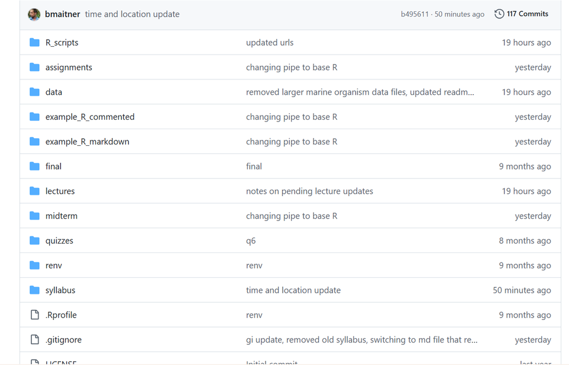
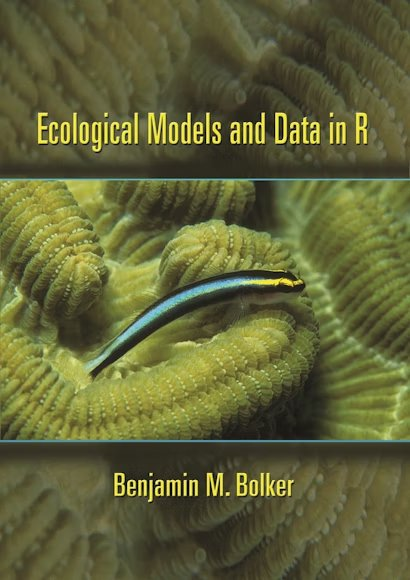
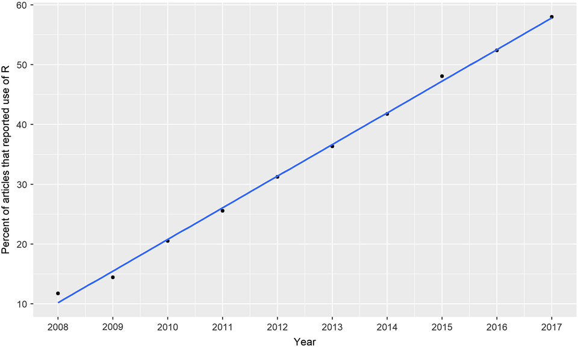
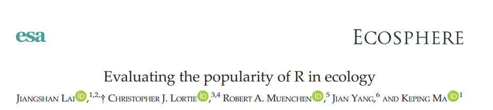
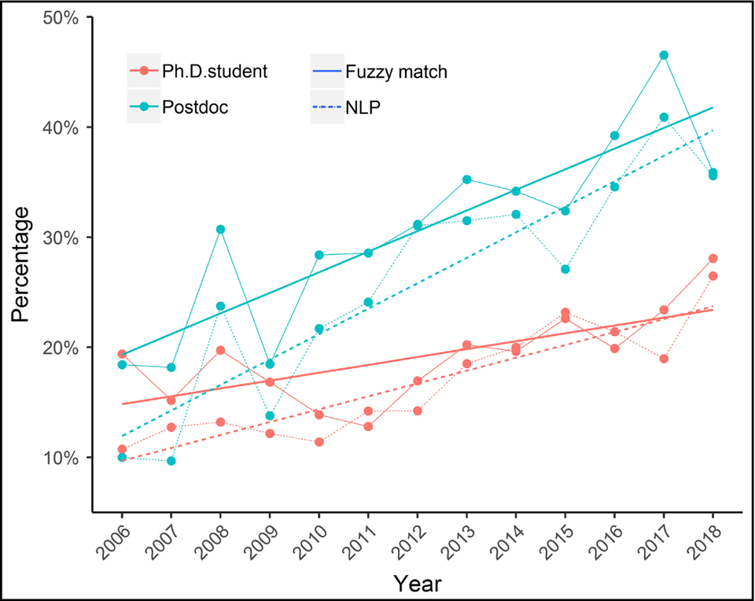
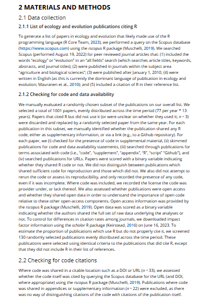
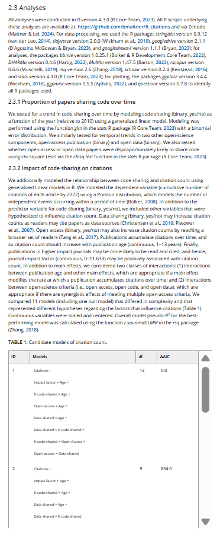
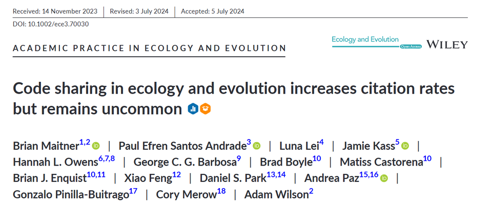
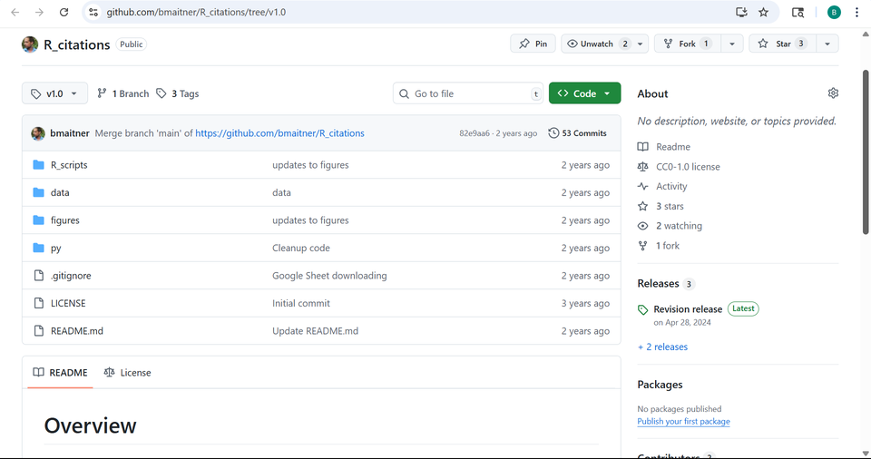

## Today's agenda

- Introductions
- Syllabus
- Why we need stats
- Reproducibility and Openness

## Introductions

[**Please take a moment to tell us about yourself:**]{style="color: #a00000;"}

::: {.cards style="--cols: 3;"}
::: {.card}
[01]{.card-num}

[Your Name]{.card-title}

[Introduce yourself to the class, including what you prefer to be called and
your pronouns if you'd like to share.]{.card-text}
:::

::: {.card}
[02]{.card-num}

[Research]{.card-title}

[Describe your current research interests, what systems or questions you study,
or what you hope to work on.]{.card-text}
:::

::: {.card}
[03]{.card-num}

[Fun Fact]{.card-title}

[Tell us something interesting or unique about yourself: hobbies, favorite
travel spots, pets, or hidden talents!]{.card-text}
:::
:::

## Syllabus: basic stuff {.smaller}

Class Meeting Days: T, Th\
Class Meeting Time: 2:00 to 3:50 pm\
Class Meeting Location: DAV 265\
Instructor: Dr. Brian Maitner\
Office Location: DAV 226 (but I'm usually in URL 106, because it's warmer)\
Office Hours: TBD - ?\
Email: <bmaitner@usf.edu>

Up to date syllabus: <https://github.com/bmaitner/biometry_course>

## Course Github page

:::: {.columns}
::: {.column width="62%"}

:::

::: {.column width="38%"}
**Full of useful stuff**

- Syllabus
- Lectures
- Previous quizzes
:::
::::

## Syllabus: Course structure {.smaller}

:::: {.columns}
::: {.column width="68%"}
Flipped course: read before class, work during class

Assignments will focus on data of your choosing

| **Graded Item** | **Percent of Final Grade** |
|---|---|
| In-class participation | 20% |
| In-class quizzes | 20% |
| Assignments (4x) | 20% |
| Midterm (take-home) | 20% |
| Final (presentation + take-home) | 20% |
:::

::: {.column width="32%"}
{width="85%"}

Digital copies available through the library for free
:::
::::

## Course Expectations

::: {.cards style="--cols: 2;"}
::: {.card}
[💬]{.card-icon}

[Participate!]{.card-title}

[Ask questions. Share ideas, experiences, and knowledge!]{.card-text}
:::

::: {.card}
[🙂]{.card-icon}

[Be Respectful.]{.card-title}

[Create a welcoming environment for everyone to learn, collaborate, and grow
together.]{.card-text}
:::
:::

## Recommendations

::: {.cards style="--cols: 5; text-align: center;"}
::: {.card}
[📋]{.card-icon}

[Read the syllabus]{.card-title}
:::

::: {.card}
[📖]{.card-icon}

[Read the book]{.card-title}
:::

::: {.card}
[✏️]{.card-icon}

[Take notes on paper]{.card-title}
:::

::: {.card}
[📅]{.card-icon}

[Plan ahead]{.card-title}
:::

::: {.card}
[💻]{.card-icon}

[Bring a laptop]{.card-title}
:::
:::

## Questions so far? {.center}

## What will you get out of this class?

[In general:]{.lede}

::: {.cards style="--cols: 2;"}
::: {.card}
[📊]{.card-icon}

[Practical Application]{.card-label}

Ability to do common analyses and visualizations
:::

::: {.card}
[📈]{.card-icon}

[Future Growth]{.card-label}

Ability to go further on your own
:::
:::

## What will you get out of this class?

[More specifically:]{.lede}

::: {.cards style="--cols: 3;"}
::: {.card}
[Data & Visualization]{.card-label}

- Load data into R & perform common data-wrangling
- Create plots using base R & ggplot2
:::

::: {.card}
[Stats & Analysis]{.card-label}

- Understand key statistical distributions and applications
- Select correct analyses for ecological datasets
:::

::: {.card}
[Problem Solving]{.card-label}

- Troubleshoot & debug R code effectively
- Approach novel coding challenges with confidence
- Apply new programming skills directly to your own work
:::
:::

## Learning Stats

[People learn differently and stats can be non-intuitive]{.lede}

::: {.cards style="--cols: 3;"}
::: {.card}
[The Book]{.card-label}

Exposes you to verbal and mathematical descriptions of key statistical concepts.
:::

::: {.card}
[In Class]{.card-label}

Hands-on coding and interactive visualizations help build intuitive
understanding.
:::

::: {.card}
[The Goal]{.card-label}

Providing multiple teaching methods ensures that at least one appeals to
everyone.
:::
:::

## Learning Stats

::: {.cards style="--cols: 2;"}
::: {.card}
[What to Avoid]{.card-label style="color: #d93025;"}

**Don't focus on memorization**
:::

::: {.card}
[What to Focus On]{.card-label style="color: #188038;"}

**DO focus on practice and understanding**
:::
:::

## A Note on AI

[Establishing core fundamentals before leveraging artificial intelligence]{.lede}

::: {.cards style="--cols: 3;"}
::: {.card}
[Timing]{.card-label}

We'll cover AI later in the semester, once the foundations are established.
:::

::: {.card}
[Approach]{.card-label style="color: #d93025;"}

Strongly recommend that you start out without it to truly grasp the mechanics.
:::

::: {.card}
[Requirement]{.card-label style="color: #188038;"}

You need reasonable fundamentals to be able to effectively and safely use AI.
:::
:::

## Questions so far? {.center}

# Why do we need statistics? {.red-title}

## Why do we need statistics?

::: {.cards style="--cols: 3;"}
::: {.card}
[01 . Cognitive Limits]{.card-label}

[Imperfect Minds]{.card-title}

[We must overcome human biases, logical fallacies, and cognitive
limitations.]{.card-text}
:::

::: {.card}
[02 . Measurement]{.card-label}

[Effect Sizes]{.card-title}

[Accurately quantifying the strength and magnitude of different
relationships.]{.card-text}
:::

::: {.card}
[03 . Validation]{.card-label}

[Hypothesis Testing]{.card-title}

[Systematically validating assumptions against empirical data.]{.card-text}
:::

::: {.card}
[04 . Forecasting]{.card-label}

[Making Predictions]{.card-title}

[Building robust models to anticipate future outcomes and trends.]{.card-text}
:::

::: {.card}
[05 . Clarity]{.card-label}

[Visualizations]{.card-title}

[Making complex numerical relationships instantly clear and intuitive.]{.card-text}
:::

::: {.card}
[06 . Etc]{.card-label}

[Lots of Other Stuff]{.card-title}

[From optimizing systems to driving data-informed strategic decisions.]{.card-text}
:::
:::

## What is R and why is it useful? {.smaller}

:::: {.columns}
::: {.column width="32%"}
::: {.card .card-feature}
[The Core Idea]{.card-label}

[Scripted Language]{style="font-size: 1.5em; font-weight: bold;"}

[**Type commands** instead of clicking buttons. This fundamental shift unlocks
precision and power in data analysis.]{.card-text}
:::
:::

::: {.column width="68%"}
::: {.card}
[Reproducibility]{.card-label}

[Easily Re-run & Revise Analyses]{.card-title}

[Modify your inputs or parameters and re-execute entire workflows
instantly.]{.card-text}
:::

::: {.card}
[Efficiency]{.card-label}

[Re-use Code Across Projects]{.card-title}

[Build on top of previous work by recycling robust scripts for new
datasets.]{.card-text}
:::

::: {.card}
[Documentation]{.card-label}

[Code as a Methods Section]{.card-title}

[Your codebase serves as a transparent, step-by-step record of your
methodology.]{.card-text}
:::
:::
::::

## What is R and why is it useful?

::: {.cards style="--cols: 2;"}
::: {.card}
[01 . Cost-Effective]{.card-label}

[R is Free to Use]{.card-title}

[Anyone can download and use R without licensing costs, lowering the barrier to
entry.]{.card-text}
:::

::: {.card}
[02 . Extensibility]{.card-label}

[User-Contributed Packages]{.card-title}

[A massive ecosystem of user-developed packages is contributed for free,
extending its capabilities.]{.card-text}
:::

::: {.card}
[03 . Versatility]{.card-label}

[Incredible Flexibility]{.card-title}

[The vast range of libraries allows researchers to handle virtually any
quantitative analysis task.]{.card-text}
:::

::: {.card}
[04 . Community]{.card-label}

[Popular & Supported]{.card-title}

[An active, global developer and user base provides vast documentation and
peer-to-peer help.]{.card-text}
:::
:::

## What is R and why is it useful?

{width="62%"}

{width="40%" style="float: right; border: 1px solid #cccccc;"}

[Lai et al. (2019), *Ecosphere* 10: e02567. CC BY 4.0]{.credit}

## What is R and why is it useful?

{height="450px"}

[Front Ecol Environ 2020; 18(3): 123--124]{.credit}

## Transparency & Reproducibility

[Science needs to be open, clear, and verifiable.]{.lede}

::: {.cards style="--cols: 2;"}
::: {.card}
[👁️]{.card-icon}

[Transparency]{.card-title}

[What was done is clear]{.card-text}
:::

::: {.card}
[🔄]{.card-icon}

[Reproducibility]{.card-title}

[Can be re-done with the same results]{.card-text}
:::
:::

::: {.banner}
R helps with both of these!
:::

## Transparency and Reproducibility

:::: {.columns}
::: {.column width="22%"}
{height="300px"}
:::

::: {.column width="18%"}
{height="400px"}
:::

::: {.column width="60%"}
{height="160px" style="border: 1px solid #cccccc;"}

::: {.fragment}
{height="240px" style="border: 1px solid #cccccc;"}
:::
:::
::::

[Maitner et al. (2024), *Ecology and Evolution* 14: e70030. CC BY 4.0]{.credit}

## Transparency and Reproducibility

Note: many journals and funders are now requiring code to be published

## Questions on any of this? {.center}

## Next time:

Before class: read 1.1 - 1.3

During class:

- Discuss 1.1-1.3
- Installing and setting up R, RStudio, and Github (if needed)
