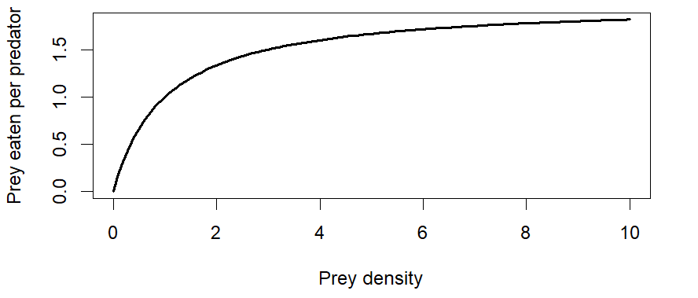
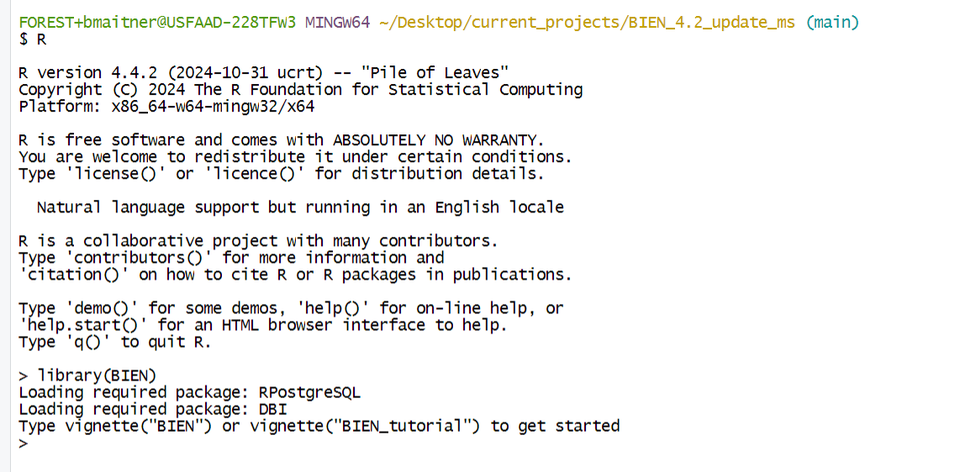
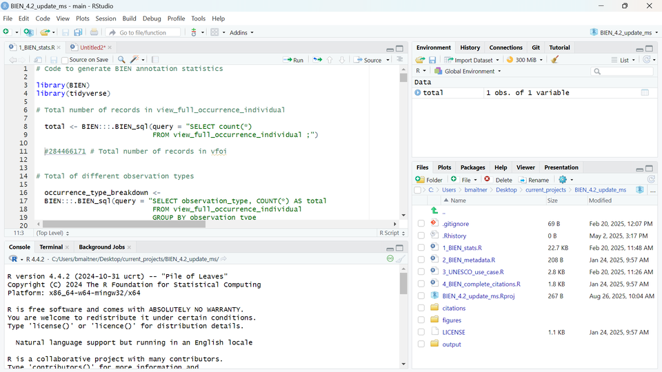
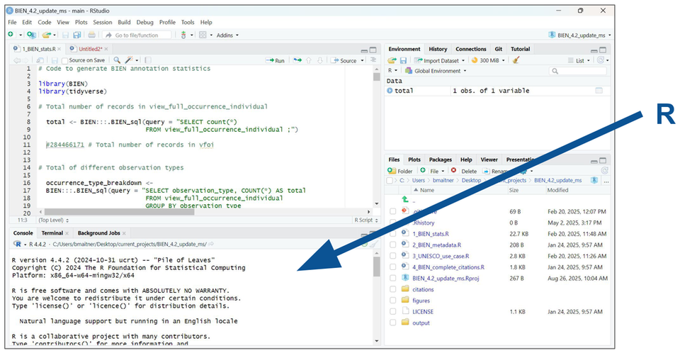
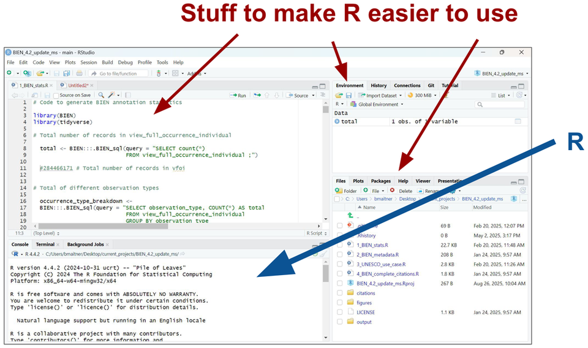
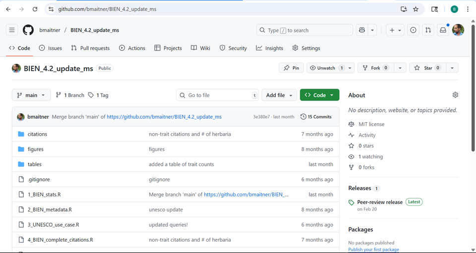
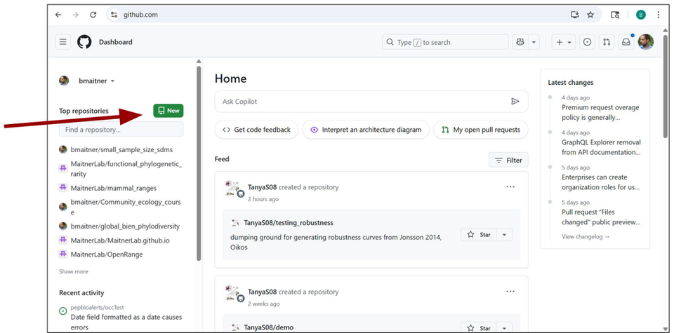
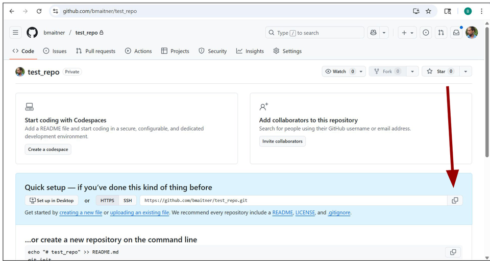
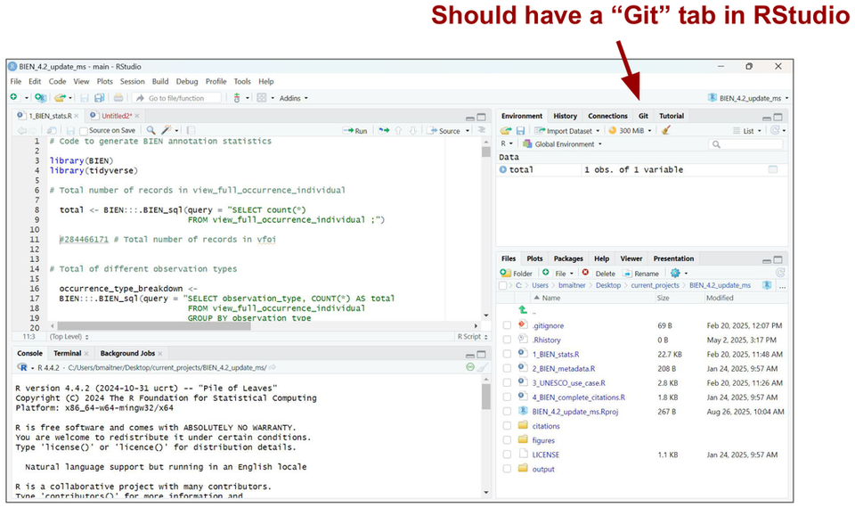

## Today's agenda {.smaller}

1. Why not just run a correlation?
2. Choosing a model: what it is for, and how it is built
3. One curve, two stories: mechanistic and phenomenological
4. Where variability comes from
5. Setting up R, RStudio, Git and GitHub

. . .

[Type and run]{.type-badge} on a code block: type it into your script and run it.\
[Run once, in the console]{.once-badge}: setup you do once per computer, not part
of a script.

::: {.notes}
Reading: Bolker 1.1 to 1.3. The first half is ideas from the reading, the
second half is software setup, which always takes longer than planned, so keep
the first half moving. The Fall 2026 version of this lecture filled the session
without running over.
:::

# Why not just run a correlation?

## Reef fish and their predators {.smaller}

Reef fish in the Caribbean. You have **population counts through time**, and
**underwater video of predator visits**.

**Question:** does living at high density make a fish more likely to be eaten?

How would you test this, based on what you already know?

. . .

**Challenges to deal with:**

**Correlation** assumes bivariate normal data.

**Regression** assumes a linear relationship and normal errors.

**Mortality counts are neither,** and there were lots of zeros.

::: {.notes}
Five minutes. Let them answer before the click: most will say correlation or
regression of mortality on density. Then the click shows why neither fits
counts of deaths, which are whole numbers, never negative, and often zero.
:::

## What Sandin and Pacala (2005) did instead {.smaller}

They **wrote the model down directly**:

| Mortality | Model |
|---|---|
| absolute | r₀ + r₁n |
| per capita | (r₀ + r₁n) / n |

with binomial and Poisson variation instead of normal.

. . .

The answer is **predator visits per hour per additional prey individual**: a
number with **ecological units**, not just a p-value or a slope on transformed
data.

::: {.plain}
A model written from the biology gives answers with biological meaning, not just
a verdict of "significant".
:::

::: {.notes}
Three minutes. n is the number of prey. r₀ is mortality that happens whatever
the density; r₁ is the extra per individual. Per capita mortality falls with n
if r₀ is positive, which is the inverse density dependence they were testing.

Then: this course adds tools like this to their toolbox, alongside
correlations and linear regressions, not instead of them.

Do not explain binomial and Poisson yet: Lecture 12 does. The point is only that
they chose distributions that fit counts.
:::

## Learning to model {.smaller}

"I want to learn how to model" is **too broad to act on**. Compare "I want to
learn genetics": population structure? Gene expression? Phylogenetics?

Which question are you actually asking?

. . .

**This course covers one kind:** statistical modeling, leaning mechanistic.
There are lots of other modeling frameworks, and sometimes they can be combined.

::: {.notes}
Two minutes. Other frameworks worth naming if asked: agent-based models,
differential equation models, machine learning, species distribution models.
:::

## What you should already know {.smaller}

| Area | Enough is |
|---|---|
| Statistics | basic familiarity (one undergraduate semester) |
| Computers | beyond point-and-click |
| Math | rusty calculus is fine |
| Ecology | the basics: growth, functional responses |

**Which is rustiest for you?** The book lists remedial reading for each.

We will often **cover things more than once**: to see why the details matter you
need the big picture, and to grasp the big picture you need some details. The
repetition also helps long-term memory.

::: {.notes}
Two minutes. A show of hands for the rustiest area is useful information for
the rest of the semester.
:::

# Choosing a model

## Scope and approach: what is the model for? {.smaller}

**Before the table:** what model choices did the reading mention?

. . .

| | | |
|---|---|---|
| abstract ↔ concrete | strategic ↔ tactical | general ↔ specific |
| theoretical ↔ applied | qualitative ↔ quantitative | descriptive ↔ predictive |
| mathematical ↔ statistical | mechanistic ↔ phenomenological | pattern ↔ process |

**Generality has a price.**

**Theoretical:** general and oversimplified; used for qualitative predictions.

**Applied:** messier and more specific; better forecasts, but needs more data.

[Adapted from Bolker (2008), Table 1.1]{.credit}

::: {.notes}
Five minutes. Collect answers before the click. A theoretical model is often
written in precise numbers of individuals but used only for qualitative
predictions. These pairs are ends of a
spectrum, not boxes: most real models sit somewhere between.

A classic theoretical model: logistic growth, which says populations level off,
not exactly where. An applied one: a fisheries stock assessment, built for one
stock, with years of catch data.
:::

## Technical details: how is it built? {.smaller}

| | | |
|---|---|---|
| analytical ↔ computational | dynamic ↔ static | continuous ↔ discrete |
| population-based ↔ individual-based | deterministic ↔ stochastic | |

. . .

| | Dynamic | Static |
|---|---|---|
| Usually | mathematical models | statistical models |
| What it says | today's state feeds tomorrow's | the relationship is fixed |

Combining the two is hard (Bolker chapter 11). This course is mostly static.

[Adapted from Bolker (2008), Table 1.1]{.credit}

::: {.notes}
Three minutes. Dynamic: population next year depends on population this year.
Static: survival depends on body size, and that relationship does not feed
back on itself.
:::

## Simple is not crude {.smaller}

**Simple ↔ complex:** how long is the description? **Crude ↔ sophisticated:**
how much depth is hidden in it?

. . .

| | Description | Depth |
|---|---|---|
| Flipping virtual coins, one at a time | simple | crude |
| `rbinom()` | simple | sophisticated |
| A random walk | simpler still | more sophisticated |

::: {.plain}
Sophisticated tools buy power but cost transparency: you can no longer see every
step.
:::

[Adapted from Bolker (2008), Table 1.1]{.credit}

::: {.notes}
Three minutes. The random walk result predicts the outcome for any birth or
death rate without simulating at all.

This is why we will happily call R's optimizers and random number
generators without deriving them, but will build the likelihood machinery by
hand: sophistication in the tools, transparency in the reasoning.
:::

## Why are there so many options? {.smaller}

**Trade-offs:** models differ in when they are useful.

For example, mechanistic models can be linked to specific mechanisms, **but** may
require more data.

You will have to weigh these trade-offs when you choose methods for your own
data.

::: {.notes}
One minute, then pause for questions before the next section.
:::

# One curve, two stories

## A shape you've seen before {.smaller}

{width="62%"}

Describe it in words. Where else have you seen this shape?

::: {.notes}
Two minutes. Starts at zero, rises quickly, then levels off. Other places:
enzyme kinetics, photosynthesis against light, species accumulation curves,
learning curves.
:::

## Two ways to end up here {.smaller}

**A.** I needed a curve that starts at zero, rises, then flattens. This one does.

**B.** A predator can only handle so many prey per hour.

Which is **mechanistic**, and which is **phenomenological**?

::: {.notes}
Two minutes. A is phenomenological: chosen for its shape. B is mechanistic:
the shape follows from a reason (time spent handling one prey is time not spent
searching for the next).
:::

## One curve, two ways to write it {.smaller}

:::: {.columns}
::: {.column width="50%"}
**Mechanistic:** Holling type II

$$f(x) = \frac{\alpha\,x}{1 + \alpha\,h\,x}$$

$\alpha$ is the attack rate; $h$ is the handling time.
:::

::: {.column width="50%"}
**Phenomenological:** Michaelis-Menten form

$$f(x) = \frac{a\,x}{b + x}$$

$a$ is the maximum; $b$ is the half-saturation point, where $f(x) = a/2$.
:::
::::

**The same curve**, when $a = 1/h$ and $b = 1/(\alpha\,h)$.

::: {.plain}
The same curve can be mechanistic or phenomenological: what decides it is why
you chose it, and so which parameters you write down.
:::

::: {.notes}
Three minutes. Earlier versions of this slide said a and b were attack rate
and handling time; in the right-hand form they are not. The maximum is set by
handling time (a predator that takes h hours per prey can eat at most 1/h per
hour), and the attack rate is the initial slope, a/b. Lecture 9 comes back to
this with both forms side by side.
:::

## Why does it matter? {.smaller}

| You chose the curve for | So you can |
|---|---|
| its **shape** | *describe* your data |
| its **mechanism** | talk about the *process*, *extrapolate further*, and be wrong in a specific, testable way |

::: {.notes}
Two minutes. "Wrong in a specific way" is a strength: a mechanistic model that
fails tells you which assumption failed. A curve chosen for its shape that
fails just tells you to try another curve.
:::

# Where variability comes from

## Two parts to every model {.smaller}

| Part | What it describes |
|---|---|
| **Deterministic** | the expected pattern: the predictable core relationship, written as a formula |
| **Stochastic** | how the observations scatter around it: the unpredictable variation |

We've just done the first part. **Where does the scatter come from?**

::: {.plain}
Every model has a pattern and a scatter around it, and both are choices.
:::

::: {.notes}
One minute. Lectures 9 and 10 are the deterministic part (Bolker chapter 3),
Lectures 11 and 12 the stochastic part (chapter 4).
:::

## Three kinds of randomness {.smaller}

| Kind | Where it comes from | For example |
|---|---|---|
| **Measurement error** | imperfect observation; instruments have limits. Almost always present | a tape read to the nearest cm |
| **Demographic** | different outcomes by chance alone. Matters most in small populations | 20 identical tadpoles, one predator: a different number eaten each time |
| **Environmental** | outside the system: climate, season, topography. Only the unpredictable part | a wet year and a dry year |

::: {.notes}
Four minutes. Measurement error is usually modeled as normal variation around
a mean.

Demographic, with coins: one coin, 20 flips gives 9 heads, or 10,
or 11. With 9 individuals and 50% survival, 4 or 5 survive, never 4.5.

Environmental: a predictable seasonal change is part of the deterministic
model; only the year-to-year surprise is stochastic.
:::

## Process vs. measurement {.smaller}

**Process variability** = demographic + environmental. It changes what happens
next in the system. **Measurement error** does not.

| A plot has 12 seedlings | Measurement error | Process error |
|---|---|---|
| What happens | you miscount and record 9 | a deer eats 3 |
| Recount next week | 12 | 9, and 9 forever |

::: {.plain}
Process variation changes the system; measurement error only changes what you
write down.
:::

::: {.notes}
Three minutes. Why it matters: in a time series, process error carries forward
and measurement error does not, so the two leave different fingerprints and
need different models (Bolker chapter 11).
:::

## Your turn: sort the randomness {.smaller}

Measurement, demographic, or environmental?

1. Two observers, same transect, different counts
2. A hurricane kills a seedling cohort
3. 50 tagged fish: 12 survive, then 15
4. A thermometer reads 0.4 °C higher than true
5. Seedlings differ with small-scale light

**Then, in pairs:** think of one question you'd like to ask in your own system.
What kind of model could address it: theoretical or applied, mechanistic or
phenomenological, deterministic or stochastic?

::: {.notes}
Seven minutes. Answers:

1. Measurement: the system is the same; only the observing differs.
2. Environmental: an outside event, and it changes what happens next.
3. Demographic: same kind of fish, same odds, different outcomes by chance.
4. Measurement, but a bias rather than noise: every reading is off the same
   way, so averaging more readings does not fix it. Worth the discussion.
5. Environmental: spatial variation in an outside factor. Some would call it
   individual heterogeneity; the line between the two blurs, and saying so is a
   good answer.
:::

# Setting up your software

## What we're installing {.smaller}

| Software | Where | Who |
|---|---|---|
| R | <https://www.r-project.org/> | everyone |
| RStudio | <https://posit.co/download/rstudio-desktop/> | everyone |
| Git | <https://git-scm.com/downloads> | grad students; optional for undergrads |
| A GitHub account | <https://github.com/> | grad students; optional for undergrads |

Install R before RStudio.

::: {.notes}
The rest of the class. Walk around; installs fail in more ways than slides can
cover. Undergraduates who skip Git still need R and RStudio today.
:::

## R

{width="80%"}

::: {.notes}
R on its own: a console that runs commands. Nobody works in it directly any
more, which is what RStudio is for.
:::

## RStudio

{width="80%"}

## RStudio

{width="85%"}

::: {.notes}
The console, bottom left, is R itself, the same as the previous slide.
:::

## RStudio

{width="85%"}

::: {.notes}
Everything else is RStudio making R easier to use: the script editor (top left),
the environment (top right: the objects you have made) and files, plots and
help (bottom right).
:::

## Write code in a script, not the console {background-color="#f0f4f8" .smaller}

**File > New File > R Script** opens one in the top left. Type there, then run a
line, or a selection, with **Ctrl+Enter** (Cmd+Enter on a Mac).

::: {.type-it}
```{r}
#| eval: false
# my first script
seedlings <- c(12, 9, 15)
mean(seedlings)
```
:::

**Check:** 12. Save it with **Ctrl+S** (Cmd+S).

::: {.plain}
The console is a scratchpad for quick checks; the script is the record of your
work, which you can rerun, fix and hand in.
:::

::: {.notes}
Three minutes. In Fall 2026 some students were still typing into the console in
week four, so say this plainly. Everything later depends on it: assignments are
graded on reproducibility and documentation, which need a script; every "Your
turn" builds on a file students can edit and rerun; and comments and sections
(Lecture 6) only exist in the editor.

Fine uses of the console: ?mean, str(x), a quick calculation you will not need
again.
:::

## Git and GitHub {.smaller}

:::: {.columns}
::: {.column width="45%"}
**Git** tracks changes in files. No more multiple versions of a file: you can
always go back.

It records what was added or removed in each version, and lets several people
work on the same files and combine their changes.

**GitHub** stores Git repositories online, can be used to edit files, and can
even run analyses for you
:::

::: {.column width="55%"}

:::
::::

::: {.notes}
Two minutes. Git is the program on your computer; GitHub is the website. A
repository ("repo") is a folder that Git tracks.
:::

## Why use GitHub? {.smaller}

| For you | For others |
|---|---|
| a secure backup, in case your computer dies | collaboration |
| easier when you use more than one computer | transparency and reproducibility, if you make it public |
| | they can use your code (forking and copying) |
| | it can be archived and cited, for example through Zenodo |

Increasingly expected of biologists.

**Grad students have to; undergrads get extra credit.**

::: {.notes}
One minute.
:::

## Tell Git who you are {.smaller}

::: {.run-once}
```{r}
#| eval: false
install.packages(c("usethis", "gitcreds"))

usethis::use_git_config(
  user.name  = "Your Name",
  user.email = "your GitHub email"
)
```
:::

Your name and email are attached to every change you save with Git. Use the
email your GitHub account uses.

::: {.notes}
Two minutes. In the console, not a script: this is setup for the computer, and
a script that changes someone's Git settings is a nasty surprise if it is ever
rerun.
:::

## Restart RStudio {.smaller}

**Quit RStudio completely, and open it again.** RStudio only looks for Git when
it starts, so if Git was installed while RStudio was open, it does not know Git
is there yet.

Then open **Tools → Global Options → Git/SVN** and check two things:

The **Git executable** box shows a path (Windows: `C:/Program Files/Git/bin/git.exe`).

**Enable version control interface for RStudio projects** is ticked.

No Git tab yet? That's expected: it appears once you open a project that Git
tracks, which is the next few steps.

::: {.notes}
Two minutes. This is the step that trips people up: Git installed with RStudio
open, and RStudio never notices. A full quit matters on a Mac, where closing the
window leaves RStudio running.

If the Git executable box is empty, click Browse and point it at git.exe (or
/usr/bin/git on a Mac), then restart RStudio again.
:::

## Make your first repository {.smaller}

**Go to your GitHub page and make a new repo**

{width="80%"}

## Copy its address {.smaller}

**Copy the URL**

{width="75%"}

## Bring it into RStudio {.smaller}

In RStudio:

1. **File > New Project...**
2. Select **Version Control**, then **Git**
3. Paste the copied URL into **Repository URL**
4. Pick a folder for it to be created in
5. **Create Project**

This is **cloning**: a copy of the repository on your computer, still linked
to GitHub.

::: {.notes}
Three minutes. Lecture 5 does the same thing with the course repository, so
this is practice for that.
:::

## Did it work? A Git tab {.smaller}

The project opens, and a **Git** tab appears in the top right:

{width="78%"}

::: {.notes}
One minute. The Git tab only exists inside a project that Git tracks, which is
why it did not appear right after installing. If it is missing here, use the
next slide.
:::

## If something's wrong {.smaller}

| Problem | Try |
|---|---|
| No Git tab | **Tools → Global Options → Git/SVN.** Is the Git executable found? Restart RStudio after changing it. Then reopen the project |
| "Git not found" | restart RStudio, then restart the computer |
| Windows: packages won't build | install Rtools |
| Mac: packages won't build | in Terminal, `xcode-select --install` |
| Still stuck | flag me down |

## Send a change back {.smaller}

1. Open `README.md` from the Files pane, change a line, save
2. In the **Git** tab, tick the file, then **Commit**, and write a short message
3. **Push** (the green up arrow)

The first push asks who you are: **a browser window opens to sign in to
GitHub**. Approve it, and the push finishes. Refresh your repo on GitHub to see
the change.

::: {.notes}
Five minutes. This is where Fall 2026 departed from the plan. The old slides
said pushing would fail until students made and stored a personal access
token. In current setups, RStudio's first push opens a browser sign-in instead
(Git Credential Manager, which comes with Git for Windows), and that is what
students saw. If anyone gets a username and password prompt instead, which is more
likely on a Mac or on Linux, use the next slide.

Commit saves a version on your computer; push sends it to GitHub. Pulling
(Lecture 5) brings changes the other way.
:::

## If push asks for a password instead {.smaller}

GitHub stopped accepting account passwords for Git in 2021. Use a **token**:

::: {.run-once}
```{r}
#| eval: false
usethis::create_github_token()   # opens GitHub with the right boxes ticked
gitcreds::gitcreds_set()         # paste the token when asked: once per computer
usethis::git_sitrep()            # checks everything at once
```
:::

Name the token, generate it, and copy it straight away: GitHub shows it once.

**Treat a token like a password.** Never put one in a script, and never commit
one.

::: {.notes}
Two minutes, or skip it if every push in the room worked. The warning is worth
saying either way: a token in a script on a public GitHub repo is found by
automated scanners within minutes.
:::

## Two repositories {.smaller}

**Your GitHub repo:** where your assignments will live. Keep it public, or make
it private and give me access.

**The course repo:** lectures, scripts, data, at
[github.com/bmaitner/biometry_course](https://github.com/bmaitner/biometry_course).
Browse it online, or pull everything with Git (Lecture 5).

For grad students: one repo per paper or thesis chapter usually works well.

## Which tool, when {.smaller}

| Tool | What it is | You'll use it to |
|---|---|---|
| R | the language that runs your code | everything |
| RStudio | where you write and run R | write scripts, see plots and help |
| An R script | a file of code, top to bottom | keep a record you can rerun and hand in |
| Git | tracks every version of your files | go back, see what changed |
| GitHub | your repositories, online | back up, share, hand in assignments |

::: {.notes}
The slide to photograph.
:::

## Before next class

Read Bolker **1.4 to 1.6**

Next class: discuss 1.4 to 1.6, then work through the examples in 1.7 together

May be a quiz.

::: {.notes}
Anyone whose setup did not finish: come to office hours or catch me before
next class, because Lecture 3 has code to run.
:::
