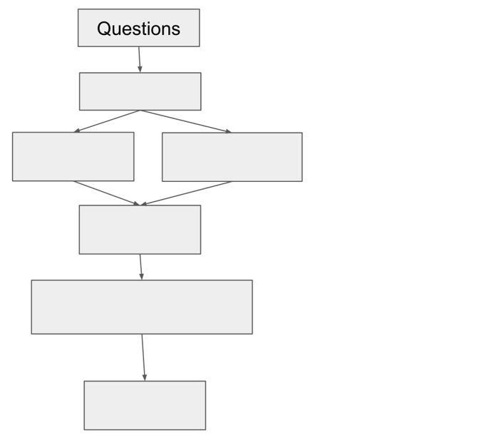
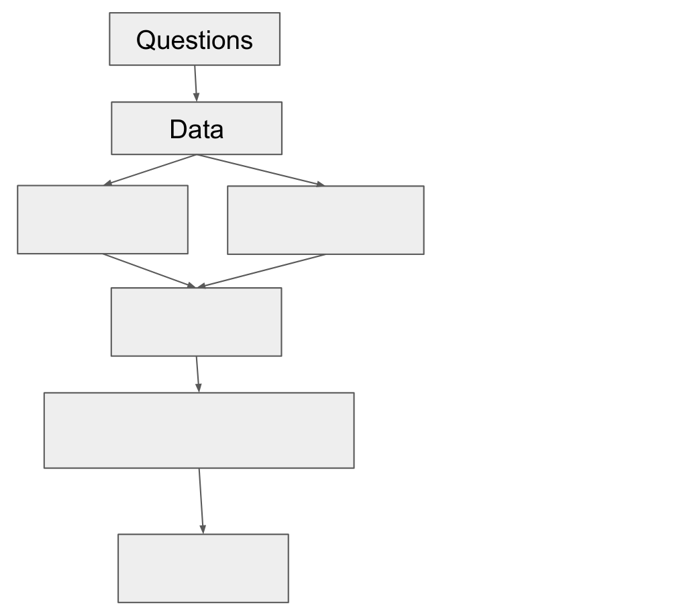
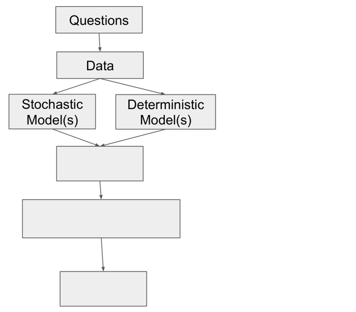
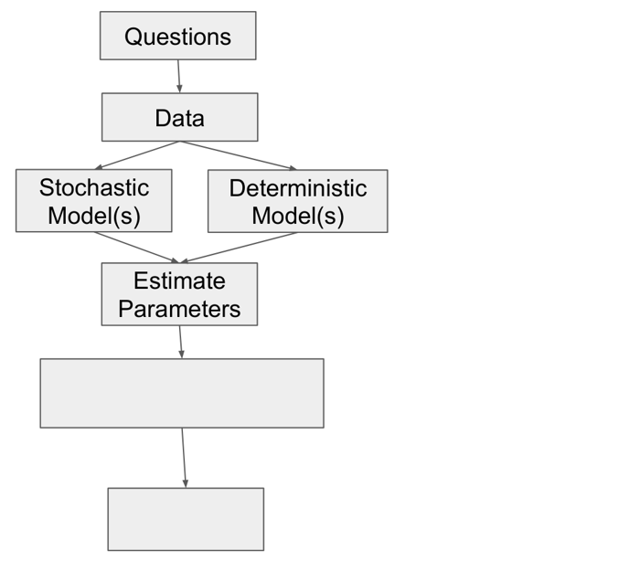
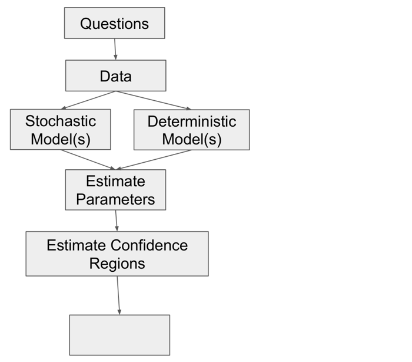
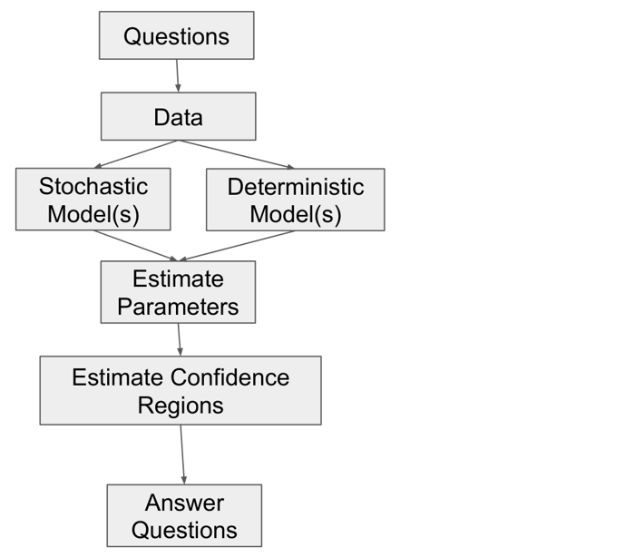
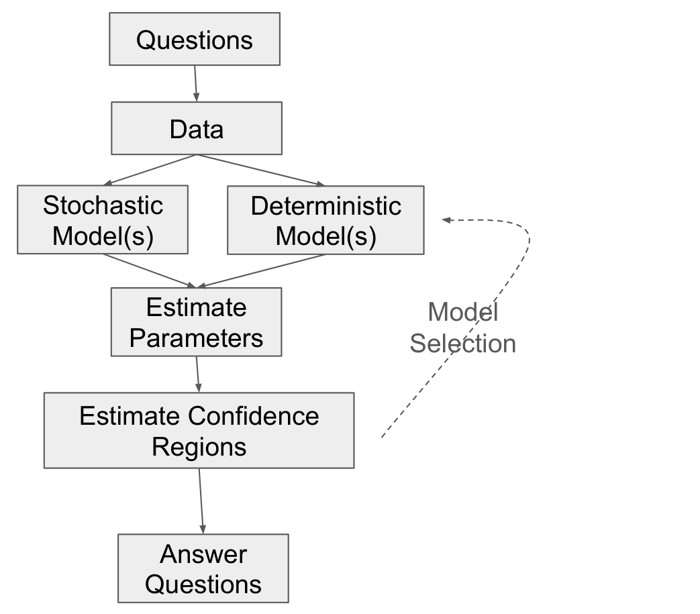
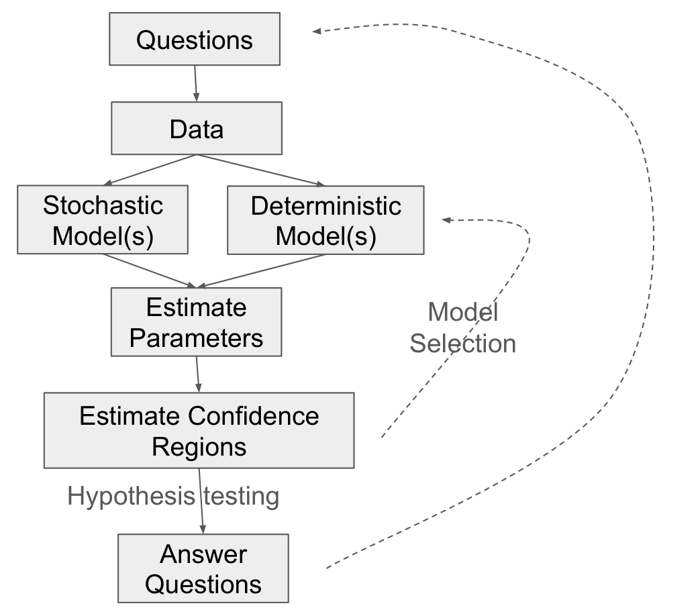
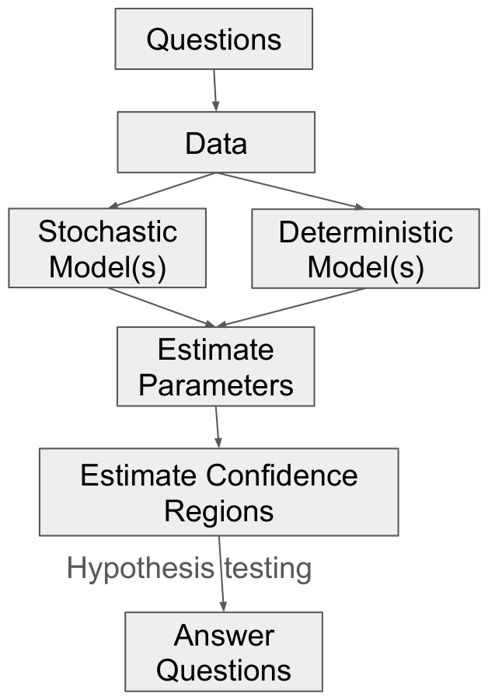

```{r}
#| echo: false
knitr::knit_hooks$set(small_mar = function(before, options, envir) {
  if (before) par(mar = c(3.4, 3.4, 0.6, 0.6), mgp = c(2.1, 0.6, 0))
})
knitr::opts_chunk$set(small_mar = TRUE)

f2 <- function(x){ sprintf("%.2f", x) }

# the student path, in the order students run it, so the checks match
frogs <- c(1.1, 1.3, 1.7, 1.8, 1.9, 2.1,
           2.3, 2.4, 2.5, 2.8, 3.1, 3.3,
           3.6, 3.7, 3.9, 4.1, 4.5, 4.8,
           5.1, 5.3)
set.seed(101)
tadpoles <- rnorm(n = 20, mean = 2 * frogs, sd = 0.5)
tadpoles_noisy <- rnorm(n = 20, mean = 2 * frogs, sd = 3)
frog_lm <- lm(tadpoles ~ frogs)
frog_lm_noisy <- lm(tadpoles_noisy ~ frogs)
ci_frog <- confint(frog_lm)["frogs", ]
slopes_clean <- replicate(1000, coef(lm(rnorm(20, 2 * frogs, sd = 0.5) ~ frogs))[2])
slopes_noisy <- replicate(1000, coef(lm(rnorm(20, 2 * frogs, sd = 3) ~ frogs))[2])
cor_test <- cor.test(frogs, tadpoles)
set.seed(202)
tadpoles2 <- rnorm(n = 20, mean = 2 * frogs, sd = 0.5)

# coverage: 50 intervals from fresh datasets, for the figure
set.seed(1)
cover <- t(replicate(50, confint(lm(rnorm(20, 2 * frogs, sd = 0.5) ~ frogs))["frogs", ]))
cover_miss <- cover[, 1] > 2 | cover[, 2] < 2
```

## Today's agenda {.smaller}

1. Ways to do statistics
2. R code basics
3. The modeling process
4. Code: build a dataset, fit it, test it

. . .

[Type and run]{.type-badge} on a code block: type it into your script and run it.
Code without the label is there to watch.

::: {.notes}
Reading: Bolker 1.4 to 1.6. The session alternates ideas and code: frameworks,
code, the modeling process, code. That structure is what made this lecture work
in Fall 2026, where Fall 2025 had sent students off to work through 1.7 alone.
:::

## The story so far {.smaller}

**Lecture 1:** why we need statistics, and why we do it in R.

**Lecture 2:** the choices behind a model, and where its scatter comes from.

**Today:** the different ways to turn data into an answer, and our first real
code.

::: {.notes}
Thirty seconds.
:::

# Ways to do statistics

## How many ways are there to do statistics? {.smaller}

. . .

**Three:** frequentist, likelihood, and Bayesian.

This course focuses mostly on **likelihood**.

::: {.notes}
Two minutes. Let them guess first. "A hundred, one per test" is a common
answer, and a good lead-in: the tests are many, but the ways of thinking about
what a probability means are few.
:::

## One dataset, three answers {.smaller}

Bolker's example, from Duncan and Duncan (2000):

Seeds at **941 stations** in Kibale, Uganda, from two species: *Polyscias*
(tiny seeds) and *Pseudospondias* (seeds of about 50 g).

Seeds were taken at **51** stations.

**Does being taken depend on species?**

::: {.notes}
One minute. Seed predation by rodents in a tropical forest: the kind of
question that gets asked with a two-by-two table. The next slides answer it
three ways.
:::

## Three meanings of probability {.smaller}

::: {.tiny-table}
| | Probability is | The question it asks | The answer |
|---|---|---|---|
| **Frequentist** | a long-run frequency | assume nothing is going on: how surprising is what we saw? | a p-value |
| **Likelihood** | the probability of the data, given the parameters | which parameter values make what we saw most probable? | an estimate, with support |
| **Bayesian** | a degree of belief | start with a prior, update it with the data | a posterior distribution |
:::

::: {.plain}
A frequentist asks how surprising the data are if nothing is going on; likelihood
asks which values make the data most probable; a Bayesian asks what to believe
after seeing the data.
:::

::: {.notes}
Four minutes. One row at a time. The likelihood row is the one the whole course
builds on, from Lecture 15 on.
:::

## Likelihood and Bayes, drawn {.smaller}

Seeds taken at 51 of 941 stations. What is the chance a station loses its seeds?

```{r}
#| echo: false
#| fig-height: 3.0
#| fig-width: 9
par(mfrow = c(1, 2))
p <- seq(0.02, 0.10, length.out = 400)
plot(p, dbinom(51, 941, p), type = "l", lwd = 2,
     xlab = "chance a station's seeds are taken", ylab = "likelihood")
abline(v = 51 / 941, lty = 2, col = "#d95f02", lwd = 2)
plot(p, dbeta(p, 52, 891), type = "l", lwd = 2, col = "#1b9e77",
     xlab = "chance a station's seeds are taken", ylab = "posterior density")
abline(v = 51 / 941, lty = 2, col = "#d95f02", lwd = 2)
```

**Left:** how probable 51 of 941 is, for each possible chance. It peaks at
51/941 = `r f2(51 / 941)`. **Right:** the Bayesian posterior, from a flat prior: the
same shape.

::: {.notes}
Three minutes. Left: the likelihood, dbinom(51, 941, p) for every p. The
highest point is the maximum likelihood estimate, 0.054, which is just the
observed proportion. Right: with a flat prior, the posterior is the likelihood
rescaled to integrate to 1, so the shape is the same. A prior that favored
some values would shift it.

This uses the stations overall, ignoring species, to keep the picture simple.
The species question on the next slide compares two such chances.
:::

## Same data, same conclusion {.smaller}

| Framework | Method | Result |
|---|---|---|
| **Frequentist** | Fisher's exact test | p = 3.8 × 10⁻⁶ |
| **Likelihood** | maximum likelihood + likelihood ratio | estimate 3.62, limits 2.13 to 6.16 |
| **Bayesian** | flat prior | mode 3.48, credible interval 2.01 to 6.01 |

None of the intervals include 1.

The frameworks agree on the conclusion. They differ in what the numbers **mean**.

::: {.notes}
Three minutes. The estimate compares the two species' chances of being taken,
as a ratio, so 1 would mean no difference. From Bolker chapter 1.

This is the usual situation with plenty of data: the frameworks agree. They
part ways with small samples and strong priors.
:::

## The three frameworks, compared (1 of 2) {.smaller}

::: {.tiny-table}
| | Frequentist | Likelihood | Bayesian |
|---|---|---|---|
| **Probability is** | the long-run frequency of events | the probability of the data, given parameters | a degree of belief |
| **Parameters** | fixed but unknown | fixed but unknown | random variables with distributions |
| **Data** | random (due to sampling) | fixed: the thing whose probability we evaluate | fixed: they update beliefs about parameters |
| **Prior information** | not used | not used | required (informative or weak) |
| **Main output** | point estimates, confidence intervals, p-values | point estimates, likelihood-based confidence limits | posterior distributions, credible intervals, Bayes factors |
:::

::: {.notes}
Reference slides: point at them, do not read them out. They are here so
students can come back to them as the course fills in each column.
:::

## The three frameworks, compared (2 of 2) {.smaller}

::: {.tiny-table}
| | Frequentist | Likelihood | Bayesian |
|---|---|---|---|
| **Interval** | 95% CI: in repeated samples, 95% of intervals contain the true value | support interval: values that make the data nearly as probable as the best estimate | 95% credible interval: given data and prior, a 95% chance the parameter is inside |
| **How** | hypothesis tests, maximum likelihood, resampling | maximize the likelihood; compare models by likelihood ratio test | Bayes' theorem: prior × likelihood → posterior |
| **Computation** | often formulas, asymptotics, bootstraps | numerical optimization | often simulation (MCMC, variational inference) |
| **Common critique** | ignores prior knowledge; p-values easily misread | no probability statement about the parameter itself; relies on asymptotics in small samples | can be subjective (depends on the prior); computationally intensive |
| **Example question** | "If we repeated this study many times, how often would we see results like this?" | "Which parameter values make my data most probable?" | "Given the data, what is the probability the hypothesis is true?" |
:::

::: {.notes}
Pause for questions here. Reassure them: this will become clearer as the
course goes; Lectures 15 to 21 are the likelihood column in detail.
:::

# R code basics

## Let's use it {.smaller}

1. Open RStudio, in the **project** you made last time
2. **File > New File > R Script**, and save it in the project
3. **Type along. Don't paste**: typing helps you remember

Run a line, or a selection, with **Ctrl+Enter** (Cmd+Enter on a Mac), or the
Run button.

::: {.notes}
Two minutes. Older versions of this slide gave Ctrl+Shift+R as a way to run
code: it is not. Ctrl+Shift+R inserts a section header (Lecture 6). Ctrl+Enter
runs the current line or selection; Ctrl+Shift+Enter runs the whole script.
:::

## R as a calculator {background-color="#f0f4f8" .smaller}

::: {.type-it}
```{r}
2 * 8
sqrt(25)
```
:::

What does the output look like? **What does `[1]` refer to?**

::: {.notes}
Two minutes. [1] is the position of the first value on that line of output.
Every answer in R is a vector, even a single number, which is why it is always
there. Print 1:30 to see [1] and a later position on the next line.
:::

## Assignment {background-color="#f0f4f8" .smaller}

::: {.type-it}
```{r}
x <- sqrt(36)
x
```
:::

What does the first line do? **Why is nothing shown when you run
`x <- sqrt(36)`?**

`<-` is read "gets". The book uses `=` for assignment; `<-` is now standard
practice.

::: {.notes}
Two minutes. Assignment stores the answer under a name instead of printing it.
Typing the name prints it. The Environment pane (top right) now shows x.
:::

## Getting help {background-color="#f0f4f8" .smaller}

::: {.type-it}
```{r}
#| eval: false
?sqrt
example(sqrt)
help.search("correlation")
```
:::

What's different about them? What's similar?

These are a good place to start; Lecture 27 goes further.

::: {.notes}
Three minutes. ?sqrt opens the help page for a function you can name.
example() runs the examples at the bottom of that page. help.search() is for
when you do not know the function's name.
:::

# The modeling process

## What is the modeling process? {.smaller}

::: {.r-stack}
{height="530px"}

{.fragment height="530px"}

{.fragment height="530px"}

{.fragment height="530px"}

{.fragment height="530px"}

{.fragment height="530px"}

{.fragment height="530px"}

{.fragment height="530px"}

{.fragment height="530px"}
:::

::: {.notes}
Six minutes, building it box by box (Bolker Figure 1.5). Ask what comes next
before each click.

Questions, then data. Then two models: the stochastic model describes the
noise, the deterministic model the signal (Lecture 2). Estimate the parameters,
then how sure we are of them, then answer the question. Model selection loops
back to try other deterministic models; hypothesis testing sits on the way to
the answer; and the answers usually raise new questions.
:::

## Asking a good question {.smaller}

Consider two levels:

**General:** does disease select against cannibalism in tiger salamanders?

**Specific:** what is the difference in the probability of becoming a cannibal
between populations A and B?

General is how you **talk** about the question. Specific is how you **test** it.

. . .

**Too vague:** "I want to explore the population genetics of cannibalism", which
is hard to test.\
**Too specific:** "What is the difference in the intercepts of these two linear
regressions?", which leads to uninteresting questions.

::: {.notes}
Three minutes. Bolker 1.4. A good project has both levels and can move between
them: the general question is the introduction of the paper, the specific one
is the methods.
:::

## Your turn: two levels {.smaller}

Take the question you thought about last time.

1. **Write it at the other level**: general if you had specific, specific if you
   had general
2. **Swap with a neighbor.** Can they tell which is which?

::: {.notes}
Five minutes. Walk around. The usual difficulty is going from general to
specific: it forces you to say what you would measure. Pause for questions
after this.
:::

# Code: build, fit, test

## First we'll play nature {.smaller}

:::: {.columns}
::: {.column width="58%"}
We'll **build a dataset where we know the true answer**:

- `mean = 2 * frogs`: the real signal
- `sd = 0.5`: the real noise

Then we'll forget we know, analyze it, and see whether the analysis can
**recover the truth**.
:::

::: {.column width="42%"}
{height="500px"}
:::
::::

::: {.notes}
One minute. This is the trick the whole course leans on: simulate data from a
model you chose, then check whether a method gets the model back. With real
data you never know the right answer, so this is the only way to test a method.
:::

## The signal {background-color="#f0f4f8" .smaller}

::: {.type-it}
```{r}
#| eval: false
frogs <- c(1.1, 1.3, 1.7, 1.8, 1.9, 2.1,
           2.3, 2.4, 2.5, 2.8, 3.1, 3.3,
           3.6, 3.7, 3.9, 4.1, 4.5, 4.8,
           5.1, 5.3)
frogs
```
:::

`frogs` is a **vector** of length 20: adult frog density in 20 populations.
`c()` combines values into one.

::: {.notes}
Two minutes. Most of the class's typos happen here. The line breaks are only for
readability: R keeps reading until the parentheses close.
:::

## The noise {background-color="#f0f4f8" .smaller}

::: {.type-it}
```{r}
#| eval: false
set.seed(101)
tadpoles <- rnorm(n = 20,
                  mean = 2 * frogs,
                  sd = 0.5)
tadpoles
```
:::

- `mean = 2 * frogs` is the **deterministic** model
- `sd = 0.5` is the **stochastic** model

::: {.fragment}
**Check:** the first value is `r f2(tadpoles[1])`.
:::

::: {.notes}
Two minutes. set.seed() makes the random numbers repeatable, so everyone gets
the same tadpoles. rnorm() draws from a normal distribution: one draw for each
frog density, centered on twice that density, with a spread of 0.5.

Those are the two branches of the flowchart, written as one line of code.
:::

## Look at it {background-color="#f0f4f8" .smaller}

::: {.type-it}
```{r}
#| fig-height: 3.4
plot(x = frogs, y = tadpoles)
abline(a = 0, b = 2)
```
:::

The line is the truth. **Why don't the points sit on it?**

::: {.notes}
Two minutes. Because of sd = 0.5: the stochastic part. abline(a, b) draws a
line with intercept a and slope b.
:::

## Turn the noise up {background-color="#f0f4f8" .smaller}

::: {.type-it}
```{r}
#| eval: false
tadpoles_noisy <- rnorm(n = 20, mean = 2 * frogs, sd = 3)
plot(x = frogs, y = tadpoles_noisy)
abline(a = 0, b = 2)
```
:::

```{r}
#| echo: false
#| fig-height: 2.6
#| fig-width: 9
par(mfrow = c(1, 2))
plot(frogs, tadpoles, ylim = range(c(tadpoles, tadpoles_noisy)), main = "sd = 0.5",
     xlab = "frogs", ylab = "tadpoles")
abline(a = 0, b = 2)
plot(frogs, tadpoles_noisy, ylim = range(c(tadpoles, tadpoles_noisy)), main = "sd = 3",
     xlab = "frogs", ylab = "tadpoles")
abline(a = 0, b = 2)
```

Same relationship. **Would you have spotted it this time?**

::: {.notes}
Two minutes. The same deterministic model; only the stochastic part changed.
This is why the stochastic half of a model matters as much as the
deterministic half, and it is the idea behind power analysis (Lecture 14).
:::

## Can we recover the truth? {background-color="#f0f4f8" .smaller}

::: {.type-it}
```{r}
#| eval: false
frog_lm <- lm(tadpoles ~ frogs)
frog_lm_noisy <- lm(tadpoles_noisy ~ frogs)

coef(frog_lm)
coef(frog_lm_noisy)
confint(frog_lm)
```
:::

The real slope is 2. **Which one got closer?** (You just fit two linear models.)

::: {.fragment}
**Check:** slopes of `r f2(coef(frog_lm)["frogs"])` and
`r f2(coef(frog_lm_noisy)["frogs"])`.
:::

::: {.notes}
Three minutes. With this seed the noisy fit happens to land closer to 2: one
draw is luck. The next slides show what happens over many draws.

lm() never saw how we made the data. It fits its own model, which has the same
two halves: a straight line (deterministic) and normal errors with constant
variance (stochastic). Our simulation used the same shapes, which is why it
lands near the truth. With real data you never get to check that.
:::

## Our interval missed {.smaller}

`confint(frog_lm)` gives `r f2(ci_frog[1])` to `r f2(ci_frog[2])`. The true slope is 2:
**not in there.**

```{r}
#| echo: false
#| fig-height: 2.0
plot(NA, xlim = range(cover), ylim = c(1, 50), yaxt = "n",
     xlab = "95% interval for the slope, from 50 simulated datasets", ylab = "")
segments(cover[, 1], 1:50, cover[, 2], 1:50,
         col = ifelse(cover_miss, "#d95f02", "grey50"), lwd = ifelse(cover_miss, 3, 1.5))
abline(v = 2, lwd = 2)
```

Ours was one of the 5% that miss, like the orange ones above.

::: {.plain}
A 95% interval comes from a method that is right 95% of the time; any one
interval can miss.
:::

::: {.notes}
Three minutes. Build intervals this way many times and 95% of them contain
the truth. This miss is the lesson, not a mistake. Fifty fresh datasets,
fifty intervals: `r sum(cover_miss)` miss the true value of 2. Run
1000 and about 95% cover it; the code is in Chapter_1_examples.R.
:::

## One draw proves little {background-color="#f0f4f8" .smaller}

::: {.type-it}
```{r}
#| eval: false
slopes_clean <- replicate(1000,
  coef(lm(rnorm(20, 2 * frogs, sd = 0.5) ~ frogs))[2])
slopes_noisy <- replicate(1000,
  coef(lm(rnorm(20, 2 * frogs, sd = 3) ~ frogs))[2])

mean(slopes_clean)
mean(slopes_noisy)
sd(slopes_clean)
sd(slopes_noisy)
```
:::

**What did adding noise do?**

::: {.fragment}
**Check:** both means near 2; spreads about
`r f2(sd(slopes_clean))` and `r f2(sd(slopes_noisy))`.
:::

::: {.notes}
Three minutes. replicate() runs the same simulation 1000 times. Each time:
make a new dataset, fit a line, keep the slope ([2] is the second coefficient).
Exact numbers will differ a little if anyone ran lines more than once.
:::

## One draw proves little {.smaller}

```{r}
#| echo: false
#| fig-height: 3.0
br <- seq(min(slopes_noisy) - 0.05, max(slopes_noisy) + 0.05, length.out = 60)
hist(slopes_noisy, breaks = br, col = "grey80", border = "white", main = "",
     xlab = "estimated slope (true value = 2)", ylim = c(0, 400))
hist(slopes_clean, breaks = br, col = "#2a7ab0", border = "white", add = TRUE)
abline(v = 2, col = "#d95f02", lwd = 3)
legend("topright", legend = c("sd = 0.5", "sd = 3"), fill = c("#2a7ab0", "grey80"),
       bty = "n")
```

Both are **centered on the truth**: noise does not bias the slope. It makes any
**one** estimate less reliable.

::: {.notes}
Two minutes. So on one draw, the noisy estimate can land closer by luck, as it
did here. Over many draws, it rarely does.
:::

## Summarize and test {background-color="#f0f4f8" .smaller}

::: {.type-it}
```{r}
#| eval: false
mean(tadpoles)
summary(tadpoles)
cor(frogs, tadpoles)
cor.test(frogs, tadpoles)
```
:::

**Is that p-value impressive?**

::: {.fragment}
**Check:** correlation `r sprintf("%.3f", cor(frogs, tadpoles))`; p is tiny.
:::

::: {.notes}
Three minutes. We built the data ourselves with very little noise, so a tiny
p-value says more about our simulation than about frogs. Bolker suggests
reporting anything this small as p < 0.001.

Compare Sandin and Pacala from Lecture 2: cor.test() says there is an
association. It says nothing about the slope, the units or the mechanism.
:::

## Run it again {background-color="#f0f4f8" .smaller}

::: {.type-it}
```{r}
#| eval: false
set.seed(202)
tadpoles2 <- rnorm(n = 20, mean = 2 * frogs, sd = 0.5)
cor(frogs, tadpoles2)
```
:::

**How did this differ? Why?**

Different data, same truth: the stochastic part of the model at work.

::: {.fragment}
**Check:** `r sprintf("%.3f", cor(frogs, tadpoles2))`, against
`r sprintf("%.3f", cor(frogs, tadpoles))` before.
:::

::: {.notes}
Two minutes. Nothing about the frogs changed; the estimate moved anyway. Older
versions of this slide called this demographic stochasticity. In this
simulation the noise is just rnorm(): it stands for whatever scatters the
counts, which could be any of Lecture 2's three kinds, so "sampling variation"
is the honest name.
:::

## What we just did {.smaller}

:::: {.columns}
::: {.column width="66%"}
::: {.tiny-table}
| Flowchart box | Here | Code |
|---|---|---|
| Data | 20 populations | `c()`, `rnorm()` |
| Deterministic model | the line `lm()` fits | `lm()` |
| Stochastic model | the normal errors it assumes | `lm()` |
| Estimate parameters | the slope | `coef()` |
| Confidence regions | its 95% interval | `confint()` |
| Hypothesis testing | is there a correlation? | `cor.test()` |
:::

**`lm()` never saw how we made the data.**
:::

::: {.column width="34%"}
{height="420px"}
:::
::::

::: {.notes}
The slide to photograph: the flowchart and the functions that do each box.
:::

## Before next class

Read Bolker **2.1 to 2.3**

Think about the kinds of data you might want to work with this semester

Next class: discuss 2.1 to 2.3, and start loading data into R

May be a quiz.
