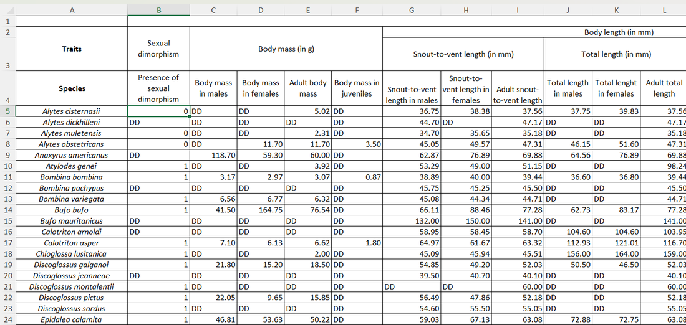

```{r}
#| echo: false
# the same objects students make, read from the lectures/ folder
avonet <- read.csv("../data/Avonet/AVONET1_BirdLife.csv")
amniotes_naive <- read.csv("../data/Amniote_traits/Amniote_Database_Aug_2015.csv")
amniotes <- read.csv("../data/Amniote_traits/Amniote_Database_Aug_2015.csv",
                     na.strings = -999)
big <- function(x){ format(round(x), big.mark = ",") }
f2 <- function(x){ sprintf("%.2f", x) }
```

## Today's agenda {.smaller}

1. File formats, and why plain text
2. Getting data into R: paths, the web, and Excel
3. Metadata, and two ways to lay out the same data
4. Data types: what R thinks your data are
5. Looking inside your data

. . .

[Type and run]{.type-badge} on a code block: type it into your script and run it.
Code without the label is there to watch.

::: {.notes}
Reading: Bolker 2.1 to 2.3. Timing in Fall 2026 was good but with less slack
than Lectures 2 and 3: it depends on the debugging going quickly. If it needs
trimming, the long/wide pair is the most cuttable; Lecture 26 covers it properly.
:::

## The story so far {.smaller}

**Lecture 2:** the choices behind a model, and where its scatter comes from.

**Lecture 3:** three ways to do statistics, and data we simulated ourselves.

**Today:** real data, from a file, and how to tell whether R read it right.

::: {.notes}
Thirty seconds. Last time we made our data with rnorm(), so we knew exactly what
was in it. From today on, someone else made the data, and the first job is
making sure R sees what they meant.
:::

# File formats

## Electronic formats {.smaller}

| Kind | Examples | In R |
|---|---|---|
| Plain text | `.csv`, `.txt` | built in |
| Proprietary | Excel `.xlsx`, ESRI `.shp` | may need a package |
| R's own | `.RDS` | built in |

Different formats have different pros and cons.

::: {.notes}
One minute. The next slide is the case for the first kind.
:::

## Why plain text? {.smaller}

**Readable by anything,** on any machine.

**Won't become obsolete** with the next software version.

**Survives partial corruption:** lose a line, and the rest still reads.

A `.csv` is just a text file whose layout tells you how to read it:
csv = comma-separated values.

::: {.plain}
If you can open it in Notepad and read it, so can anyone, with any software, in
twenty years.
:::

::: {.notes}
Two minutes. Open a .csv in a text editor if there is time: it is just rows of
text with commas between the values.
:::

## We practice this {.smaller}

| What | Format |
|---|---|
| Your assignments | `.R`, `.Rmd`, `.qmd` |
| This course's syllabus | Markdown |
| The data in `data/` | `.csv` |

These are all basically text files.

**Not an accident!**

::: {.notes}
One minute.
:::

# Getting data into R

## Getting data into R {.smaller}

**The function depends on the file type,** and there are often several to
choose from.

**R can read from almost anywhere:** your computer, the web, databases.

**Functions can mess things up when importing!** R nearly always reads
*something*. Whether it read what you meant is a separate question.

::: {.notes}
One minute. The third point is the theme of the whole lecture: R will nearly
always read something. Whether it read what you meant is a separate question.
:::

## Example functions {.smaller}

::: {.tiny-table}
| File type | Extension(s) | Common R import function(s) | Package(s) |
|---|---|---|---|
| Comma-separated values | `.csv` | `read.csv()`, `read_csv()` | base, readr |
| Tab-delimited text | `.tsv`, `.txt` | `read.delim()`, `read_tsv()` | base, readr |
| Excel | `.xls`, `.xlsx` | `read_excel()`, `read.xlsx()` | readxl, openxlsx (`.xlsx` only) |
| R object (several) | `.RData`, `.rda` | `load()` | base |
| R object (single) | `.RDS` | `readRDS()` | base |
| SPSS | `.sav` | `read.spss()`, `read_sav()` | foreign, haven |
| Stata | `.dta` | `read.dta()`, `read_dta()` | foreign, haven |
| SAS | `.sas7bdat`, `.xpt` | `read_sas()`, `read.xport()` | haven, foreign |
| JSON | `.json` | `fromJSON()` | jsonlite |
| XML | `.xml` | `xmlParse()`, `read_xml()` | XML, xml2 |
| Feather, Parquet | `.feather`, `.parquet` | `read_feather()`, `read_parquet()` | arrow |
| HDF5 | `.h5` | `h5read()` | rhdf5 |
| NetCDF | `.nc` | `nc_open()` | ncdf4 |
| SQLite database | `.sqlite`, `.db` | `dbConnect(RSQLite::SQLite(), ...)` | RSQLite |
| Shapefile, GeoPackage (GIS) | `.shp`, `.gpkg` | `st_read()` | sf |
:::

::: {.notes}
One minute. A reference slide: do not read it out. The point is that almost
anything can be read, and that the first few rows are the ones they will use
this semester. The old version listed gdata's read.xls(); gdata dropped its
Excel functions in 2023, so it is gone from the table.
:::

## Work in a script {.smaller}

Everything today builds on the step before, so keep it in a file you can rerun.

1. **File → New File → R Script**
2. Save it in your project, for example as `lecture_04.R`
3. Run a line, or a selection, with **Ctrl+Enter** (Mac: **Cmd+Enter**)

The console is for quick checks, like `?read.csv`. The script is your record.

::: {.notes}
One minute. The reminder from Lecture 2, repeated because this is the first day
with real data. If something goes wrong halfway through, they fix one line and
rerun from the top instead of retyping. Assignment 1 grades reproducibility,
which needs a script.
:::

## Get the file {.smaller}

1. Go to the course GitHub site:
   [github.com/bmaitner/biometry_course](https://github.com/bmaitner/biometry_course)
2. Navigate to **data/Avonet**
3. Download **AVONET1_BirdLife.csv**
4. Save it in your project, in a folder **data/Avonet/**, so your paths match ours

AVONET: measurements of 11,009 bird species.

[AVONET: Tobias et al. (2022), *Ecology Letters* 25: 581--597. CC BY 4.0]{.credit}

::: {.notes}
Two minutes. Step 4 is new: the relative path on the next slides only works if
the file sits at data/Avonet/ inside their project. In Lecture 5 they will pull
the whole course repository with Git and stop downloading files one at a time.
:::

## Two ways to say where a file is {.smaller}

**Absolute:** the path from the root of your file system.

**Relative:** the path from your working directory (your project folder).

. . .

**Which is which?**

`"C:/Users/bmaitner/Desktop/courses/biometry_course/data/Avonet/AVONET1_BirdLife.csv"`

`"data/Avonet/AVONET1_BirdLife.csv"`

. . .

The first works only on my computer. The second works on anyone's, as long as
the project is laid out the same way.

::: {.notes}
Two minutes. Let them answer before revealing. The first is absolute, and it is
genuinely where the file lives on my machine and nowhere else. That is the
argument for relative paths: send someone your project and your code still
runs.
:::

## Read it {background-color="#f0f4f8" .smaller}

::: {.type-it}
```{r}
#| eval: false
avonet <- read.csv("data/Avonet/AVONET1_BirdLife.csv")
```
:::

Then try it with the absolute path to the file on your own computer, as
`avonet_v2`.

**Tab completion makes it easier:** type `read.csv("")`, put the cursor between
the quotes, and press **Tab**.

::: {.fragment}
**Check:** `avonet` has `r big(nrow(avonet))` rows and `r ncol(avonet)` columns
(see the Environment pane).
:::

::: {.notes}
Five minutes. Tab completion is the useful habit here: it lists the folders
from wherever you are, so it shows what R can see, and it avoids typos in long
file names. If read.csv() says "cannot open file", the file is not where the
path says, which usually means the working directory is not the project folder.
:::

## Reading data from the web {background-color="#f0f4f8" .smaller}

Many R functions can also read online data:

::: {.type-it}
```{r}
#| eval: false
avonet_v3 <- read.csv("https://github.com/bmaitner/biometry_course/raw/refs/heads/main/data/Avonet/AVONET1_BirdLife.csv")
identical(avonet, avonet_v3)
```
:::

Same data, two routes.

::: {.fragment}
**Check:** `TRUE`
:::

::: {.notes}
Two minutes. Useful for sharing, and for these slides: anyone who could not get
the download working can use this line, and rename avonet_v3 to avonet.
:::

# When the file fights back

## Not everything is a .csv {background-color="#f0f4f8" .smaller}

Download **data/European_amphibians/oo_32985.xlsx** into the same place, then:

::: {.type-it}
```{r}
#| eval: false
# the wrong function, on purpose: see what R does
amphibians <- read.csv("data/European_amphibians/oo_32985.xlsx")
```
:::

This is an Excel file. Try it anyway.

**What happens? Why?**

::: {.notes}
Two minutes. Let them run it before the next slide. What they see depends on
the computer. On Windows it does not error: it warns and returns nonsense,
which is worse and more instructive. On Linux, where the course's automated
check runs, it stops with an error instead, and a Mac probably does the same
(not yet confirmed in class). Ask the room who got
which: the same file and the same code giving different results on different
machines is itself the lesson about binary formats.
:::

## That's not text {.smaller}

Depending on your computer, a warning or an error:

```
line 1 appears to contain embedded nulls
duplicate 'row.names' are not allowed
```

Either way, `.xlsx` isn't text. It's a zip file full of XML.

`read.csv()` reads **text**. It tried.

::: {.notes}
One minute. An .xlsx really is a zip archive: rename one to .zip and you can
open it. That is why base R can't read it without help, and it ties straight
back to "Why plain text?". A .csv you can open in Notepad; an .xlsx you cannot.
Where it only warned, the amphibians object is one column of garbage; where it
errored, there is no amphibians object yet. Either way it gets made properly on
the next slides.
:::

## You need a package {.smaller}

Base R can't read Excel files. Someone else wrote code that can.

::: {.run-once}
```{r}
#| eval: false
install.packages("readxl")
```
:::

Needed once per computer, not once per session.

::: {.notes}
One minute. The first package install of the course. Point out the quotes:
install.packages() takes a string, because the package is not in R yet, so
there is no name for R to look up. Run it in the console, not the script:
rerunning the script should not reinstall things.
:::

## Installing is not loading {background-color="#f0f4f8" .smaller}

::: {.type-it}
```{r}
#| eval: false
# this fails on purpose: read the error
read_xlsx("data/European_amphibians/oo_32985.xlsx")
```
:::

```
Error: could not find function "read_xlsx"
```

Installed is not the same as available. Load it, with no quotes this time:

::: {.type-it}
```{r}
#| eval: false
library(readxl)
```
:::

::: {.plain}
`install.packages()` downloads a package to your computer: do it once.
`library()` turns it on for this R session: do it every time you open R.
:::

::: {.notes}
Three minutes. The single most common beginner error, and they will hit it all
semester, usually at the top of a script they reopened the next day. Name the
quotes asymmetry rather than hoping they don't notice: quoted to install,
unquoted to load.

The other error they'll meet, on a new computer:

    Error in library(readxl) : there is no package called 'readxl'

That one means install first.
:::

## Now read it {background-color="#f0f4f8" .smaller}

::: {.type-it}
```{r}
#| eval: false
amphibians <- read_xlsx("data/European_amphibians/oo_32985.xlsx")
head(amphibians)
```
:::

R prints a long list of "New names" first. Then the data.

**Did it work?**

::: {.notes}
Two minutes. It reads without an error, and the result is wrong: the columns
are called ...1, Morphology, ...3, and the first rows are pieces of a header.
The "New names" list is R telling them it found hundreds of blank column names.
Same lesson as the -999 demo coming later: no error is not the same as no
problem.
:::

## Look at the file first {.smaller}

{height="390px"}

Rows 1 to 3: titles and groupings. Row 4: the actual column names.

[Trochet et al. (2014), *Biodiversity Data Journal* 2: e4123. CC0]{.credit}

::: {.notes}
One minute. Open the file in Excel if you can. Also point at the DD cells:
data deficient, used in place of a blank.
:::

## Telling R where to start {background-color="#f0f4f8" .smaller}

::: {.type-it}
```{r}
#| eval: false
amphibians <- read_xlsx("data/European_amphibians/oo_32985.xlsx",
                        skip  = 3,
                        sheet = 1,
                        na    = "DD")
head(amphibians)
```
:::

| Argument | Why |
|---|---|
| `skip = 3` | ignore the three title rows |
| `sheet = 1` | an Excel file can hold several sheets; use the first |
| `na = "DD"` | "DD" (data deficient) is used instead of NA |

::: {.fragment}
**Check:** 86 species. The first column is `Species`.
:::

::: {.notes}
Three minutes. sheet = 1 is the default, but it is worth showing: that one
spreadsheet can hold several tables is news to some students. This file has
three sheets. A shorter "New names" list still prints, because some trait
columns share a name; that can be left for now.

Then the hand-off: how were you supposed to know any of that? You had to open
the file and look, or someone had to tell you. That is metadata.
:::

# Metadata

## Metadata {.smaller}

Data about data: the information that describes your data.

Variable names. Units. When and where it was collected.

R has no system for this. Keeping it is on **you**.

**Super important to do this well!**

::: {.notes}
One minute.
:::

## Column names are metadata {.smaller}

Strike a balance between **clarity** and **brevity**. Which would you rather be
given?

`larvdens` &nbsp;&nbsp;&nbsp; `larval_density` &nbsp;&nbsp;&nbsp; `x`
&nbsp;&nbsp;&nbsp; `larval_density_per_m3_in_ponds`

. . .

**`larval_density`.** `x` says nothing, and the last one is a sentence: units
belong in the metadata.

Use underscores or dots. **Never** spaces.

::: {.notes}
Two minutes. Ask which they would pick. larval_density is the balance. The units belong
in the metadata, not the name. Spaces force backticks in every line of code that
uses the column, which is why amphibians needs `Body mass in males` with
backticks.
:::

## You can put metadata in the file {.smaller}

The top of a `.csv` can carry notes, marked with `#`:

```
# Amniote traits, Myhrvold et al. 2015
# Missing values coded as -999
species,adult_body_mass_g,longevity_y
...
```

`read.csv()` will not skip those lines on its own. Tell it to:

```{r}
#| eval: false
read.csv("my_traits.csv", comment.char = "#")
```

::: {.notes}
Two minutes. In R code, anything after # is ignored. In a data file it is not
automatic: read.csv() treats a # line as data unless you set comment.char, and
then the comment line becomes a column name. The older version of this slide
said R ignores anything after #, which is true for scripts but not for
read.csv().

The advantage of notes in the file itself: the metadata travels with the data.
:::

## What we do in this course {.smaller}

Every folder in `data/` has a README: where the data came from, the license,
and any gotchas.

Open **data/Amniote_traits/README** on the course GitHub site.

::: {.notes}
One minute. Let them read the first lines. It warns about something we are
going to trip over on purpose later today, so don't dwell on it.
:::

# Two ways to lay out the same data

## Long format {.smaller}

One row per observation:

::: {.small-table}
| station | date | species | seeds |
|---|---|---|---|
| 1 | 1999-03-23 | psd | 5 |
| 1 | 1999-03-27 | psd | 5 |
| 2 | 1999-03-23 | uva | 5 |
| 2 | 1999-03-27 | uva | 5 |
:::

Also called skinny, or tidy.

::: {.notes}
One minute. Seeds remaining at seed-predation stations, counted on two dates.
This pair is the most cuttable part of the deck: Lecture 26 covers layout
properly, with pivot_longer() and pivot_wider().
:::

## Wide format {.smaller}

One row per station, dates as columns:

::: {.small-table}
| station | species | 03-23 | 03-27 |
|---|---|---|---|
| 1 | psd | 5 | 5 |
| 2 | uva | 5 | 5 |
:::

Same data. Most R functions want the long version.

::: {.notes}
One minute. Wide is how people often enter data in a spreadsheet, and it is
fine for reading. Long is what plotting and modeling functions expect.
:::

# Data types

## Data types in R {.smaller}

In R, all data have a type:

| Type | Example |
|---|---|
| Numeric | `2005` |
| Logical | `TRUE` |
| Character | `"Optimus Prime"` |
| Factor | `"Small"` vs `"Medium"` vs `"Large"` |

To find out what type something is, use **`class()`**.

::: {.notes}
Two minutes. A factor is a character variable with a fixed set of levels, and
an order if you give it one.
:::

## Try class() {background-color="#f0f4f8" .smaller}

::: {.type-it}
```{r}
#| eval: false
class("something")
class(1)
class(1L)
class(TRUE)
```
:::

::: {.fragment}
**Check:** `"character"`, `"numeric"`, `"integer"`, `"logical"`
:::

::: {.notes}
Two minutes. 1L is the surprise: the L makes it a whole number stored as an
integer. Counts read from a file often come in as integer, and that's fine.
:::

## R guesses, and sometimes gets it very wrong {.smaller}

R tries to guess what type things are. Common mistakes:

| Mix-up | For example |
|---|---|
| numeric vs logical | yes/no recorded as 0 and 1, read as numbers |
| date vs character or number | `2015-08-01` read as text |
| factor vs numeric | site numbers 1, 2, 3 treated as amounts |

These mistakes can cause big problems in analyses.

**It's important to check your data!**

::: {.notes}
One minute. Then a demonstration of the worst kind.
:::

## R read it. Is it right? {background-color="#f0f4f8" .smaller}

Download **data/Amniote_traits/Amniote_Database_Aug_2015.csv**, then:

::: {.type-it}
```{r}
#| eval: false
amniotes <- read.csv("data/Amniote_traits/Amniote_Database_Aug_2015.csv")
mean(amniotes$litter_or_clutch_size_n)
mean(amniotes$longevity_y)
```
:::

**What do you get?**

[Myhrvold et al. (2015), *Ecology* 96: 3109. CC BY 4.0]{.credit}

::: {.notes}
Three minutes. They get `r f2(mean(amniotes_naive$litter_or_clutch_size_n))`
eggs per clutch and a lifespan of
`r f2(mean(amniotes_naive$longevity_y))` years. Ask what is wrong
before showing the next slide. Negative clutches are impossible, so this one is
easy to catch.
:::

## What happened? {background-color="#f0f4f8" .smaller}

This dataset codes missing values as **−999**. R read them as numbers.

::: {.type-it}
```{r}
#| eval: false
amniotes <- read.csv("data/Amniote_traits/Amniote_Database_Aug_2015.csv",
                     na.strings = -999)
mean(amniotes$litter_or_clutch_size_n, na.rm = TRUE)
```
:::

::: {.fragment}
**Check:** `r f2(mean(amniotes$litter_or_clutch_size_n, na.rm = TRUE))`
:::

We needed metadata to get this right! (It's in the README.)

::: {.notes}
Two minutes. na.strings tells read.csv() which values mean "missing". na.rm =
TRUE tells mean() to leave the missing ones out; without it the answer is NA.
:::

## The one that should worry you {background-color="#f0f4f8" .smaller}

::: {.type-it}
```{r}
#| eval: false
mean(amniotes$adult_body_mass_g, na.rm = TRUE)
```
:::

| | Mean body mass |
|---|---|
| Read naively | `r big(mean(amniotes_naive$adult_body_mass_g))` g |
| Read correctly | `r big(mean(amniotes$adult_body_mass_g, na.rm = TRUE))` g |

Nothing about the first number looks wrong. No error. No warning. Just wrong.

::: {.plain}
R reading a file without complaint does not mean it read it right. Check the
README, and check the numbers.
:::

::: {.notes}
Two minutes. `r big(sum(amniotes_naive$adult_body_mass_g == -999))` of the
`r big(nrow(amniotes_naive))` species have -999 for body mass. Each one pulls
the mean down, but there are so many big animals that the answer still looks
like a sensible mass. A negative clutch size gets noticed. This does not.
:::

# Data structures

## Higher data types {.smaller}

A single value is not often useful. Usually we want sets of data:

::: {.small-table}
| Structure | What it is | One type throughout? |
|---|---|---|
| Vector | the most basic: an ordered set of elements | yes |
| Matrix | a vector in two dimensions | yes |
| Array | a matrix in more dimensions | yes |
| List | an ordered set of objects of any types or lengths | no |
| Data frame | a table: a list of equal-length vectors (the columns) | per column |
| Tibble | a modern data frame, with cleaner printing and stricter rules | per column |
:::

::: {.notes}
Three minutes. Most of the semester is data frames. read.csv() gives a data
frame; read_xlsx() gives a tibble, which is why the amphibians printed
differently.
:::

## What is avonet? {background-color="#f0f4f8" .smaller}

`class()` works on these too:

::: {.type-it}
```{r}
#| eval: false
class(avonet)
class(amphibians)
```
:::

::: {.fragment}
**Check:** `"data.frame"`, then `"tbl_df" "tbl" "data.frame"`
:::

::: {.notes}
One minute. A tibble has three classes because it is a data frame with extra
features: anything that works on a data frame works on it.
:::

## Getting things out: by position {background-color="#f0f4f8" .smaller}

For a vector or a list, you can get elements by their **position**:

::: {.type-it}
```{r}
#| eval: false
test_vector <- c("Optimus Prime", "Megatron")
test_vector[[1]]
test_vector[1]
```
:::

::: {.fragment}
**Check:** both give `"Optimus Prime"`
:::

::: {.notes}
Two minutes. For a plain vector the two look the same. The difference is in
what comes back: [ ] returns a smaller version of the same thing (it keeps
names, and for a list it returns a list), [[ ]] returns the element itself. The
next slide shows it.
:::

## Getting things out: by name {background-color="#f0f4f8" .smaller}

::: {.type-it}
```{r}
#| eval: false
test_named_vector <- c("A" = "Optimus Prime",
                       "B" = "Megatron")
test_named_vector[["A"]]
test_named_vector["A"]
names(test_named_vector)
```
:::

`names()` tells you what names there are.

::: {.fragment}
**Check:** `[["A"]]` gives just `"Optimus Prime"`; `["A"]` keeps the name `A`
above it.
:::

::: {.notes}
Two minutes. That is the [ ] versus [[ ]] difference made visible.
:::

## Tables have rows and columns {.smaller}

For matrices, data frames and arrays, ask for `x[row, column]`, by name or by
number. Leave one blank to get all of it:

```{r}
#| eval: false
x[1, ]          # row 1, every column
x[, "mass"]     # the mass column, every row
x[1, "mass"]    # one value
```

::: {.notes}
One minute.
:::

## Same shape, different rules {.smaller}

Data frames and matrices look alike, but work differently:

| | Data frame | Matrix |
|---|---|---|
| Column names | `names()` or `colnames()` | `colnames()` only |
| One column | `x$a`, `x[["a"]]`, `x[, "a"]` | `x[, "a"]` only |

`class(x)` tells you which one you have.

::: {.notes}
One minute. On a matrix, names() returns NULL and x$a is an error ("$
operator is invalid for atomic vectors"), which is a confusing message the
first time.
:::

## Columns of avonet {background-color="#f0f4f8" .smaller}

To get the species names:

::: {.type-it}
```{r}
#| eval: false
head(avonet$Species1)
head(avonet[1])
head(avonet[, 1])
class(avonet[1])
class(avonet[, 1])
```
:::

::: {.fragment}
**Check:** `avonet[1]` is a `"data.frame"`; `avonet[, 1]` is a `"character"`
vector.
:::

::: {.notes}
Three minutes. head() keeps all 11,009 names from filling the console. The
classes are the point: avonet[1] is a one-column data frame (a list with one
element), avonet[, 1] and avonet$Species1 are the vector itself. A function
that wants numbers or characters and gets a one-column data frame instead is a
common source of errors.
:::

## Rows of avonet {background-color="#f0f4f8" .smaller}

To get one species:

::: {.type-it}
```{r}
#| eval: false
avonet[1, ]
avonet["1", ]
```
:::

`avonet["1", ]` only works because the first row is **named** `"1"`.

::: {.fragment}
**Check:** both show *`r avonet$Species1[1]`*
:::

::: {.notes}
One minute. read.csv() names the rows "1", "2", "3" and so on, so row 1 and the
row named "1" are the same. After sorting or filtering they need not be.
:::

# Looking inside your data

## Check the types {background-color="#f0f4f8" .smaller}

::: {.type-it}
```{r}
#| eval: false
class(avonet$Species1)
class(avonet[, 2])
```
:::

That's two columns. There are `r ncol(avonet)`. To see them all at once:

::: {.type-it}
```{r}
#| eval: false
str(avonet)
```
:::

::: {.notes}
Two minutes. str() is short for structure. It is the first thing to run on any
dataset you read in.
:::

## Reading str() {.smaller}

::: {.out}
```{r}
#| echo: false
str(avonet, list.len = 10, vec.len = 2)
```
:::

The class, the size, then one line per column: its **name**, its **type**, and
its first values.

::: {.notes}
Two minutes. The first 10 of 37 columns. Walk through one line: Total.individuals
is int, whole numbers, the count of birds measured for that species. Ask: is every type what you
expected? Here they are, which is what we want to be able to say about every
dataset.
:::

## Other quick ways to check {background-color="#f0f4f8" .smaller}

| Function | Shows |
|---|---|
| `str()` | the structure of an object |
| `summary()` | summaries, which differ by column type |
| `head()` | the first few rows |
| `table()` | how often each value (or combination) occurs |
| `rownames()`, `colnames()` | row names, column names |

::: {.type-it}
```{r}
#| eval: false
summary(avonet$Beak.Length_Culmen)
table(avonet$Trophic.Level)
colnames(avonet)
```
:::

::: {.fragment}
**Check:** `r big(sum(avonet$Trophic.Level == "Carnivore", na.rm = TRUE))`
carnivores
:::

::: {.notes}
Three minutes. Let them also try summary(avonet), head(avonet), and
head(rownames(avonet)). summary() on a number column gives the range and
quartiles, plus a count of NAs if there are any: another quick check that the
missing values were read as missing.
:::

## What if R gets the type wrong? {background-color="#f0f4f8" .smaller}

Convert between types with the "as" functions: `as.factor()`, `as.character()`,
`as.numeric()`, `as.data.frame()`, `as.matrix()`

::: {.type-it}
```{r}
#| eval: false
trophic <- as.factor(avonet$Trophic.Level)
class(trophic)
levels(trophic)
```
:::

::: {.fragment}
**Check:** `"factor"`, with `r nlevels(as.factor(avonet$Trophic.Level))` levels
:::

::: {.notes}
Two minutes. Trophic level is a category, so it belongs as a factor. The levels
are the categories R found, in alphabetical order unless you say otherwise.
:::

## Dealing with NAs {.smaller}

| You want to | Use |
|---|---|
| drop every row that has an NA | `na.omit()` |
| leave NAs out of one calculation | `na.rm` in `mean()`, `na.action` in `lm()`, `use` in `cor()` |
| replace NAs with a value, such as 0 | only when it makes sense, like species seen in a day; we'll see how later |

::: {.notes}
Two minutes. Then the warning on the next slide about the first option.
:::

## na.omit() is a blunt tool {background-color="#f0f4f8" .smaller}

::: {.type-it}
```{r}
#| eval: false
nrow(avonet)
nrow(na.omit(avonet))
```
:::

::: {.fragment}
**Check:** `r big(nrow(avonet))`, then `r nrow(na.omit(avonet))`
:::

It drops a row if **any** column is NA. One reference column is mostly empty,
so almost every species goes.

::: {.notes}
Two minutes. Mass.Refs.Other is NA for
`r big(sum(is.na(avonet$Mass.Refs.Other)))` species. Remove NAs from the columns
you are actually using, not from the whole table. This is new in the Quarto
version of the deck, and it makes the "check your data" point one more time.
:::

# Wrapping up

## Which tool, when {.smaller}

::: {.tiny-table}
| You want to | Use |
|---|---|
| read a .csv | `read.csv()` |
| read an Excel file | `library(readxl)`, then `read_xlsx()` |
| skip title rows, choose a sheet | `skip =`, `sheet =` |
| tell R which values mean missing | `na.strings =` in `read.csv()`, `na =` in `read_xlsx()` |
| leave NAs out of a calculation | `na.rm = TRUE` |
| see what type something is | `class()` |
| see every column at once | `str()`, `summary()`, `head()` |
| count categories | `table()` |
| get a column | `x$a` or `x[, "a"]` |
| fix a type | `as.factor()`, `as.numeric()`, ... |
:::

::: {.notes}
The slide to photograph.
:::

## Before next class

Read Bolker **2.4 to 2.5**

Next class: discuss 2.4 to 2.5 and the data you're interested in, then work
through 2.6
