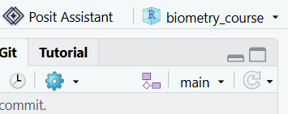
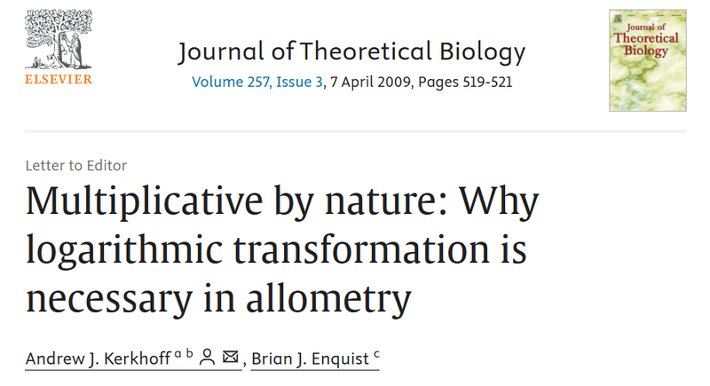
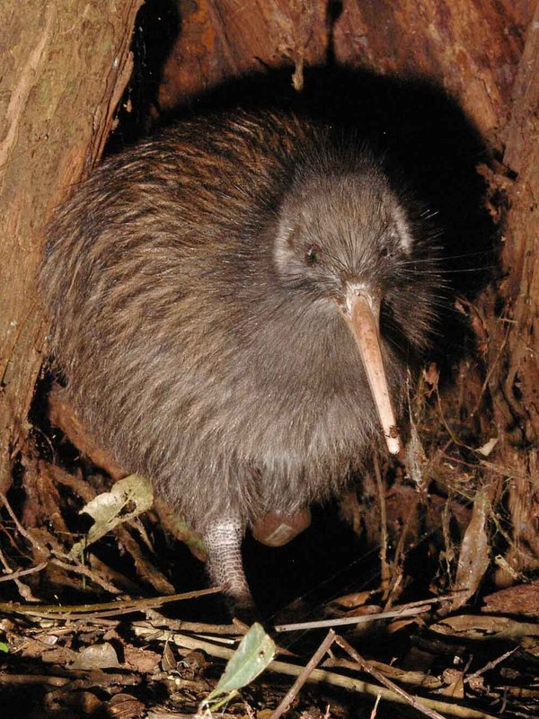
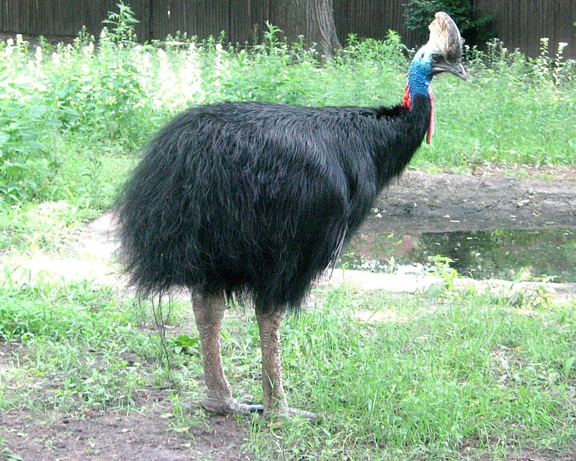

```{r}
#| echo: false
knitr::knit_hooks$set(small_mar = function(before, options, envir) {
  if (before) par(mar = c(3.4, 3.6, 0.6, 0.6), mgp = c(2.2, 0.6, 0))
})
knitr::opts_chunk$set(small_mar = TRUE)

avonet <- read.csv("../data/Avonet/AVONET1_BirdLife.csv")
big <- function(x){ format(round(x), big.mark = ",") }
h_raw <- hist(avonet$Mass, plot = FALSE)
r_raw <- cor(avonet$Mass, avonet$Wing.Length, use = "complete.obs")
r_log <- cor(log(avonet$Mass), log(avonet$Wing.Length), use = "complete.obs")
no_kiwi <- avonet$Wing.Length >= 1
r_log_nokiwi <- cor(log(avonet$Mass[no_kiwi]), log(avonet$Wing.Length[no_kiwi]))
kiwi <- avonet[which(avonet$Wing.Length < 1), ]
huge <- avonet[which(avonet$Mass > 20000), ]
n_mig_na <- sum(is.na(avonet$Migration))
```

## Today's agenda {.smaller}

1. Get the course repository
2. Discuss data of interest
3. Exploratory analyses and graphics
4. Work through 2.6

::: {.notes}
Reading: Bolker 2.4 to 2.5. Planned timing: why explore 8 minutes, the repo 15,
the go-around 15, graphics 45, then 2.6. In Fall 2026 the front ran 10 to 15
minutes long and left 10 to 15 minutes for 2.6 instead of 25. That was fine:
2.6 is really a Lecture 6 activity, so plan it that way.

If something has to go, in order: the overplotting slide, then the boxplot and
barplot slides (run them live from the script instead). Do not cut the log-log
and kiwi sequence, or the go-around.
:::

## The story so far {.smaller}

**Lecture 3:** three ways to do statistics, and data we simulated ourselves.

**Lecture 4:** reading real data into R, and checking that R read it right.

**Today:** looking at the data before modeling it.

::: {.notes}
Thirty seconds. Last week's lesson was that R reading a file without complaint
doesn't mean it read it right. Today's is the same lesson with plots: a plot can
show a problem that no error message will.
:::

# Why explore?

## Exploratory analyses and graphics {.smaller}

Why do we do exploratory analyses and graphing?

. . .

| Reason | For example |
|---|---|
| **Detect errors** | nonsensical values, perfect correlations, "weird" patterns |
| **Understand distributions, check assumptions** | non-normal data where a test assumes normal |
| **Find patterns and relationships** | mapping variables, pairwise correlation plots |
| **Identify variables to drop** | highly correlated variables (in some cases) |

. . .

**A critical part of science!**

::: {.notes}
Six minutes. Collect answers before the click. The graphics block later today
shows three of these four happening on one dataset, so the table is a promise
and the block is the payoff.
:::

# Get the course repository

## Last time you downloaded one file {.smaller}

Today you need several, and I'll add more all semester.

There's a better way: **get the whole repository at once, and update it with
one click.**

[github.com/bmaitner/biometry_course](https://github.com/bmaitner/biometry_course)

::: {.notes}
One minute. Name the annoyance they already felt in Lecture 4. Then go
straight to the next slide and get the clone started before explaining
anything else: the repository is about 167 MB, and a room of students cloning
at once on classroom wifi takes a while. Talk through the following slides
while it downloads.
:::

## Cloning a repository {.smaller}

The same steps as your own repository in Lecture 2, with a different address.

**In RStudio:** File → New Project… → Version Control → Git

Paste `https://github.com/bmaitner/biometry_course`

Pick a folder. Create Project.

*(Big download: start it now, and we'll keep going while it runs.)*

::: {.notes}
Two minutes. Say out loud that this is a procedure they have already done.

Two differences from Lecture 2, one sentence each. This is my repository: they
can pull from it, but they can't push to it. And no token or sign-in is needed:
reading a public repository needs no login, so none of Lecture 2's
authentication steps apply.
:::

## Why a Project, not just a folder {.smaller}

Class scripts use paths like:

```{r}
#| eval: false
read.csv("data/Avonet/AVONET1_BirdLife.csv")
```

Those only work if R is *in* the right folder. Opening the repository as a
Project is what puts you there.

None of the confusion of looking for your files!

::: {.notes}
Two minutes. This is the answer to last week's relative-path confusion, and the
reason the Project matters rather than just the download. The Git tab also only
appears inside a Project, which sets up the next slide.
:::

## Getting updates later {.smaller}

I add lectures, scripts and data as we go. To get them:

**Git tab → Pull** (the blue down arrow)

Do this before every class.

::: {.notes}
Two minutes. This is the point of cloning rather than downloading a zip. Have
everyone press Pull once now, even though nothing has changed, so the button is
familiar.
:::

## Don't edit existing files in this folder {.smaller}

If you change a script here, the next Pull may refuse to run. That can be
fixed, but it's a hassle.

**Instead:** copy what you want into your own project, then edit it there. Or
make a folder with your name on it in this one: nothing in it will be
overwritten.

Treat the code and data I've provided as read-only.

::: {.notes}
Two minutes. The failure is a merge conflict, which is unpleasant to untangle in
week three. If someone hits it: in the Git tab, revert their changes to that
file, then pull again.

Worth saying aloud: they now have two projects. Theirs is for assignments; this
one is for class scripts and data. The project name is in the top right of
RStudio.
:::

# Data of interest

## What types of data are we interested in? {.smaller}

Let's go around: what kinds of data, and what questions? You'll be choosing one
or more focal datasets to work with.

In particular, tell us **if you already have data**, or **if you need help
finding some**.

Have a look in `data/` in the repository you just cloned: each folder has a
README.

::: {.notes}
Fifteen minutes, and protect this time: the students who need help finding data
need it before Assignment 1 is introduced next class. The clone is still
running for some, so this is laptop-free time that covers it.
:::

# Exploratory graphics

## Which plot? {.smaller}

It depends on what kind of variables you have.

| Predictor | Response | Plot |
|---|---|---|
| none | one continuous | `hist()`, `boxplot()` |
| one categorical | one continuous | `boxplot()` |
| one continuous | one continuous | `plot()` |
| none | one categorical | `table()`, `barplot()` |
| two categorical | | `table()`, `mosaicplot()` |

Bolker's Table 2.1 is the long version.

::: {.notes}
Two minutes. Bolker's Table 2.1 is a full page, with lattice and 3D options.
These five rows are the ones they will use this month. Every one gets used in
the next half hour.
:::

## Start with one continuous variable {background-color="#f0f4f8" .smaller}

:::: {.columns}
::: {.column width="62%"}
Make sure you're in the **biometry_course** project: check the top right.

::: {.type-it}
```{r}
#| eval: false
avonet <- read.csv("data/Avonet/AVONET1_BirdLife.csv")
hist(avonet$Mass)
```
:::
:::

::: {.column width="38%"}

:::
::::

The first line is last week's, now with the file already in place.

::: {.notes}
Three minutes. Let them run it and look before the next slide: the reveal only
works if they have seen their own version first. If read.csv() can't find the
file, they are in the wrong project.
:::

## That's one bar {.smaller}

:::: {.columns}
::: {.column width="45%"}
This is not broken. It's telling you the truth, badly.

`r big(h_raw$counts[1])` of `r big(nrow(avonet))` species
(`r sprintf("%.1f", 100 * h_raw$counts[1] / nrow(avonet))`%) are in that first
bin.
:::

::: {.column width="55%"}
```{r}
#| echo: false
#| fig-width: 5
#| fig-height: 3.8
hist(avonet$Mass, main = "", xlab = "Body mass (g)", col = "grey80")
```
:::
::::

::: {.notes}
One minute.
:::

## Why? {background-color="#f0f4f8" .smaller}

::: {.type-it}
```{r}
#| eval: false
range(avonet$Mass)
```
:::

::: {.fragment}
**Check:** `r avonet$Mass[which.min(avonet$Mass)]` and
`r big(max(avonet$Mass))`
:::

| Smallest | Largest |
|---|---|
| Peruvian sheartail, *`r avonet$Species1[which.min(avonet$Mass)]`*: `r avonet$Mass[which.min(avonet$Mass)]` g | Ostrich, *Struthio camelus*: `r big(max(avonet$Mass))` g |

A `r big(round(max(avonet$Mass) / min(avonet$Mass), -3))`-fold range. The
median is `r median(avonet$Mass)` g.

::: {.notes}
Two minutes. Any linear axis wide enough for an ostrich makes every songbird a
single pixel. This is not a quirk of these data: body size, abundance, range
size, population density and seed counts are all like this. It is the normal
condition in ecology, not the exception.
:::

## Log scaling and body size {background-color="#f0f4f8" .smaller}

:::: {.columns}
::: {.column width="48%"}
::: {.type-it}
```{r}
#| eval: false
hist(log10(avonet$Mass),
     breaks = 40)
```
:::



[Kerkhoff and Enquist (2009), *Journal of Theoretical Biology* 257: 519--521]{.credit}
:::

::: {.column width="52%"}
```{r}
#| echo: false
#| fig-width: 5
#| fig-height: 4.2
hist(log10(avonet$Mass), breaks = 40, main = "",
     xlab = "log10 body mass (g)", col = "grey80")
```
:::
::::

::: {.notes}
Three minutes. A 1 on this axis is 10 g, a 2 is 100 g, a 5 is the ostrich. Now
the shape is visible: most birds are 10 to 100 g, with a long tail of big ones.

The paper's argument: growth and size are multiplicative, so differences in size
are ratios, and a log scale is the natural one. Bolker makes a similar point in
chapter 2.
:::

## Two continuous variables {background-color="#f0f4f8" .smaller}

:::: {.columns}
::: {.column width="50%"}
::: {.type-it}
```{r}
#| eval: false
plot(x = avonet$Mass,
     y = avonet$Wing.Length)
cor(avonet$Mass,
    avonet$Wing.Length,
    use = "complete.obs")
```
:::

**What is the correlation?**

::: {.fragment}
**Check:** `r sprintf("%.2f", r_raw)`
:::
:::

::: {.column width="50%"}
```{r}
#| echo: false
#| fig-width: 4.8
#| fig-height: 4.0
plot(avonet$Mass, avonet$Wing.Length, xlab = "Mass (g)",
     ylab = "Wing length (mm)")
```
:::
::::

::: {.notes}
Three minutes. use = "complete.obs" tells cor() to skip rows with an NA, the
same idea as na.rm last week. An r of 0.35 is the kind of number you would shrug
at, and possibly conclude that wing length tells you little about mass.
:::

## The same data, log-log {background-color="#f0f4f8" .smaller}

:::: {.columns}
::: {.column width="50%"}
::: {.type-it}
```{r}
#| eval: false
plot(x = avonet$Mass,
     y = avonet$Wing.Length,
     log = "xy")
```
:::

**What is the correlation now?** Hint: use the `log()` function.

::: {.fragment}
**Check:** `cor(log(avonet$Mass), log(avonet$Wing.Length))` is
`r sprintf("%.2f", r_log)`
:::
:::

::: {.column width="50%"}
```{r}
#| echo: false
#| fig-width: 4.8
#| fig-height: 3.7
plot(avonet$Mass, avonet$Wing.Length, log = "xy", xlab = "Mass (g)",
     ylab = "Wing length (mm)")
```
:::
::::

::: {.plain}
Same data, same species, same function. The plot didn't just look nicer: it
changed the answer.
:::

::: {.notes}
Four minutes. The most important slide in the lecture. On the raw scale you
might have dropped wing length as uninformative, which is the "identify
variables to drop" reason from the start of class arriving as a mistake you
nearly made.

`log = "xy"` only changes the axes. To get the correlation on the log scale,
they have to log the numbers themselves.
:::

## What birds are those? {.smaller}

:::: {.columns}
::: {.column width="40%"}
Any guesses?
:::

::: {.column width="60%"}
```{r}
#| echo: false
#| fig-width: 5
#| fig-height: 4.6
plot(avonet$Mass, avonet$Wing.Length, log = "xy", xlab = "Mass (g)",
     ylab = "Wing length (mm)")
points(exp(mean(log(kiwi$Mass))), 0.1, cex = 7, lwd = 3, col = "#b2182b")
```
:::
::::

::: {.notes}
One minute. Ask before revealing. Let them guess.
:::

## Kiwis {background-color="#f0f4f8" .smaller}

:::: {.columns}
::: {.column width="72%"}
::: {.type-it}
```{r}
#| eval: false
avonet[which(avonet$Wing.Length < 1),
       c("Species1", "Family1", "Mass", "Wing.Length")]
```
:::

::: {.out}
```{r}
#| echo: false
kiwi[, c("Species1", "Family1", "Mass", "Wing.Length")]
```
:::

0.1 is a placeholder for "too small to measure."
:::

::: {.column width="28%"}


[*Apteryx mantelli*]{style="font-size:0.7em"}<br>
[Photo: Maungatautari Ecological Island Trust, public domain]{style="font-size:0.45em; color:#777"}
:::
::::

::: {.notes}
Four minutes. Slow down here. Last week they found the -999 problem by being
told to read a README. Here the data announced its own problem the moment it was
plotted on the right scale. On the raw-scale plot these five points sit
invisibly on the x axis with everything else. Nothing errored, and summary()
would not have flagged it. The plot found it.

The genus name, Apteryx, means "without wing". Kiwi wings are a few centimeters
long and hidden under the feathers, so they can't be measured the usual way.

They also pull the correlation down: without them, the log-log r is
`r sprintf("%.2f", r_log_nokiwi)` instead of `r sprintf("%.2f", r_log)`.
:::

## What birds are those? {.smaller}

:::: {.columns}
::: {.column width="40%"}
Any guesses?
:::

::: {.column width="60%"}
```{r}
#| echo: false
#| fig-width: 5
#| fig-height: 4.6
plot(avonet$Mass, avonet$Wing.Length, log = "xy", xlab = "Mass (g)",
     ylab = "Wing length (mm)")
points(exp(mean(log(huge$Mass))), exp(mean(log(huge$Wing.Length))),
       cex = 12, lwd = 3, col = "#b2182b")
```
:::
::::

::: {.notes}
One minute.
:::

## Outlier is not the same as error {background-color="#f0f4f8" .smaller}

:::: {.columns}
::: {.column width="68%"}
::: {.type-it}
```{r}
#| eval: false
avonet[which(avonet$Mass > 20000),
       c("Species1", "Mass", "Wing.Length")]
```
:::

::: {.out}
```{r}
#| echo: false
huge[, c("Species1", "Mass", "Wing.Length")]
```
:::
:::

::: {.column width="32%"}


[*Casuarius casuarius*]{style="font-size:0.7em"}<br>
[Photo: DoroshenkoE, Kyiv Zoo, public domain]{style="font-size:0.45em; color:#777"}
:::
::::

**Also extreme. Also flightless. These are real measurements.**

::: {.notes}
Three minutes. Ostriches, rheas, cassowaries, the emu and the emperor penguin.
Both groups are odd points on the same figure: one is a data problem, the other
is biology. No rule of thumb separates them; you need to know what the organisms
are. Deleting outliers because they are outliers is how you delete your result.
:::

## Too many points {background-color="#f0f4f8" .smaller}

:::: {.columns}
::: {.column width="50%"}
::: {.type-it}
```{r}
#| eval: false
plot(x = avonet$Mass,
     y = avonet$Wing.Length,
     log = "xy",
     pch = 16,
     cex = 0.4,
     col = rgb(0, 0, 0, alpha = 0.3))
```
:::

**`cex`** sets the point size. **`alpha`** sets the transparency.
:::

::: {.column width="50%"}
```{r}
#| echo: false
#| fig-width: 4.8
#| fig-height: 4.4
plot(avonet$Mass, avonet$Wing.Length, log = "xy", pch = 16, cex = 0.4,
     col = rgb(0, 0, 0, alpha = 0.3), xlab = "Mass (g)",
     ylab = "Wing length (mm)")
```
:::
::::

Now you can see where the points are densest.

::: {.notes}
Three minutes. With 11,000 points a solid black blob hides its own shape. Their
first sight of rgb(), and of the idea that a color can be see-through. pch = 16
is a filled circle.
:::

## A categorical predictor {background-color="#f0f4f8" .smaller}

::: {.type-it}
```{r}
#| eval: false
boxplot(log10(Mass) ~ Trophic.Level,
        data = avonet)
```
:::

**Which trophic level is the largest?**

`~` means "as a function of". You'll see this notation all semester.

`data = avonet` saves typing `avonet$` in front of every column.

. . .

**Check:** scavengers, with a median around
`r big(10^median(log10(avonet$Mass[avonet$Trophic.Level %in% "Scavenger"])))` g.

::: {.notes}
Three minutes. Their first formula. Name it as notation they will meet again in
lm() and everything after. Boxplots show the median, the middle half of the
data, and the points beyond the whiskers.
:::

## One categorical variable {background-color="#f0f4f8" .smaller}

**Try both. Which is more informative?**

::: {.type-it}
```{r}
#| eval: false
table(avonet$Habitat)
barplot(sort(table(avonet$Habitat),
             decreasing = TRUE),
        las = 2)
```
:::

`las = 2` turns the labels sideways (las: label axis style).

::: {.notes}
Three minutes. table() is from last week, so this is one new function wrapped
around something familiar. Sorting is what makes the barplot readable: forest
is by far the most common habitat.
:::

## Numbers that aren't quantities {background-color="#f0f4f8" .smaller}

Migration is coded 1, 2, 3 (sedentary, partial, migratory).

::: {.type-it}
```{r}
#| eval: false
mean(avonet$Migration)
mean(avonet$Migration, na.rm = TRUE)
```
:::

**What do you get?**

. . .

**Check:** `NA`, then `r sprintf("%.2f", mean(avonet$Migration, na.rm = TRUE))`

::: {.notes}
Two minutes. The NA is a callback to last week: `r n_mig_na` species have no
migration code. Then the real question: what does 1.29 mean? Nothing. The mean
of a code is not a quantity.
:::

## Numbers that aren't quantities {background-color="#f0f4f8" .smaller}

R doesn't know what a column means. That's up to you.

**What class is R treating Migration as?** Then try both fixes:

::: {.type-it}
```{r}
#| eval: false
class(avonet$Migration)
barplot(table(avonet$Migration))
avonet$Migration <- as.factor(avonet$Migration)
class(avonet$Migration)
```
:::

::: {.fragment}
**Check:** `"integer"`, then `"factor"`
:::

::: {.plain}
R checks types, not meaning. Only you know that a column of numbers is really a
code.
:::

::: {.notes}
Three minutes. This closes the loop on the block: the class was right for the
numbers, the call ran, there was no warning, and the answer was meaningless.
After as.factor(), mean() gives a warning and NA instead of a number, which is
what you want.
:::

# Wrapping up

## Which tool, when {.smaller}

::: {.tiny-table}
| You want to see | Use |
|---|---|
| one continuous variable | `hist()`, with `log10()` if it spans orders of magnitude |
| two continuous variables | `plot(x, y)`, with `log = "xy"` if needed; `cor()` for a number |
| a continuous variable by group | `boxplot(y ~ group, data = )` |
| one categorical variable | `table()`, `barplot(sort(table()))` |
| the rows behind odd points | `data[which(condition), columns]` |
| many overlapping points | `pch = 16`, `cex =`, `col = rgb(0, 0, 0, alpha = )` |
| a code treated as a category | `as.factor()` |
:::

::: {.notes}
The slide to photograph.
:::

## Remainder of class: work through 2.6 {.smaller}

Start at **2.6.2** (the plots). Skip the reconstruction in 2.6.1: one line gets
you the finished dataset.

::: {.run-once}
```{r}
#| eval: false
install.packages("emdbook")
```
:::

::: {.type-it}
```{r}
#| eval: false
library(emdbook)
data(SeedPred)
str(SeedPred)
```
:::

The chapter's code is in `R_scripts/Chapter_2_examples.R`, in the repository you
just cloned.

::: {.notes}
The rest of class. emdbook is the book's own package. The install is a callback
to last week's install-versus-load slide.

Why skip 2.6.1: it starts with library(reshape), a retired package, and is three
pages of reshaping that Lecture 7 does in one line with pivot_longer().
data(SeedPred) gives the finished dataset, all 11,803 rows.
:::

## Before next class

Review Bolker **2.5 to 2.6**

Next class: discuss Assignment 1 and potential data sources, continue working
through 2.6, and start applying chapter 2 to your own data
