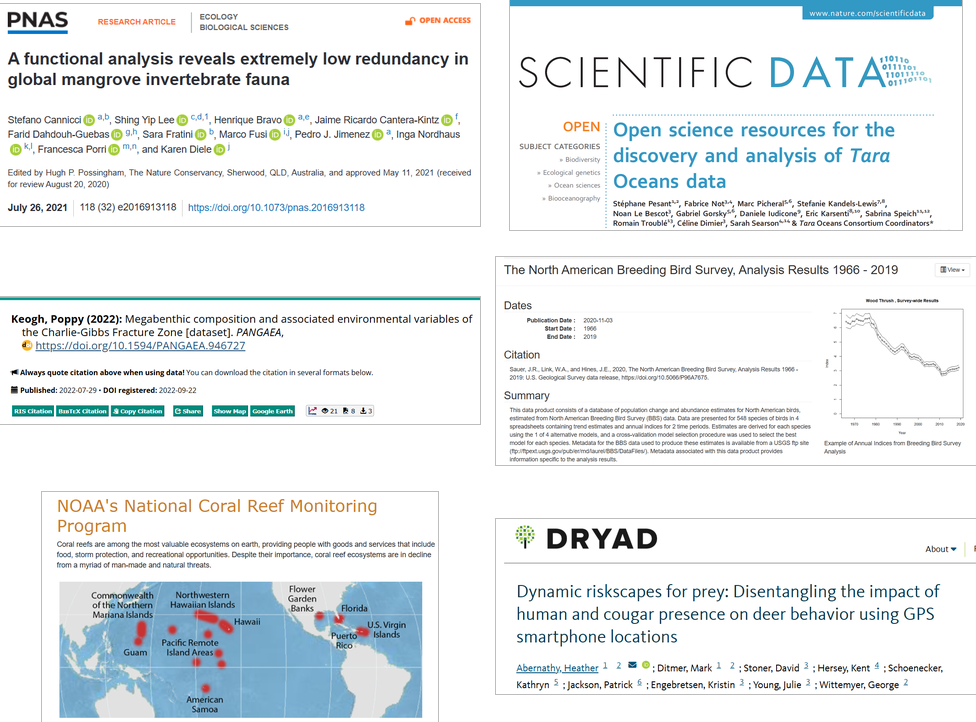
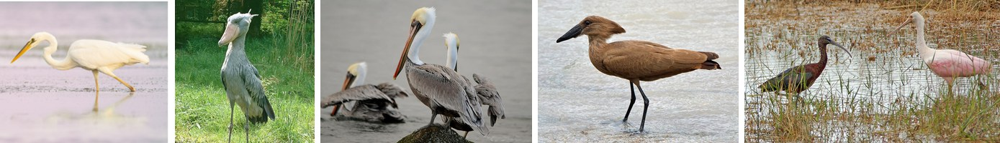

```{r}
#| echo: false
knitr::knit_hooks$set(small_mar = function(before, options, envir) {
  if (before) par(mar = c(3.4, 3.6, 2.0, 0.6), mgp = c(2.2, 0.6, 0))
})
knitr::opts_chunk$set(small_mar = TRUE)

avonet <- read.csv("../data/Avonet/AVONET1_BirdLife.csv")
big <- function(x){ format(round(x), big.mark = ",") }
beak <- avonet[c("Beak.Length_Culmen",
                 "Beak.Length_Nares",
                 "Beak.Width",
                 "Beak.Depth")]
pelicans <- avonet[which(avonet$Order1 == "Pelecaniformes"), ]
carnivores <- avonet[which(avonet$Trophic.Level == "Carnivore"), ]
scavengers <- avonet[which(avonet$Trophic.Level == "Scavenger"), ]
fit <- lm(log10(Wing.Length) ~ log10(Mass), data = avonet)
```

## Today's agenda {.smaller}

1. Discuss Assignment 1
2. Discuss potential data sources
3. Apply chapter 2 techniques to your own data
4. Work through 2.6

::: {.notes}
Reading: review Bolker 2.5 to 2.6. No new reading. Assignment 1 goes out today.

Planned timing: Assignment 1 40 minutes, finding data 12, the guided block on
their own data 45, then 2.6 with whatever is left. In Fall 2026 this fit but
left only a few minutes for 2.6: the front of the lecture ran 10 to 15 minutes
long, the same as Lecture 5.

The guided block is the thing to protect. If something has to go, in order: the
2.6 work time (push it to the weekend), then "What counts as three different
figures", then "Comparing groups". Keep "Look before you believe it": it is the
only slide in the block that teaches judgment rather than syntax.
:::

## The story so far {.smaller}

**Lecture 4:** reading real data into R, and checking that R read it right.

**Lecture 5:** looking at one or two variables at a time.

**Today:** many variables at once, groups side by side, and figures someone else
can read.

::: {.notes}
Thirty seconds. Today is also where Lectures 4 and 5 turn into a graded
assignment, so say that out loud: nothing in Assignment 1 is new.
:::

## Research Opportunity

::: {.notes}
This slide was blank in the original deck, a placeholder for a verbal
announcement. Fill it in or drop it.
:::

# Assignment 1

## Assignment 1 {.smaller}

Full information online: see Canvas or GitHub.

**Overview:** select a dataset (you want one that can ask multiple questions),
then do some exploratory analyses, and document them.

::: {.notes}
One minute. The "multiple questions" part matters: a dataset with one response
and nothing to group it by will make step 7 hard.
:::

## Assignment 1 {.smaller}

In this assignment, students will need to:

1. Select a dataset, provide a description, note where it came from
2. Read in their dataset
3. Note the class of the dataset itself (e.g., matrix, list, data frame, etc.)
4. List the variables of interest and their classes (e.g., numeric, character,
   etc.)
5. Examine the structure of the dataset and correct any formatting mistakes
6. Provide summary statistics for variables of interest
7. Produce at least 3 different figures that convey different information
8. For the figures in 7, briefly describe what the figures show

::: {.notes}
Two minutes. Read it through once; the next slide is the one they will want to
photograph.
:::

## You already have the tools {.smaller}

::: {.small-table}
| Step | Where we did it |
|---|---|
| 1. Describe it, cite it | READMEs, Lecture 4 |
| 2. Read it in | Lecture 4: `read.csv`, `read_xlsx` |
| 3. Class of the dataset | Lecture 4: `class()` |
| 4. Variables and classes | Lecture 4: `str()` |
| 5. Fix formatting problems | Lecture 4: `-999`. Lecture 5: the kiwi |
| 6. Summary statistics | Lecture 4: `summary()`, `table()` |
| 7. Three figures | Lecture 5: `hist`, `plot`, `boxplot`, `barplot` |
| 8. Describe the figures | Lecture 5: what log-log changed |
:::

We're going to get more practice with some of these today as well.

::: {.notes}
Three minutes. The assignment reads like eight separate tasks and is really a
checklist of things they have each done once already. A first assignment always
looks bigger than it is, so say that.

Step 5 is worth lingering on. It is the only step with no single function behind
it, and it is where the last two lectures both landed: the -999, which you find
by reading a README, and the kiwi, which you find by plotting. Tell them to
expect their dataset to have one of these, and that finding it is the
assignment working rather than going wrong.

Steps 6 to 8 we do together later today.
:::

## What counts as three different figures {.smaller}

"Three **different figures** that convey different information"

Three scatterplots of different variables is **one kind** of figure.

Different information means a different question, e.g.:

| Question | Plot |
|---|---|
| How is one variable distributed? | `hist` |
| How do two relate? | `plot` |
| How do groups compare? | `boxplot` |
| How many in each category? | `barplot` |

::: {.notes}
Two minutes. The rubric gives 20% for this, and the obvious failure is three
scatterplots with different y variables. The table is Lecture 5's "Which plot?"
table, so this is a callback rather than new material.
:::

## Assignment 1: what you'll submit {.smaller}

Needs to document what you did and be reproducible. Either:

| Submit | See this folder for an example |
|---|---|
| The output of an `.Rmd` file showing code and outputs (e.g., html, pdf) | `example_R_markdown/` |
| A `.R` file that can be run anywhere | `example_R_commented/`, for comment examples |

::: {.notes}
Two minutes. Say explicitly: R Markdown is not taught until Lecture 27. The .Rmd
option is there for anyone who wants to try it, but the commented .R route is
the intended path and nobody is behind for taking it.
:::

## How and when {.smaller}

Assignments can be submitted on Canvas. You can either:

**Upload your file to GitHub** and submit the link on Canvas (required for
grads, extra credit for undergrads), or

**Upload the file on Canvas.**

**Due Friday, Sept. 18th before midnight.**

::: {.notes}
One minute. The syllabus row for Lecture 8 says the same date (Fri Sep 18,
11:59 pm). Canvas needs to match. Update the date each year.
:::

## "Runs anywhere" includes the data {.smaller}

```{r}
#| eval: false
# Only works on my laptop
read.csv("C:/Users/bmaitner/Desktop/.../AVONET1_BirdLife.csv")

# Works if you have the course repo open
read.csv("data/Avonet/AVONET1_BirdLife.csv")

# Works for anyone, anywhere
read.csv("https://github.com/bmaitner/biometry_course/raw/refs/heads/main/data/Avonet/AVONET1_BirdLife.csv")
```

**Using your own data? Put it in your repo and link it, or link the original
source.**

::: {.notes}
Three minutes. Reproducibility is 20% of the grade and this is the commonest way
to lose it. The first line is the exact failure from Lecture 4's absolute path
slide, so they have watched it break already.

The last line is the part nobody thinks of. A student who downloads something
from Dryad and reads it out of their Downloads folder has written a script only
they can run. Two ways out: read from the original URL, or commit the file to
their own GitHub repo and use the raw link. Anyone using something from data/
can take the URL straight from data/short_links.md.

Whatever line they pick here is the line they start today's script with.
:::

## Documenting what you did {.smaller}

**Open** `example_R_commented/Example.R`

**Comments say why, not what:**

```{r}
#| eval: false
x <- log10(mass)   # take the log of mass (not great)
x <- log10(mass)   # mass spans 5 orders of magnitude (better)
```

| Shortcut | What it does |
|---|---|
| Ctrl (Cmd) + Shift + R | makes a section |
| Ctrl (Cmd) + Shift + C | makes a comment (or comments out highlighted code) |
| Ctrl (Cmd) + Shift + O | opens an outline |

**Try these commands out.**

::: {.notes}
Three minutes. Open the file and scroll it rather than describing it. It is
short, it is in the repo they cloned last class, and its Figure 2 is the mass
versus wing length plot from Lecture 5, so they will recognize it.

Sections pay off immediately: every Chapter_N_examples.R script in the repo uses
them, and the outline is how you navigate those scripts.
:::

## Questions so far?

# Finding data

## Getting data {.smaller}

| | Pro | Con |
|---|---|---|
| **Collect it** | you know it best, can be tailored to a specific question | time-consuming, possibly expensive, probably requires cleaning |
| **Download it** | quick | less knowledge of collection, probably still needs cleaning |
| **Aggregate it** | data volume and breadth | even less knowledge of collection, lots of standardization and cleaning required |

::: {.notes}
Three minutes. The cons column gets longer as you go down, and every row ends in
cleaning. Assignment 1 step 5 is that cleaning.
:::

## Where to look for data {.smaller}

| Where | What you'll find |
|---|---|
| **Course GitHub site** | links to resources; the `data/` folder contains some options |
| **Scientific publications** | supplementary information; data publications (e.g., [Scientific Data](https://www.nature.com/sdata/)) |
| **Data repositories** | [Dryad](https://datadryad.org/), [TRY](https://www.try-db.org/TryWeb/Home.php) |

::: {.notes}
Three minutes. Dryad is the general one; TRY is plant traits and needs a data
request, so it takes days rather than minutes.
:::

## Datasets of interest to this class {.smaller}

:::: {.columns}
::: {.column width="34%"}
Mangrove invert communities

Marine microorganisms

Deep sea megabenthos

Bird survey data

Coral populations

**Reef fish data**
:::

::: {.column width="66%"}

:::
::::

::: {.notes}
Three minutes. This is the slide the Lecture 5 go-around feeds: update it each
year with what the students said, and name the specific datasets found for the
ones who needed help, so they leave with something concrete rather than a
category.

The screenshots are the sources behind the data/ folders: the mangrove
invertebrate paper (PNAS), Tara Oceans (Scientific Data), the Charlie-Gibbs
megabenthos dataset (PANGAEA), the North American Breeding Bird Survey, NOAA's
National Coral Reef Monitoring Program, and the deer movement data (Dryad).
:::

## Datasets of interest to this class {.smaller}

General places to look for data are noted on the course GitHub homepage.

The data folders on the course GitHub each have a **README file** with useful
information.

You may need to look up the data sources to understand all the column names.

::: {.notes}
Two minutes. Close the block by making sure nobody is stuck: anyone still
without data uses AVONET for the next 40 minutes and picks their own dataset
before the weekend.
:::

# Now do it to your own data

## Now do it to your own data {background-color="#f0f4f8" .smaller}

**Open a new script. Read your dataset in.**

::: {.type-it}
```{r}
#| eval: false
avonet <- read.csv("https://github.com/bmaitner/biometry_course/raw/refs/heads/main/data/Avonet/AVONET1_BirdLife.csv")
```
:::

I'll show each step on the bird data. Then you do it on yours.

By the end you'll have three figures, labeled and saved. That's Assignment 1,
steps 6 to 8.

**No dataset yet?** Use AVONET for now, and modify your code later.

::: {.notes}
Three minutes, and this slide is load-bearing: it tells them how the next 40
minutes work. Make the deal explicit: if they keep up, they leave with most of
the assignment done.

Give them two or three minutes to open a script and get their data in before
moving on, and circulate. Reading in is where the stragglers will be, and it is
much cheaper to fix now than in the middle of the next slide.

Have them start the file with a section header (Ctrl/Cmd + Shift + R), which
practices the shortcut from earlier and gives them somewhere to put everything
that follows.
:::

## Assessing many variables at once {background-color="#f0f4f8" .smaller}

Note: if using a different dataset, use your variables.

::: {.type-it}
```{r}
#| eval: false
beak <- avonet[c("Beak.Length_Culmen",
                 "Beak.Length_Nares",
                 "Beak.Width",
                 "Beak.Depth")]
round(cor(beak), 2)
```
:::

**What do these lines of code do?**

::: {.fragment .out}
```{r}
#| echo: false
b <- round(cor(beak), 2)
dimnames(b)[[2]] <- c("Culmen", "Nares", "Width", "Depth")
b
```
:::

::: {.notes}
Three minutes. Ask before clicking. The first line picks four columns by name;
the second correlates every column with every other and rounds to two places.

Then ask why Culmen and Nares agree at `r sprintf("%.2f", cor(beak)[1, 2])`.
Culmen length is measured from the feathers, Nares length from the nostril: two
ways of measuring the same beak. Put both into an analysis and you have counted
one measurement twice. This is "identify variables to drop" from the Lecture 5
list, finally shown on the course's own data.

Remember: they may need `use = "complete.obs"` for their own dataset if it has
NAs. The four beak columns in AVONET have none.

No work pause here. It runs straight into the next slide, and they do both
together.
:::

## The same thing as a picture {background-color="#f0f4f8" .smaller}

:::: {.columns}
::: {.column width="48%"}
::: {.type-it}
```{r}
#| eval: false
pairs(x = beak,
      pch = 16,
      cex = 0.3,
      col = rgb(red = 0,
                green = 0,
                blue = 0,
                alpha = 0.15)
      )
```
:::

Same code, different style:

```{r}
#| eval: false
pairs(beak,pch=16,cex=0.3,col=rgb(0,0,0,0.15))
```
:::

::: {.column width="52%"}
```{r}
#| echo: false
#| fig-width: 4.6
#| fig-height: 4.4
pairs(beak, pch = 16, cex = 0.3, col = rgb(0, 0, 0, 0.15),
      labels = c("Culmen", "Nares", "Width", "Depth"))
```

**Your turn:** try this on your data.
:::
::::

::: {.notes}
First work pause, about 6 minutes. The number told them there was a problem; the
picture tells them what kind. The Culmen/Nares panel is nearly a straight line,
visible from across the room, and a picture would also show a curved or clumped
relationship that a single correlation flattens into one number.

The two code blocks do the same thing. The first is what we want them writing:
one argument per line, named.

Before releasing them: three to five numeric columns, not fifty, or the panels
get too small to read. Two things will come up while you circulate:
non-numeric columns error, so pick numeric ones, and NAs give a correlation
matrix full of NA, which is what use = "complete.obs" is for.
:::

## Correlations in your own data {.smaller}

Did anyone find any suspiciously high correlations?

Or anything that might need log-scaling?

::: {.notes}
Two minutes. Take two or three examples from the room. Most datasets have a
redundant pair, and finding it is the point.
:::

## Comparing groups {background-color="#f0f4f8" .smaller}

:::: {.columns}
::: {.column width="48%"}
::: {.type-it}
```{r}
#| eval: false
pelicans <- avonet[which(
  avonet$Order1 == "Pelecaniformes"), ]
nrow(pelicans)
boxplot(log10(Mass) ~ Family1,
        data = pelicans)
```
:::

::: {.fragment}
**Check:** `r nrow(pelicans)` species, in `r length(unique(pelicans$Family1))`
families
:::

Note the use of `which()` to select only Pelecaniformes!

**Your turn:** try a boxplot on your data (figure 1 of 3!)
:::

::: {.column width="52%"}
```{r}
#| echo: false
#| fig-width: 5.2
#| fig-height: 2.8
par(cex.axis = 0.65)
boxplot(log10(Mass) ~ Family1, data = pelicans, xlab = "Family1",
        ylab = "log10(Mass)")
```


:::
::::

::: {.notes}
Second work pause, about 6 minutes. Calling it "figure 1 of 3" is worth doing:
it turns an exercise into visible progress on the assignment.

The photos are in boxplot order: a great egret (herons), the shoebill, brown
pelicans, the hamerkop, and a glossy ibis with a roseate spoonbill. Two of the
five boxes are single species, which is why they are flat lines.

which() and == are from Lecture 4, and the boxplot is Lecture 5's, applied to a
slice rather than the whole dataset. Worth one sentence: this is clunky, and
filter() next lecture turns it into one line.

Some students will have no obvious categorical column. Two outs: a character
column with a manageable number of values, or come back to this later.
:::

## Two plots side by side {background-color="#f0f4f8" .smaller}

:::: {.columns}
::: {.column width="50%"}
::: {.type-it}
```{r}
#| eval: false
carnivores <- avonet[which(
 avonet$Trophic.Level == "Carnivore"), ]
scavengers <- avonet[which(
 avonet$Trophic.Level == "Scavenger"), ]
par(mfrow = c(1, 2))
 hist(log10(carnivores$Mass),
      main = "Carnivore")
 hist(log10(scavengers$Mass),
      main = "Scavenger")
par(mfrow = c(1, 1))   # put it back!
```
:::
:::

::: {.column width="50%"}
```{r}
#| echo: false
#| fig-width: 5
#| fig-height: 3.6
par(mfrow = c(1, 2))
hist(log10(carnivores$Mass), main = "Carnivore")
hist(log10(scavengers$Mass), main = "Scavenger")
par(mfrow = c(1, 1))
```
:::
::::

::: {.notes}
Three minutes. Two explicit hist() calls, deliberately, not a loop: the loop
lands much better later if they have felt the repetition first.

par(mfrow = c(rows, columns)) splits the plotting window, filled row by row.

Warn them about the reset. If they forget par(mfrow = c(1, 1)), every plot for
the rest of the session lands in a grid and they will think R is broken.

No work pause yet. Show the trap on the next slide first, so they build the
fixed version rather than the broken one.
:::

## Look before you believe it {background-color="#f0f4f8" .smaller}

:::: {.columns}
::: {.column width="45%"}
Scavengers look about as common as carnivores.

**Read the y axes.**

We can sanity check with:

::: {.type-it}
```{r}
#| eval: false
nrow(carnivores)
nrow(scavengers)
```
:::

::: {.fragment}
**Check:** `r big(nrow(carnivores))` and `r nrow(scavengers)`
:::
:::

::: {.column width="55%"}
```{r}
#| echo: false
#| fig-width: 5
#| fig-height: 3.6
par(mfrow = c(1, 2))
hist(log10(carnivores$Mass), main = "Carnivore")
hist(log10(scavengers$Mass), main = "Scavenger")
par(mfrow = c(1, 1))
```
:::
::::

::: {.notes}
Two minutes. The best slide in the block. The bars look the same height because
R made them the same height: each panel picked its own y axis. The fix is to
set the same ylim in both panels and put n in each title.

The general point is chapter 2's point: a figure you made yourself can still
mislead you. Exploratory graphics are for catching errors, and that includes
the errors in your own plot.
:::

## Two plots side by side {background-color="#f0f4f8" .smaller}

:::: {.columns}
::: {.column width="50%"}
```{r}
#| eval: false
carnivores <- avonet[which(
 avonet$Trophic.Level == "Carnivore"), ]
scavengers <- avonet[which(
 avonet$Trophic.Level == "Scavenger"), ]
par(mfrow = c(1, 2))
 hist(log10(carnivores$Mass),
      main = "Carnivore")
 hist(log10(scavengers$Mass),
      main = "Scavenger")
par(mfrow = c(1, 1))   # put it back!
```
:::

::: {.column width="50%"}
**Your turn:** plot two groups from your data side by side.

Potential figure 2 of 3.
:::
::::

::: {.notes}
Third work pause, about 8 minutes. Push them to fix the axes (ylim) and put n
in each title, so their version doesn't have the trap in it.

While you circulate: anyone whose groups are of similar size won't see the
effect. Suggest they pick the commonest and the rarest group, which is where it
shows up.
:::

## Four groups, four blocks {.smaller}

What about all four groups?

```{r}
#| eval: false
herbivores <- avonet[which(
avonet$Trophic.Level == "Herbivore"), ]
omnivores <- avonet[which(
avonet$Trophic.Level == "Omnivore"), ]
```

...then four `hist()` calls, differing by one word each, with `ylim` written out
four times.

**What's the issue with this approach?**

::: {.notes}
Two minutes. Let them answer. The three answers you want: it is tedious, it is
easy to mistype one of the four, and if you change your mind about ylim you
have to change it in four places. The third is the real one, and it is why
professionals avoid copy-paste, not the typing.
:::

## For loops {background-color="#f0f4f8" .smaller}

A `for()` loop does it once.

::: {.type-it}
```{r}
#| eval: false
for (level in c("Carnivore", "Herbivore",
                "Omnivore", "Scavenger")) {
  print(level)
}
```
:::

Runs the code in `{ }` once per element, setting `level` to each in turn.

Now we put the plotting code inside!

::: {.notes}
Two minutes. Run this version on its own first. It takes ten seconds and makes
the mechanism visible before any plotting is involved: nearly every loop
misunderstanding comes from not seeing that the loop variable changes on each
pass.

They will meet a loop again today: section 2.6.2.3 of the R supplement uses one
to make small multiples of the seed data. Bolker explains loops in 2.6.1, in the
paragraph beginning "for loops are a general way of executing similar commands
many times". We skip the rest of 2.6.1, so point them at that paragraph.
:::

## For loops {background-color="#f0f4f8" .smaller}

:::: {.columns}
::: {.column width="55%"}
::: {.type-it}
```{r}
#| eval: false
par(mfrow = c(2, 2))
for (level in c("Carnivore", "Herbivore",
                "Omnivore", "Scavenger")) {
  print(level)
  group_data <- avonet[which(
    avonet$Trophic.Level == level), ]
  hist(log10(group_data$Mass),
       main = level,
       xlab = "log10(Mass)",
       ylim = c(0, 4000), breaks = c(0:6))
}
par(mfrow = c(1, 1))
```
:::
:::

::: {.column width="45%"}
```{r}
#| echo: false
#| fig-width: 4.4
#| fig-height: 4.2
par(mfrow = c(2, 2), mar = c(3.2, 3.4, 1.8, 0.4))
for (level in c("Carnivore", "Herbivore", "Omnivore", "Scavenger")) {
  group_data <- avonet[which(avonet$Trophic.Level == level), ]
  hist(log10(group_data$Mass), main = level, xlab = "log10(Mass)",
       ylim = c(0, 4000), breaks = c(0:6))
}
par(mfrow = c(1, 1))
```
:::
::::

::: {.notes}
Three minutes, demonstration only. Four panels, one copy of the code, one ylim:
say that out loud, because it answers the question two slides back.

Now the axes are shared, and the scavengers really do look as rare as they are.

Also worth a sentence: 2.6.2.3 shows a one-line lattice alternative, and Lecture
8 does the same job with facet_wrap(). Three ways to the same figure is normal
in R and not something to be anxious about.
:::

## Making figures readable {background-color="#f0f4f8" .smaller}

:::: {.columns}
::: {.column width="50%"}
::: {.type-it}
```{r}
#| eval: false
plot(x = log10(avonet$Mass),
     y = log10(avonet$Wing.Length))
```
:::

Not bad, but could be improved.

**How can we see the available arguments for `plot()`?**
:::

::: {.column width="50%"}
```{r}
#| echo: false
#| fig-width: 4.6
#| fig-height: 3.6
plot(x = log10(avonet$Mass), y = log10(avonet$Wing.Length))
```
:::
::::

::: {.notes}
Two minutes. The answer: ?plot, which points on to ?par for the graphical
settings, plus pressing Tab inside the parentheses in RStudio.

Default labels are the code you typed, which means nothing to a reader. Theirs
should be words, with units.
:::

## Making figures readable {background-color="#f0f4f8" .smaller}

:::: {.columns}
::: {.column width="56%"}
::: {.type-it}
```{r}
#| eval: false
plot(x = log10(avonet$Mass),
     y = log10(avonet$Wing.Length),
     xlab = "Body mass (log10 g)",
     ylab = "Wing length (log10 mm)",
     main = "Wing length scales with body mass")
fit <- lm(log10(Wing.Length) ~ log10(Mass),
          data = avonet)
abline(fit, col = "red", lwd = 3)
```
:::

::: {.fragment}
**Your turn:** make a scatterplot from your own data (potential figure 3 of 3).
:::
:::

::: {.column width="44%"}
```{r}
#| echo: false
#| fig-width: 4.4
#| fig-height: 3.6
plot(x = log10(avonet$Mass), y = log10(avonet$Wing.Length),
     xlab = "Body mass (log10 g)", ylab = "Wing length (log10 mm)",
     main = "Wing length scales with body mass")
abline(fit, col = "red", lwd = 3)
```
:::
::::

::: {.notes}
Fourth work pause, about 6 minutes, then go back and add labels to figures 1 and
2. This feeds the "figure explanations" 20% directly: a figure whose axes are
labeled is most of the way to being explained.

lm() and abline() are from Lecture 3, so the trend line is a callback. The slope
is `r sprintf("%.2f", coef(fit)[2])`, worth a passing remark: wing length grows
more slowly than mass, which is why big birds look stubby-winged. Don't chase
it. The trend line is optional for their own figures; labels are not.
:::

## Saving a figure {.smaller}

```{r}
#| eval: false
png("my_figure.png",
    width = 900, height = 650)
plot(log10(avonet$Mass),
     log10(avonet$Wing.Length))
dev.off()   # nothing is written until this
```

Nothing appears in the Plots pane. That's normal.

**Your turn:** save all three figures. Write a commented-out sentence below the
code describing what each plot shows.

::: {.notes}
About 6 minutes, and the move that turns the work into a deliverable.
Everything between png() and dev.off() goes to the file instead of the screen,
so the first time they run it they will think nothing happened. Say so before
they run it. The file lands in the working directory. The Export button in the
Plots pane does the same thing by hand.

Example.R says "in an R file, you can't save plots the way you can in a .Rmd
output", which raises the question and never answers it. This answers it.

The one-sentence descriptions are Assignment 1 step 8, and writing them now,
while the figure is fresh, is far easier than reconstructing the thought later.

End the block by saying what they have: three labeled figures, saved, with
descriptions, in a commented script that reads its data from a URL. That is most
of Assignment 1.
:::

# Wrapping up

## Which tool, when {.smaller}

::: {.tiny-table}
| You want to | Use |
|---|---|
| see how many variables relate, as numbers | `cor()`, with `use = "complete.obs"` if there are NAs |
| see how many variables relate, as a picture | `pairs()` |
| pull out one group | `data[which(data$column == "value"), ]` |
| compare a number across groups | `boxplot(y ~ group, data = )` |
| put plots side by side | `par(mfrow = c(rows, columns))`, then put it back |
| compare panels fairly | the same `ylim` in each, and n in the title |
| do the same thing for each group | `for (x in values) { ... }` |
| make a figure readable | `xlab`, `ylab`, `main`, with units |
| save a figure | `png()`, plot, `dev.off()` |
:::

::: {.notes}
The slide to photograph.
:::

## Remainder of class {.smaller}

Continue working on 2.6.

Start working on Assignment 1.

::: {.notes}
Spillover time: finishing 2.6, catching up on anything missed, or starting the
writing.
:::

## Before next class

Read and work through **R for Data Science, chapter 3**:
[r4ds.hadley.nz/data-transform.html](https://r4ds.hadley.nz/data-transform.html)
