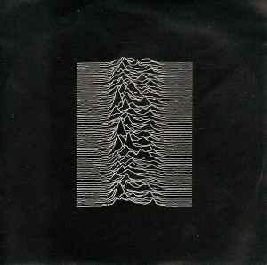

```{r}
#| echo: false
suppressPackageStartupMessages({
  library(tidyverse)
  library(ggridges)
})
avo <- read_rds("../data/Avonet/AVONET1_BirdLife.rds")
five_orders <- c("Struthioniformes", "Cathartiformes", "Gaviiformes",
                 "Sphenisciformes", "Ciconiiformes")
kipps_v_hwi_model <- avo |>
  lm(formula = Kipps.Distance ~ Hand.Wing.Index)
```

## Today's agenda {.smaller}

1. One variable: distributions
2. Two variables: which plot depends on the kind of data
3. More than two variables: color, fill and facets
4. Finishing a figure: labels and saving

::: {.notes}
Reading: R for Data Science, chapter 1 (data visualization). Assignment 1 is due
tomorrow, Friday at 11:59 pm, so the last two content slides (labeling and
saving) are the ones students need tonight: protect them.

This is the longest deck of the semester, with roughly 19 hands-on pauses. In
Fall 2026 it worked well even with six slides carried over from Lecture 7 in
front of it. If it needs trimming, in order: the categorical by categorical
block (three slides, which the deck itself calls "not a common thing"), then the
geom_line() pair, then "Soooo many more options".
:::

## The story so far {.smaller}

**Lectures 5 and 6:** base R plots: `hist()`, `plot()`, `boxplot()`.

**Lecture 7:** dplyr, and the pipe.

**Today:** the tidyverse's plotting package, which takes the pipe's output
directly.

::: {.notes}
Thirty seconds. Nearly every example today starts with avo |> and a bit of
Lecture 7 wrangling before the plot. That's the payoff of learning dplyr first.
:::

# Getting started

## ggplot2 {.smaller}

**A package in the tidyverse.**

**"gg" refers to "grammar of graphics"**, a consistent format for plotting.

**Offers a lot of options** for publication-quality figures.

**Additional packages** (usually starting with "gg") add more features.

**Syntax can be tricky at first.**

::: {.notes}
One minute. "Grammar" means every plot is built from the same parts: data,
a mapping from columns to things you can see (aesthetics), and a geometry. Once
those three click, every plot today is a variation.
:::

## Getting set up {background-color="#f0f4f8" .smaller}

`ggridges` is new. Install it first if you need to:

::: {.run-once}
```{r}
#| eval: false
install.packages("ggridges")
```
:::

::: {.type-it}
```{r}
#| eval: false
library(tidyverse)
library(ggridges)
avo <- read_rds("https://tinyurl.com/avonetbirddata")
```
:::

**Go ahead and run this.**

::: {.notes}
Two minutes. Their second package install, after readxl in Lecture 4: install
once, load every session. library(tidyverse) already loads ggplot2, so there's
no separate library(ggplot2).
:::

## Understanding ggplot {.smaller}

Today, we're going to work through some examples.

We'll start with single variables, then work up to more complicated figures.

::: {.notes}
Thirty seconds.
:::

# One variable

## Distributions {background-color="#f0f4f8" .smaller}

Let's start with the single variable case and look at distributions.

**Base R:**

```{r}
#| eval: false
hist(avo$Hand.Wing.Index)
```

**ggplot:**

::: {.type-it}
```{r}
#| eval: false
avo |>
  ggplot(mapping = aes(x = Hand.Wing.Index)) +
  geom_histogram()
```
:::

**Try this out now and examine the output.**

::: {.notes}
Three minutes. The hand-wing index measures how long and pointed the wing is:
high for long-distance fliers like swifts and albatrosses, low for birds that
barely fly. The message about bins is ggplot nudging you to choose binwidth = ,
not an error.

Point at the + signs: layers are added with +, not piped with |>. Mixing them up
is the most common error today.
:::

## Distributions {background-color="#f0f4f8" .smaller}

You could also use a density plot:

::: {.type-it}
```{r}
#| eval: false
avo |>
  ggplot(mapping = aes(x = Hand.Wing.Index)) +
  geom_density()
```
:::

**Try this out now and examine the output.**

::: {.notes}
Two minutes. One word changed, a different plot. That's the grammar.
:::

## ggplot syntax {.smaller}

```{r}
#| eval: false
avo |>
  ggplot(mapping = aes(x = Hand.Wing.Index)) +
  geom_histogram()
```

**`aes()`** maps data to plot elements.

**`geom_histogram()`** tells ggplot what type of plot to make.

**What happens if we omit the "geom_histogram" bit?**

::: {.fragment}
**Check:** an empty plot: the axis is set up from the mapping, but nothing is
drawn on it.
:::

::: {.notes}
Two minutes. Worth having them try it. ggplot() alone sets up the canvas and the
mapping; the geom is what puts ink on it.
:::

## ggplot syntax {.smaller}

```{r}
#| eval: false
avo |>
  ggplot(mapping = aes(x = Hand.Wing.Index)) +
  geom_histogram()
```

**Plot functions begin with "geom_".**

**What are some of the other "geom_" options?** (hint: use tab completion)

**Do they result in a figure if we call them instead of geom_histogram?**

::: {.fragment}
**Check:** some do (`geom_density()`, `geom_freqpoly()`, `geom_dotplot()`);
others stop with an error such as "`geom_point()` requires the following missing
aesthetics: y".
:::

::: {.notes}
Three minutes. Tab completion: type geom_ and press Tab. The error message is a
good one to read aloud: it names the missing piece, which is the next section.
:::

# Two variables

## Two variables {.smaller}

Options depend on type of data:

| | **y continuous** | **y categorical** |
|---|---|---|
| **x continuous** | `geom_point`, `geom_line` | `geom_density_ridges`, `coord_flip()`-ed versions |
| **x categorical** | `geom_bar`, `geom_boxplot`, `geom_violin` | `geom_tile`, `geom_raster` |

::: {.notes}
One minute. The map for the rest of the lecture: we go through the four cells in
order. It's the same idea as Lecture 5's "Which plot?" table, with ggplot names.
:::

# Continuous x,<br>continuous y

## geom_point {background-color="#f0f4f8" .smaller}

::: {.type-it}
```{r}
#| eval: false
avo |>
  ggplot(mapping = aes(x = Hand.Wing.Index,
                       y = Kipps.Distance)) +
  geom_point()
```
:::

**Try this out. Then, plot two other continuous variables.**

::: {.notes}
Three minutes. Kipp's distance is how far the longest flight feather sticks out
past the others: another measure of a pointed wing, so the two should be
related. Students may reach for Mass and should be reminded of log scales from
Lecture 5 (scale_x_log10() is the ggplot way).
:::

## geom_point {.smaller}

```{r}
#| eval: false
avo |>
  ggplot(mapping = aes(x = Hand.Wing.Index,
                       y = Kipps.Distance)) +
  geom_point()
```

**How would we plot a line showing the relationship between the two?**

::: {.notes}
One minute. Collect ideas before the next slide.
:::

## Lines {.smaller}

Three main approaches:

| Function | What it does | Here? |
|---|---|---|
| `geom_line()` | adds a line connecting adjacent points | doesn't work in this case |
| `geom_abline()` | allows you to add a line you specify | good option here if we fit a line first |
| `geom_smooth()` | fits a line for you and adds it | good option here |

::: {.notes}
One minute.
:::

## geom_line() {background-color="#f0f4f8" .smaller}

::: {.type-it}
```{r}
#| eval: false
avo |>
  ggplot(mapping = aes(x = Hand.Wing.Index,
                       y = Kipps.Distance)) +
  geom_line()
```
:::

**Try this out. Is it useful?**

::: {.fragment}
**Check:** no. It joins all 11,009 points in order of x, so it zigzags up and
down between birds with similar wings.
:::

::: {.notes}
Two minutes. geom_line() is for data where each x has one y, like a time series.
:::

## geom_line() {background-color="#f0f4f8" .smaller}

::: {.type-it}
```{r}
#| eval: false
avo |>
  mutate(rounded_hwi = round(Hand.Wing.Index)) |>
  group_by(rounded_hwi) |>
  summarise(mean_kipps = mean(Kipps.Distance)) |>
  ggplot(mapping = aes(x = rounded_hwi,
                       y = mean_kipps)) +
  geom_line()
```
:::

**Try this one. Is this useful?**

::: {.notes}
Two minutes. Now each x has one y: the mean Kipp's distance for each whole-number
hand-wing index. That's Lecture 7's group_by() and summarise() feeding straight
into a plot. More useful, though it hides how much the birds vary around each
mean.
:::

## geom_abline() {background-color="#f0f4f8" .smaller}

With this, we can add a fitted line to a plot.

First, we need to decide on a line, or model one:

::: {.type-it}
```{r}
#| eval: false
kipps_v_hwi_model <- avo |>
  lm(formula = Kipps.Distance ~ Hand.Wing.Index)
```
:::

**What data do we need from the model to plot the fitted line?**

::: {.fragment}
**Check:** the intercept and the slope, `r round(coef(kipps_v_hwi_model)[1], 2)`
and `r round(coef(kipps_v_hwi_model)[2], 2)`.
:::

::: {.notes}
Two minutes. lm() is from Lecture 3. Piping avo in works because formula is
named, so the data lands in lm()'s data argument.
:::

## geom_abline() {background-color="#f0f4f8" .smaller}

::: {.type-it}
```{r}
#| eval: false
ggplot(data = avo,
       mapping = aes(x = Hand.Wing.Index,
                     y = Kipps.Distance)) +
  geom_point() +
  geom_abline(slope = kipps_v_hwi_model$coefficients[2],
              intercept = kipps_v_hwi_model$coefficients[1],
              color = "blue")
```
:::

**Run this. How does it look? Any changes you'd want to make?**

::: {.notes}
Three minutes. The likely answer: 11,000 black points bury the line.
geom_point(alpha = 0.1) is Lecture 5's transparency trick, and it appears on the
labeling slide later.
:::

## geom_smooth() {background-color="#f0f4f8" .smaller}

Fits a line for you. By default it fits a flexible curve: **loess** (a local
smoother) for fewer than 1,000 points, or a **GAM** (generalized additive model)
for more. In many cases, we want an lm instead.

::: {.type-it}
```{r}
#| eval: false
ggplot(data = avo,
       mapping = aes(x = Hand.Wing.Index,
                     y = Kipps.Distance)) +
  geom_point() +
  geom_smooth()
```
:::

**Run this now. How does the fitted line look?**

::: {.notes}
Two minutes. With 11,009 birds this one is a GAM, and the console message says
so: method = 'gam' and formula = 'y ~ s(x, bs = "cs")'. Loess fits a straight
line to each small window of the data and joins them up; a GAM builds the curve
from smooth pieces. Both are flexible curves that follow the data rather than a
straight line, and loess gets slow on big datasets, which is why ggplot switches.
Neither is on the exam; the point is that the default is not a straight line.
:::

## geom_smooth() {background-color="#f0f4f8" .smaller}

::: {.type-it}
```{r}
#| eval: false
ggplot(data = avo,
       mapping = aes(x = Hand.Wing.Index,
                     y = Kipps.Distance)) +
  geom_point() +
  geom_smooth(method = "lm")
```
:::

**Run this. How does it compare with the plot you made using `geom_abline`?**

::: {.fragment}
**Check:** the same line, plus a grey band around it.
:::

::: {.notes}
Two minutes. The grey band is a confidence band for the line, not a range where
new birds will fall. That distinction is Lecture 23; for now, it shows how sure
we are about where the line goes.
:::

# Categorical x,<br>continuous y

## geom_bar {background-color="#f0f4f8" .smaller}

::: {.type-it}
```{r}
#| eval: false
avo |>
  group_by(Order1) |>
  summarise(mean_mass = mean(Mass)) |>
  slice_max(n = 5, order_by = mean_mass) |>
  ggplot(mapping = aes(y = mean_mass, x = Order1)) +
  geom_bar(stat = "identity")
```
:::

**Try this out. Then, try it for different variable(s).**

::: {.notes}
Three minutes. Every line before ggplot() is Lecture 7. The five heaviest orders
on average: the ratites and tinamous, penguins, New World vultures, storks and
loons.
:::

## geom_bar {.smaller}

By default, `geom_bar` uses count data.

We forced it to use the raw data we gave it (`mean_mass`).

Let's try the default setting.

::: {.notes}
Thirty seconds. stat = "identity" means "use the numbers as they are". geom_col()
is the shortcut for the same thing.
:::

## geom_bar {background-color="#f0f4f8" .smaller}

::: {.type-it}
```{r}
#| eval: false
avo |>
  filter(Order1 %in% c("Struthioniformes",
                       "Cathartiformes",
                       "Gaviiformes",
                       "Sphenisciformes",
                       "Ciconiiformes")) |>
  ggplot(mapping = aes(x = Order1)) +
  geom_bar()
```
:::

**Try this one. Why don't we have to specify y in the aesthetics?**

::: {.fragment}
**Check:** `geom_bar()` counts the rows for each order, and that count is the y.
:::

::: {.notes}
Two minutes. Struthioniformes has
`r sum(avo$Order1 == "Struthioniformes")` species, which will surprise anyone
expecting two ostriches. In AVONET's BirdLife taxonomy, Struthioniformes is the
ratites (ostriches, rheas, emus, cassowaries and kiwis) plus
`r sum(avo$Family1 == "Tinamidae")` tinamous, which are small and can fly. Most
students will know "ratites"; the formal name for ratites and tinamous together
is the palaeognaths.
:::

## geom_boxplot {background-color="#f0f4f8" .smaller}

::: {.type-it}
```{r}
#| eval: false
avo |>
  filter(Order1 %in% c("Struthioniformes",
                       "Cathartiformes",
                       "Gaviiformes",
                       "Sphenisciformes",
                       "Ciconiiformes")) |>
  ggplot(mapping = aes(x = Order1,
                       y = Wing.Length)) +
  geom_boxplot()
```
:::

**Run this now. Who remembers what the different features denote?**

::: {.notes}
Two minutes. Collect answers; the next slide has them.
:::

## geom_boxplot {.smaller}

:::: {.columns}
::: {.column width="66%"}
```{r}
#| echo: false
#| fig-width: 6.6
#| fig-height: 4.6
avo |>
  filter(Order1 %in% five_orders) |>
  ggplot(mapping = aes(x = Order1, y = Wing.Length)) +
  geom_boxplot() +
  theme_grey(base_size = 14) +
  theme(axis.text.x = element_text(angle = 20, hjust = 1))
```
:::

::: {.column width="34%"}
**Horizontal line:** median

**Hinges:** Q1 and Q3

**Whiskers:** furthest data within 1.5 × IQR from Q1/Q3

**IQR:** Q3 − Q1

**Dots:** outliers (points outside the whiskers)
:::
::::

::: {.notes}
Two minutes. The Struthioniformes box is the taxonomy point from the bar chart:
the box is mostly tinamous, the dots far above it are the rheas and ostriches,
and the dot at the bottom is a kiwi, whose wings are recorded as 0.1 mm.
:::

## geom_violin {.smaller}

A sort of combination of a density plot and a boxplot.

It contains more information than a boxplot.

**Revise the code we used for our boxplot to make a violin plot instead.**

::: {.notes}
Three minutes. One word: geom_boxplot() becomes geom_violin(). Let them do it
before showing the next slide.
:::

## Box vs violin {.smaller}

```{r}
#| echo: false
#| fig-width: 6.4
#| fig-height: 3.9
avo |>
  filter(Order1 %in% five_orders) |>
  ggplot(mapping = aes(x = Order1, y = Wing.Length)) +
  geom_boxplot() +
  geom_violin(fill = NA) +
  theme_grey(base_size = 14)
```

::: {.notes}
One minute. The violin shows what the box hides: where within the range the
birds actually are. The two layers here are just added with +.
:::

# Continuous x,<br>categorical y

## Flip the axes {background-color="#f0f4f8" .smaller}

Same functions as for categorical x and continuous y: just flip the x and y
variables. You can also use `coord_flip()`:

::: {.type-it}
```{r}
#| eval: false
avo |>
  group_by(Order1) |>
  summarise(mean_mass = mean(Mass)) |>
  slice_max(n = 5, order_by = mean_mass) |>
  ggplot(mapping = aes(y = mean_mass, x = Order1)) +
  geom_bar(stat = "identity") +
  coord_flip()
```
:::

**Try this one out.**

::: {.notes}
Two minutes. Horizontal bars are the fix for long category names that overlap on
the x axis.
:::

## Joy plots (aka ridgeline plots) {.smaller}

:::: {.columns}
::: {.column width="55%"}
**Inspired by Joy Division's album**, *Unknown Pleasures* (1979).

**Essentially a stacked set of distributions.**

**Implemented in R using** `geom_density_ridges()`.

The cover is itself a plot: radio pulses from pulsar CP 1919, stacked.
:::

::: {.column width="45%"}


[Album cover: Joy Division, *Unknown Pleasures* (Factory Records, 1979), design
by Peter Saville.]{.credit}
:::
::::

::: {.notes}
One minute. CP 1919 was the first pulsar ever discovered (1967). The plot of its
successive pulses, stacked one above the next, comes from Harold Craft's 1970
PhD thesis; Peter Saville used it for the cover. The package was
called ggjoy until 2017, when its author renamed it ggridges; "ridgeline plot"
is now the usual name.
:::

## geom_density_ridges {background-color="#f0f4f8" .smaller}

::: {.type-it}
```{r}
#| eval: false
avo |>
  group_by(Order1) |>
  mutate(mean_mass = mean(Mass)) |>
  filter(Order1 %in% c("Struthioniformes",
                       "Cathartiformes",
                       "Gaviiformes",
                       "Sphenisciformes",
                       "Ciconiiformes")) |>
  ggplot(mapping = aes(x = Wing.Length,
                       y = Order1,
                       group = Order1)) +
  geom_density_ridges()
```
:::

**Try this out!**

::: {.notes}
Three minutes. If it says it can't find geom_density_ridges, ggridges isn't
loaded: back to the setup slide. The violin plot's information, laid on its
side and stacked.
:::

# Categorical x,<br>categorical y

## Not a common thing {.smaller}

Categorical by categorical plots are not a common thing.

Sometimes done to show the counts in the different categories.

::: {.notes}
Thirty seconds. First cut if time is short: the whole three-slide block.
:::

## geom_count {background-color="#f0f4f8" .smaller}

::: {.type-it}
```{r}
#| eval: false
avo |>
  filter(Family1 %in% c("Psittacidae", "Cacatuidae")) |>
  ggplot(mapping = aes(x = Family1, y = Habitat)) +
  geom_count()
```
:::

**Try this out. Are there situations where it might be useful?**

::: {.notes}
Two minutes. One answer: a scatterplot with many identical points, where
geom_point() would draw them on top of each other. That's the overplotting
problem from Lecture 5 in a different form.
:::

## geom_tile {background-color="#f0f4f8" .smaller}

::: {.type-it}
```{r}
#| eval: false
avo |>
  group_by(Family1, Trophic.Level) |>
  mutate(n_species = n(),
         log10_species = n() |> log10()) |>
  filter(Family1 %in% c("Psittacidae", "Cacatuidae")) |>
  ggplot(mapping = aes(x = Family1,
                       y = Trophic.Level,
                       fill = log10_species)) +
  geom_tile()
```
:::

**Try this one out as well.**

::: {.notes}
Two minutes. A heat map: the color carries the third variable. That leads
straight into the next section.
:::

# More than two variables

## More than 2 variables? {.smaller}

When you have more than two variables, options include:

| Option | Example |
|---|---|
| color / fill | `aes(color = Habitat)` |
| shape / line type | `aes(shape = Trophic.Level)` |
| size | `aes(size = Mass)` |
| faceting | `facet_wrap(~ Family1)` |

::: {.notes}
One minute. The first three go inside aes(), because they map a column onto
something you can see. Faceting splits the plot instead.
:::

## Color and fill {background-color="#f0f4f8" .smaller}

Color is used for lines and points, fill for polygons. Example of using color
to show three variables:

::: {.type-it}
```{r}
#| eval: false
avo |>
  filter(Family1 %in% c("Psittacidae", "Cacatuidae")) |>
  group_by(Family1, Habitat) |>
  summarise(mean_mass = mean(Mass)) |>
  slice_max(n = 5, order_by = mean_mass) |>
  ggplot(mapping = aes(y = mean_mass,
                       x = Family1, fill = Habitat)) +
  geom_bar(stat = "identity", position = "dodge")
```
:::

**Try this one out.**

::: {.notes}
Three minutes. position = "dodge" puts the bars side by side instead of stacking
them. The NA habitat gets its own grey bar among the parrots: two species with
no habitat recorded.

The message about summarise() regrouping is Lecture 7's sticky grouping: the
result is still grouped by family, which is why slice_max() then picks the top
five habitats within each family.
:::

## Faceting {background-color="#f0f4f8" .smaller}

`facet_wrap` and `facet_grid` split up plots into different facets.

**Try out this example:**

::: {.type-it}
```{r}
#| eval: false
avo |>
  filter(Family1 %in% c("Psittacidae", "Cacatuidae")) |>
  ggplot(mapping = aes(x = Mass,
                       y = Wing.Length)) +
  geom_point() +
  facet_wrap(~Family1)
```
:::

::: {.notes}
Two minutes. This is Lecture 6's for loop over groups, in one line. The panels
share axes by default, which fixes Lecture 6's y axis trap for free.
:::

## Faceting {background-color="#f0f4f8" .smaller}

Facet grid allows you to have plots divided into rows and columns.

::: {.type-it}
```{r}
#| eval: false
avo |>
  filter(Family1 %in% c("Psittacidae", "Cacatuidae")) |>
  ggplot(mapping = aes(x = Mass,
                       y = Wing.Length)) +
  geom_point() +
  facet_grid(Family1 ~ Trophic.Niche)
```
:::

**Try this one out as well. Note the structure of the facet_grid arguments
(y ~ x).**

::: {.notes}
Two minutes. Rows are the families, columns the diets. Empty panels are real: no
cockatoo in AVONET is classed as a nectarivore.
:::

# Finishing a figure

## Labeling your figure {background-color="#f0f4f8" .smaller}

::: {.type-it}
```{r}
#| eval: false
avo |>
  ggplot(mapping = aes(x = Hand.Wing.Index,
                       y = Kipps.Distance)) +
  geom_point(alpha = 0.1) +
  geom_smooth(method = "lm") +
  labs(title = "Kipp's distance rises with hand-wing index",
       x = "Hand-wing index",
       y = "Kipp's distance (mm)",
       caption = "Data: AVONET") +
  theme_bw()
```
:::

One function, multiple labels.

::: {.notes}
Three minutes. Lecture 6 spent a slide on xlab, ylab and main in base R and tied
it to the "figure explanations" part of Assignment 1. This is the ggplot
version, and a student switching to ggplot for the assignment needs it tonight.
labs() also takes color = and fill = for legend titles.

theme_bw() is worth the five seconds: the grey default background is the most
common complaint about ggplot figures, and one word fixes it.
:::

## Saving your figure {.smaller}

```{r}
#| eval: false
my_plot <- avo |>
  ggplot(mapping = aes(x = Mass, y = Wing.Length)) +
  geom_point()

ggsave(filename = "my_figure.png",
       plot     = my_plot,
       width    = 8,
       height   = 5,
       dpi      = 300)
```

**No `dev.off()`. No blank Plots pane.**

**Leave out `plot =` and it saves the last one you made.**

::: {.notes}
Three minutes. The callback to Lecture 6's png() and dev.off() is the point:
ggsave() is one call, guesses the format from the file extension, and needs no
closing call.

width and height are in inches by default, and dpi = 300 is the usual journal
request: the first time in the course they can make a figure at publication
resolution. Leaving out plot = is convenient, and a trap if they have made
another plot in between.
:::

## Soooo many more options {.smaller}

What we've done today only scratches the surface.

There are many ways of combining plots, customizing, etc.

There are lots of blogs and tutorials to look at once you have the basics down.

Check out the cheat sheet:
[rstudio.github.io/cheatsheets/html/data-visualization.html](https://rstudio.github.io/cheatsheets/html/data-visualization.html)

::: {.notes}
One minute.
:::

# Wrapping up

## Which tool, when {.smaller}

::: {.tiny-table}
| You want to see | Use |
|---|---|
| one continuous variable | `geom_histogram()`, `geom_density()` |
| two continuous variables | `geom_point()`, plus `geom_smooth(method = "lm")` for a line |
| a number across groups | `geom_boxplot()`, `geom_violin()`, `geom_density_ridges()` |
| counts per category | `geom_bar()` |
| a value you calculated, per category | `geom_bar(stat = "identity")` |
| a third variable | `color =`, `fill =`, `shape =` or `size =` inside `aes()` |
| one panel per group | `facet_wrap(~ group)`, `facet_grid(rows ~ cols)` |
| a finished figure | `labs()`, `theme_bw()`, `ggsave()` |
:::

::: {.notes}
The slide to photograph, and the one to have open while finishing Assignment 1.
:::

## Before next class

Read **Bolker 3.1 to 3.3**

Next time: deterministic functions

**Assignment 1 due tomorrow, Friday, 11:59 pm**
