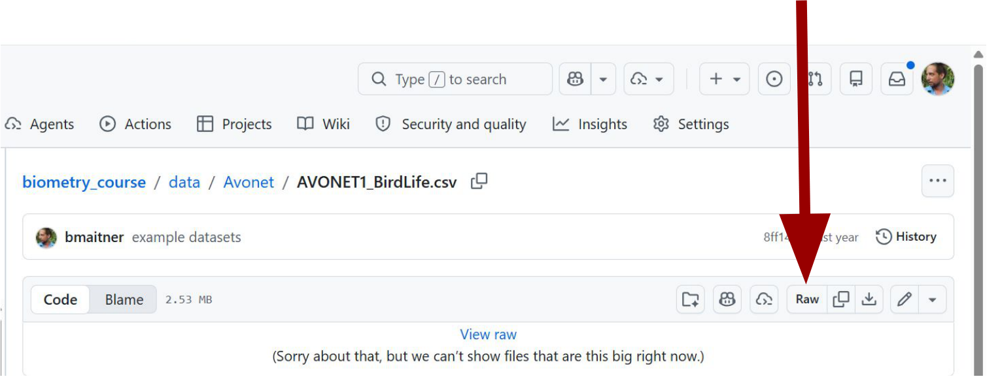

```{r}
#| echo: false
knitr::knit_hooks$set(small_mar = function(before, options, envir) {
  if (before) par(mar = c(3.4, 3.6, 1.6, 0.6), mgp = c(2.2, 0.6, 0))
})
knitr::opts_chunk$set(small_mar = TRUE)

avonet <- read.csv("../data/Avonet/AVONET1_BirdLife.csv")
big <- function(x){ format(round(x), big.mark = ",") }
mass <- avonet$Mass

# simulated predictor and response for the variability slides
set.seed(11)
predictor <- runif(100, 0, 100)
response <- 2 * predictor + rnorm(100, 0, 15)
```

## Today's agenda {.smaller}

1. Variability
2. Probability theory
3. Probability distributions
4. Working with distributions in R

::: {.notes}
Reading: Bolker 4.1 to 4.2, and 4.4. Assignment 2 (distributions) is introduced
next class.

In Fall 2026 this deck finished about 40 minutes early. The frog practice block
was added to use that time well, and the floating point slide after the
variance activity was added because the var(x) == sd(x)^2 check came back FALSE
on the Macs in the room. If there is still time at the end, the remainder of
class is the start of Assignment 2 Part 2: loading their own data and running
today's functions on it.
:::

## The story so far {.smaller}

**Lectures 9 and 10:** deterministic functions, the "signal" in a model.

**Today:** the "noise": variability, and the probability rules that describe it.

**Next:** the distributions we use to model that noise.

::: {.notes}
Thirty seconds. Every model in the course is a deterministic function plus a
probability distribution. Lectures 9 and 10 were the first half.
:::

# Variability

## Variability {.smaller}

**Increasing recognition of importance biologically** (e.g., intraspecific
variation).

**Important component of statistical models** ("signal" vs "noise").

```{r}
#| echo: false
#| fig-width: 5.5
#| fig-height: 3.4
plot(predictor, response, xlab = "Predictor", ylab = "Response")
abline(lm(response ~ predictor), col = "slateblue")
```

::: {.notes}
Two minutes. The line is the signal, the scatter around it is the noise.
Intraspecific variation is a good example of "noise" that turned out to be
biology: individuals within a species differ, and that difference matters for
how populations respond to change.
:::

## Variability {.smaller}

Different sources of variability:

::: {.small-table}
| Source | What it is | For example |
|----------------|--------------------|--------------------------|
| **Unmeasured variables** | unrecorded drivers, e.g. weather (environmental stochasticity) | a drought year lowers seedling survival, but rainfall isn't in the data |
| **Measurement error** | the recorded value isn't the true one | two people measure the same wing and get different lengths |
| **Inherent uncertainty** | random even if we knew everything | which allele a heterozygous parent passes on |
| **Demographic stochasticity** | chance in who survives or breeds; biggest in small populations | 50% survival of 3 animals: 0, 1, 2 or 3 survive, never 1.5 |
| **Nonlinear dynamics** | feedbacks that can damp or amplify variation | density dependence damps it; chaotic dynamics amplify tiny differences in starting numbers |
:::

::: {.notes}
Three minutes. Go down the table asking "is this noise, or is it something we
could measure?" The first row is the one that moves: unmeasured variables are
noise only until someone measures them, which is the "explain it vs treat it as
error" choice on the next slide.

Demographic stochasticity is worth the example: with 3 animals and a 50% chance
each survives, you can't get 1.5 survivors. You get 0, 1, 2 or 3, by chance. In a
large population that luck averages out; in a small one it can be the whole
story, which is why it matters for rare species.

Chaotic dynamics: the discrete logistic model at high growth rates is the
classic case, where two populations that start a few individuals apart end up
nothing alike.
:::

## Variability {.smaller}

:::: {.columns}
::: {.column width="45%"}
Different ways of handling variability:

**Try to explain it** vs. **treat it as error.**
:::

::: {.column width="55%"}
```{r}
#| echo: false
#| fig-width: 4.4
#| fig-height: 4.4
par(mfrow = c(2, 1))
hist(response, main = "Treat it as error", xlab = "Response", col = "grey85")
plot(predictor, response, main = "Explain it", xlab = "Predictor",
     ylab = "Response", cex = 0.6)
abline(lm(response ~ predictor), col = "slateblue")
par(mfrow = c(1, 1))
```
:::
::::

::: {.notes}
Two minutes. Same 100 responses in both panels. On top, all the spread is
"error". Below, most of it is explained by the predictor, and only the scatter
around the line is left over. Adding a predictor moves variation from the noise
column to the signal column.
:::

# Probability theory

## Probability theory refresher {.smaller}

**Probabilities sum to 1.**

::: {.notes}
Thirty seconds. Everything that can happen, all together, has probability 1.
:::

## Probability theory refresher

**For mutually exclusive events:**

**P(A or B) = P(A) + P(B)**

:::: {.columns}
::: {.column width="45%"}
**Dead or alive**

P(Dead) + P(Alive) = 1

If P(Dead) = 0.4,

then P(Alive) = 0.6
:::

::: {.column width="55%"}
**Susceptible, infected, recovered**

P(S) + P(I) + P(R) = 1

If P(S) = 0.1 and P(R) = 0.2,

then P(S or R) = 0.3,

and P(I) = 1 − 0.3 = 0.7
:::
::::

::: {.notes}
Two minutes. SIR is susceptible, infected, recovered: every individual is in
exactly one, which is what mutually exclusive means.
:::

## Probability theory refresher {.smaller}

**For non-mutually exclusive events, we have to account for double counting:**

**P(A or B) = P(A) + P(B) − P(A and B)**

:::: {.columns}
::: {.column width="60%"}
P(Blue or Male)

= P(Blue) + P(Male) − P(Blue and Male)

= 0.50 + 0.35 − 0.20 = 0.65

The subtraction corrects for double counts.
:::

::: {.column width="40%"}
| | Male | Female |
|---|---|---|
| **Blue** | 20 | 30 |
| **Green** | 15 | 35 |
:::
::::

::: {.notes}
Three minutes. 100 birds. P(Blue) = 50/100, P(Male) = 35/100, and the 20 blue
males are in both, so without the subtraction they count twice:
0.50 + 0.35 − 0.20 = 0.65. Check by counting: 20 + 30 + 15 = 65 birds.
:::

## Can you just add them? {.smaller}

**P(A or B) = P(A) + P(B) only when A and B cannot both happen.**

**Which of these pairs can both happen at once?**

1. A frog is infected / the frog is uninfected
2. A bird is male / the bird is blue
3. A site is a pond / the site is a stream
4. A tree flowered this year / the tree is more than 20 cm across

::: {.fragment}
**Check:** 2 and 4 can both happen, so you can't just add them. 1 and 3 can't,
so you can.
:::

::: {.notes}
Two minutes, answered out loud. Worth saying that mutually exclusive is a claim
about the biology, not about the arithmetic: you have to know what the
categories mean to know whether adding is allowed.
:::

## Probability theory refresher {.smaller}

:::: {.columns}
::: {.column width="58%"}
**Conditional probability: the probability of something, given something
else.**

**P(A | B) = P(A and B) / P(B)**

P(Male | Blue) = P(Blue male) / P(Blue)

0.40 = 0.20 / 0.50
:::

::: {.column width="42%"}
| | Male | Female |
|---|---|---|
| **Blue** | 20 | 30 |
| **Green** | 15 | 35 |
:::
::::

::: {.plain}
Look only at the cases where B happened, and ask how often A happened among them.
:::

::: {.notes}
Three minutes. Read the bar as "given". Off the table: of the 50 blue birds, 20
are male, so 20/50 = 0.40. Conditioning on blue makes the blue row the new
whole.
:::

## Probability theory refresher {.smaller}

:::: {.columns}
::: {.column width="58%"}
**Independent variables: P(A and B) = P(A) × P(B)**

If sex and color were independent, we'd expect:

P(Blue male) = P(Blue) × P(Male)

0.175 = 0.5 × 0.35

0.20 ≠ 0.175: measurement error? dependence?
:::

::: {.column width="42%"}
| | Male | Female |
|---|---|---|
| **Blue** | 20 | 30 |
| **Green** | 15 | 35 |
:::
::::

::: {.plain}
Independent means knowing one tells you nothing about the other.
:::

::: {.notes}
Three minutes. Independence is a prediction you can check against counts. 20
blue males against 17.5 expected: close, but not equal. Whether that gap is more
than chance is the question statistics answers, and it comes later in the
course.
:::

## Practice: frogs and a fungus {.smaller}

:::: {.columns}
::: {.column width="55%"}
**100 frogs, each scored for habitat and for infection with *Bd*.**

**Working in groups, figure out:**

1. P(infected)
2. P(infected and pond)
3. P(infected, given pond)
4. P(infected, given stream)
5. P(infected or pond)
:::

::: {.column width="45%"}
| | Pond | Stream | Total |
|---|---|---|---|
| **Infected** | 30 | 12 | 42 |
| **Uninfected** | 20 | 38 | 58 |
| **Total** | 50 | 50 | 100 |
:::
::::

::: {.notes}
Eight to ten minutes in pairs. The questions climb: 1 and 2 are counting, 3 and
4 need the conditional formula, 5 needs the double-counting correction.

Worked answers, for circulating:

1. P(infected) = 42/100 = 0.42, the infected row total over all 100 frogs.
2. P(infected and pond) = 30/100 = 0.30, one cell over all 100 frogs.
3. P(infected | pond) = 0.30 / 0.50 = 0.60, or 30/50 straight off the pond
   column. Wrong answer to expect: 30/100 = 0.30, dividing by everyone.
4. P(infected | stream) = 0.12 / 0.50 = 0.24, or 12/50.
5. P(infected or pond) = 0.42 + 0.50 − 0.30 = 0.62. Check by counting: 30 + 12
   + 20 = 62 frogs. Wrong answer to expect: 0.92, the 30 counted twice.

Bd is the chytrid fungus behind global amphibian declines. The numbers are
invented.
:::

## Answers {.smaller}

1. P(infected) = 42/100 = 0.42
2. P(infected and pond) = 30/100 = 0.30
3. P(infected | pond) = 0.30 / 0.50 = 0.60
4. P(infected | stream) = 0.12 / 0.50 = 0.24
5. P(infected or pond) = 0.42 + 0.50 − 0.30 = 0.62

Pond frogs are infected at 60%, stream frogs at 24%.

::: {.notes}
Two minutes. Read 3 and 4 as the biology, not the arithmetic. Conditioning on
habitat turns one overall rate, 42%, into two rates that differ by a factor of
2.5. That comparison is the point of conditional probability, and it is what
every model in this course is doing underneath.
:::

## P(A | B) is not P(B | A) {.smaller}

**P(A | B) = P(A and B) / P(B)**

P(infected | pond) = 0.30 / 0.50 = 0.60

P(pond | infected) = 0.30 / 0.42 = 0.71

Same numerator. Different denominator. Different question.

P(spots | measles) is nearly 1.

P(measles | spots) is nearly 0.

::: {.notes}
Two minutes. The single most common probability mistake. Almost everyone with
measles has spots; almost nobody with spots has measles. The habit to teach: say
the conditioning event out loud, "out of the pond frogs", "out of the infected
frogs". The denominator is whatever you conditioned on.
:::

## Your turn: does habitat matter? {.smaller}

:::: {.columns}
::: {.column width="55%"}
If infection and habitat were independent:

P(infected and pond) = P(infected) × P(pond)

1. Work out what that gives, and compare it to what we counted.
2. How many of the 100 frogs would be infected pond frogs?
:::

::: {.column width="45%"}
| | Pond | Stream | Total |
|---|---|---|---|
| **Infected** | 30 | 12 | 42 |
| **Uninfected** | 20 | 38 | 58 |
| **Total** | 50 | 50 | 100 |
:::
::::

::: {.notes}
Three to four minutes. They have every number they need from the answers slide.
The point is to use independence as a prediction and then check it, which is
what the next slide does and what a statistical test does formally.
:::

## Answer: not independent {.smaller}

Expected if independent: 0.42 × 0.50 = 0.21, so 21 frogs.

Actually counted: 30 frogs.

More infected pond frogs than independence predicts. Habitat and infection are
associated.

Knowing the habitat changes the probability.

**That is what a model is: P(outcome | what you know).**

::: {.notes}
Two minutes, and two things to land. First, the honest caveat: 30 against 21 is
a gap, but we have not shown it is bigger than chance would produce with 100
frogs. Deciding that is a statistical test, and the machinery for it is chapter
6.

Second, the payoff line. Every model from chapter 6 on is a conditional
probability: the likelihood is P(data | parameters). Students who own the
conditional probability idea today are meeting only new notation then, not a new
idea.
:::

## Questions so far?

# Probability distributions

## What to know about probability distributions {.smaller}

:::: {.columns}
::: {.column width="55%"}
**Two classes:** discrete vs continuous.

**Discrete:** integers. E.g., individuals, number of events.

**Continuous:** any real number (or a subset, e.g. positives). E.g., body
sizes, speeds, etc.

For continuous variables, P(any exact number) = 0, so we focus on P(some number
or more extreme), e.g. P(x ≥ 4).
:::

::: {.column width="45%"}
```{r}
#| echo: false
#| fig-width: 3.8
#| fig-height: 4.6
set.seed(17)
par(mfrow = c(2, 1))
plot(table(rpois(n = 1000, lambda = 1)), main = "Discrete: Poisson",
     xlab = "rpois(n = 1000, lambda = 1)", ylab = "Frequency")
hist(rnorm(n = 1000, mean = 2, sd = 1), breaks = 50, main = "Continuous: Normal",
     xlab = "rnorm(n = 1000, mean = 2, sd = 1)", col = "grey70")
par(mfrow = c(1, 1))
```
:::
::::

::: {.notes}
Three minutes. Why P(any exact number) = 0: a bird weighing exactly 35.5000...
grams, to infinitely many decimals, has probability zero. What has a probability
is a range, such as between 35 and 36 grams.
:::

## Continuous or discrete? {.smaller}

::: {.small-table}
| Organisms | Environment | Evolution |
|---|---|---|
| Body mass | Temperature | Base pair substitutions |
| Age | Elevation | Evolutionary rate |
| Leaf area | Depth | Species per taxon |
| Population size | Hurricane severity | |
| Population density | | |
| Species richness | | |
| Functional diversity | | |
| Individuals per transect | | |
| Mean body mass | | |
:::

::: {.fragment}
**Check:** counts are discrete (population size, species richness, individuals
per transect, substitutions, species per taxon); the rest are continuous. Age and
hurricane severity depend on how you record them.
:::

::: {.notes}
Four minutes. Take them one at a time. The useful rule: can you count it in
whole units? Then it's discrete. The two that start arguments: age (continuous
in reality, often recorded in whole years) and hurricane severity (categories 1
to 5, but built on wind speed, which is continuous). Population density is
continuous even though it comes from a count, because it's a count divided by
an area. Same for mean body mass.
:::

## What to know about probability distributions {.smaller}

:::: {.columns}
::: {.column width="50%"}
**Central tendencies: mean**

"Average"

Expected value (denoted *E*[*x*])

Also denoted $\bar{x}$

Use function `mean()`
:::

::: {.column width="50%"}
```{r}
#| echo: false
#| fig-width: 4.4
#| fig-height: 3.6
curve(dnorm(x, 0, 2), from = -10, to = 10, n = 81, type = "b", cex = 0.5,
      xlab = "Some variable", ylab = "Probability density")
abline(v = 0, col = "royalblue")
```
:::
::::

::: {.notes}
Two minutes. For a symmetric distribution like this one, the mean sits at the
peak. The next slide is the case where it doesn't.
:::

```{r}
#| echo: false
set.seed(6)
pois_sample <- rpois(40, 2)
pois_mode <- as.numeric(names(which.max(table(pois_sample))))
draw_centers <- function(){
  hist(pois_sample, breaks = seq(-0.5, max(pois_sample) + 0.5, 1),
       main = "Discrete: Poisson", xlab = "Some variable", col = "grey85")
  abline(v = mean(pois_sample), col = "blue", lwd = 2)
  abline(v = median(pois_sample), col = "orange", lwd = 2)
  abline(v = pois_mode, col = "deeppink", lwd = 2)
}
```

## What to know about probability distributions {.smaller}

:::: {.columns}
::: {.column width="50%"}
**Central tendencies: median**

More robust than the mean: less sensitive to outliers and skew.

Use function `median()`
:::

::: {.column width="50%"}
```{r}
#| echo: false
#| fig-width: 4.4
#| fig-height: 3.4
draw_centers()
```

[[Blue = mean]{style="color: blue"} &nbsp; [Orange = median]{style="color: darkorange"}
&nbsp; [Pink = mode]{style="color: deeppink"}]{style="font-size: 0.8em"}
:::
::::

::: {.notes}
Two minutes. A right-skewed sample: the long tail to the right pulls the mean
up, and the median stays nearer the bulk of the data. AVONET mass in the
activity is the same thing, much more extreme.
:::

## What to know about probability distributions {.smaller}

:::: {.columns}
::: {.column width="50%"}
**Central tendencies: mode**

Most likely or most common value.

No built-in function: the DescTools package has `Mode()`.
:::

::: {.column width="50%"}
```{r}
#| echo: false
#| fig-width: 4.4
#| fig-height: 3.4
draw_centers()
```

[[Blue = mean]{style="color: blue"} &nbsp; [Orange = median]{style="color: darkorange"}
&nbsp; [Pink = mode]{style="color: deeppink"}]{style="font-size: 0.8em"}
:::
::::

::: {.notes}
One minute. R does have a function called mode(), but it tells you the storage
type of an object ("numeric"), not the most common value. A classic trap.
:::

## What to know about probability distributions {.smaller}

:::: {.columns}
::: {.column width="55%"}
**Spread: variance and standard deviation**

| | Variance | SD |
|---|---|---|
| Definition | SD² | √variance |
| Additive? | yes | no |
| Units | mean squared | same as the mean |
| Function | `var()` | `sd()` |
:::

::: {.column width="45%"}
```{r}
#| echo: false
#| fig-width: 4.2
#| fig-height: 3.4
curve(dnorm(x, 0, 2), from = -10, to = 10, n = 81, type = "b", cex = 0.5,
      xlab = "Some variable", ylab = "Probability density")
abline(v = c(-2, 0, 2), col = "slateblue")
```

[Blue lines: mean ± SD]{style="color: blue"}
:::
::::

::: {.notes}
Three minutes. "Additive" means variances of independent things add: the
variance of a sum is the sum of the variances. Standard deviations don't add.
That's why the math is done with variances and the reporting with SDs, which
are in the units of the data.
:::

# Working with<br>distributions in R

## Activities {.smaller}

Load data and calculate the mean, variance, standard deviation, median, mode,
etc.

We'll use data on GitHub.

::: {.notes}
Thirty seconds.
:::

## Working with probability distributions {.smaller}

Load the AVONET data. **To get the link:** right click on "Raw", copy the URL.

{width="85%"}

::: {.notes}
Two minutes. github.com/bmaitner/biometry_course, then data, Avonet,
AVONET1_BirdLife.csv. GitHub won't preview a file this big, but the Raw button
still works, and the link it gives is one anyone can read from: the "runs
anywhere" line from Lecture 6.
:::

## Working with probability distributions {background-color="#f0f4f8" .smaller}

Load the AVONET data:

::: {.type-it}
```{r}
#| eval: false
avonet <- read.csv("https://github.com/bmaitner/biometry_course/raw/refs/heads/main/data/Avonet/AVONET1_BirdLife.csv")
```
:::

Or, shorter, the same data:

```{r}
#| eval: false
library(readr)
avonet <- read_rds("https://tinyurl.com/avonetbirddata")
```

::: {.notes}
Two minutes. Either works; the short link points at the .rds copy of the same
file.
:::

## Working with probability distributions {.smaller}

Using the AVONET data:

1. Generate a histogram of Hand-Wing Index (high HWI = long-distance flyer), with
   `hist()`. The column is called `Hand.Wing.Index`.
2. Calculate the mean and median Hand-Wing Index: `mean()` and `median()`.
3. Generate a histogram of body mass. Also try a histogram of the log of body
   mass (use `log10()` or `log()`).
4. Calculate the mean and median body mass. How similar are they?
5. (optional) Try calculating the mode of body mass: `Mode()` in the DescTools
   package.

::: {.fragment}
**Check:** HWI mean `r round(mean(avonet$Hand.Wing.Index), 1)`, median
`r median(avonet$Hand.Wing.Index)`. Mass mean `r round(mean(mass), 1)` g,
median `r median(mass)` g: not similar at all.
:::

::: {.notes}
Ten minutes. R turns the hyphen in the original column name into a period when
the file is read, so avonet$Hand-Wing.Index won't work; the slide gives the name
to save five minutes of typos.

Mass is the interesting part: a mean of 267 g and a median of 35.5 g is the skew
from Lecture 5, showing up in the numbers instead of the picture. The mode is
`r names(which.max(table(mass)))` g (`r max(table(mass))` species): lots of
small birds.
:::

## Working with probability distributions {.smaller}

Using the AVONET data:

1. Calculate the variance and standard deviation of Mass: `var()` and `sd()`.
2. Check that variance equals SD². Use `==` to test whether things are equal. R
   uses `^` for powers, so `x^2` means x². For square roots, use either `sqrt()`
   or `x^0.5`.
3. Calculate the mean and variance of Range.Size.

Range.Size has missing values. What do `mean()` and `var()` give you? Fix it
with `na.rm = TRUE`.

::: {.fragment}
**Check:** SD `r big(sd(mass))` g. The `==` test may say TRUE or FALSE,
depending on your computer (next slide). Range.Size gives NA until you add
`na.rm = TRUE`: `r sum(is.na(avonet$Range.Size))` species have no range size.
:::

::: {.notes}
Eight minutes. Let them hit the NA rather than warning them: it's the na.rm
from Lecture 4, met again on real data.

In Fall 2026 the var(x) == sd(x)^2 check came back FALSE on the Macs in the room
and TRUE elsewhere (on Brian's Windows laptop the difference is exactly 0). Go
straight to the next slide while the FALSE is still on their screens.
:::

## Why did `==`<br>say FALSE? {background-color="#f0f4f8" .smaller}

::: {.type-it}
```{r}
#| eval: false
0.1 + 0.2 == 0.3
print(0.1 + 0.2, digits = 20)
```
:::

::: {.fragment}
**Check:** `r 0.1 + 0.2 == 0.3`, and `r format(0.1 + 0.2, digits = 20)`.
:::

The fix: compare with a tolerance.

::: {.type-it}
```{r}
#| eval: false
all.equal(var(avonet$Mass), sd(avonet$Mass)^2)
```
:::

**Never use `==` on numbers with decimals. Use `all.equal()`.** `==` is fine
for whole numbers and for text.

::: {.notes}
Three minutes. Computers store decimals in binary with a fixed number of digits,
and most decimals have no exact binary form, the same way 1/3 has no exact
decimal form. So 0.1 + 0.2 lands a hair away from 0.3, and == asks whether every
digit matches.

Demo with 0.1 + 0.2, not the variance: it's FALSE on every machine, while the
variance version is TRUE on some. Why some students saw TRUE and others FALSE:
sd() is sqrt(var()), so sd(x)^2 takes a square root and then squares it back,
rounding at each step. Whether the last digit survives the round trip depends on
the machine and the math library R was built with.

all.equal() compares with a tolerance (about 1.5e-8). It returns TRUE, or a
description of the difference, which is why isTRUE(all.equal(...)) is the form
to use inside an if(). This is R FAQ 7.31.
:::

# Wrapping up

## Which tool, when {.smaller}

::: {.tiny-table}
| You want | Use |
|---|---|
| P(A or B), when both can't happen | P(A) + P(B) |
| P(A or B), when both can happen | P(A) + P(B) − P(A and B) |
| P(A given B) | P(A and B) / P(B): only count within B |
| to check independence | compare P(A and B) with P(A) × P(B) |
| the center of skewed data | `median()`, not just `mean()` |
| the spread | `var()` for the math, `sd()` for reporting |
| summaries with missing values | `na.rm = TRUE` |
| to compare decimals | `all.equal()`, not `==` |
:::

::: {.notes}
The slide to photograph.
:::

## Remainder of class {.smaller}

Load in your focal data, and use today's functions to better understand your key
variables:

```{r}
#| eval: false
# your focal dataset from Assignment 1
my_data <- read.csv("your_file.csv")

hist(my_data$your_variable)
hist(log10(my_data$your_variable))    # if the first one is skewed

mean(my_data$your_variable, na.rm = TRUE)
median(my_data$your_variable, na.rm = TRUE)
```

**Before next class:** skim 4.5 and 4.6, the bestiary of distributions.

::: {.notes}
The rest of class. The starter code is the scaffolding pattern from Lectures 9
and 10: they change the names, not the structure. This work is Part 2 of
Assignment 2 under another name, so it is worth saying that when the assignment
comes out next class.

Circulating is worth more than usual here: it's the first time most of them will
look at their own variable and have to decide what kind it is.
:::
