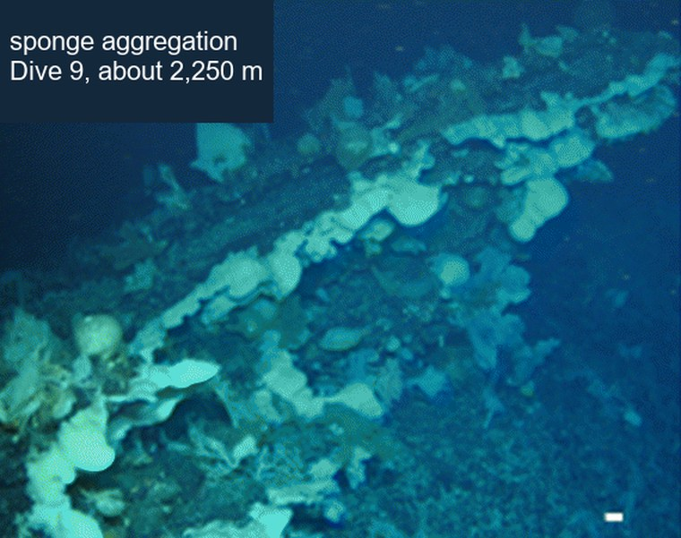
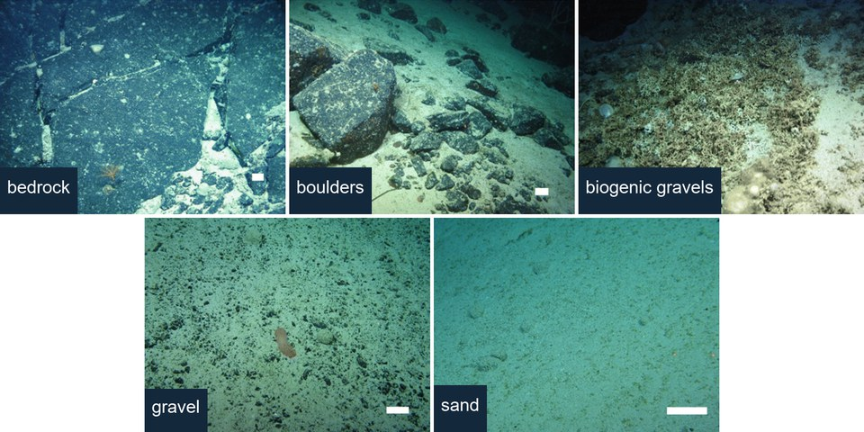
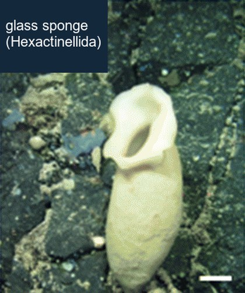
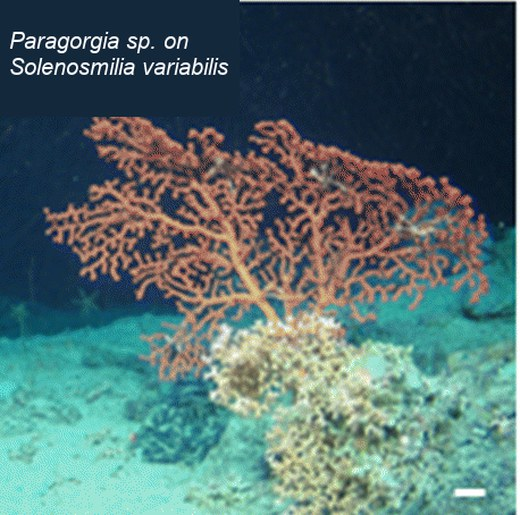

```{r}
#| echo: false
knitr::knit_hooks$set(small_mar = function(before, options, envir) {
  if (before) par(mar = c(3.4, 3.4, 0.6, 0.6), mgp = c(2.1, 0.6, 0))
})
knitr::opts_chunk$set(small_mar = TRUE)

library(bbmle)
library(emdbook)

pct <- function(x){ paste0(round(100 * x), "%") }
f1 <- function(x){ sprintf("%.1f", x) }
f2 <- function(x){ sprintf("%.2f", x) }
big <- function(x){ format(round(x), big.mark = ",") }

tosca <- read.csv("../data/Deep_sea_megabenthos/TOSCA_ROV.csv")
rov <- data.frame(dive = tosca$Dive.no,
                  depth = tosca$Depth.water..m.,
                  substrate = tosca$Substrate,
                  fov = tosca$FOV.camera..m.,
                  sponges = tosca$Porifera....,
                  corals = tosca$Cnidaria....)
n_all <- nrow(rov)
rov <- rov[!is.na(rov$fov), ]
rov$area <- 50 * rov$fov
rov$density <- 100 * rov$sponges / rov$area
zero_frac <- mean(rov$sponges == 0)
med_dens <- tapply(rov$density, rov$substrate, median)

# step 3: the distribution
m_pois <- mle2(sponges ~ dpois(lambda = exp(log_d) * area / 100),
               start = list(log_d = 0), data = rov)
m_nb <- mle2(sponges ~ dnbinom(mu = exp(log_d) * area / 100, size = exp(log_k)),
             start = list(log_d = 0, log_k = 0), data = rov)
m_zinb <- mle2(sponges ~ dzinbinom(mu = exp(log_d) * area / 100, size = exp(log_k),
                                   zprob = plogis(logit_z)),
               start = list(log_d = 0, log_k = 0, logit_z = -2), data = rov)
aic_dist <- AIC(m_pois, m_nb, m_zinb)$AIC
names(aic_dist) <- c("pois", "nb", "zinb")

# step 4: the deterministic part
rov$depth_km <- (rov$depth - 1500) / 1000
m_sub <- mle2(sponges ~ dnbinom(mu = exp(log_d) * area / 100, size = exp(log_k)),
              start = list(log_d = 0, log_k = 0),
              parameters = list(log_d ~ substrate - 1), data = rov)
m_depth <- mle2(sponges ~ dnbinom(mu = exp(log_d + b * depth_km) * area / 100, size = exp(log_k)),
                start = list(log_d = 0, b = 0, log_k = 0), data = rov)
m_both <- mle2(sponges ~ dnbinom(mu = exp(log_d + b * depth_km) * area / 100, size = exp(log_k)),
               start = list(log_d = 0, b = 0, log_k = 0),
               parameters = list(log_d ~ substrate - 1), data = rov)
m_both_2 <- update(m_both, start = list(log_d = 3, b = -1, log_k = 1))
aic_det <- AIC(m_nb, m_sub, m_depth, m_both)$AIC
names(aic_det) <- c("nb", "sub", "depth", "both")
dens_both <- exp(coef(m_both)[1:5])
names(dens_both) <- sub("log_d.substrate", "", names(dens_both))
mean_depth_sub <- tapply(rov$depth, rov$substrate, mean)

# step 7: simulate zeros from the best plain model
set.seed(7)
mu_hat <- predict(m_both)
k_hat <- exp(coef(m_both)["log_k"])
fake_zeros <- replicate(1000, {
  fake <- rnbinom(nrow(rov), mu = mu_hat, size = k_hat)
  tapply(fake == 0, rov$substrate, mean)
})
obs_zeros <- tapply(rov$sponges == 0, rov$substrate, mean)
z_lo <- apply(fake_zeros, 1, quantile, 0.025)
z_hi <- apply(fake_zeros, 1, quantile, 0.975)

# the zero model: only substrates with loose sediment can be truly empty
rov$sediment <- as.numeric(rov$substrate %in% c("sand", "gravel", "boulders"))
m_zero <- mle2(sponges ~ dzinbinom(mu = exp(log_d + b * depth_km) * area / 100,
                                   size = exp(log_k), zprob = sediment * plogis(logit_z)),
               start = list(log_d = 3, b = 0.5, log_k = -0.7, logit_z = -2),
               parameters = list(log_d ~ substrate - 1), data = rov)
aic_zero <- AIC(m_both, m_zero)$AIC
z_hat <- plogis(coef(m_zero)["logit_z"])

# re-check, under the zero model (rzinbinom, mean computed by hand)
cz <- coef(m_zero)
log_d_row <- cz[paste0("log_d.substrate", rov$substrate)]
mu_zero <- exp(log_d_row + cz["b"] * rov$depth_km) * rov$area / 100
set.seed(8)
fake_zeros2 <- replicate(1000, {
  fake <- rzinbinom(nrow(rov), mu = mu_zero, size = exp(cz["log_k"]),
                    zprob = rov$sediment * plogis(cz["logit_z"]))
  tapply(fake == 0, rov$substrate, mean)
})
z2_lo <- apply(fake_zeros2, 1, quantile, 0.025)
z2_hi <- apply(fake_zeros2, 1, quantile, 0.975)

# for the notes: zero inflation on sand and gravel only, and its re-check
sg <- as.numeric(rov$substrate %in% c("sand", "gravel"))
m_sg <- mle2(sponges ~ dzinbinom(mu = exp(log_d + b * depth_km) * area / 100,
                                 size = exp(log_k), zprob = sg * plogis(logit_z)),
             start = list(log_d = 3, b = 0.5, log_k = -0.7, logit_z = -2),
             parameters = list(log_d ~ substrate - 1), data = rov)
aic_sg <- AIC(m_sg)
c_sg <- coef(m_sg)
mu_sg <- exp(c_sg[paste0("log_d.substrate", rov$substrate)] + c_sg["b"] * rov$depth_km) *
  rov$area / 100
set.seed(8)
fake_zeros3 <- replicate(1000, {
  fake <- rzinbinom(nrow(rov), mu = mu_sg, size = exp(c_sg["log_k"]),
                    zprob = sg * plogis(c_sg["logit_z"]))
  tapply(fake == 0, rov$substrate, mean)
})
z3_lo <- apply(fake_zeros3, 1, quantile, 0.025)
z3_hi <- apply(fake_zeros3, 1, quantile, 0.975)

# step 8: intervals by the recipe
set.seed(22)
draws <- MASS::mvrnorm(1000, mu = coef(m_zero), Sigma = vcov(m_zero))
ratio_hat <- exp(cz["log_d.substratebedrock"] - cz["log_d.substratesand"])
ratio_ci <- quantile(exp(draws[, "log_d.substratebedrock"] - draws[, "log_d.substratesand"]),
                     c(0.025, 0.975))
depth_hat <- exp(cz["b"])
depth_ci <- quantile(exp(draws[, "b"]), c(0.025, 0.975))
empty_ci <- quantile(plogis(draws[, "logit_z"]), c(0.025, 0.975))

# step 8: the picture, built the way students build it
library(ggplot2)
grid <- expand.grid(depth = seq(900, 2900, by = 50), substrate = c("bedrock", "sand"))
grid$depth_km <- (grid$depth - 1500) / 1000
col_d <- paste0("log_d.substrate", grid$substrate)
curves <- matrix(NA, nrow = 1000, ncol = nrow(grid))
for (i in 1:1000) {
  curves[i, ] <- exp(draws[i, col_d] + draws[i, "b"] * grid$depth_km)
}
grid$lower <- apply(curves, 2, quantile, 0.025)
grid$upper <- apply(curves, 2, quantile, 0.975)
grid$density <- exp(cz[col_d] + cz["b"] * grid$depth_km)
g1500 <- grid[grid$depth == 1500 & grid$substrate == "bedrock", ]

# caveat: dives differ
m_dive <- mle2(sponges ~ dnbinom(mu = exp(log_d + b * depth_km) * area / 100, size = exp(log_k)),
               start = list(log_d = 0, b = 0, log_k = 0),
               parameters = list(log_d ~ substrate + factor(dive) - 1), data = rov)
dive_gain <- AIC(m_both) - AIC(m_dive)

# your turn: corals
c_nb <- mle2(corals ~ dnbinom(mu = exp(log_d) * area / 100, size = exp(log_k)),
             start = list(log_d = 0, log_k = 0), data = rov)
c_sub <- mle2(corals ~ dnbinom(mu = exp(log_d) * area / 100, size = exp(log_k)),
              start = list(log_d = 0, log_k = 0),
              parameters = list(log_d ~ substrate - 1), data = rov)
c_depth <- mle2(corals ~ dnbinom(mu = exp(log_d + b * depth_km) * area / 100, size = exp(log_k)),
                start = list(log_d = 0, b = 0, log_k = 0), data = rov)
c_both <- mle2(corals ~ dnbinom(mu = exp(log_d + b * depth_km) * area / 100, size = exp(log_k)),
               start = list(log_d = 0, b = 0, log_k = 0),
               parameters = list(log_d ~ substrate - 1), data = rov)
aic_c <- AIC(c_nb, c_sub, c_depth, c_both)$AIC
names(aic_c) <- c("nb", "sub", "depth", "both")
set.seed(23)
c_draws <- MASS::mvrnorm(1000, mu = coef(c_both), Sigma = vcov(c_both))
c_depth_hat <- exp(coef(c_both)["b"])
c_depth_ci <- quantile(exp(c_draws[, "b"]), c(0.025, 0.975))
c_ratio_hat <- exp(coef(c_both)["log_d.substratebedrock"] - coef(c_both)["log_d.substratesand"])
c_ratio_ci <- quantile(exp(c_draws[, "log_d.substratebedrock"] - c_draws[, "log_d.substratesand"]),
                       c(0.025, 0.975))
```

## Today's agenda {.smaller}

One question, **start to finish**, on data you have not seen:

1. Ask the question
2. Look at the data
3. Choose the distribution
4. Choose the deterministic function
5. Fit, and check the fit worked
6. Compare models
7. Check the best model against the data
8. Put intervals on the answer, draw it, and say it in biology

Then **your turn**: the same eight steps, on a second question.

. . .

[Type and run]{.type-badge} on a code block: type it into your script and run it.
Code without the label is there to watch.

::: {.notes}
Bolker chapter 8, which students skimmed, is three of these walk-throughs. Today
is one more, on new data, so that every step is a decision rather than a
recipe. Nothing today is a new method; the new thing is doing all of them, in
order, on one problem. This is also the shape of the final project's analysis.
:::

## The story so far {.smaller}

- We have learned each piece **separately**: distributions, functions, fitting,
  comparing, checking, intervals
- Each lecture used a dataset chosen to show **one** piece
- **Today:** all the pieces, in order, on one new dataset

::: {.notes}
Thirty seconds.
:::

# The question and the data

## Step 1: sponges on a mid-ocean ridge {.smaller}

:::: {.columns}
::: {.column width="56%"}
- **The Charlie-Gibbs Fracture Zone**: a break in the Mid-Atlantic Ridge,
  about 52° N, 560 to 2,970 m deep
- In 2018, five ROV dives filmed the seafloor; every **50 m section** was
  scored for substrate and the animals in view
- **Sponges** filter food from the water, and most must **attach to something
  hard**
:::

::: {.column width="42%"}


[Photo: Keogh et al. 2022, CC BY 4.0, cropped and relabeled]{style="font-size:0.45em; color:#777"}
:::
::::

. . .

**The question:** are sponges denser on hard substrate than on soft sediment?
And does depth matter once substrate is accounted for?

**The prediction:** more on bedrock and boulders, fewer on sand and gravel.

::: {.notes}
Write the question and the prediction before looking at any data. That order
is the point of step 1: a question chosen after looking at the data is a
question the data have already answered.

Why anyone cares: dense sponge aggregations are habitat for many other species,
and in the North Atlantic they are treated as vulnerable marine ecosystems,
protected from bottom trawling. Knowing where they occur is a management
question as much as an ecological one.

The data are Keogh (2022), PANGAEA, from the TOSCA expedition on the RV Celtic
Explorer. Counts are by phylum, so "sponges" is all Porifera in view.

The photo is from these dives: the dense sponge aggregation the survey found on
a ridge on Dive 9, at about 2,250 m (Keogh et al. 2022, the paper that goes with
the data). The white bar is 100 mm.
:::

## What the substrates look like {.smaller}

{fig-align="center"}

All from these dives, at 2,000 to 2,500 m. White bars are 100 mm.

[Photos on this and other slides: Keogh, Command, Edinger, Georgiopoulou and Robert (2022), *Marine Biodiversity* 52:55, [doi:10.1007/s12526-022-01285-1](https://doi.org/10.1007/s12526-022-01285-1), [CC BY 4.0](https://creativecommons.org/licenses/by/4.0/); cropped, panel letters removed, and relabeled]{style="font-size:0.45em; color:#777"}

::: {.notes}
One minute. These are the five values of the substrate column, as the ROV
pilots and annotators saw them, all from this survey: bedrock, Dive 9, about
2,200 m; boulders, Dive 8, about 2,500 m; biogenic gravels (including coral
rubble), Dive 5, about 2,500 m; gravel and sand, Dive 6, about 2,000 m.

Two things to point at, because they come back later. The boulders sit on
sediment, with sand between the rocks: that matters at Step 7. And biogenic
gravels are made of skeletal fragments, much of it coral rubble, so they are
neither bare rock nor bare sediment.
:::

## Get set up {background-color="#f0f4f8" .smaller}

::: {.type-it}
```{r}
#| eval: false
library(bbmle)
library(emdbook)        # for the zero-inflated negative binomial, later
library(biometrydata)
library(ggplot2)        # for the figure, later

# the original column names are long and mangled: rename the ones we need
rov <- data.frame(dive = tosca_rov$Dive.no,
                  depth = tosca_rov$Depth.water..m.,
                  substrate = tosca_rov$Substrate,
                  fov = tosca_rov$FOV.camera..m.,       # camera width, m
                  sponges = tosca_rov$Porifera....,
                  corals = tosca_rov$Cnidaria....)      # all cnidarians, mostly corals

rov <- rov[!is.na(rov$fov), ]        # sections with no camera width
rov$area <- 50 * rov$fov             # seafloor seen: 50 m long, fov wide
```
:::

**Check:** `r nrow(rov)` sections, down from `r n_all`.

::: {.notes}
Three minutes. Renaming first is the habit worth modeling: Depth.water..m. is
what read.csv makes of "Depth water [m]", and nobody wants to type it forty
times.

The area line is the first modeling decision, and it comes before any model:
the camera's field of view varied from about 2 m to over 18 m wide, so some
sections saw nine times as much seafloor as others. More seafloor, more
sponges, whatever the substrate. The next slides use area to turn counts into
densities.

The 20 dropped sections had no recorded camera width. Dropping them is fine
here; in a paper, you would say so.
:::

## Step 2: look at the data {background-color="#f0f4f8" .smaller}

::: {.type-it}
```{r}
#| eval: false
table(rov$substrate)

mean(rov$sponges == 0)                                 # fraction with none
c(mean = mean(rov$sponges), variance = var(rov$sponges))

rov$density <- 100 * rov$sponges / rov$area           # per 100 m2
tapply(rov$density, rov$substrate, median)
```
:::

**Check:** `r pct(zero_frac)` of sections have no sponges. The variance is about
`r round(var(rov$sponges) / mean(rov$sponges))` times the mean. Median density:
`r f1(med_dens["bedrock"])` per 100 m² on bedrock, `r f1(med_dens["sand"])` on sand.

. . .

**Think:** why look at the variance against the mean, and at how many zeros
there are, before fitting anything?

::: {.notes}
Give them a minute with a neighbor on the Think question, then take a couple
of answers. What to draw out:

- variance against the mean: a Poisson forces the variance to equal the mean.
  A variance 200 times the mean rules it out before we fit it, and points to
  the negative binomial (Lecture 18).
- the zeros: more empty sections than a count distribution expects is a sign
  that some places may be truly empty, which is what a zero-inflated model is
  for.
- both are about choosing the distribution. The Step 3 slide, just after the
  plots, confirms their answers.

Three minutes for the code. Each line is there to inform a later decision:

- table(): five substrates, with enough sections of each to estimate a density.
- the zeros and the variance: these decide the distribution in step 3.
- the medians: a first look at the answer, which the model will put numbers
  and intervals on. Medians, not means, because a few sections have hundreds of
  sponges.

Biogenic gravels are gravels made of skeletal fragments of corals, sponges and
shells. They are not hard rock, but they are not bare sediment either.
:::

## What the data look like {.smaller}

```{r}
#| echo: false
#| fig-height: 3.3
#| fig-width: 9
par(mfrow = c(1, 2), mar = c(4.6, 3.6, 0.6, 0.6), mgp = c(2.3, 0.6, 0))
ord <- names(sort(med_dens, decreasing = TRUE))
boxplot(density + 1 ~ factor(substrate, levels = ord), data = rov, log = "y",
        las = 2, xlab = "", ylab = "sponges per 100 m² (+1)", cex.axis = 0.8,
        col = "#cfe2f0", outcol = "grey40", names = sub(" ", "\n", ord))
plot(rov$depth, rov$density + 1, log = "y", pch = 16, cex = 0.6,
     col = rgb(0.16, 0.48, 0.69, 0.4),
     xlab = "depth (m)", ylab = "sponges per 100 m² (+1)", bty = "l")
```

Left: denser on bedrock and biogenic gravels. Right: depth, by itself, shows no
clear pattern.

::: {.notes}
The +1 is only so that sections with no sponges can sit on a log axis. The log
axis is needed because densities run from 0 to several hundred.

Two things to say. The substrate difference is large, about the size the
question predicted. And the right panel is a warning: depth looks like it does
nothing, but every point mixes substrates. Step 6 shows what happens when both
are in one model.
:::

# Building the model

## Step 3: which distribution? {.smaller}

| What we know | Points to |
|---|---|
| whole-number counts, no upper limit | Poisson or negative binomial |
| variance about `r round(var(rov$sponges) / mean(rov$sponges))` times the mean | **negative binomial** |
| `r pct(zero_frac)` zeros | perhaps **zero-inflated**? |

. . .

A **zero-inflated** distribution has two kinds of zero: places where there could
**never** be any, and places where there happened to be none.

::: {.plain}
A zero-inflated model says some places are truly empty, on top of the places that are empty by chance.
:::

::: {.notes}
The first two rows are Lecture 12 and Lecture 18. The third is new, and it is
the one in Bolker's seed removal example: there, a zero might mean predators
never found the station at all, which is a different process from predators
finding it and taking nothing.

Here, the equivalent would be a section where sponges simply cannot live, for
example bare sand with nothing to attach to. That is a structural zero; a
section with suitable rock that happened to have no sponges in it is a chance
zero.

The zero-inflated negative binomial has one extra parameter: the probability
that a section is structurally empty. dzinbinom() from emdbook provides it.
:::

## Count, or density? {.smaller}

Two possible responses:

| Response | For | Against |
|---|---|---|
| **count** | whole numbers: Poisson, negative binomial | not comparable: sections saw 96 to 929 m² |
| **density** (count per 100 m²) | comparable across sections | not whole numbers; 1 in 100 m² looks as sure as 10 in 1,000 m² |

. . .

**Both:** ask the question about density, but model the count, with

$$\mu = \text{density} \times \frac{\text{area}}{100}$$

::: {.plain}
Model the density, and let each section's area scale it to an expected count. The count keeps its distribution, and big sections count for more.
:::

::: {.notes}
Ask the room which response they would use before revealing the answer. Most
will say density, for the right reason: the camera's field of view varied about
ninefold, so raw counts mostly measure how much seafloor was in view.

The two problems with modeling density directly:

- Density is not a whole number, so the count distributions from Lecture 12 no
  longer apply; we would need a continuous distribution, and the 13% of exact
  zeros would be awkward for most of those.
- It throws away information. One sponge in 100 m² and ten in 1,000 m² are both
  1 per 100 m², but the second is ten times as much evidence. Modeling the
  count gets this right automatically: a big section's count has a bigger mean,
  so it pins the density down more tightly.

Putting area into the mean is the standard answer whenever sampling effort
varies: trap-nights, minutes of a point count, length of a transect. GLMs call
it an offset, Lecture 24.

The density is fitted on the log scale, exp(log_d), so it can never go negative
(Lecture 20's Fix 3).
:::

## Step 3: fit three distributions {background-color="#f0f4f8" .smaller}

::: {.type-it}
```{r}
#| eval: false
# one density everywhere, three ways the counts could scatter around it
m_pois <- mle2(sponges ~ dpois(lambda = exp(log_d) * area / 100),
               start = list(log_d = 0), data = rov)
m_nb   <- mle2(sponges ~ dnbinom(mu = exp(log_d) * area / 100, size = exp(log_k)),
               start = list(log_d = 0, log_k = 0), data = rov)
m_zinb <- mle2(sponges ~ dzinbinom(mu = exp(log_d) * area / 100, size = exp(log_k),
                                   zprob = plogis(logit_z)),
               start = list(log_d = 0, log_k = 0, logit_z = -2), data = rov)
AICtab(m_pois, m_nb, m_zinb)
```
:::

**Check:** the negative binomial beats the Poisson by
**`r big(aic_dist["pois"] - aic_dist["nb"])`** AIC units. Zero inflation adds
nothing: `r f1(aic_dist["zinb"] - aic_dist["nb"])` units **worse**.

::: {.notes}
Four minutes. All three are discrete distributions of the same response, so
Lecture 18's rule says their AICs can be compared.

m_zinb will print warnings about NaNs. Ask what they mean before explaining:
the estimated probability of a structurally empty section is pushed almost to
zero, the edge of what is possible, and the standard error cannot be computed
there. That is itself the answer: with one density everywhere, the zeros are
what the negative binomial already expects.

Hold on to "with one density everywhere". Step 7 comes back to it.
:::

## Step 4: the deterministic part {.smaller}

Four candidate models for the **density**, all negative binomial:

| Model | log density = | The idea |
|---|---|---|
| `m_nb` | $a$ | one density everywhere |
| `m_sub` | $a_{\text{substrate}}$ | each substrate has its own |
| `m_depth` | $a + b \cdot \text{depth}$ | changes with depth |
| `m_both` | $a_{\text{substrate}} + b \cdot \text{depth}$ | both |

. . .

Depth in **km from 1,500 m**: centered and rescaled (Lecture 20), so $a$ is the
density at 1,500 m and $b$ the change per km.

::: {.notes}
Each row is a version of the question. m_sub is the prediction from step 1;
m_both asks whether depth matters once substrate is in. m_depth is there so
the comparison can say whether depth matters on its own.

The models are nested, as in Lecture 18: m_nb inside each of the others, and
m_sub and m_depth both inside m_both.

On the log scale, b is a multiplier: exp(b) is how many times denser sponges
are 1 km deeper, the same way the development effect worked for bobwhite.
:::

## Step 4: fit them {background-color="#f0f4f8" .smaller}

::: {.type-it}
```{r}
#| eval: false
rov$depth_km <- (rov$depth - 1500) / 1000

m_sub <- mle2(sponges ~ dnbinom(mu = exp(log_d) * area / 100, size = exp(log_k)),
              start = list(log_d = 0, log_k = 0),
              parameters = list(log_d ~ substrate - 1), data = rov)

m_depth <- mle2(sponges ~ dnbinom(mu = exp(log_d + b * depth_km) * area / 100,
                                  size = exp(log_k)),
                start = list(log_d = 0, b = 0, log_k = 0), data = rov)

m_both <- mle2(sponges ~ dnbinom(mu = exp(log_d + b * depth_km) * area / 100,
                                 size = exp(log_k)),
               start = list(log_d = 0, b = 0, log_k = 0),
               parameters = list(log_d ~ substrate - 1), data = rov)
```
:::

`parameters = list(log_d ~ substrate - 1)`: one `log_d` **per substrate**. The
`- 1` gives each substrate its own value, rather than differences from the first.

::: {.notes}
Four minutes. The parameters argument is Lecture 18's, from the cardinal and
bobwhite comparison. The - 1 is what Bolker does in the seed removal example:
without it, the first substrate (bedrock, alphabetically) becomes the
intercept and every other value is a difference from bedrock. Both fit the
same model; - 1 just makes the coefficients easier to read.
:::

## Step 5: did the fits work? {background-color="#f0f4f8" .smaller}

::: {.type-it}
```{r}
#| eval: false
m_both@details$convergence              # 0 is good

# a second start, far from the first: does it find the same bottom?
m_both_2 <- update(m_both, start = list(log_d = 3, b = -1, log_k = 1))
c(m_both@min, m_both_2@min)
```
:::

**Check:** convergence `r m_both@details$convergence`, and both starts reach an
NLL of `r format(round(m_both@min, 2), nsmall = 2, big.mark = ",")`.

::: {.notes}
Two minutes. Lecture 19's checklist, items 1 and 2. update() refits a model
with something changed, here the start, which saves retyping the whole call.

Item 5 of the checklist also holds: each bigger model should never fit worse
than the smaller ones inside it. The next slide shows they do not.
:::

# Comparing and checking

## Step 6: compare {background-color="#f0f4f8" .smaller}

::: {.type-it}
```{r}
#| eval: false
AICtab(m_nb, m_sub, m_depth, m_both, weights = TRUE)
exp(coef(m_both))
```
:::

**Check:** `m_both` is best, by `r f1(aic_det["sub"] - aic_det["both"])` over
`m_sub`. Depth alone is no better than nothing
(`r f1(aic_det["depth"] - aic_det["nb"])` units).

. . .

| | bedrock | biogenic gravels | boulders | gravel | sand |
|---|---|---|---|---|---|
| sponges per 100 m², at 1,500 m | `r round(dens_both["bedrock"])` | `r round(dens_both["biogenic gravels"])` | `r round(dens_both["boulders"])` | `r f1(dens_both["gravel"])` | `r f1(dens_both["sand"])` |

And `r f2(exp(coef(m_both)["b"]))` times as dense for every km deeper.

::: {.notes}
Three minutes. Read the densities as the answer taking shape: bedrock and
biogenic gravels highest, boulders in between, gravel and sand lowest. That is
the prediction, with numbers.

Why depth alone does nothing but matters alongside substrate: the substrates
sit at different depths. Biogenic gravels, which have the most sponges, are
the shallowest substrate on average (`r round(mean_depth_sub["biogenic gravels"])` m,
against `r round(mean_depth_sub["boulders"])` m for boulders). So without
substrate in the model, shallow water looks good for sponges because that is
where the biogenic gravels are, which hides the real increase with depth on any
one substrate. Two predictors that go together have to be in the model together.
:::

## Step 7: does the best model look like the data? {background-color="#f0f4f8" .smaller}

The fraction of sections with **no sponges**, by substrate, real versus 1,000 fakes:

::: {.type-it}
```{r}
#| eval: false
set.seed(7)
mu_hat <- predict(m_both)                    # the fitted mean, every section
k_hat <- exp(coef(m_both)["log_k"])

fake_zeros <- replicate(1000, {
  fake <- rnbinom(nrow(rov), mu = mu_hat, size = k_hat)
  tapply(fake == 0, rov$substrate, mean)
})

cbind(observed = tapply(rov$sponges == 0, rov$substrate, mean),
      lower = apply(fake_zeros, 1, quantile, 0.025),
      upper = apply(fake_zeros, 1, quantile, 0.975))
```
:::

**Check:** sand, `r pct(obs_zeros["sand"])` observed against
`r pct(z_lo["sand"])` to `r pct(z_hi["sand"])` simulated.

::: {.notes}
Four minutes. Lecture 19's "simulate from the fit", aimed at one feature of the
data: the zeros, split by substrate. predict() on an mle2 fit gives the fitted
mean count for every row.

Why zeros, and why by substrate: step 3 tested zero inflation with one density
everywhere, which is a weak test. Now that the model knows about substrate, the
question can be asked where it matters.
:::

## Too many empty sections {.smaller}

| | observed | simulated, 95% |
|---|---|---|
| bedrock | `r pct(obs_zeros["bedrock"])` | `r pct(z_lo["bedrock"])` to `r pct(z_hi["bedrock"])` |
| biogenic gravels | `r pct(obs_zeros["biogenic gravels"])` | `r pct(z_lo["biogenic gravels"])` to `r pct(z_hi["biogenic gravels"])` |
| **boulders** | **`r pct(obs_zeros["boulders"])`** | `r pct(z_lo["boulders"])` to `r pct(z_hi["boulders"])` |
| **gravel** | **`r pct(obs_zeros["gravel"])`** | `r pct(z_lo["gravel"])` to `r pct(z_hi["gravel"])` |
| **sand** | **`r pct(obs_zeros["sand"])`** | `r pct(z_lo["sand"])` to `r pct(z_hi["sand"])` |

Sand is well above its range, boulders just above, gravel at the very top.

. . .

Why? **Loose sediment** gives sponges nothing to settle on, so it can be **truly
empty**. Boulder fields have sediment between the rocks (look back at the photo).

::: {.plain}
The check found something AIC could not: the best model was wrong in one particular place, and the biology said why.
:::

::: {.notes}
Ask the room for an explanation before revealing the second half. Someone will
get there: sponges need something to settle on.

AIC only ranks the models it is given; it cannot say that all of them miss
something. A check against the data can. This is the step most often skipped,
and it is the one that changed the model here.

Only sand is far outside. Boulders are just above their range and gravel is
right at its top edge, so on the numbers alone either could be chance. The
biology is what ties the three together: all three have loose sediment, where a
section can be empty because there is nowhere to settle. Bedrock and biogenic
gravels (skeletal fragments, which sponges can settle on) have no such patches.

Worth saying out loud: boulders were added after looking at this table, so the
AIC gain on the next slide flatters the model a little. A write-up should say
the zero model was chosen after the check, not before.
:::

## Step 7: let sediment be empty {background-color="#f0f4f8" .smaller}

::: {.type-it}
```{r}
#| eval: false
rov$sediment <- as.numeric(rov$substrate %in% c("sand", "gravel", "boulders"))

# the on/off switch: sediment is 0 or 1, so sediment * plogis(logit_z) is 0
# (zero inflation off) on rock and plogis(logit_z) (on) on sediment
# start near m_both's estimates
m_zero <- mle2(sponges ~ dzinbinom(mu = exp(log_d + b * depth_km) * area / 100,
                                   size = exp(log_k), zprob = sediment * plogis(logit_z)),
               start = list(log_d = 3, b = 0.5, log_k = -0.7, logit_z = -2),
               parameters = list(log_d ~ substrate - 1), data = rov)

AICtab(m_both, m_zero)
plogis(coef(m_zero)["logit_z"])
```
:::

**Check:** `m_zero` is better by **`r f1(aic_zero[1] - aic_zero[2])`**. About
**`r pct(z_hat)`** of sand, gravel and boulder sections are truly empty.

::: {.notes}
Four minutes. sediment * plogis(logit_z) is zero on bedrock and biogenic
gravels, so those sections are plain negative binomial, and plogis(logit_z) on
sand, gravel and boulders.

The switch is worth pointing out as a general trick: multiplying any term by a
0/1 variable turns it off for some rows and on for others, without writing two
models. It works for any parameter, not just zero inflation.
One extra parameter, and m_both is nested inside it (logit_z very negative
makes the zero inflation vanish).

The start is close to m_both's estimates: Lecture 20's Fix 4, building up from
the simpler model.

Re-running the zeros check on m_zero (in the solutions) puts every substrate
inside its simulated range: sand `r pct(obs_zeros["sand"])` against
`r pct(z2_lo["sand"])` to `r pct(z2_hi["sand"])`, boulders
`r pct(obs_zeros["boulders"])` against `r pct(z2_lo["boulders"])` to
`r pct(z2_hi["boulders"])`. Zero inflation on sand and gravel alone, without
boulders, is `r f1(aic_sg - aic_zero[2])` AIC units worse and leaves boulders
outside (`r pct(z3_lo["boulders"])` to `r pct(z3_hi["boulders"])`).
:::

# The answer

## Step 8: intervals, by the recipe {background-color="#f0f4f8" .smaller}

::: {.type-it}
```{r}
#| eval: false
set.seed(22)
draws <- MASS::mvrnorm(1000, mu = coef(m_zero), Sigma = vcov(m_zero))
colnames(draws)

# how many times denser on bedrock than on sand (where sponges can settle)
quantile(exp(draws[, "log_d.substratebedrock"] - draws[, "log_d.substratesand"]),
         c(0.025, 0.975))

# how many times denser for every km deeper
quantile(exp(draws[, "b"]), c(0.025, 0.975))

# the fraction of sediment sections that are truly empty
quantile(plogis(draws[, "logit_z"]), c(0.025, 0.975))
```
:::

**Check:** `r f1(ratio_ci[1])` to `r f1(ratio_ci[2])`; `r f2(depth_ci[1])` to
`r f2(depth_ci[2])`; `r pct(empty_ci[1])` to `r pct(empty_ci[2])`.

::: {.notes}
Four minutes. Lecture 21's recipe: draw, compute, take the middle 95%. The
first number uses two parameters, so it needs the recipe. The other two use
one parameter each, so transforming the ends of confint() would also work; the
recipe is used for all three here only to keep the code in one pattern.

colnames(draws) is there so students can see the names to type: mle2 names
the substrate parameters log_d.substratebedrock and so on.
:::

## Step 8: a band for the figure {background-color="#f0f4f8" .smaller}

Lecture 21's band, with one new line: each grid point picks its own substrate's
parameter.

::: {.type-it}
```{r}
#| eval: false
grid <- expand.grid(depth = seq(900, 2900, by = 50), substrate = c("bedrock", "sand"))
grid$depth_km <- (grid$depth - 1500) / 1000
col_d <- paste0("log_d.substrate", grid$substrate)     # the new line

# one row per draw, one column per grid point
curves <- matrix(NA, nrow = 1000, ncol = nrow(grid))
for (i in 1:1000) {
  curves[i, ] <- exp(draws[i, col_d] + draws[i, "b"] * grid$depth_km)
}
grid$lower <- apply(curves, 2, quantile, 0.025)        # the middle 95%
grid$upper <- apply(curves, 2, quantile, 0.975)
grid$density <- exp(coef(m_zero)[col_d] + coef(m_zero)["b"] * grid$depth_km)
```
:::

**Check:** bedrock at 1,500 m, `r round(g1500$density)` sponges per 100 m²
(`r round(g1500$lower)` to `r round(g1500$upper)`).

::: {.notes}
Five minutes for this slide and the next. Why not predict()? On an mle2 fit it
returns only the fitted line, with no interval, and on a dzinbinom fit it does
not work at all (it needs a function called szinbinom, which does not exist).
So the band is Lecture 21's recipe, which works for any model. Lecture 24 shows
the shortcut that glm() has.

col_d is the only new idea: for each row of the grid it builds the name of that
row's density parameter, log_d.substratebedrock or log_d.substratesand, so
draws[i, col_d] picks the right one for every point at once.

The grid spans 900 to 2,900 m, roughly the depths where both substrates were
filmed; drawing the lines beyond the data would be extrapolating.

The line is the density where sponges can settle. On sand, the average over all
sections, empty ones included, is about `r pct(1 - z_hat)` of it.
:::

## Step 8: draw it {background-color="#f0f4f8" .smaller}

::: {.type-it}
```{r}
#| eval: false
ggplot(grid, aes(x = depth, y = density, color = substrate, fill = substrate)) +
  geom_point(data = rov[rov$substrate %in% c("bedrock", "sand"), ], alpha = 0.3) +
  geom_ribbon(aes(ymin = lower, ymax = upper), alpha = 0.3, color = NA) +
  geom_line(linewidth = 1) +
  scale_y_continuous(trans = "log1p", breaks = c(0, 1, 10, 100, 1000)) +  # log axis, allows 0
  labs(x = "depth (m)", y = "sponges per 100 m²")
```
:::

```{r}
#| echo: false
#| fig-height: 3.1
#| fig-width: 8
ggplot(grid, aes(x = depth, y = density, color = substrate, fill = substrate)) +
  geom_point(data = rov[rov$substrate %in% c("bedrock", "sand"), ], alpha = 0.3) +
  geom_ribbon(aes(ymin = lower, ymax = upper), alpha = 0.3, color = NA) +
  geom_line(linewidth = 1) +
  scale_y_continuous(trans = "log1p", breaks = c(0, 1, 10, 100, 1000)) +
  labs(x = "depth (m)", y = "sponges per 100 m²")
```

::: {.notes}
The points come from rov, the lines and bands from grid: ggplot can take a
different data frame for each layer, as long as the column names match. That
is why grid's columns are called depth and density, the same as rov's.

What to point at: the gap between the lines is substrate, about
`r round(ratio_hat)` times; the shared upward slope is depth; and the band is
narrow compared with the scatter of the points. That is the confidence band
against prediction interval difference from Lecture 21: the band is where the
average is, not where the next section will be.
:::

## The answer, in biology {.smaller}

On the Charlie-Gibbs Fracture Zone:

- Where sponges can settle, they are about **`r round(ratio_hat)` times as dense
  on bedrock as on sand** (`r f1(ratio_ci[1])` to `r f1(ratio_ci[2])`)
- About **`r pct(z_hat)` of sections on sand, gravel or boulders have no sponges at all**
  (`r pct(empty_ci[1])` to `r pct(empty_ci[2])`)
- On the same substrate, density rises about **`r f1(depth_hat)` times per km
  deeper** (`r f2(depth_ci[1])` to `r f2(depth_ci[2])`)

. . .

The prediction holds, and the model found a second part of the story: **some
patches with sediment are empty**, not just sparse.

::: {.notes}
This is the paragraph that goes in the results section: biological units,
an estimate, and an interval, with no log odds or AIC in sight. Those belong in
the methods and the supplement.

The depth effect was not part of the prediction, and it is worth saying so in a
write-up: it is a pattern found while answering a different question, which
makes it a hypothesis for the next study rather than a conclusion. Why sponges
might increase with depth here is open: food supply, currents, or something
about the ridge's geology.
:::

## What this analysis cannot tell us {.smaller}

- **Five dives.** Neighboring sections on one dive are alike; a model with a
  separate density per dive fits better by `r round(dive_gain)` AIC units. Our
  intervals are too narrow
- **Observational.** Substrate and depth go together; neither was assigned
- **"Sponges" is a phylum.** Different species may respond differently

. . .

::: {.plain}
Every analysis has limits. Saying what they are is part of the answer, not an admission of failure.
:::

::: {.notes}
The first point is the important one, and it previews mixed models, which are
beyond this course: sections are not independent replicates, because the
sections from one dive share a site, a day, and a stretch of ridge. Treating
729 sections as independent overstates how much information there is, so the
real intervals would be wider. Adding dive as a predictor is a partial fix; a
random effect for dive is the standard one. The substrate pattern survives
adding dive, so the main conclusion is safe.
:::

# Your turn: corals

## Your turn: the same eight steps {background-color="#f0f4f8" .smaller}

**Corals** also feed on particles in the water, and many attach to hard
substrate. Cold-water corals also depend on temperature, which falls with depth.
(`corals` is shorthand: the column counts all cnidarians, but at least 79 of the
116 cnidarian morphospecies on these dives are corals.)

::: {.type-it}
```{r}
#| eval: false
c_nb <- mle2(corals ~ dnbinom(mu = exp(log_d) * area / 100, size = exp(log_k)),
             start = list(log_d = 0, log_k = 0), data = rov)

# c_sub, c_depth and c_both go here: the sponge models, with corals in place
# of sponges (hint: Step 4's slide)

# compare the four with AICtab() here
```
:::

**Before you fit:** predict which model wins. **Check:** `c_both` is best, and
`c_depth` beats `c_sub` by `r round(aic_c["sub"] - aic_c["depth"])` units.

::: {.notes}
On the shorthand, in case someone asks: Keogh et al. (2022) list 116 cnidarian
morphospecies from these dives, of which 26 are black corals (Antipatharia), 37
are Alcyonacea (gorgonians and soft corals), 16 are sea pens (Pennatulacea,
which are octocorals), and at least one is a stony coral (Solenosmilia
variabilis). The rest are sea anemones, cerianthids and hydroids. That is a
count of species, not individuals: the dataset only gives the phylum total, so
we cannot say what share of the individuals are corals.

Ten minutes, in pairs. Ask each pair to write their prediction down first,
step 1 again. Then the three missing models are copies of the sponge models
with "corals" in place of "sponges".

The surprise for most: for corals, depth matters far more than substrate. The
substrate effect is still there, but depth alone beats substrate alone by a
wide margin, the reverse of the sponges.

For anyone fast: steps 2 and 3 for corals (zeros, variance, and whether the
negative binomial still wins), which the solutions show.
:::

## Your turn: how much does depth matter? {background-color="#f0f4f8" .smaller}

::: {.type-it}
```{r}
#| eval: false
set.seed(23)
# 1,000 draws from c_both go here (hint: Step 8's slide)

# how many times as dense for every km deeper, with its interval, goes here
```
:::

**Check:** about **`r f2(c_depth_hat)` times** as dense per km deeper
(`r f2(c_depth_ci[1])` to `r f2(c_depth_ci[2])`): about
**`r pct(1 - c_depth_hat)` fewer** corals for every km.

. . .

Now say it in biology, in one sentence, with the interval.

::: {.notes}
Five minutes. Two lines:

c_draws <- MASS::mvrnorm(1000, mu = coef(c_both), Sigma = vcov(c_both))
quantile(exp(c_draws[, "b"]), c(0.025, 0.975))

Then have two or three pairs read out their sentence. A good one: "On the
same substrate, coral density falls by about `r pct(1 - c_depth_hat)` for every
kilometer of depth (`r pct(1 - c_depth_ci[2])` to `r pct(1 - c_depth_ci[1])`)."
Note that the ends swap when the multiplier is turned into a percentage
decrease.
:::

## Same workflow, different answers {.smaller}

| | Sponges | Corals |
|---|---|---|
| best model | substrate + depth, zeros on sediment | substrate + depth |
| bedrock vs sand | `r f1(ratio_hat)` times as dense | `r f1(c_ratio_hat)` times as dense |
| per km deeper | **`r f1(depth_hat)` times as dense** | **`r pct(1 - c_depth_hat)` fewer** |
| which matters more | substrate | depth |

. . .

:::: {.columns}
::: {.column width="58%"}
Two suspension feeders, on the same ridge, filmed on the same dives, with
opposite responses to depth.

[Photos: Keogh et al. 2022, CC BY 4.0, cropped and relabeled]{style="font-size:0.45em; color:#777"}
:::

::: {.column width="20%"}

:::

::: {.column width="20%"}

:::
::::

::: {.notes}
The point of doing the same workflow twice: the method does not decide the
answer. Same data, same steps, same code, and two different stories, each of
which could be written up.

Why corals and sponges might differ is a good open question for the room:
cold-water corals are known to be limited by temperature and by the chemistry
of deep water, which makes building a skeleton harder at depth. Sponge
skeletons are made differently.

The photos, both from this survey: a glass sponge (Hexactinellida), whose
skeleton is silica; and a bubblegum coral (Paragorgia, an octocoral) that
appears to be attached to Solenosmilia variabilis, a reef-building stony coral
with an aragonite skeleton. The white bars are 100 mm.
:::

# Wrapping up

## The workflow, with its tools {.smaller}

| Step | Tools |
|---|---|
| 1. ask the question | a sentence and a prediction, before the data |
| 2. look at the data | `table()`, `tapply()`, plots: sizes, spread, zeros |
| 3. choose the distribution | AIC across distributions (Lecture 18) |
| 4. choose the deterministic part | `parameters =`, centering, rescaling (Lecture 20) |
| 5. check the fit worked | `convergence`, a second start (Lecture 19) |
| 6. compare models | `AICtab()`, `anova()` (Lecture 18) |
| 7. check against the data | simulate from the fit (Lecture 19) |
| 8. intervals, in biology | the recipe, `confint()`, a band (Lecture 21); `ggplot()` |

::: {.notes}
The slide to photograph, and the plan for the analysis in the final project.
Step 7 can send you back to steps 3 or 4, as it did today: that loop is normal,
not a sign that something went wrong.
:::

## Before next class

Read Bolker **9.1 to 9.2**

**Assignment 3** is due **Friday, November 6**

Next time: **general linear models**, `lm()`, and how they relate to everything so far

::: {.notes}
Chapter 9 is "standard statistics revisited": the familiar tests and
regressions, shown to be special cases of what they have been doing by hand.
:::
