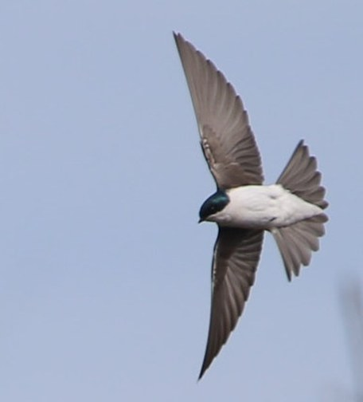
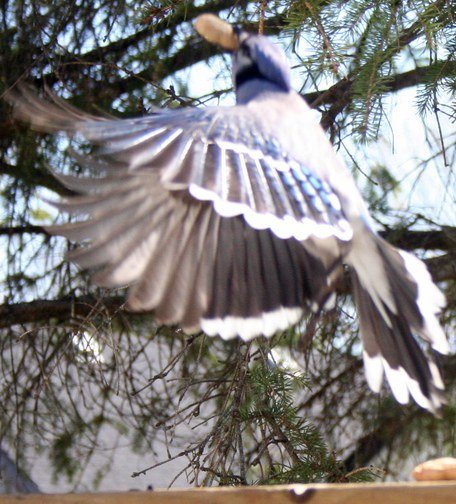

```{r}
#| echo: false
knitr::knit_hooks$set(small_mar = function(before, options, envir) {
  if (before) par(mar = c(3.4, 3.4, 0.6, 0.6), mgp = c(2.1, 0.6, 0))
})
knitr::opts_chunk$set(small_mar = TRUE)

library(bbmle)
library(biometrydata)

pct <- function(x){ paste0(round(100 * x), "%") }
f1 <- function(x){ sprintf("%.1f", x) }
f2 <- function(x){ sprintf("%.2f", x) }
f3 <- function(x){ sprintf("%.3f", x) }
big <- function(x){ format(round(x), big.mark = ",") }

songbirds <- avonet[avonet$Order1 == "Passeriformes", ]
birds <- data.frame(species = songbirds$Species1,
                    family = songbirds$Family1,
                    hwi = songbirds$Hand.Wing.Index,
                    lat = abs(songbirds$Centroid.Latitude),
                    migration_code = songbirds$Migration,
                    habitat_code = songbirds$Habitat.Density)
n_all <- nrow(birds)
birds <- na.omit(birds)

mig_levels <- c("sedentary", "partial", "migratory")
hwi_by_code <- tapply(birds$hwi, birds$migration_code, mean)
lat_by_code <- tapply(birds$lat, birds$migration_code, mean)
n_by_code <- table(birds$migration_code)

# regression, both ways
m_lat <- mle2(hwi ~ dnorm(mean = a + b * lat, sd = s),
              start = list(a = 15, b = 0, s = 5), data = birds)
lm_lat <- lm(hwi ~ lat, data = birds)
ci_lat <- confint(lm_lat)
r2_lat <- summary(lm_lat)$r.squared

# the factor trap
lm_num <- lm(hwi ~ migration_code, data = birds)
birds$migration <- factor(birds$migration_code, levels = 1:3, labels = mig_levels)
lm_mig <- lm(hwi ~ migration, data = birds)
aic_trap <- AIC(lm_num) - AIC(lm_mig)

# both
lm_add <- lm(hwi ~ lat + migration, data = birds)
lm_int <- lm(hwi ~ lat * migration, data = birds)
aic_all <- AIC(lm_lat, lm_mig, lm_add, lm_int)$AIC
names(aic_all) <- c("lat", "mig", "add", "int")
ci_add <- confint(lm_add)

# checking
res <- resid(lm_add)
fam_res <- sort(tapply(res, birds$family, mean), decreasing = TRUE)
skew <- function(x){ mean((x - mean(x))^3) / sd(x)^3 }
lm_log <- lm(log(hwi) ~ lat + migration, data = birds)

# intervals: the shortcut and the recipe
new_bird <- data.frame(lat = 45, migration = factor("migratory", levels = mig_levels))
p_conf <- predict(lm_add, newdata = new_bird, interval = "confidence")
p_pred <- predict(lm_add, newdata = new_bird, interval = "prediction")
set.seed(23)
draws <- MASS::mvrnorm(1000, mu = coef(lm_add), Sigma = vcov(lm_add))
mu_draws <- draws[, "(Intercept)"] + draws[, "lat"] * 45 + draws[, "migrationmigratory"]
recipe_conf <- quantile(mu_draws, c(0.025, 0.975))
recipe_pred <- quantile(rnorm(1000, mean = mu_draws, sd = sigma(lm_add)), c(0.025, 0.975))

# drawing the predictions, and checking them against the data
library(ggplot2)
grid <- expand.grid(lat = 0:70, migration = levels(birds$migration))
conf <- predict(lm_add, newdata = grid, interval = "confidence")
pred <- predict(lm_add, newdata = grid, interval = "prediction")
grid <- data.frame(grid, conf, pred_lwr = pred[, "lwr"], pred_upr = pred[, "upr"])
pi_data <- predict(lm_add, newdata = birds, interval = "prediction")
inside <- birds$hwi > pi_data[, "lwr"] & birds$hwi < pi_data[, "upr"]
above <- mean(birds$hwi[!inside] > pi_data[!inside, "upr"])
inside_by_group <- tapply(inside, birds$migration, mean)
pi_log <- exp(predict(lm_log, newdata = birds, interval = "prediction"))
inside_log <- birds$hwi > pi_log[, "lwr"] & birds$hwi < pi_log[, "upr"]
above_log <- mean(birds$hwi[!inside_log] > pi_log[!inside_log, "upr"])

# good enough? the log fit against the raw one
ci_log <- exp(confint(lm_log))
p_pred_log <- exp(predict(lm_log, newdata = new_bird, interval = "prediction"))
aic_log_gain <- AIC(lm_add) - (AIC(lm_log) + 2 * sum(log(birds$hwi)))  # log fit on the hwi scale
bc_lambda <- with(MASS::boxcox(lm_add, lambda = seq(-1, 1, 0.01), plotit = FALSE), x[which.max(y)])

# your turn
lm_hab_num <- lm(hwi ~ lat + migration + habitat_code, data = birds)
birds$habitat <- factor(birds$habitat_code, levels = 1:3,
                        labels = c("dense", "semi-open", "open"))
lm_hab_fac <- lm(hwi ~ lat + migration + habitat, data = birds)
aic_h <- AIC(lm_add, lm_hab_num, lm_hab_fac)$AIC
names(aic_h) <- c("add", "num", "fac")
ci_open <- confint(lm_hab_fac)["habitatopen", ]
lm_hab_int <- lm(hwi ~ lat + migration * habitat, data = birds)
lm_quad <- lm(hwi ~ lat + I(lat^2) + migration, data = birds)
```

## Today's agenda {.smaller}

1. Why use a built-in shortcut when `mle2()` already works
2. What makes a model a **general linear model**
3. One question, three classic analyses, one function:
    - **regression** (a continuous predictor)
    - **ANOVA** (a categorical predictor)
    - **ANCOVA** (both)
4. Checking the assumptions and intervals the quick way
5. Drawing the predictions, and checking them against the data
6. Your turn

. . .

[Type and run]{.type-badge} on a code block: type it into your script and run it.
Code without the label is there to watch.

::: {.notes}
Bolker 9.1 to 9.2. The point of the day: regression, ANOVA and ANCOVA are
usually taught as three different tests with three different tables. They are
one model, and students already know how to fit it by hand. lm() is a fast
special case of what they have been doing with mle2() for five weeks.
:::

## The story so far {.smaller}

- We build a model from parts: a **function** for the mean, a **distribution**
  for the scatter, then fit it by maximum likelihood with `mle2()`
- That works for **any** model we can write down
- **Today:** the most common special case has a fast, built-in shortcut, `lm()`

::: {.notes}
Thirty seconds.
:::

# Why a shortcut?

## Why use `lm()` at all? {.smaller}

`mle2()` can fit everything `lm()` can. Bolker's reasons to use `lm()` anyway:

| Reason | What it means |
|---|---|
| **fast and stable** | no starting values; it cannot get stuck the way `optim()` can |
| **convention** | "we used linear regression" needs no explaining in a paper |
| **easy to compare** | change the model by adding or removing one term: `y ~ x`, `y ~ z`, `y ~ x + z` |

. . .

The cost: it only fits **one shape** of model.

::: {.plain}
When your model is the standard one, use the standard tool. When it is not, you already know how to build your own.
:::

::: {.notes}
Bolker 9.1. The "cannot get stuck" claim is because lm() does not search at
all: for this kind of model the best parameters can be calculated directly, in
one step, by least squares. Lecture 20 was a whole class about optim()
getting stuck; that whole problem disappears.

"Easy to compare": in mle2(), adding a predictor means rewriting the mean,
naming a new parameter and giving it a starting value. In lm(), it means adding
"+ z" to the formula.

The fourth reason Bolker gives is "stable definitions": standard models are
parameterized in ways that make fitting easy. Fine to leave out.
:::

## What makes a model a "general linear model" {.smaller}

1. **Normal** scatter around the mean
2. The **same** amount of scatter everywhere (constant variance)
3. Each observation **independent** of the others
4. The mean is **linear in the parameters**

We have made the first three before, in any `mle2()` model with a normal
distribution and a single fitted `sd` shared by every observation. The fourth
is new.

::: {.notes}
Bolker also lists "no measurement error in the predictors". Worth a sentence:
the model treats x as known exactly.

Point at assumption 3 and hold on to it: it comes back at the end, when
species turn out not to be independent.
:::

## Linear in what? {.smaller}

"Linear" is about the **parameters**, not the shape of the line:

| Model for the mean | General linear model? |
|---|---|
| $a + b\,x$ | yes |
| $a + b\,x^2$ | yes: $x^2$ is just another column of data |
| $a + b\,\log(x)$ | yes, the same reason |
| $a\,x^b$ | **no**: the parameter $b$ is an exponent |

::: {.plain}
A general linear model multiplies each predictor by a parameter and adds them up; the predictors themselves can be curved.
:::

::: {.notes}
Ask the room about each row of the table before revealing it, if time allows;
otherwise reveal and talk through the last row.

The test: can you write the mean as a + b times (something you can calculate
from the data) + c times (something else)? Then it is linear in the
parameters, however curved the "something" is. In a x^b, b is inside the
power, so no amount of renaming makes it a column of data.
:::

## In practice: can `lm()` write it? {.smaller}

If you can write the model as an `lm()` formula, it is a general linear model,
and `lm()` will fit it.

| Model for the mean | `lm()` formula |
|------------------|------------------|
| $a + b\,x^2$ | `y ~ I(x^2)` |
| $a + b\,\log(x)$ | `y ~ log(x)` |
| $a + b\,x + c\,z + d\,x z$ | `y ~ x * z` |
| $a\,x^b$ | none |

. . .

**Stuck writing the formula?** Look for a parameter that is not simply
multiplying a term: in an exponent, inside `exp()`, or in a denominator. Then
the model is not linear, and `mle2()` is the tool.

::: {.notes}
Two minutes. The rule of thumb students will actually use: the formula is the
test. Every term in an lm() formula gets one parameter multiplying it, so if
the model can be written that way, it is linear in the parameters by
construction.

Common non-linear models from earlier lectures: the power law a x^b, the
Ricker a x e^(-bx), Michaelis-Menten a x / (b + x), logistic curves. All need
mle2() (or nls(), Bolker 9.3, for the normal-errors version).

A trick students will meet in papers: a x^b becomes linear after logging both
sides, log(y) = log(a) + b log(x), so lm(log(y) ~ log(x)) fits it. But that
also changes the assumed scatter (normal on the log scale, not on the original
one), which Bolker points out is a different model, not just a different way
of fitting the same one. Thursday's glm() offers another route for some of
these.
:::

# The question and the data

## Wings and migration {.smaller}

- The **hand-wing index** (HWI) measures how long and pointed a wing is:
  100 × (how far the longest flight feather reaches past the others) / (wing
  length)
- Long, pointed wings make long flights **cheaper**; short, rounded wings are
  better for quick takeoffs and **maneuvering** through cover
- **AVONET** has the HWI of every bird species, measured on museum specimens
  and live birds

. . .

**The question:** do migratory songbirds have more pointed wings? And does
latitude matter, once migration is accounted for?

**The prediction:** higher HWI in migrants, and higher at high latitudes, where
seasons are harsher.

::: {.notes}
The longest-feather distance is Kipp's distance: from the tip of the first
secondary feather to the tip of the longest primary. Dividing by wing length
makes it a shape, not a size.

Why biologists care: HWI is used as a stand-in for dispersal ability, which is
hard to measure directly, and dispersal shapes range sizes, how species respond
to habitat loss, and how they track climate change. Sheard et al. (2020,
Nature Communications) mapped HWI for nearly every bird species and found it
rises with latitude.

Songbirds only (Passeriformes) keeps the comparison among broadly similar
birds; the full dataset includes swifts and seabirds, which have extreme wings
for other reasons.
:::

## Two songbirds {.smaller}

:::: {.columns}
::: {.column width="49%"}
{height="380px"}

**Tree Swallow**: HWI 53.0, migratory. Long, narrow wings that taper to a
point.
:::

::: {.column width="49%"}
{height="380px"}

**Blue Jay**: HWI 17.4, mostly resident. Short, broad wings with rounded tips.
:::
::::

[Photos: Derald Grimwood, CC0 (left); Robert Taylor, [CC BY 2.0](https://creativecommons.org/licenses/by/2.0/) (right). Both cropped.]{style="font-size:0.45em; color:#777"}

::: {.notes}
One minute. The two ends of the wing-shape range among North American
songbirds. HWI values are from AVONET, the data we are about to load.

What to point at: on the swallow, the outer flight feathers (the primaries)
are much longer than the inner ones, so the wing comes to a point; that long
gap is what HWI measures (on the folded wing, as Kipp's distance). On the jay,
the feathers across the wing are much closer in length, so the tip is broad and
rounded.

Pointed wings are efficient for long, fast flight; rounded wings give lift and
maneuverability for short flights through cover. Tree Swallows also catch
insects on the wing, which pushes them further toward pointed wings, and they
come back later today: swallows are the long tail in the residuals.

AVONET codes Blue Jays as sedentary; some northern populations do move south
in fall, hence "mostly resident" on the slide.
:::

## Get set up {background-color="#f0f4f8" .smaller}

::: {.type-it}
```{r}
#| eval: false
library(bbmle)
library(biometrydata)

songbirds <- avonet[avonet$Order1 == "Passeriformes", ]
birds <- data.frame(species = songbirds$Species1,
                    family = songbirds$Family1,
                    hwi = songbirds$Hand.Wing.Index,
                    lat = abs(songbirds$Centroid.Latitude),   # degrees from the equator
                    migration_code = songbirds$Migration,     # 1, 2 or 3
                    habitat_code = songbirds$Habitat.Density) # 1, 2 or 3
birds <- na.omit(birds)
```
:::

**Check:** `r big(nrow(birds))` species, down from `r big(n_all)`.

::: {.notes}
Two minutes. abs() on the latitude because the question is about distance
from the equator, north or south.

Migration codes, from the AVONET documentation: 1 sedentary, 2 partial
migrant (some populations migrate), 3 migratory. Habitat density: 1 dense
(forest), 2 semi-open, 3 open. Both are numbers standing for categories, which
matters in about twenty minutes.
:::

## What the data look like {.smaller}

```{r}
#| echo: false
#| fig-height: 3.3
#| fig-width: 9
par(mfrow = c(1, 2), mar = c(3.6, 3.6, 0.6, 0.6), mgp = c(2.3, 0.6, 0))
cols <- c("grey55", "#d9a400", "#2a7ab0")
boxplot(hwi ~ migration_code, data = birds, names = mig_levels, xlab = "",
        ylab = "hand-wing index", col = "#cfe2f0", outcol = "grey40", cex.axis = 0.9)
plot(birds$lat, birds$hwi, pch = 16, cex = 0.45,
     col = adjustcolor(cols[birds$migration_code], 0.5),
     xlab = "degrees from the equator", ylab = "hand-wing index", bty = "l")
legend("topright", legend = mig_levels, col = cols, pch = 16, bty = "n", cex = 0.8)
```

Migrants: HWI `r f1(hwi_by_code[3])` against `r f1(hwi_by_code[1])`. But they
also live farther from the equator: `r round(lat_by_code[3])`° against
`r round(lat_by_code[1])`°.

::: {.notes}
Say the second sentence slowly: it is the whole plot of today. Migration and
latitude go together, so a model with only one of them will give it credit for
both. Same lesson as depth and substrate in last Thursday's sponges.

Counts: `r big(n_by_code[1])` sedentary, `r big(n_by_code[2])` partial,
`r big(n_by_code[3])` migratory.
:::

# Regression: a continuous predictor

## The same model, two ways {background-color="#f0f4f8" .smaller}

::: {.type-it}
```{r}
#| eval: false
# names: m_ for mle2() fits, lm_ for lm() fits

# the way we know: write the mean and the distribution
m_lat <- mle2(hwi ~ dnorm(mean = a + b * lat, sd = s),
              start = list(a = 15, b = 0, s = 5), data = birds)

# the shortcut
lm_lat <- lm(hwi ~ lat, data = birds)

coef(m_lat)
coef(lm_lat)
c(logLik(m_lat), logLik(lm_lat))
```
:::

**Check:** both give intercept `r f2(coef(lm_lat)[1])`, slope `r f3(coef(lm_lat)[2])`,
and log-likelihood `r big(logLik(lm_lat))`.

::: {.plain}
lm() is maximum likelihood with a normal distribution; it just gets there by a faster route.
:::

::: {.notes}
Three minutes. The key slide of the day. Same estimates to the third decimal,
same log-likelihood. "Least squares", which students may have heard of, gives
exactly the maximum-likelihood answer whenever the scatter is normal with
constant variance: minimizing the squared distances and maximizing the normal
likelihood are the same calculation.

The tiny differences in later decimals are mle2's optimizer stopping a hair
short; lm() solves it exactly.
:::

## What `lm()` does for you {.smaller}

| | `mle2()` | `lm()` |
|--------|------------------|----------------------|
| intercept | you write `a` | included automatically (`- 1` removes it) |
| slope | you write `b * lat` | `lat` means "a slope for `lat`" |
| scatter | you write `dnorm(..., sd = s)` | always normal, `sd` fitted for you |
| starting values | you choose them | none needed |

. . .

The formula `hwi ~ lat` is a **shorthand** for $\text{hwi} \sim \text{Normal}(a + b\,\text{lat},\ \sigma)$.

::: {.notes}
The shorthand is the thing to internalize: every term on the right of the
tilde gets its own parameter, and the intercept comes free. Everything else
today is new terms on the right.
:::

## Reading the fit {background-color="#f0f4f8" .smaller}

::: {.type-it}
```{r}
#| eval: false
summary(lm_lat)       # estimates, standard errors, R-squared
confint(lm_lat)       # 95% confidence intervals
sigma(lm_lat)         # the fitted sd of the scatter: s in the mle2 version
```
:::

**Check:** HWI rises by `r f3(ci_lat[2, 1])` to `r f3(ci_lat[2, 2])` per degree
of latitude. $R^2$ is `r f2(r2_lat)`: latitude explains `r pct(r2_lat)` of the
variation.

::: {.notes}
Three minutes. confint() works on lm() fits exactly as on mle2() fits; for
lm() it is exact rather than an approximation.

sigma(lm_lat) is `r f2(sigma(lm_lat))`; mle2's s was `r f2(coef(m_lat)["s"])`.
The small difference is deliberate: lm() divides by n minus the number of
parameters instead of n, which corrects a slight underestimate. With 6,000
species it hardly matters; with 10 it would.

R-squared: the fraction of the variation in HWI that the model accounts for.
Low here, and that is normal for a comparison across thousands of species:
the slope is very clearly real, but latitude is far from the only thing that
shapes wings.
:::

# ANOVA: a categorical predictor

## The number trap {background-color="#f0f4f8" .smaller}

::: {.type-it}
```{r}
#| eval: false
lm_num <- lm(hwi ~ migration_code, data = birds)   # codes 1, 2, 3 as numbers
coef(lm_num)

# tell R the codes are categories
birds$migration <- factor(birds$migration_code, levels = 1:3,
                          labels = c("sedentary", "partial", "migratory"))
lm_mig <- lm(hwi ~ migration, data = birds)
coef(lm_mig)
AIC(lm_num, lm_mig)
```
:::

**Check:** `lm_num` has one slope, `r f2(coef(lm_num)[2])` per code. `lm_mig` is
better by `r f1(aic_trap)` AIC units.

::: {.notes}
Four minutes. Bolker's warning, made real. Codes that look like numbers get
treated as numbers: lm_num fits a straight line through 1, 2 and 3, which
assumes partial migrants sit exactly halfway between sedentary and migratory
birds. Nothing about the biology says so, and the data disagree.

factor() turns the codes into categories, and each category gets its own
mean. Site numbers, plot numbers, years used as groups, treatment codes: any
of these will fall into the same trap. Always check with str() or class().
:::

## What the coefficients mean {.smaller}

| `coef(lm_mig)` | value | means |
|---|---|---|
| `(Intercept)` | `r f1(coef(lm_mig)[1])` | mean HWI of **sedentary** birds, the first level |
| `migrationpartial` | `r f1(coef(lm_mig)[2])` | partial migrants **minus** sedentary |
| `migrationmigratory` | `r f1(coef(lm_mig)[3])` | migrants **minus** sedentary |

. . .

`lm(hwi ~ migration - 1)` gives the three **means** instead:
`r f1(hwi_by_code[1])`, `r f1(hwi_by_code[2])`, `r f1(hwi_by_code[3])`. Same model, same fit.

::: {.plain}
By default R reports the first group, then how far each other group is from it; minus 1 reports each group's own mean.
:::

::: {.notes}
Three minutes. This is the most common confusion in reading lm() output, so
worth the slide. The default is useful when the first group is a control:
each coefficient is then directly "how different from the control".

This is the same choice as last Thursday's parameters = list(log_d ~ substrate - 1)
in mle2: the - 1 there gave each substrate its own density.

An ANOVA is exactly this model: a mean for each group, normal scatter around
it. anova(lm_mig) gives the classic ANOVA table, if a reviewer asks for one.
:::

# ANCOVA: both

## Latitude and migration together {background-color="#f0f4f8" .smaller}

::: {.type-it}
```{r}
#| eval: false
lm_add <- lm(hwi ~ lat + migration, data = birds)   # one slope, three intercepts
lm_int <- lm(hwi ~ lat * migration, data = birds)   # each group its own slope

AICtab(lm_lat, lm_mig, lm_add, lm_int)
coef(lm_add)
```
:::

**Check:** `lm_add` is best; separate slopes (`lm_int`) are
`r f1(aic_all["int"] - aic_all["add"])` units worse.

::: {.notes}
Three minutes. AICtab() works on lm() fits, because they have a
log-likelihood like any other. That is the payoff of the slide two back.

The + and * are the whole difference between an ANCOVA with parallel lines and
one with separate slopes. lat * migration is shorthand for lat + migration +
lat:migration, where lat:migration is the extra slope for each group.
:::

## Parallel lines {.smaller}

```{r}
#| echo: false
#| fig-height: 3.0
#| fig-width: 8
par(mar = c(3.6, 3.6, 0.6, 0.6), mgp = c(2.3, 0.6, 0))
plot(birds$lat, birds$hwi, pch = 16, cex = 0.4,
     col = adjustcolor(cols[birds$migration_code], 0.3),
     xlab = "degrees from the equator", ylab = "hand-wing index", bty = "l")
for (g in 1:3) {
  xr <- range(birds$lat[birds$migration_code == g])
  xs <- seq(xr[1], xr[2], length.out = 50)
  nd <- data.frame(lat = xs, migration = factor(mig_levels[g], levels = mig_levels))
  lines(xs, predict(lm_add, newdata = nd), col = cols[g], lwd = 3)
}
legend("topright", legend = mig_levels, col = cols, lwd = 3, bty = "n", cex = 0.8)
```

| Formula | Shape |
|--------------|----------------------|
| `hwi ~ lat + migration` | **parallel** lines: one slope, a height per group |
| `hwi ~ lat * migration` | a separate slope for each group |

::: {.notes}
Each line is drawn only across the latitudes where that group occurs.

The biology: at any latitude, migrants have wings about
`r f1(coef(lm_add)["migrationmigratory"])` HWI points more pointed than
sedentary birds, and the latitude effect is the same for all three groups
(separate slopes did not help).
:::

## Why did the latitude slope shrink? {.smaller}

| Model | HWI per degree of latitude |
|---|---|
| `hwi ~ lat` | `r f3(coef(lm_lat)["lat"])` |
| `hwi ~ lat + migration` | `r f3(coef(lm_add)["lat"])` (`r f3(ci_add["lat", 1])` to `r f3(ci_add["lat", 2])`) |

. . .

Migrants live far from the equator. Alone, latitude got the credit for
**migration too**.

::: {.plain}
When two predictors go together, a model with only one of them gives it credit for both.
:::

::: {.notes}
Two minutes. The slope shrank by about `r pct(1 - coef(lm_add)["lat"] / coef(lm_lat)["lat"])`,
but did not vanish: among birds with the same migratory behavior, wings are
still more pointed farther from the equator. Last Thursday it was depth and
substrate; the lesson is the same, and it is the main reason to put more than
one predictor in a model.

Which one "really" matters cannot be settled by this model alone; that would
take knowing why migrants live where they do.
:::

# Checking and using the fit

## Are the assumptions met? {background-color="#f0f4f8" .smaller}

::: {.type-it}
```{r}
#| eval: false
plot(lm_add, which = 2)   # normal Q-Q: are the residuals normal?
plot(lm_add, which = 1)   # residuals against fitted: is the scatter even?
```
:::

```{r}
#| echo: false
#| fig-height: 2.7
#| fig-width: 8
par(mfrow = c(1, 2), mar = c(3.4, 3.4, 0.6, 0.6), mgp = c(2.1, 0.6, 0))
plot(lm_add, which = 2, sub.caption = "", caption = "", pch = 16, cex = 0.4, id.n = 0)
plot(lm_add, which = 1, sub.caption = "", caption = "", pch = 16, cex = 0.4, id.n = 0)
```

**Check:** the points bend up at the right of the Q-Q plot: a long upper tail.

::: {.notes}
Three minutes. Residual: each species' HWI minus what the model predicts for
it. The Q-Q plot puts the residuals against what normal residuals would look
like; a straight line means normal.

Who is in the tail: swallows (Hirundinidae), whose wings are on average
`r f1(fam_res["Hirundinidae"])` points more pointed than the model predicts.
They feed on the wing, so it is no surprise.

What to do about it: model log(hwi) instead (the skew drops from
`r f1(skew(res))` to `r f1(skew(resid(lm_log)))`), or use a distribution with a
long right tail, which is this Thursday's generalized linear models. The estimates
here are still useful: the tail affects the intervals more than the slopes.

And assumption 3, independence: species are not independent, because related
species inherit similar wings. Comparative biologists use phylogenetic
regression for this; it is beyond this course, but worth naming as the main
limitation of this analysis.
:::

## Intervals, the quick way {background-color="#f0f4f8" .smaller}

::: {.type-it}
```{r}
#| eval: false
# a migratory songbird, 45 degrees from the equator
new_bird <- data.frame(lat = 45,
                       migration = factor("migratory", levels = levels(birds$migration)))

predict(lm_add, newdata = new_bird, interval = "confidence")   # the average bird
predict(lm_add, newdata = new_bird, interval = "prediction")   # one new species
```
:::

**Check:** confidence `r f1(p_conf[, "lwr"])` to `r f1(p_conf[, "upr"])`;
prediction `r f1(p_pred[, "lwr"])` to `r f1(p_pred[, "upr"])`.

Lecture 21's recipe gives the same: `r f1(recipe_conf[1])` to
`r f1(recipe_conf[2])`, and `r f1(recipe_pred[1])` to `r f1(recipe_pred[2])`.

::: {.notes}
Three minutes. This is the shortcut promised at the end of Lecture 21. The
recipe numbers on the slide come from drawing 1,000 parameter sets with
mvrnorm(), computing the mean for each, and (for the prediction interval)
adding normal scatter with sd = sigma(lm_add): exactly Lecture 21's code.

Which to use is Lecture 21's vote: the average migratory bird at 45 degrees
is pinned down to about a point; a newly described species there could have
almost any wing from short to long.

Also: the grey ribbon that geom_smooth(method = "lm") draws around a line is
a confidence band, not a prediction band. It shows where the average is, not
where the points will fall.

The shortcut only exists for lm(). For glm() it is partly there (this Thursday),
and for mle2() there is only the recipe.
:::

## Drawing the predictions {background-color="#f0f4f8" .smaller}

::: {.type-it}
```{r}
#| eval: false
library(ggplot2)

# the birds to predict for: every latitude from 0 to 70, in each migration group
grid <- expand.grid(lat = 0:70, migration = levels(birds$migration))
conf <- predict(lm_add, newdata = grid, interval = "confidence")
pred <- predict(lm_add, newdata = grid, interval = "prediction")
grid <- data.frame(grid, conf, pred_lwr = pred[, "lwr"], pred_upr = pred[, "upr"])

ggplot(grid, aes(x = lat)) +
  geom_point(data = birds, aes(y = hwi), size = 0.3, alpha = 0.2) +
  geom_ribbon(aes(ymin = pred_lwr, ymax = pred_upr), fill = "#2a7ab0", alpha = 0.2) +
  geom_ribbon(aes(ymin = lwr, ymax = upr), fill = "#2a7ab0", alpha = 0.6) +
  geom_line(aes(y = fit)) +
  facet_wrap(~ migration) +
  labs(x = "degrees from the equator", y = "hand-wing index")
```
:::

**Check:** `grid` has `r nrow(grid)` rows (71 latitudes × 3 groups) and the
columns `fit`, `lwr`, `upr`, `pred_lwr`, `pred_upr`.

::: {.notes}
Four minutes. The same two predict() lines as the last slide, but for 213
made-up birds instead of one. Why a grid and not the data: the grid is evenly
spaced, so the line and ribbons come out smooth, and it covers every
latitude in every group.

data.frame(grid, conf, ...) works because conf is a matrix with columns fit,
lwr and upr; they become columns of grid.

Why each layer: the points are the data, so we can see whether the model goes
through them. The pale ribbon is the prediction band (where new species
should fall), the dark one the confidence band (where the average is). The
points come from birds, the rest from grid: each layer can use its own data.

facet_wrap() splits the plot by migration group, because 6,583 points on one
panel bury the lines. birds has a migration column too, so the points split
the same way.

Compare Lecture 22, where the band took a for-loop over 1,000 draws: with lm()
it is two lines.
:::

## Does the model match the data? {.smaller}

```{r}
#| echo: false
#| fig-height: 2.8
#| fig-width: 7.5
ggplot(grid, aes(x = lat)) +
  geom_point(data = birds, aes(y = hwi), size = 0.3, alpha = 0.2) +
  geom_ribbon(aes(ymin = pred_lwr, ymax = pred_upr), fill = "#2a7ab0", alpha = 0.2) +
  geom_ribbon(aes(ymin = lwr, ymax = upr), fill = "#2a7ab0", alpha = 0.6) +
  geom_line(aes(y = fit)) +
  facet_wrap(~ migration) +
  labs(x = "degrees from the equator", y = "hand-wing index")
```

**Think:** does the line run through the middle of the points? About 95% of
species should fall in the pale band. Are the misses split evenly above and below?

. . .

**Check:** `r pct(mean(inside))` fall inside. But `r pct(above)` of the misses
are **above** the band: the long upper tail from the Q-Q plot.

::: {.plain}
Look at where the model misses, not only how often.
:::

::: {.notes}
Three minutes. This is model checking by eye, and it is often where problems
show up first: a line that misses the middle of the points, a band too narrow
or too wide, or misses all on one side.

The numbers, for anyone who asks (the code is in the solutions):
pi_data <- predict(lm_add, newdata = birds, interval = "prediction"), then
the share of species with hwi between lwr and upr. `r pct(mean(inside))` inside
looks fine, but `r sum(!inside)` misses with `r pct(above)` above means the band
is symmetric and the data are not. By group: `r pct(inside_by_group[1])`
sedentary, `r pct(inside_by_group[2])` partial, `r pct(inside_by_group[3])`
migratory.

The log model (next slide) gets `r pct(mean(inside_log))`
inside, with `r pct(above_log)` of its misses above: it corrects the skew, and
overshoots a little. Thursday's generalized linear models are the other fix.

Why this matters beyond this example: a reviewer or a manager will look at the
figure, not the AIC table. If the band does not hold the points, the model is
not describing the data, however good its AIC looks against the alternatives.
:::

## Good enough? {background-color="#f0f4f8" .smaller}

The fix for a long upper tail: model `log(hwi)`. Does the answer change?

::: {.type-it}
```{r}
#| eval: false
lm_log <- lm(log(hwi) ~ lat + migration, data = birds)
exp(confint(lm_log))   # back on the HWI scale: each effect is now "times"
exp(predict(lm_log, newdata = new_bird, interval = "prediction"))
```
:::

| | `hwi ~ ...` | `log(hwi) ~ ...` |
|---|---|---|
| migrants vs sedentary | `r f1(ci_add["migrationmigratory", 1])` to `r f1(ci_add["migrationmigratory", 2])` points more | `r f2(ci_log["migrationmigratory", 1])` to `r f2(ci_log["migrationmigratory", 2])` times |
| latitude | slope above zero | slope above zero |
| one new migrant at 45° | `r f1(p_pred[, "lwr"])` to `r f1(p_pred[, "upr"])` | `r f1(p_pred_log[, "lwr"])` to `r f1(p_pred_log[, "upr"])` |

. . .

The effects hold up; the prediction for one new species does not.

::: {.plain}
"Good enough" depends on the question: refit with the fix and see whether your answer changes.
:::

::: {.notes}
Four minutes. Students will ask whether the fit is good enough after the last
two slides; this is the answer. Normality is never exactly met, so the useful
question is whether the problem changes the conclusion we care about.

Why log: HWI is a ratio and cannot go below zero, and logs pull in a long right
tail. Effects become multiplicative: migrants have wings about
`r f2(exp(coef(lm_log)["migrationmigratory"]))` times as pointed, i.e. about
`r pct(exp(coef(lm_log)["migrationmigratory"]) - 1)` more. exp() of a predicted
log is the median wing, not the mean.

What changes and what does not. The migration and latitude effects point the
same way, and are about the same size: at the average sedentary HWI of
`r f1(hwi_by_code[1])`, `r pct(exp(coef(lm_log)["migrationmigratory"]) - 1)` more
is about `r f1(hwi_by_code[1] * (exp(coef(lm_log)["migrationmigratory"]) - 1))`
points, against `r f1(coef(lm_add)["migrationmigratory"])` from the raw model. The prediction interval
is where it matters: the raw model's band is symmetric and stops at
`r f1(p_pred[, "upr"])`; the log model's reaches `r f1(p_pred_log[, "upr"])`,
which is where swallows actually are.

Which fits better: AIC(lm_add) and AIC(lm_log) cannot be compared directly,
because one is a likelihood for hwi and the other for log(hwi). Putting the log
model back on the hwi scale (add 2 * sum(log(hwi)) to its AIC) makes the log
model better by `r big(aic_log_gain)` units. If a student asks about Box-Cox:
MASS::boxcox(lm_add) puts the best power at `r f2(bc_lambda)`, between a
square root and a log. Log is close enough, and much easier to interpret.

Why not use log from the start: the additive version is easier to read on a
first day with lm(), and finding the problem is the lesson. Thursday's glm()
handles a skewed response without transforming it, which is the other route.
:::

# Your turn

## Your turn: habitat {background-color="#f0f4f8" .smaller}

Pointed wings may also suit **open** country, where birds fly farther and need
less maneuvering than in forest. `habitat_code`: 1 dense, 2 semi-open, 3 open.

::: {.type-it}
```{r}
#| eval: false
lm_hab_num <- lm(hwi ~ lat + migration + habitat_code, data = birds)

# make habitat a factor here, with labels dense, semi-open and open
# (hint: the number trap slide)

# lm_hab_fac goes here: lm_add plus habitat as a factor

# compare lm_add, lm_hab_num and lm_hab_fac here
```
:::

**Before you fit:** predict which wins. **Check:** `lm_hab_fac` is best, by
`r f1(aic_h["num"] - aic_h["fac"])` over `lm_hab_num`; open-country songbirds have
wings `r f1(ci_open[1])` to `r f1(ci_open[2])` points more pointed than forest
birds.

::: {.notes}
Ten minutes, in pairs. The trap again, on purpose: habitat_code is 1, 2, 3,
and lm_hab_num treats it as a number. The factor version should win, and
confint(lm_hab_fac) gives the open-habitat interval.

Semi-open birds differ from forest birds by only
`r f1(coef(lm_hab_fac)["habitatsemi-open"])` points, open-country birds by
`r f1(coef(lm_hab_fac)["habitatopen"])`: not evenly spaced, which is exactly what
the numeric version assumes.

For anyone fast:

- does the habitat effect depend on migration? (migration * habitat; it does,
  by `r f1(AIC(lm_hab_fac) - AIC(lm_hab_int))` AIC units)
- is the latitude effect curved? (add I(lat^2); it is, by
  `r f1(AIC(lm_add) - AIC(lm_quad))` units: flat in the tropics, rising beyond)
:::

# Wrapping up

## Which formula, when {.smaller}

| You want | Formula | Classic name |
|---|---|---|
| a slope | `y ~ x` | regression |
| a mean for each group | `y ~ f`, or `y ~ f - 1` | one-way ANOVA |
| two sets of groups | `y ~ f1 + f2`, or `y ~ f1 * f2` | two-way ANOVA |
| parallel lines | `y ~ x + f` | ANCOVA |
| a slope for each group | `y ~ x * f` | ANCOVA, with interaction |
| a curve, still linear | `y ~ x + I(x^2)` | polynomial regression |
| not normal, or not linear | `mle2()`, or Thursday's `glm()` | |

Group codes stored as numbers: `factor()` first.

::: {.notes}
The slide to photograph. Every row is the same model, normal scatter around a
mean that is linear in the parameters; only the right-hand side changes.

I() means "as is": inside a formula, ^ has a special meaning (crossing terms),
so I(x^2) tells R to square x arithmetically.
:::

## Before next class

Read Bolker **9.3 to 9.4**

Thursday: **generalized linear models** (`glm()`), and **Assignment 4**

::: {.notes}
Generalized linear models relax assumption 1: the scatter can be Poisson,
binomial or another distribution, which handles counts, yes/no data, and long
tails like the swallows'.
:::
