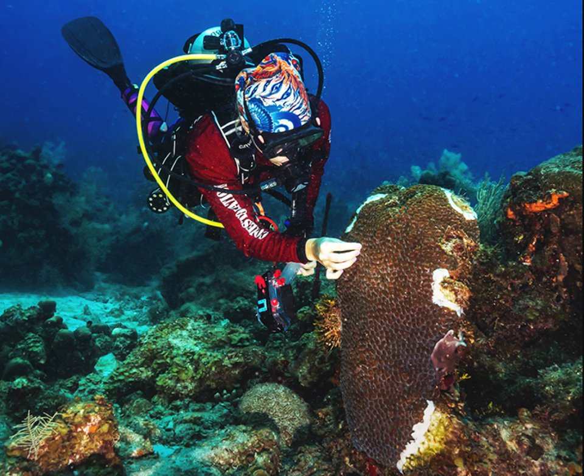

```{r}
#| echo: false
knitr::knit_hooks$set(small_mar = function(before, options, envir) {
  if (before) par(mar = c(3.4, 3.4, 0.6, 0.6), mgp = c(2.1, 0.6, 0))
})
knitr::opts_chunk$set(small_mar = TRUE)

library(bbmle)
library(biometrydata)
library(ggplot2)

pct <- function(x){ paste0(round(100 * x), "%") }
pct1 <- function(x){ paste0(sprintf("%.1f", 100 * x), "%") }
f1 <- function(x){ sprintf("%.1f", x) }
f2 <- function(x){ sprintf("%.2f", x) }
f3 <- function(x){ sprintf("%.3f", x) }
big <- function(x){ format(round(x), big.mark = ",") }

# --- bobwhite occupancy: glm against Lecture 16's mle2 -----------------------
occ <- bobwhite_occupancy
m_occ <- mle2(n_occupied ~ dbinom(size = n_routes, prob = plogis(a + b * elapsed)),
              start = list(a = 2, b = -0.05), data = occ)
g_occ <- glm(cbind(n_occupied, n_routes - n_occupied) ~ elapsed,
             family = binomial, data = occ)
trap <- predict(g_occ, newdata = data.frame(elapsed = c(0, 22)), interval = "confidence")
p19 <- predict(g_occ, newdata = data.frame(elapsed = 22), type = "link", se.fit = TRUE)
ends19 <- p19$fit + c(-1.96, 0, 1.96) * p19$se.fit
band19 <- plogis(ends19)
set.seed(21)                                  # Lecture 21's seed and draws
draws <- MASS::mvrnorm(1000, mu = coef(m_occ), Sigma = vcov(m_occ))
recipe19 <- quantile(plogis(draws[, "a"] + 22 * draws[, "b"]), c(0.025, 0.975))
library(marginaleffects)
library(emmeans)
me19 <- predictions(g_occ, newdata = data.frame(elapsed = 22))

# --- songbirds: which ones migrate? -------------------------------------------
songbirds <- avonet[avonet$Order1 == "Passeriformes", ]
birds <- data.frame(species = songbirds$Species1,
                    hwi = songbirds$Hand.Wing.Index,
                    lat = abs(songbirds$Centroid.Latitude),
                    migratory = as.numeric(songbirds$Migration == 3),
                    mass = songbirds$Mass,
                    wing = songbirds$Wing.Length)
birds <- na.omit(birds)
l_mig <- lm(migratory ~ lat, data = birds)
g_lat <- glm(migratory ~ lat, family = binomial, data = birds)
g_add <- glm(migratory ~ lat + hwi, family = binomial, data = birds)
g_int <- glm(migratory ~ lat * hwi, family = binomial, data = birds)
aic_mig <- AIC(g_lat) - AIC(g_add)
or_lat <- exp(coef(g_add)["lat"])
or_hwi <- exp(coef(g_add)["hwi"])
ci_or <- exp(confint.default(g_add))
p45 <- predict(g_add, newdata = data.frame(lat = 45, hwi = c(15, 30)), type = "response")

grid <- expand.grid(lat = 0:70, hwi = c(15, 30))
p <- predict(g_add, newdata = grid, type = "link", se.fit = TRUE)
grid$prob <- plogis(p$fit)
grid$lwr <- plogis(p$fit - 1.96 * p$se.fit)
grid$upr <- plogis(p$fit + 1.96 * p$se.fit)

# observed share migratory in 10-degree bands, against the model's average
birds$band <- cut(birds$lat, seq(0, 80, 10), include.lowest = TRUE)
obs_band <- tapply(birds$migratory, birds$band, mean)
fit_band <- tapply(fitted(g_add), birds$band, mean)

# --- reef fish richness: counts ----------------------------------------------
reef <- reef_surveys
g_pois <- glm(richness ~ depth + I(depth^2), family = poisson, data = reef)
disp <- deviance(g_pois) / df.residual(g_pois)
g_nb <- MASS::glm.nb(richness ~ depth + I(depth^2), data = reef)
se_p <- summary(g_pois)$coefficients[, 2]
se_nb <- summary(g_nb)$coefficients[, 2]
aic_nb <- AIC(g_pois) - AIC(g_nb)
# where 95% of surveys should fall, under each model
lo_p <- qpois(0.025, fitted(g_pois)); hi_p <- qpois(0.975, fitted(g_pois))
lo_n <- qnbinom(0.025, mu = fitted(g_nb), size = g_nb$theta)
hi_n <- qnbinom(0.975, mu = fitted(g_nb), size = g_nb$theta)
in_p <- mean(reef$richness >= lo_p & reef$richness <= hi_p)
above_p <- mean(reef$richness > hi_p)
below_p <- mean(reef$richness < lo_p)
in_n <- mean(reef$richness >= lo_n & reef$richness <= hi_n)
peak_nb <- -coef(g_nb)["depth"] / (2 * coef(g_nb)["I(depth^2)"])

# --- nls: wing allometry -----------------------------------------------------
start_ll <- coef(lm(log(wing) ~ log(mass), data = birds))
n_wing <- nls(wing ~ a * mass^b, data = birds,
              start = list(a = exp(start_ll[[1]]), b = start_ll[[2]]))
ci_wing <- confint.default(n_wing)
m_wing <- mle2(wing ~ dnorm(mean = a * mass^b, sd = s), data = birds,
               start = list(a = exp(start_ll[[1]]), b = start_ll[[2]], s = 10))

# --- your turn: coral disease at the Dry Tortugas -----------------------------
corals <- coral_cover[coral_cover$REGION == "Tortugas", ]
corals$station <- paste(corals$PRIMARY_SAMPLE_UNIT, corals$STATION_NR, corals$YEAR)
stations <- unique(corals[, c("station", "YEAR")])
susceptible <- "Colpophyllia|Dendrogyra|Dichocoenia|Diploria|Eusmilia|Meandrina"
found_at <- corals$station[grepl(susceptible, corals$COVER_CAT_NAME)]
stations$found <- as.numeric(stations$station %in% found_at)
stations$year <- factor(stations$YEAR)
g_null <- glm(found ~ 1, family = binomial, data = stations)
g_year <- glm(found ~ year, family = binomial, data = stations)
aic_coral <- AIC(g_null) - AIC(g_year)
yrs <- data.frame(year = factor(levels(stations$year), levels = levels(stations$year)))
pc <- predict(g_year, newdata = yrs, type = "link", se.fit = TRUE)
yrs$prob <- plogis(pc$fit)
yrs$lwr <- plogis(pc$fit - 1.96 * pc$se.fit)
yrs$upr <- plogis(pc$fit + 1.96 * pc$se.fit)
others <- corals$station[grepl("Siderastrea|Montastraea|Porites", corals$COVER_CAT_NAME)]
stations$other <- as.numeric(stations$station %in% others)
other_by_year <- tapply(stations$other, stations$year, mean)
```

## Today's agenda {.smaller}

1. **Assignment 4**
2. From `lm()` to `glm()`: what changes
3. Intervals for a GLM, the quick way
4. Yes/no data: which songbirds migrate?
5. Counts: reef fish, and too much scatter
6. Curves with normal scatter: `nls()`
7. Your turn: a coral disease reaches the Dry Tortugas

. . .

[Type and run]{.type-badge} on a code block: type it into your script and run it.
Code without the label is there to watch.

::: {.notes}
Bolker 9.3 to 9.4. The point of the day: glm() is the same move as Tuesday's
lm(), a built-in shortcut for a model students already know how to write by
hand, this time for counts and yes/no data. They wrote their first GLM by
hand in Lecture 16 without knowing it.
:::

## The story so far {.smaller}

- `mle2()`: write any mean and any distribution, and fit by likelihood
- Tuesday: `lm()`, the shortcut when the scatter is normal and the mean is linear
- **Today:** `glm()`, the shortcut for **yes/no data** and **counts**

::: {.notes}
Thirty seconds.
:::

# Assignment 4

## Assignment 4: GLMs {.smaller}

Your focal dataset again, now with chapter 9's tools: `lm()`, `glm()`, and their
relatives.

1. Pick one or more **biological questions** your data can answer
2. Fit **at least three candidate models** for each
3. For **each model**, say:
    - why this distribution and this form (why binomial? why a log link?)
    - why these predictors
    - what it means biologically ("*y* depends on *x*, with an intercept for
      each *group*")
4. Say which model(s) you would keep, and **why**
5. **Check** the one you keep against the data: residuals, its predictions
   with a band, or (for counts) how many fall inside its 95% range

Reusing Assignment 3's models is fine, but try **new** ones too. **Due Friday,
November 20.**

::: {.notes}
Three minutes, then questions. Grading: model documentation and rationale 40%,
biological interpretation 40%, reproducibility 20%. Same submission rules as
before: grads link a GitHub repository (or lose 10%), undergrads may upload the
file and get 10% extra for GitHub.

The assignment also asks them to interpret glm() effects on the original scale
(undo the link), which the "Coefficients are on the link scale" slide shows;
point back to it then.

Today's songbird, reef and coral examples are each a model of what a good
submission looks like: a question, a distribution chosen for the data, a few
candidate models, and a sentence of biology for each coefficient.

The full assignment page is linked from Canvas.
:::

# From `lm()` to `glm()`

## What a GLM changes {.smaller}

| Part | `lm()` | `glm()` |
|---|---|---|
| distribution | normal | binomial, Poisson, normal, Gamma, ... (`family =`) |
| the mean | linear in the parameters | linear **after a transformation**, the **link** |
| link | none | logit for binomial, log for Poisson |

. . .

::: {.plain}
A GLM is a linear model for a transformed mean, with a non-normal distribution around the mean.
:::

::: {.notes}
Two minutes. Bolker 9.4. The link is the function that turns the mean into
something that can be any number: the logit turns a probability (0 to 1) into
any number, the log turns a count's mean (above 0) into any number. The model
is linear on that scale.

Students have used both links by hand for weeks: plogis(a + b * x) undoes a
logit link, exp(a + b * x) undoes a log link. Lecture 16's "keeping parameters
legal" was exactly this.

The distributions glm() knows are the "exponential family" (see ?family). The
negative binomial is not one of them, which is why it has its own function,
MASS::glm.nb(), later today.

Name trap: "general" linear model (Tuesday, lm) and "generalized" linear model
(today, glm). Bolker warns about it too.
:::

## You've already fit one {background-color="#f0f4f8" .smaller}

::: {.type-it}
```{r}
#| eval: false
library(bbmle)
library(biometrydata)
occ <- bobwhite_occupancy

# names: m_ for mle2() fits, g_ for glm() fits
# Lecture 16's model, by hand
m_occ <- mle2(n_occupied ~ dbinom(size = n_routes, prob = plogis(a + b * elapsed)),
              start = list(a = 2, b = -0.05), data = occ)

# the same model: cbind(successes, failures) on the left, the predictors on the right
g_occ <- glm(cbind(n_occupied, n_routes - n_occupied) ~ elapsed,
             family = binomial, data = occ)

coef(m_occ)
coef(g_occ)
c(logLik(m_occ), logLik(g_occ))
```
:::

**Check:** both give `r f3(coef(g_occ)[1])` and `r f3(coef(g_occ)[2])`, and a
log-likelihood of `r f2(logLik(g_occ))`.

::: {.notes}
Three minutes. This is the glm half of the promise from Lecture 21 (Tuesday did
lm): the same likelihood, maximized two ways, gives the same answer. glm() is
not a different kind of statistics; it is mle2() for a menu of common models.

Lecture 16 showed the glm() line once, at the end; now students write it.

The cbind() on the left is new notation; the next slide explains it.
:::

## Why `cbind()`? {.smaller}

Elsewhere the left side is one column: `y ~ x`. A binomial needs **two
numbers** per row: successes, and **out of how many** (`size` in `dbinom()`).

```{r}
head(cbind(occ$n_occupied, occ$n_routes - occ$n_occupied), 2)
```

. . .

| Your data | In `glm()` |
|---|---|
| successes out of trials, per group | `cbind(successes, failures) ~ x` |
| the same, stored as a proportion | `proportion ~ x, weights = trials` |
| 0 or 1, one row per individual | as usual: `migratory ~ lat` |

::: {.plain}
cbind(successes, failures): failures, not the total.
:::

::: {.notes}
Two minutes. cbind() means "column bind": it makes a two-column matrix, and
glm() reads the first column as successes and the second as failures. In 1997,
`r occ$n_occupied[1]` routes had bobwhite and `r occ$n_routes[1] - occ$n_occupied[1]`
did not.

The common mistake: cbind(n_occupied, n_routes). R does not complain; it
treats the total as the number of failures, so 1997 becomes
`r occ$n_occupied[1]` out of `r occ$n_occupied[1] + occ$n_routes[1]` instead of
`r occ$n_occupied[1]` out of `r occ$n_routes[1]`. Occupancy comes out at about
half its true value, and the slope is wrong too. Point at the "failures, not
the total" box.

The weights row is the form they will meet in other people's code:
glm(n_occupied / n_routes ~ elapsed, weights = n_routes, family = binomial).
It gives the same coefficients, standard errors and AIC as the cbind() version.
The weights are what tell glm() each proportion is out of a different number of
routes; leave them off and every year counts as one trial, which R warns about
("non-integer #successes"). cbind() is easier to read and harder to get wrong.

The 0/1 version is the same model with every trial in its own row: a
binomial with size 1 for each species. The songbirds in a few minutes use it.
:::

## What `glm()` writes for you {.smaller}

| In `mle2()` you wrote | In `glm()` |
|---|---|
| `dbinom(size = n_routes, ...)` | `family = binomial`, with `cbind()` on the left |
| `plogis(a + b * elapsed)` | the logit link: the default for `binomial` |
| `start = list(a = 2, b = -0.05)` | nothing: no starting values |

. . .

Unlike `lm()`, `glm()` **does** search, but with a method built for these
models that picks its own starting point, so it rarely gets stuck.

::: {.notes}
Two minutes. This answers Tuesday's question from the other side. lm()
calculates the answer in one step. glm() iterates: Bolker 9.4 calls it
iteratively reweighted least squares. Fit a weighted lm(), use it to work out
how variable each point should be (the variance depends on the mean in a
binomial or Poisson), reweight, refit, until nothing changes. It usually takes
four to six rounds.

It can still fail, and says so: "glm.fit: algorithm did not converge" or
"fitted probabilities numerically 0 or 1 occurred". The second usually means a
predictor separates the 0s from the 1s perfectly, so the slope wants to be
infinite.

The default links: logit for binomial, log for Poisson. Bolker's example of
changing one: family = binomial(link = "log") for survival that falls
exponentially with density.
:::

## Coefficients are on the link scale {.smaller}

```{r}
coef(g_occ)
```

. . .

| Number | Undo the link | Meaning |
|---|---|---|
| intercept `r f2(coef(g_occ)[1])` | `plogis()`: `r pct(plogis(coef(g_occ)[1]))` | share of routes with bobwhite in 1997 |
| slope `r f3(coef(g_occ)[2])` | `exp()`: `r f2(exp(coef(g_occ)[2]))` | the **odds** of occupancy shrink about `r pct(1 - exp(coef(g_occ)[2]))` a year |

::: {.plain}
Every glm() coefficient is on the link scale. Undo the link before you say what it means.
:::

::: {.notes}
Three minutes. Odds are p / (1 - p): 88% occupancy is odds of about 7 to 1.
On the logit scale a slope is a change in log odds, so exp(slope) is how much
the odds are multiplied by for each step in x: an odds ratio. That is the
standard way logistic regression results are reported in papers.

Why not plogis(slope)? Because the slope is a change, not a level. plogis()
works on a whole logit (intercept plus slope times x), which is what predict()
does on the next slides.

For a Poisson GLM (log link) the same idea is simpler: exp(slope) is how much
the expected count is multiplied by per unit of x. The next slide has the whole
reference.
:::

## Undoing the link: a reference {.smaller}

| Model (link) | Intercept $a$, at $x = 0$ | Slope $b$, per unit of $x$ |
|---|---|---|
| `lm()` (none) | as is: the mean | as is: **added** to the mean |
| `poisson`, `glm.nb()` (log) | `exp(a)`: the mean count | `exp(b)`: the mean is **multiplied** by it |
| `binomial` (logit) | `plogis(a)`: the probability | `exp(b)`: the **odds** are multiplied by it |

. . .

- **$k$ units:** `exp(k * b)`. **A group:** the same transform, against the
  baseline group
- **An interval:** transform the two ends from `confint()`
- **Squared terms or interactions:** no single number; use
  `predict(type = "response")` at values you choose

::: {.notes}
The slide to photograph for Assignment 4, which asks them to interpret glm()
effects on the original scale.

Examples from today, to point at:

- binomial: bobwhite occupancy in 1997 is plogis(`r f2(coef(g_occ)[1])`) =
  `r pct(plogis(coef(g_occ)[1]))`; the odds fall to `r f2(exp(coef(g_occ)[2]))`
  of themselves each year. Songbirds: the odds of migrating are multiplied by
  `r f2(or_lat)` per degree, exp(b); per 10 degrees it is exp(10 * b) =
  `r f1(or_lat^10)`.
- log link: the reef fish model has a squared depth term, so depth has no single
  multiplier: the last bullet. Peak richness and predictions at chosen depths
  are the way to describe it.

Odds versus probability: odds are p / (1 - p). An odds ratio of 3 does not
mean 3 times as likely, except when the probability is small (below about 10%),
where odds and probability are nearly the same. To say "how much more likely",
compare predicted probabilities.

Percent change from a multiplier: (exp(b) - 1) x 100. exp(b) = 1.10 is 10%
more per unit of x; exp(b) = 0.94 is a 6% drop.

exp(k * b), not k * exp(b): multipliers compound, so ten steps of x1.1 is
x2.6, not x11. A factor's coefficient transforms the same way and compares
that group with the baseline group (the ratio of mean counts, or the odds
ratio). For an interval, transform the ends of confint(), never plus or minus
the standard error after transforming.

Other families, if anyone asks: Gamma's default link is the inverse (1/mean),
which has no easy reading; family = Gamma(link = "log") reads exactly like the
Poisson row. binomial(link = "log") makes exp(b) a ratio of probabilities (a
risk ratio) instead of an odds ratio.
:::

# Intervals for a GLM

## A trap {.smaller}

`predict()` on an `lm()` takes `interval = "confidence"`. On a `glm()`:

```{r}
# 1997 and 2019
predict(g_occ, newdata = data.frame(elapsed = c(0, 22)), interval = "confidence")
```

. . .

- **No interval**, and no warning: `glm()` ignores the argument
- These are **logits**, not probabilities. `r f2(trap[1])` cannot be a
  probability; occupancy in 1997 is `plogis()` of it, `r pct1(plogis(trap[1]))`
- 2019's `r f3(trap[2])` only *looks* right (`r pct1(plogis(trap[2]))`): a
  logit and its probability agree only near 66%

::: {.notes}
Two minutes. Both traps bite silently, which is why they get a slide.

Why two years: a logit equals its own probability at only one point, p = 0.659,
and the bobwhite curve passes almost exactly through it in 2019. Predict at 2019
alone and the wrong number looks right, which is the most dangerous version of
the trap. Elsewhere the gap is obvious: 2007 is 1.40 (80%), and a projection to
2037 gives -0.46, a negative "probability" (39%). Logits are negative whenever
the probability is below 50%.

type = "response" gives the probability. It also gives an se.fit, but on the
probability scale, where the estimate is not close to normal; an interval
built from it can run past 0 or 1. The next slide is the safe way.
:::

## The band, the quick way {background-color="#f0f4f8" .smaller}

::: {.type-it}
```{r}
#| eval: false
# 2019 is 22 years after 1997
p19 <- predict(g_occ, newdata = data.frame(elapsed = 22),
               type = "link", se.fit = TRUE)
p19$fit        # the estimate for 2019, on the logit scale
p19$se.fit     # its standard error, also on the logit scale

# lower end, estimate, upper end: all still logits
ends <- p19$fit + c(-1.96, 0, 1.96) * p19$se.fit
plogis(ends)   # undo the link: back to probabilities
```
:::

**Check:** `r pct1(band19[1])` to `r pct1(band19[3])`, around
`r pct1(band19[2])`. Lecture 21's recipe gave `r pct1(recipe19[1])` to
`r pct1(recipe19[2])`.

::: {.notes}
Three minutes to type and run; the next two slides take it apart. This is the
shortcut promised at the end of Lecture 21, for glm().

type = "link" asks for the logit, not the probability, and se.fit = TRUE adds
its standard error. predict() then returns a list, which is why the pieces are
p19$fit and p19$se.fit.

Agreement with the recipe to within a few tenths of a percent: two routes to the
same answer.

What there is NOT: a built-in prediction interval for a GLM (where the next
year's count of occupied routes will land). For that, Lecture 21's recipe is
still the way: draw, compute, then simulate rbinom() around each draw.
:::

## What that line does {.smaller}

`c(-1.96, 0, 1.96) * p19$se.fit` makes three numbers at once: minus 1.96
standard errors, zero, plus 1.96 standard errors. Adding `p19$fit` centers them
on the estimate.

| | On the logit scale | `plogis()`: probability |
|---|---|---|
| lower end | `r f3(p19$fit)` − 1.96 × `r f3(p19$se.fit)` = `r f3(ends19[1])` | `r pct1(band19[1])` |
| estimate | `r f3(p19$fit)` | `r pct1(band19[2])` |
| upper end | `r f3(p19$fit)` + 1.96 × `r f3(p19$se.fit)` = `r f3(ends19[3])` | `r pct1(band19[3])` |

. . .

- The `0` is only there to keep the estimate in the middle of the printout
- Symmetric as logits, slightly lopsided as probabilities (`r sprintf("%.1f", 100 * (band19[2] - band19[1]))`
  points below, `r sprintf("%.1f", 100 * (band19[3] - band19[2]))` above)
- Transform the **ends**, never the standard error (Lecture 17):
  `plogis(p19$se.fit)` means nothing

::: {.notes}
Two minutes. Walk the table row by row; it is the same arithmetic R just did,
with the numbers shown.

R works through c(-1.96, 0, 1.96) * se element by element, so one line gives
all three. Writing them out separately is fine too:
p19$fit - 1.96 * p19$se.fit and so on.

Lopsided: plogis() squeezes more as it nears 1, so the upper end is pulled in
more than the lower one. At 66% the effect is small; near 0 or 1 it is large,
and that is the point of building the interval as logits: an interval
transformed this way can never run past 0 or 1.
:::

## Why 1.96? {.smaller}

:::: {.columns}
::: {.column width="45%"}
```{r}
#| echo: false
#| fig-width: 4.2
#| fig-height: 3.2
par(mar = c(3.4, 0.6, 0.6, 0.6), mgp = c(2.1, 0.6, 0))
zz <- seq(-3.5, 3.5, length.out = 400)
plot(zz, dnorm(zz), type = "n", yaxt = "n", bty = "n", ylab = "",
     xlab = "standard errors from the estimate", xaxt = "n", ylim = c(0, 0.42))
axis(1, at = c(-3, -1.96, 0, 1.96, 3), labels = c("-3", "-1.96", "0", "1.96", "3"))
mid <- zz[abs(zz) <= 1.96]
polygon(c(-1.96, mid, 1.96), c(0, dnorm(mid), 0), col = "#cfe2f0", border = NA)
lines(zz, dnorm(zz), lwd = 2)
text(0, 0.17, "95%", cex = 1.4)
text(c(-2.6, 2.6), 0.05, "2.5%", cex = 0.9)
```
:::
::: {.column width="55%"}
- 95% of a **normal** distribution lies within 1.96 standard deviations of its
  middle: `qnorm(0.975)` is `r sprintf("%.6f", qnorm(0.975))`, rounded to 1.96
- **The approximation:** that the estimate is roughly normal, so the
  likelihood is close to Lecture 17's **parabola**
- True with plenty of data, away from edges. The logit scale has **no edges**;
  the probability scale stops at 0 and 1
:::
::::

. . .

::: {.plain}
Build the interval on the link scale, where "roughly normal" is closest to true; then transform the two ends.
:::

::: {.notes}
Three minutes. The standard error is the standard deviation of the estimate:
how much it would vary if the survey were repeated. If those repeats would form
a normal curve, 95% of them land within 1.96 standard errors of the truth, which
is where the 95% comes from. For 90%, use qnorm(0.95) = 1.64; for 99%,
qnorm(0.995) = 2.58.

Why it is an approximation: the estimate is only roughly normal, and the
standard error comes from how sharply the likelihood bends at its minimum, as if
it were a parabola (Lecture 17, Bolker 6.5). With about 70 routes a year for 23
years it is very close; with a handful of observations it is not.

Why on the logit scale: Lecture 17's pewee, 3 of 71, got a negative lower limit
from plus or minus 1.96 SE on the probability scale. As logits, nothing stops at
0 or 1, so the parabola fits better, and plogis() keeps both ends between 0
and 1.

How to know it worked: compare with Lecture 21's recipe, which does not assume
normality for the probability. Here they agree to within half a percentage
point. When they disagree, trust the recipe, or the profile interval from
confint().
:::

## The same band, the easy way {background-color="#f0f4f8" .smaller}

Two packages build the same band for you:

::: {.type-it}
```{r}
#| eval: false
# once: install.packages(c("marginaleffects", "emmeans"))
library(marginaleffects)
predictions(g_occ, newdata = data.frame(elapsed = 22))

library(emmeans)
emmeans(g_occ, ~ elapsed, at = list(elapsed = 22), type = "response")
```
:::

**Check:** both give `r pct1(me19$estimate)`, `r pct1(me19$conf.low)` to
`r pct1(me19$conf.high)`: the same as by hand. emmeans says why: "Intervals are
back-transformed from the logit scale".

::: {.notes}
Three minutes, more if the installs are slow; anyone still installing can
watch and type it later. Both are on CRAN and install as binaries on Windows
and Mac.

Do it by hand first, then the easy way, as with lm() on Tuesday: now that
students have built the interval on the link scale themselves, they know what
the package is doing, and can check it.

Which to use: marginaleffects is the more general (predictions, comparisons,
slopes, for almost any model, and the songbird figure later today). emmeans
is the standard for comparing group means ("estimated marginal means"), and is
handy for factors: emmeans(fit, ~ group, type = "response") gives every group's
mean or probability with an interval in one line. A third package, ggeffects
(predict_response()), is common in ecology papers and does the same job.

None of them gives a prediction interval for a GLM. That is still Lecture 21's
recipe.
:::

# Yes/no data: which songbirds migrate?

## Turning Tuesday around {.smaller}

- Tuesday: how pointed are the wings, **given** migration?
- Today: how likely is a songbird to **migrate**, given where it lives and its
  wings?
- One row per species: **1** if migratory, **0** if not

. . .

**The prediction:** migrants are more likely far from the equator, and among
species with pointed wings.

::: {.notes}
One minute. Either direction is a fair description of the same pattern; neither
model shows cause. The new one answers a question Tuesday's could not: for a
species we know only from a museum skin and a range map, how likely is it to
migrate?

Partial migrants are counted as 0 here: "fully migratory or not". That is a
choice, and a fair thing for a student to change in their own work, for
example by fitting partial or full migration against none.
:::

## Get set up {background-color="#f0f4f8" .smaller}

::: {.type-it}
```{r}
#| eval: false
library(ggplot2)

songbirds <- avonet[avonet$Order1 == "Passeriformes", ]
birds <- data.frame(species = songbirds$Species1,
                    hwi = songbirds$Hand.Wing.Index,
                    lat = abs(songbirds$Centroid.Latitude),
                    migratory = as.numeric(songbirds$Migration == 3),  # 1 yes, 0 no
                    mass = songbirds$Mass,                             # g
                    wing = songbirds$Wing.Length)                      # mm
birds <- na.omit(birds)
mean(birds$migratory)
```
:::

**Check:** `r big(nrow(birds))` species, as on Tuesday;
`r pct(mean(birds$migratory))` of them are migratory.

::: {.notes}
Two minutes. Migration code 3 is "migratory" in AVONET; == 3 gives TRUE or
FALSE, and as.numeric() turns those into 1 and 0. The mean of a 0/1 column is
the share of 1s.

mass and wing are for the nls() section later.
:::

## Why not `lm()`? {.smaller}

```{r}
#| echo: false
#| fig-height: 3.2
#| fig-width: 7.5
set.seed(24)
plot(birds$lat, birds$migratory + runif(nrow(birds), -0.04, 0.04), pch = 16,
     cex = 0.35, col = adjustcolor("grey40", 0.25), bty = "l",
     xlab = "degrees from the equator", ylab = "migratory (1) or not (0)",
     ylim = c(-0.15, 1.05))
abline(h = 0, lty = 3)
xs <- 0:75
lines(xs, predict(l_mig, newdata = data.frame(lat = xs)), col = "#d9a400", lwd = 3)
lines(xs, predict(g_lat, newdata = data.frame(lat = xs), type = "response"),
      col = "#2a7ab0", lwd = 3)
legend("topleft", legend = c("lm()", "glm(), binomial"), col = c("#d9a400", "#2a7ab0"),
       lwd = 3, bty = "n", cex = 0.85)
```

The straight line predicts a **negative** probability at the equator
(`r f2(coef(l_mig)[1])`), and the scatter around it cannot be normal: every point
is 0 or 1.

::: {.notes}
Two minutes. The points are jittered up and down slightly so they do not all
sit on two lines.

This was the old version of this lecture's whole argument, and it still holds:
pick a distribution that can produce your data. A 0/1 response is binomial
(Bernoulli, binomial with size 1) by definition. The logistic curve also
flattens toward 0 and 1, where the straight line keeps going.

Comparing AIC between the lm() and the glm() here is not meaningful, as Bolker
warns: one is a likelihood for continuous data, the other for 0s and 1s.
:::

## Fit it {background-color="#f0f4f8" .smaller}

::: {.type-it}
```{r}
#| eval: false
# for 0/1 data the response is just the 0/1 column
g_lat <- glm(migratory ~ lat, family = binomial, data = birds)
g_add <- glm(migratory ~ lat + hwi, family = binomial, data = birds)

AICtab(g_lat, g_add)
coef(g_add)
```
:::

**Check:** adding wing shape improves AIC by `r big(aic_mig)`; both slopes are
positive.

::: {.notes}
Two minutes. Same formula language as Tuesday: + adds a predictor, * would add
an interaction, factor() makes a category. AICtab() works on glm() fits for the
same reason as on lm(): they have a log-likelihood.

For anyone fast: lat * hwi improves AIC by another
`r f1(AIC(g_add) - AIC(g_int))` units: wing shape matters a little less far
from the equator.
:::

## What the coefficients mean {.smaller}

| | `coef()`: logit scale | `exp(coef())`: odds ratio |
|---|---|---|
| latitude | `r f3(coef(g_add)["lat"])` per degree | × **`r f2(or_lat)`** per degree (`r f2(ci_or["lat", 1])` to `r f2(ci_or["lat", 2])`) |
| HWI | `r f3(coef(g_add)["hwi"])` per unit | × **`r f2(or_hwi)`** per unit (`r f2(ci_or["hwi", 1])` to `r f2(ci_or["hwi", 2])`) |

One unit of HWI: Kipp's distance is 1% more of the wing length.

. . .

At 45° from the equator, the chance a songbird migrates is
`r pct(p45[1])` with an HWI of 15, and `r pct(p45[2])` with an HWI of 30.

::: {.notes}
Three minutes. Per unit, so each odds ratio is just exp() of the number they
see in summary(g_add): `r f3(coef(g_add)["lat"])` becomes `r f2(or_lat)`. Say
it as "the odds of migrating rise about `r sprintf("%.0f%%", 100 * (or_lat - 1))`
per degree from the equator".

If someone asks about a bigger step: exp(k * b), the reference slide. Ten
degrees multiplies the odds by `r f1(or_lat^10)`, ten HWI units by
`r f1(or_hwi^10)`.

One HWI unit: Kipp's distance is 1% more of the wing length (HWI is
100 × Kipp's distance / wing length, from Tuesday).

The probabilities come from predict(g_add, newdata = ..., type = "response").
Odds ratios are what papers report; probabilities are what people understand.
Give both when you can, in Assignment 4 too.

The intervals here are Wald intervals, exp(confint.default(g_add)), which
are what summary() implies; confint(g_add) profiles instead, as for mle2(), and
with 6,583 species the two agree.
:::

## Draw it {background-color="#f0f4f8" .smaller}

::: {.type-it}
```{r}
#| eval: false
# two kinds of songbird: rounded wings (HWI 15) and pointed wings (HWI 30)
grid <- expand.grid(lat = 0:70, hwi = c(15, 30))
p <- predict(g_add, newdata = grid, type = "link", se.fit = TRUE)
grid$prob <- plogis(p$fit)
grid$lwr <- plogis(p$fit - 1.96 * p$se.fit)
grid$upr <- plogis(p$fit + 1.96 * p$se.fit)

ggplot(grid, aes(x = lat, y = prob, fill = factor(hwi))) +
  geom_ribbon(aes(ymin = lwr, ymax = upr), alpha = 0.3) +
  geom_line(aes(color = factor(hwi))) +
  labs(x = "degrees from the equator", y = "probability of migrating",
       fill = "HWI", color = "HWI")
```
:::

**Check:** `grid` has `r nrow(grid)` rows; the ribbons stay between 0 and 1.

::: {.notes}
Three minutes. The same steps as the bobwhite band, on a whole grid at once:
predict on the link scale, add and subtract 1.96 standard errors, plogis() all
three. Tuesday's version had two lines of predict() and no back-transforming;
this is the GLM version of the same figure.

factor(hwi) makes ggplot treat the two HWI values as two groups with two
colors, instead of a color scale.
:::

## Pointed wings, high latitudes {.smaller}

```{r}
#| echo: false
#| fig-height: 3.3
#| fig-width: 7.5
ggplot(grid, aes(x = lat, y = prob, fill = factor(hwi))) +
  geom_ribbon(aes(ymin = lwr, ymax = upr), alpha = 0.3) +
  geom_line(aes(color = factor(hwi))) +
  labs(x = "degrees from the equator", y = "probability of migrating",
       fill = "HWI", color = "HWI")
```

Near the equator, almost no songbird migrates whatever its wings. Past about 40°,
wing shape makes a large difference.

::: {.notes}
Two minutes. A check against the data, as on Tuesday: the share of species that
migrate in each 10-degree band, against the model's average prediction for the
same species.

`r paste0(names(obs_band), ": ", pct(obs_band), " observed, ", pct(fit_band), " predicted", collapse = "; ")`.

Close in the middle bands; worth a look at the ends, where there are few
species. The bands are narrow because there are 6,583 species; the same
caution as Tuesday applies, that related species are not independent.
:::

## The same figure, the easy way {background-color="#f0f4f8" .smaller}

::: {.type-it}
```{r}
#| eval: false
plot_predictions(g_add, condition = list("lat", hwi = c(15, 30))) +
  labs(x = "degrees from the equator", y = "probability of migrating")
```
:::

```{r}
#| echo: false
#| fig-height: 3.0
#| fig-width: 7.5
plot_predictions(g_add, condition = list("lat", hwi = c(15, 30))) +
  labs(x = "degrees from the equator", y = "probability of migrating")
```

**Check:** the same curves and bands as yours.

::: {.notes}
Two minutes. condition = names the predictor for the x-axis first, then the
values to draw separate lines for. Any predictor left out is held at its mean
(or, for a factor, its most common level), which is worth saying in a methods
section.

It returns an ordinary ggplot, so + labs(), + theme() and the rest work as
usual. The bands are built on the link scale and back-transformed, exactly like
the hand-made grid two slides back; draw = FALSE returns the numbers instead of
the plot.

For Assignment 4: with three or four predictors the grid by hand gets tedious,
and this is the sensible way to draw it.
:::

# Counts: reef fish

## Poisson first {background-color="#f0f4f8" .smaller}

Fish species per survey, against depth (Lecture 19's reef surveys):

::: {.type-it}
```{r}
#| eval: false
reef <- reef_surveys
g_pois <- glm(richness ~ depth + I(depth^2), family = poisson, data = reef)
coef(g_pois)

# if the scatter really is Poisson, about 95% of surveys fall in this range
mu <- fitted(g_pois)              # expected richness for each survey
lo <- qpois(0.025, mu)
hi <- qpois(0.975, mu)
mean(reef$richness >= lo & reef$richness <= hi)
```
:::

**Check:** `r pct(in_p)`, not 95%. `r pct(above_p)` of surveys are above the
range and `r pct(below_p)` below: the curve is in the right place, but the
scatter is far wider than a Poisson allows.

::: {.notes}
Three minutes. The log link is the default for Poisson, so the coefficients are
logs: exp() turns them into multipliers of the expected count.

The check is Tuesday's idea ("does the model match the data?") with Lecture
12's q functions: qpois(0.975, mu) is the count that 97.5% of Poisson draws
fall below. If the model were right, about 2.5% of surveys would miss on each
side. Misses split evenly above and below say the spread is wrong, not the
shape of the curve.

If a student has read ahead: Bolker's rule of thumb is residual deviance over
residual degrees of freedom, deviance(g_pois) / df.residual(g_pois), which
should be near 1 for a Poisson. Here it is `r f1(disp)`. Lecture 19 found the
same thing from the raw counts: the variance of richness is about 4.4 times its
mean. All three say the same thing; the range check is the one that shows
where the misses are.

Why it matters: a Poisson assumes variance equals the mean. With four times
the scatter, its standard errors are too small, its intervals too narrow, and
every term looks more important than it is.
:::

## The fix: a negative binomial {background-color="#f0f4f8" .smaller}

Lecture 18's answer to extra scatter, as a `glm()`:

::: {.type-it}
```{r}
#| eval: false
g_nb <- MASS::glm.nb(richness ~ depth + I(depth^2), data = reef)

AICtab(g_pois, g_nb)      # as in Lecture 18: Poisson against negative binomial
summary(g_nb)             # glm.nb() calls Lecture 18's k "theta"
```
:::

| | Poisson | negative binomial |
|---|---|---|
| AIC | `r big(AIC(g_pois))` | `r big(AIC(g_nb))` |
| surveys inside the 95% range | `r pct(in_p)` | `r pct(in_n)` |
| standard errors | too small | `r f1(se_nb["depth"] / se_p["depth"])` times the Poisson's |

::: {.plain}
Counts almost always scatter more than a Poisson allows: check, and use glm.nb() when they do.
:::

::: {.notes}
Four minutes. Bolker 9.4.1.

The negative binomial's estimates differ only slightly from the Poisson's; the
curve barely moves. What changes is the uncertainty: with the extra scatter
accounted for, the standard errors are about twice as large, so the Poisson's
intervals were far too narrow.

The negative binomial is a real likelihood with one extra parameter, k (glm.nb
calls it theta, here `r f1(g_nb$theta)`), so AIC works: it beats the Poisson by
`r big(aic_nb)` units. Lecture 20 fitted this same model by hand and checked it
against glm.nb().

The range row is the same check as the last slide, with qnbinom(0.025, mu =
fitted(g_nb), size = g_nb$theta) and 0.975 in place of qpois().

If a student has read Bolker 9.4.1 and asks about quasi-Poisson,
glm(family = quasipoisson): it keeps the Poisson estimates and inflates the
standard errors by the same factor. It is not a real likelihood, so it has no
AIC and no distribution to draw a range from, which is why we skip it:
glm.nb() does the same job and keeps every tool they know.

The biology: richness peaks at about `r round(peak_nb)` m, from
-b1 / (2 b2) on the negative binomial fit.
:::

## Does the fix match the data? {.smaller}

```{r}
#| echo: false
#| fig-height: 3.4
#| fig-width: 8.5
dgrid <- data.frame(depth = seq(min(reef$depth), max(reef$depth), length.out = 200))
mu_p <- predict(g_pois, newdata = dgrid, type = "response")
mu_n <- predict(g_nb, newdata = dgrid, type = "response")
lab_p <- paste0("Poisson: ", pct(in_p), " of surveys inside")
lab_n <- paste0("negative binomial: ", pct(in_n), " inside")
ranges <- rbind(
  data.frame(dgrid, model = lab_p, mu = mu_p,
             lo = qpois(0.025, mu_p), hi = qpois(0.975, mu_p)),
  data.frame(dgrid, model = lab_n, mu = mu_n,
             lo = qnbinom(0.025, mu = mu_n, size = g_nb$theta),
             hi = qnbinom(0.975, mu = mu_n, size = g_nb$theta)))
ranges$model <- factor(ranges$model, levels = c(lab_p, lab_n))
pts <- rbind(data.frame(reef[, c("depth", "richness")], model = lab_p),
             data.frame(reef[, c("depth", "richness")], model = lab_n))
pts$model <- factor(pts$model, levels = c(lab_p, lab_n))
ggplot() +
  geom_point(data = pts, aes(depth, richness), alpha = 0.08, size = 0.6,
             position = position_jitter(height = 0.3, width = 0, seed = 1)) +
  geom_ribbon(data = ranges, aes(depth, ymin = lo, ymax = hi),
              fill = "#2c7fb8", alpha = 0.25) +
  geom_line(data = ranges, aes(depth, mu), color = "#2c7fb8", linewidth = 1) +
  facet_wrap(~ model) +
  labs(x = "depth (m)", y = "fish species per survey") +
  theme_bw(base_size = 13)
```

Nearly the same curve in both panels; only the negative binomial's range is
wide enough for real reefs.

::: {.notes}
One minute. Shaded: where 95% of surveys should fall under each model. The
Poisson band is too narrow everywhere, and the misses fall on both sides. The
negative binomial band holds `r pct(in_n)`, close to the 95% it promises.

The same picture works for Assignment 4 with any count model: fitted means,
qpois() or qnbinom() for the range, and the data on top.
:::

# Curves with normal scatter: `nls()`

## `nls()`: a curve, normal scatter {.smaller}

Bolker 9.3: for a mean that is **not** linear in the parameters, with normal
scatter, `nls()` is the shortcut. It is `mle2()` with `dnorm()`, written as a
formula, and it **does** need starting values.

. . .

Example: wing length grows with body mass as a **power law**,
$\text{wing} = a \cdot \text{mass}^b$. If shape stayed the same as birds got
bigger, $b$ would be $1/3$.

::: {.notes}
One minute. Why 1/3: mass scales with volume, length cubed, so a bird twice as
long in every direction is eight times as heavy. If wings kept the same shape,
wing length would scale as mass to the 1/3. That is the null expectation for
any allometry with a length and a mass, and a classic in comparative biology.

Tuesday's "can lm() write it?" slide said a x^b needs mle2(). nls() is the
other answer, when the scatter is normal.
:::

## Fit a power law {background-color="#f0f4f8" .smaller}

::: {.type-it}
```{r}
#| eval: false
# starting values from the log-log line: log(wing) = log(a) + b * log(mass)
start_ll <- coef(lm(log(wing) ~ log(mass), data = birds))

n_wing <- nls(wing ~ a * mass^b, data = birds,
              start = list(a = exp(start_ll[[1]]), b = start_ll[[2]]))
coef(n_wing)
confint.default(n_wing)
```
:::

**Check:** $b$ = `r f3(coef(n_wing)["b"])` (`r f3(ci_wing["b", 1])` to
`r f3(ci_wing["b", 2])`), well above 1/3: bigger songbirds have **relatively
longer** wings.

::: {.notes}
Three minutes. Bolker's advice for starting values, used here: fit a simpler
model first. The log-log lm() is the same power law with lognormal scatter, so
its estimates are close.

The same model in mle2(), wing ~ dnorm(mean = a * mass^b, sd = s), gives the
same estimates and log-likelihood (`r f2(logLik(n_wing))` both ways; checked in
the solutions).

confint.default() gives Wald intervals; confint() profiles, as Bolker
recommends, and is slower with 6,583 species. Same answer to three decimals
here.

Two relatives, for Assignment 4: nlsList() fits the curve separately for each
group, and gnls() (package nlme) lets only some parameters differ among groups,
like mle2()'s parameters = argument. Self-starting models such as
SSmicmen() and SSlogis() pick their own starting values.

And Bolker's caution: here the scatter grows with mass, so normal scatter with
one sd is not quite right; the lognormal (the log-log lm()) is arguably the
better model.
:::

# Your turn

## A coral disease reaches the Dry Tortugas {.smaller}

:::: {.columns}
::: {.column width="55%"}
- **Stony coral tissue loss disease** was first seen near Miami in 2014 and
  spread along Florida's reef
- **Highly susceptible** species (brain, maze, pillar and star corals) lose
  living tissue fast, and whole colonies die
- The **Dry Tortugas** were the last part of Florida's reef without it, until
  **May 2021**
:::

::: {.column width="45%"}
{height="340px"}

[A diver applies antibiotic paste (the white bands) along the edge of a lesion. Photo: Joe Snyder/NOAA, public domain.]{style="font-size:0.5em; color:#777"}
:::
::::

. . .

NOAA divers recorded what covers the bottom at Tortugas stations in 2016, 2018,
2021 and 2022. **Did susceptible corals disappear from the stations?**

::: {.notes}
One minute. Dates: first observed near Virginia Key, Miami, in 2014; the
National Park Service confirmed it in Dry Tortugas National Park in May 2021,
on maze corals and elliptical star corals. The park treated affected colonies
with an antibiotic paste, as in the photo: a band of amoxicillin paste along the
edge between living tissue and bare skeleton slows or stops the lesion. The
photo's location is not recorded, so it stands for the treatment, not for the
Tortugas.

The bare white skeleton behind a lesion is what gives the disease its name:
the living tissue is lost, and the skeleton is left behind.

Highly susceptible species, from Florida's case definition: Colpophyllia natans,
Dendrogyra cylindrus, Dichocoenia stokesii, Diploria labyrinthiformis,
Eusmilia fastigiata, Meandrina meandrites, Pseudodiploria strigosa and P.
clivosa. The data also have some corals identified only to genus (Meandrina
spp., Diploria spp., Colpophyllia spp.), which the code below counts too.

The data are NOAA's National Coral Reef Monitoring Program benthic cover
surveys: at each station a diver records what is under points along a
transect, so a species is "found" when it covers at least one point.
:::

## Your turn: build the data {background-color="#f0f4f8" .smaller}

::: {.type-it}
```{r}
#| eval: false
corals <- coral_cover[coral_cover$REGION == "Tortugas", ]
corals$station <- paste(corals$PRIMARY_SAMPLE_UNIT, corals$STATION_NR, corals$YEAR)

# one row per station visit
stations <- unique(corals[, c("station", "YEAR")])

# 1 if any highly susceptible coral was recorded there, 0 if not
susceptible <- "Colpophyllia|Dendrogyra|Dichocoenia|Diploria|Eusmilia|Meandrina"
found_at <- corals$station[grepl(susceptible, corals$COVER_CAT_NAME)]
stations$found <- as.numeric(stations$station %in% found_at)
stations$year <- factor(stations$YEAR)

tapply(stations$found, stations$year, mean)
```
:::

**Check:** `r nrow(stations)` station visits; susceptible corals at
`r pct(mean(stations$found[stations$year == "2016"]))` of them in 2016.

::: {.notes}
Three minutes, before pairs start. What each line does, because it is new
wrangling:

- The data have one row per thing recorded at a station, so a station with
  nothing susceptible has no susceptible rows at all. That is why we first list
  every station visit, then mark which ones had a susceptible coral.
- grepl() looks for any of the genus names (the | means "or") inside the cover
  category name.
- %in% asks, for each station, whether it is in the list of stations where one
  was found.
- year as a factor: one probability per survey year, no assumed trend.
:::

## Your turn: fit it {background-color="#f0f4f8" .smaller}

::: {.type-it}
```{r}
#| eval: false
# g_null: found ~ 1, a binomial glm with no predictors
# g_year: found ~ year
# compare them with AICtab()

# the probability for each year, with a 95% interval:
# predict on the link scale with se.fit = TRUE for one row per year,
# then plogis() the estimate and both ends
```
:::

**Before you fit:** what should the probability do after 2021? **Check:**
`g_year` wins by `r f1(aic_coral)` AIC units; susceptible corals at
`r pct(yrs$prob[1])` (`r pct(yrs$lwr[1])` to `r pct(yrs$upr[1])`) of stations
in 2016 and `r pct(yrs$prob[4])` (`r pct(yrs$lwr[4])` to `r pct(yrs$upr[4])`) in
2022.

**For anyone fast:** check your intervals the easy way, with `emmeans()`. Then:
do other corals (`"Siderastrea|Montastraea|Porites"`), which are less
susceptible, drop as much? That guards against "the survey changed".

::: {.notes}
Fifteen minutes, in pairs. By hand first, on purpose. The hint for the years:
newdata = data.frame(year = factor(levels(stations$year), levels =
levels(stations$year))).

The easy way, once they have it by hand: emmeans(g_year, ~ year, type =
"response") gives all four years with intervals in one line, and should match.

The answer: `r paste0(levels(stations$year), " ", pct(yrs$prob), collapse = ", ")`.
2021 is in between, which makes sense: the disease was found in May 2021, and
some surveys that year came before or soon after it arrived.

The control: other corals were at `r paste0(pct(other_by_year), collapse = ", ")`
of stations in the same years. Some drop in 2021, then back up; nothing like
the susceptible corals' fall. That matters because the survey design changed
between 2018 and 2021 (new sampling strata), which could change detection for
everything. A drop in only the susceptible species points at the disease.

Limits worth saying: these are station visits, not the same colonies followed
over time; "found" depends on cover, so a coral that shrank could be missed
before it died. A presence/absence GLM is a first look, not the whole story.
:::

# Wrapping up

## Which tool, when {.smaller}

| Your response | Function |
|---|---|
| continuous, normal scatter, linear mean | `lm()` |
| continuous, normal scatter, curved mean | `nls()` |
| yes/no, or successes out of trials | `glm(family = binomial)` |
| counts | `glm(family = poisson)`, then check the scatter |
| counts with extra scatter | `MASS::glm.nb()` |
| anything else | `mle2()` |

An interval on a `glm()` prediction: `se.fit = TRUE` on the link scale, then
undo the link, or `predictions()` and `emmeans()`. For a prediction interval,
Lecture 21's recipe.

::: {.notes}
The slide to photograph, with Tuesday's "Which formula, when". Every row above
mle2() is a shortcut for a model students could write by hand; the last row is
for when the shortcuts run out, which happens in real biology more often than
textbooks suggest.
:::

## Your call: which model? (1 of 2) {.smaller}

Which function, which link, which predictors? Then click.

| The biology | Model and link | Predictors |
|----------------------|---------------|-------------|
| Lizard body temperature (°C) against air temperature, for a basking species and a shade-dwelling one. Do baskers track the air less closely? | [`lm()`, no link]{.fragment} | [`air_temp * species`: different slopes]{.fragment} |
| Sea turtle nests: eggs hatched out of each clutch, against sand temperature, on three beaches | [`glm()`, binomial, logit; `cbind(hatched, clutch - hatched)`]{.fragment} | [`temperature + beach`]{.fragment} |
| Seedlings per quadrat against canopy openness, in burned and unburned plots | [`glm()`, Poisson, log; `glm.nb()` if too scattered]{.fragment} | [`openness + burned` (`*` if fire changes the light response)]{.fragment} |

::: {.notes}
Optional: skip if time is short. Read each study out loud, take answers from
the room, then click. Each click reveals one cell. Ask "why?" before every
click; the reasons are what Assignment 4 grades.

Body temperature: continuous, with no bound anywhere near the data, so normal
scatter is reasonable. The question names an interaction ("track the air less
closely" is a slope) so it needs *; + would force parallel lines and could not
answer it. The biology: a lizard that only matches its surroundings has a slope
near 1 against air temperature; one that basks to hold its temperature up has a
shallower slope. That difference in slopes is thermoregulation.

If someone proposes a percentage instead (leaf nitrogen, percent cover): it is
bounded at 0 and 100 but is not successes out of trials, so binomial does not
apply. The strict answer is beta regression (the betareg package, logit link);
the practical one, when the values sit far from both bounds, is lm() on the
log. Worth saying for Assignment 4, where percent cover is common.

Turtles: successes out of trials, so cbind(successes, failures), not the
clutch size. A good student will add temperature^2: hatching fails when sand is
too cold or too hot. Beach as a factor gives each beach its own intercept. If
someone asks about nests within beaches being alike, that is a mixed model,
beyond this course.

Seedlings: counts, so Poisson first, then the range check from today; seedling
counts are almost always clumped, so expect glm.nb(). Whether to interact is a
biology question: fire opens the canopy and changes the soil, so it is
defensible either way, and AIC can decide between the two.
:::

## Your call: which model? (2 of 2) {.smaller}

| The biology | Model and link | Predictors |
|----------------------|---------------|-------------|
| Cogongrass present or absent in 200 plots, against distance to a road and years since fire | [`glm()`, binomial, logit, on the 0/1 column]{.fragment} | [`distance + years_since_fire`]{.fragment} |
| Lizard mass against snout-vent length, both sexes; mass grows as a power of length | [`nls(mass ~ a * svl^b)`, no link; or `lm(log(mass) ~ log(svl))`]{.fragment} | [`svl`; separate curves by sex if built differently]{.fragment} |
| Mosquito larvae per dip, ponds with and without fish: mostly 0 to 3, a few over 50 | [`MASS::glm.nb()`, log link]{.fragment} | [`fish`, plus pond area if measured]{.fragment} |

::: {.notes}
Cogongrass: 0/1, one row per plot, so the response column as is, like the
songbirds. Odds ratios per 100 m of distance and per year since fire are the
numbers to report, on the original scale.

Lizards: a power law, so a curved mean: Bolker 9.3's choice, as in today's
nls() slide. The nls() fit assumes
normal scatter of constant size; the log-log lm() assumes lognormal scatter
that grows with size, which is usually closer for body mass. Both are
defensible; say which and why. Different curves by sex: in nls(), a separate a
and b for each sex, or fit each sex separately; in the log-log lm(),
log(svl) * sex.

Mosquitoes: counts, and the description gives away the overdispersion (most
near 0, a few huge), hence glm.nb() directly. Poisson first is fine, but expect
the range check to fail.
:::

## Before next class

Read *R for Data Science*, **chapters 4 and 5** (code style, tidy data)

**Assignment 4** is due Friday, November 20, 11:59 pm

::: {.notes}
Tuesday changes gear: making code and data readable, which matters for
Assignment 4's reproducibility points and for the final project.
:::
