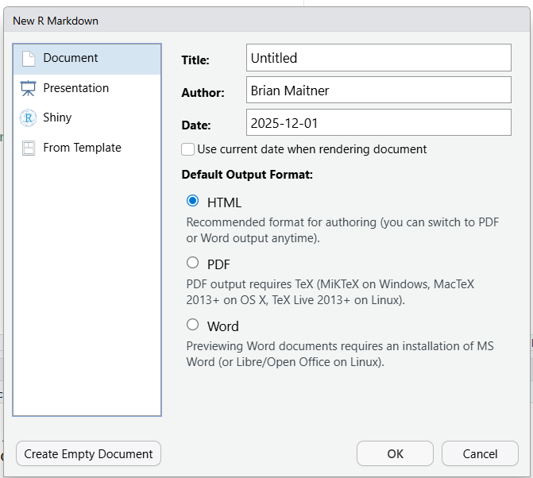
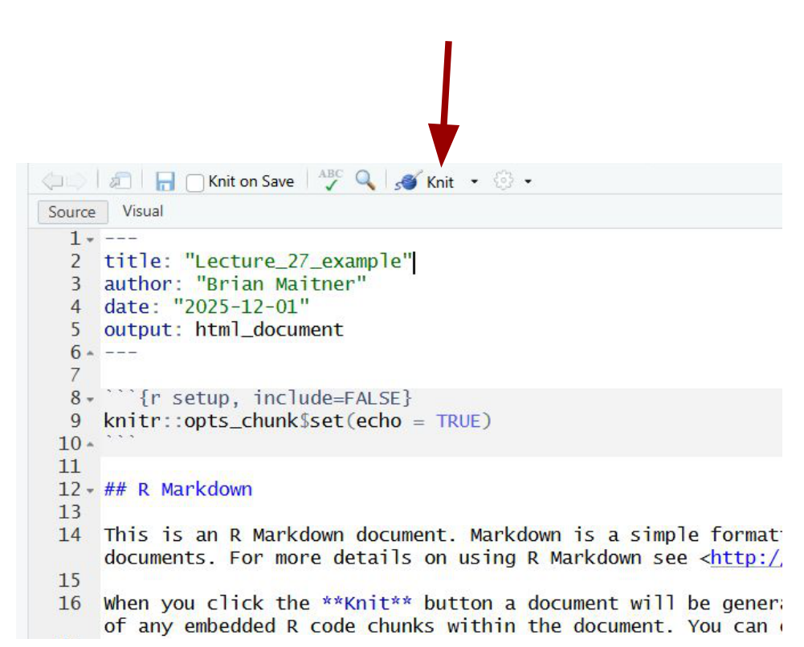

```{r}
#| echo: false
avonet_readme <- readLines("../data/Avonet/README", warn = FALSE)
```

## Today's agenda {.smaller}

1. Making code reproducible
2. R Markdown and Quarto
3. Work on .Rmd or .qmd files

::: {.notes}
Reading: R for Data Science, chapter 6 (workflow: scripts and projects). Test
free week, and the second-to-last class.

Roughly half and half: the five D's, then R Markdown with the rest of class to
practice. The practice is directly useful: the final project code can be
submitted as an .Rmd.

Five short activities are spread through the deck (about 20 minutes in all):
running old code, the AVONET README, documenting a function, the five D's
audit, and predict-then-knit. If time runs short, the README and roxygen ones
can be shortened to a question asked aloud; keep the audit.
:::

## The story so far {.smaller}

**Lecture 26:** code and data that other people can read.

**Lecture 27:** what to do when code breaks, and how to ask for help with a
reprex.

**Today:** making a whole project run on someone else's computer.

::: {.notes}
Thirty seconds. A reprex is reproducibility for one problem; today is the same
idea for a whole project.
:::

## Your turn: run your own old code {background-color="#f0f4f8" .smaller}

Open your **Assignment 1** script from September.

**Restart R** (Session > Restart R), then run the script from the top.

**Does it still run? If not, what broke?**

::: {.notes}
Five minutes, and the hook for the whole lecture. Collect what broke before
moving on; it usually covers most of today's list:

an absolute path to a file that has since moved (Data);
a package that was loaded in the console but never in the script
(Dependencies);
an object made in the console and never in the script (the same failure as the
reprex, and as knitting later today);
a dataset someone renamed or "fixed" by hand (Data).

The point to land: the "someone else" who can't run your code is most often you,
a few months later.
:::

# Reproducibility

## Reproducibility {.smaller}

When using code, this means:

**Analyses could be re-run** and would give the same results.

**Code and data are available** and usable.

Reproducibility is a spectrum: poorly structured code and data are less
reproducible.

::: {.plain}
Someone else, on another computer, can run your code and get your results.
:::

::: {.notes}
Two minutes. "Someone else" includes you in two years, on a new laptop, after
R has updated twice. That person is the most common user of your old code.
:::

## Elements of reproducibility: the five D's {.smaller}

**Design** (structure and style)

**Documentation**

**Dependencies**

**Data**

**Deposit**

::: {.notes}
One minute. The map for the first half of today: one section each.
:::

# Design

## Design {.smaller}

**A well thought-out folder structure.** E.g., folders for:

| Folder | Holds |
|---|---|
| `functions/` | functions you wrote |
| `scripts/` | the analysis, in order |
| `raw_data/` | data exactly as you got it |
| `clean_data/` | data after your cleaning scripts |
| `figures/` | output plots |

::: {.notes}
Two minutes. The course repository is an example: data/, R_scripts/,
lectures/figures/. The point is that a stranger can guess where something lives.
:::

## Design {.smaller}

**Well thought-out code:**

**If you do something multiple times, make it a function.**

**Make code modular.**

**Break up scripts into different files** (e.g., data cleaning, data analyses,
etc.).

::: {.notes}
Two minutes. The Lecture 6 for loop and the Lecture 9 functions were both this
idea: write it once, use it many times, fix it in one place.
:::

## Design {.smaller}

**Use a consistent code style.**

We discussed this in Lecture 26, along with R packages that help style your
code: `lintr` tells you what's wrong, `styler` fixes it.

::: {.notes}
One minute. A callback, not new material.
:::

# Documentation

## Documentation {.smaller}

**Use comments!**

**Document what different sections do.**

**Document any decisions or assumptions.**

**Explain complicated bits of code.**

::: {.notes}
Two minutes. "Decisions" is the one people skip: why you dropped those 12
species, why you logged mass. That's what a reviewer, or you in six months,
will ask.
:::

## Documentation {.smaller}

**Include README files.**

| Where | What it says |
|---|---|
| **The project's root directory** | the purpose; anything special needed to run the code; can be simple or very detailed; links to any resulting publications |
| **Other folders, where needed** | wherever information is helpful, e.g. data sources, file naming structure |
| **Alongside datasets** | often the most helpful of all |

::: {.notes}
Two minutes. Point at the course repository again: every folder in data/ has a
README, and Lecture 4 used them to work out what the columns meant.
:::

## Your turn: is this README enough? {background-color="#f0f4f8" .smaller}

The whole of `data/Avonet/README`, from the course repository:

::: {.out}
```{r}
#| echo: false
cat(avonet_readme, sep = "\n")
```
:::

**Could you use AVONET from this alone? What's missing?**

::: {.fragment}
**Check:** what each column is, the units (`Mass` is in grams), what an `NA`
means, how the traits were measured, and how to cite the paper. The link and the
license are a good start.
:::

::: {.notes}
Three minutes. They have used AVONET since Lecture 4 and know the answers, which
is the point: everything they know about it came from the paper, the slides or
trial and error, not from the README.

Worth admitting it's the instructor's own README. Good material for the "be
nice when you report a problem" lesson from last time.
:::

## Documentation {.smaller}

**Document functions.** You can document any functions you write using
comments, and R also has a special way of documenting functions: **roxygen
comments**.

Example (edited to fit on the slide):

```r
#' @name dr_rulsif
#' @title Density-ratio SDM estimation with RuLSIF
#' @description dr_rulsif is an internal function for density-ratio estimation with RuLSIF
#' @param presence_data dataframe of covariates
#' @param background_data dataframe of covariates
#' @importFrom densratio RuLSIF
#' @importFrom Rdpack reprompt
#' @keywords internal
#' @references
#' \insertAllCited{}
```

::: {.notes}
Two minutes. Roxygen comments start with #' and are what R packages use to build
their help files: every ?function page they have read this semester started as
comments like these.
:::

## Documentation {.smaller}

**Document functions.** Include things like:

**A description** of what they do.

**What the parameters are** and the expected data types.

**What the function returns.**

**What functions it relies on** (if any).

**An example** of how to use it.

::: {.notes}
One minute. This is the same list as the sections of any R help page:
Description, Arguments, Value, Examples.
:::

## Your turn: document a function you wrote {background-color="#f0f4f8" .smaller}

The Michaelis-Menten function from Lecture 9. Replace each comment in
parentheses with the real thing.

::: {.type-it}
```{r}
#| eval: false
#' @title Michaelis-Menten function
#' @description (what does it do, in one sentence?)
#' @param x (what is x, and what type?)
#' @param a (what does a control?)
#' @param b (what does b control?)
#' @return (what comes back?)
#' @examples (one line that calls it)
michaelis_menten <- function(x, a, b){
  a * x / (b + x)
}
```
:::

::: {.notes}
Five minutes. Everything except the documentation is handed over: they wrote
this function in Lecture 9, so the only new thing is saying what it does. The
hardest line is b: most will remember it's "where the curve bends" and need a
nudge to say it exactly (the x at which y reaches half of a).
:::

## One way to fill it in {.smaller}

```{r}
#| eval: false
#' @title Michaelis-Menten function
#' @description A saturating curve: rises steeply at low x, then levels off at a.
#' @param x numeric vector, e.g. resource density
#' @param a numeric, the asymptote: the largest value the curve approaches
#' @param b numeric, the half-saturation constant: the x at which the curve
#'   reaches a / 2
#' @return numeric vector, the same length as x
#' @examples michaelis_menten(x = 1:10, a = 5, b = 2)
michaelis_menten <- function(x, a, b){
  a * x / (b + x)
}
```

::: {.notes}
One minute. Point out that the @examples line is also a test: if it stops
running, something changed.
:::

# Dependencies

## Dependencies {.smaller}

**Your code relies upon R** as well as various packages.

**R and R packages change over time.**

**Code written at one time may not work in the future** as things change.

**It's useful to note which versions of things you use.**

::: {.notes}
Two minutes. sessionInfo() prints the R version and every loaded package's
version: the minimum to record.
:::

## Dependencies {.smaller}

The **renv** package is designed to manage dependencies for you. It keeps track
of which packages you use and which versions, and stores them inside your
project's directory.

```{r}
#| eval: false
renv::init()       # set up renv for a project
renv::snapshot()   # record the current package versions
renv::restore()    # install the recorded versions on another computer
```

See [rstudio.github.io/renv](https://rstudio.github.io/renv/) for details.

::: {.notes}
Two minutes. Don't run renv::init() in the course repository: it already uses
renv. That's why it has a renv.lock file, which lists every package and version
these slides need. snapshot() writes the lock file; restore() reads it on another
machine.

Code is in R_scripts/Lecture_28_examples.R.
:::

## Dependencies {.smaller}

If you REALLY want to be reproducible, you can use **containers**:

**Package all the code** you need to run analyses.

**Even include a lightweight operating system.**

**Run the same exact code on any OS,** which prevents OS-related issues.

**Also useful if you want to work on a cluster.**

::: {.notes}
One minute. Docker is the common one. Mention, don't teach: most of them will
never need it, and renv covers the common cases.
:::

# Data

## Data {.smaller}

**Keep raw data untouched,** separate from clean data.

**Use scripts for cleaning** so that it can be replicated. Comments in cleaning
scripts document your decisions and why you made them.

**Use relative paths to load data.**

**Data should be accessible to others.**

::: {.notes}
Two minutes. Relative paths were Lecture 4. "Runs anywhere includes the data"
was Lecture 6.
:::

## Data {.smaller}

**Data should be permanently archived** somewhere on the internet, and code
ideally downloads the data from the internet.

**Small amounts of data can be put on GitHub.**

**Large datasets need specialized storage locations,** e.g.:

| Repository | |
|---|---|
| OSF | [osf.io](https://osf.io/) |
| Dryad | [datadryad.org](https://datadryad.org/) |
| Figshare | [figshare.com](https://figshare.com/) |

::: {.notes}
Two minutes. Dryad is where some of the course datasets came from: the deer
movement data in data/Deer_movement, for example.
:::

# Deposit

## Deposit {.smaller}

Like data, code should be deposited in a **permanently archived** location.

**GitHub is a good step, but isn't permanent.**

**Zenodo** ([zenodo.org](https://zenodo.org/)) can permanently archive GitHub
code easily.

**Zenodo assigns a DOI,** so code can be cited.

::: {.notes}
Two minutes. GitHub is a company and repositories get deleted. Zenodo is run by
CERN, and a DOI is the same kind of permanent identifier a paper has.
:::

## Your turn: audit your final project {background-color="#f0f4f8" .smaller}

Score your project **0** (not yet), **1** (partly) or **2** (done) on each D:

::: {.small-table}
| | A 2 looks like |
|---|---|
| **Design** | folders for data, scripts and figures; repeated code in functions |
| **Documentation** | a README at the root; comments that say why |
| **Dependencies** | package versions recorded: `sessionInfo()` or renv |
| **Data** | raw data untouched; loaded with a relative path or a URL |
| **Deposit** | on GitHub (and archived with a DOI when you publish) |
:::

::: {.notes}
Five minutes. This replaces the plain recap of the five D's: same list, but
pointed at their own project. The scores show them where the project stands
before the final submission.
:::

# R Markdown and Quarto

## Other ways to help with reproducibility {.smaller}

**For small bits of code,** a reprex is useful (Lecture 27).

**You can also make use of R Markdown and Quarto** (`.Rmd` and `.qmd`) files.

::: {.notes}
One minute. Worth saying: these lecture slides are a Quarto (.qmd) file in the
course repository. Open one, e.g. Lecture_11_probability.qmd, to show the code
chunks that draw its figures when it renders.
:::

## R Markdown {.smaller}

Details at:
[rmarkdown.rstudio.com/lesson-1.html](https://rmarkdown.rstudio.com/lesson-1.html)

Cheatsheet at:
[rstudio.github.io/cheatsheets/html/rmarkdown.html](https://rstudio.github.io/cheatsheets/html/rmarkdown.html)

**Runs code and produces documents.**

**Can be fully reproducible.**

**Can call other programs** (e.g., Python).

::: {.notes}
One minute. The selling point: the numbers in the document come from the code,
so they can't drift out of date.
:::

## One file, many outputs {.smaller}

The same code chunks and Markdown text can become:

::: {.small-table}
| Output | How | For example |
|---|---|---|
| **Reports** | HTML, Word or PDF, set in the YAML header | your final project code |
| **Formatted manuscripts** | journal templates, with citations from a reference file | the rticles package; Quarto manuscripts |
| **Slides** | HTML (revealjs), PowerPoint or PDF | these lecture slides |
| **Websites** | Quarto websites or blogdown, published free on GitHub Pages | lab and personal websites |
| **Books** | bookdown, or Quarto books | *R for Data Science*, your reading this week |
:::

::: {.notes}
Two minutes. The point: the skill they practice today on one report is the same
skill behind a thesis chapter, a paper, a talk and a lab website. Write it once,
change one line of the header, get a different format.

Citations come from a .bib file, which Zotero and other reference managers
export, so the bibliography formats itself.
:::

## R Markdown or Quarto? {.smaller}

Two versions of the same idea, both from Posit (the company behind RStudio):

::: {.small-table}
| | R Markdown (`.Rmd`) | Quarto (`.qmd`) |
|---|---|---|
| Around since | 2014 | 2022 |
| Languages | mainly R | R, Python, Julia |
| Output set in the YAML by | `output:` | `format:` |
| Chunk options | `{r, echo = FALSE}` | <code>#&#124; echo: false</code> lines (the old way works too) |
| The button says | Knit | Render |
| Status | still supported, and very widely used | the newer system, where new features go |
:::

**Learn either one and you know most of the other:** the code chunks and the
Markdown are the same. Today we use R Markdown.

::: {.notes}
Two minutes. Quarto comes bundled with current versions of RStudio, so there is
nothing extra to install: File > New File > Quarto Document.

Why R Markdown for today's practice: it's what most existing tutorials and
Stack Overflow answers use, and the final project accepts .Rmd. Anyone who would
rather try Quarto in the practice block can: everything on the next slides
carries over.
:::

## R Markdown {.smaller}

:::: {.columns}
::: {.column width="45%"}
Let's play with R Markdown a bit.

**First, create a new Rmd file.**

In RStudio: File > New File > R Markdown
:::

::: {.column width="55%"}

:::
::::

::: {.notes}
Three minutes. Have everyone do it. The defaults are fine: HTML output. If it
asks to install packages, say yes.
:::

## R Markdown: 3 types of content {.smaller}

The new file has all three:

````markdown
---
title: "Lecture_28_example"
author: "Brian Maitner"
date: "2026-12-01"
output: html_document
---

`r ''````{r setup, include=FALSE}
knitr::opts_chunk$set(echo = TRUE)
```

## R Markdown

This is an R Markdown document. Markdown is a simple formatting syntax for
authoring HTML, PDF, and MS Word documents.
````

**YAML header** (between the `---` lines), **R code block** (between the
```` ``` ```` lines), and **Markdown text** (everything else).

::: {.notes}
Two minutes. Have them find each part in their own new file.
:::

## R Markdown: YAML header {.smaller}

```yaml
---
title: "Lecture_28_example"
author: "Brian Maitner"
date: "2026-12-01"
output: html_document
---
```

**Contains metadata** on the file.

**Also contains information on how to render the file.** `output` tells it to
render as an `html_document`; it could also render as PDF, .docx, etc.

**There are other advanced options,** like adding a table of contents,
incorporating citations, or changing the page margins:
[rstudio.github.io/cheatsheets/html/rmarkdown.html](https://rstudio.github.io/cheatsheets/html/rmarkdown.html)

::: {.notes}
Two minutes. YAML is fussy about indentation and colons, which makes it the most
common reason a file won't render.
:::

## R Markdown: code blocks {.smaller}

````markdown
`r ''````{r setup, include=FALSE}
knitr::opts_chunk$set(echo = TRUE)
```
````

**Can have as many as you like.**

**Begin with** ```` ```{r} ```` and **end with** ```` ``` ````.

**Optional arguments go inside `{r}`:** whether messages and warnings should be
shown, telling R not to run the chunk, figure sizes and captions.
[Chunk options cheatsheet](https://rstudio.github.io/cheatsheets/html/rmarkdown.html#chunk-options)

::: {.notes}
Two minutes. Ctrl/Cmd + Alt + I inserts a chunk. The most-used options:
echo = FALSE (hide the code, show the output), eval = FALSE (show the code, don't
run it), message = FALSE and warning = FALSE.
:::

## R Markdown: Markdown text chunks {.smaller}

````markdown
## R Markdown

This is an R Markdown document. Markdown is a simple formatting syntax for
authoring HTML, PDF, and MS Word documents.
````

**Can have as many as you like.**

**Syntax to specify how to render text,** e.g.:

| You type | You get |
|---|---|
| `#`, `##`, `###` | section headers, from largest to smallest |
| `**text**` | **bold** |
| `*text*` | *italics* |
| `* item` at the start of a line | a bullet point |

[Markdown cheatsheet](https://rstudio.github.io/cheatsheets/html/rmarkdown.html#write-with-markdown)

::: {.notes}
Two minutes. The asterisks are the part people mix up: two on each side is bold,
one is italics.
:::

## R Markdown: Rendering {.smaller}

:::: {.columns}
::: {.column width="40%"}
**Click the "Knit" button.**

Or, from code:

```{r}
#| eval: false
rmarkdown::render("my_file.Rmd")
```
:::

::: {.column width="60%"}

:::
::::

::: {.notes}
Two minutes. Knitting runs the file in a fresh R session, top to bottom. (For a
.qmd file the button says Render, and the function is quarto::quarto_render().) So a
file that knits is a file that runs from scratch, which is the same lesson as the
reprex: anything that only worked because of something already in your
environment fails here.
:::

## Your turn: predict, then knit {background-color="#f0f4f8" .smaller}

In the new R Markdown file you made:

1. In the setup chunk, change `echo = TRUE` to `echo = FALSE`. **What will
   change?** Knit it and see.

::: {.fragment}
**Check:** the code disappears from the document, and the results stay.
:::

2. In the **console**, run `x <- 1:10`. Add a chunk to the file containing
   `mean(x)`. **Will it knit?**

::: {.fragment}
**Check:** no: `object 'x' not found`. Knitting starts a fresh R session, so the
file only knows what the file itself creates.
:::

::: {.notes}
Three minutes. Have them write down a prediction before knitting each time.

The second one is the most common error they'll hit in the practice block, so
it's worth meeting it on purpose first. It's the reprex lesson from last time
again: anything that only worked because of something already in your
environment fails in a fresh session.
:::

## Markdown practice {.smaller}

For the remainder of class, try making your own R Markdown (or Quarto) files:

1. Create a blank R Markdown file (or use the one we created earlier). For
   Quarto: File > New File > Quarto Document.
2. Populate it with content copied from a previous R script: **comments become
   text**, and **code is placed in code chunks**.
3. Once you've got something that looks good, try rendering it!

::: {.notes}
The rest of class. A good choice of script: their Assignment 4 or their final
project code, which can be submitted as an .Rmd (or .qmd).

The most common failure: a chunk uses an object made in the console but never in
the file. Knitting starts fresh, so it errors. That's the file telling them it
isn't reproducible yet.
:::

# Wrapping up

## Which tool, when {.smaller}

::: {.small-table}
| You want to | Use |
|---|---|
| a stranger to find things in your project | a clear folder structure, and README files |
| to avoid repeating code | functions |
| record why you made a choice | comments |
| record package versions | `renv::snapshot()`, or at least `sessionInfo()` |
| someone else to install those versions | `renv::restore()` |
| your data to outlive your laptop | OSF, Dryad or Figshare |
| your code to be citable | GitHub, archived on Zenodo with a DOI |
| code and results in one document | R Markdown (`.Rmd`) or Quarto (`.qmd`) |
:::

::: {.notes}
The slide to photograph, and a checklist for the final project code.
:::

## Before next class

**Read:**

[doi.org/10.1126/science.aab2374](https://doi.org/10.1126/science.aab2374)

[doi.org/10.1002/ece3.70030](https://doi.org/10.1002/ece3.70030)

May be a quiz.
