## Today's agenda {.smaller}

1. Final presentation reminder
2. Code and data sharing
3. Coding time in class (optional)

::: {.notes}
Reading: Nosek et al. (2015) Science, on transparency and openness standards,
and Maitner et al. (2024) Ecology and Evolution, on code sharing. The last
regular class meeting.

The lecture is mostly argument, not technique: why share data, code and methods,
and the practical how. Many slides build on click; each click adds one piece.

Four short activities (about 12 minutes): "would you share it?" at the start,
coming back at the end; "is it open?" on four course datasets; "which are open
source?"; and predictions before each click of the data-value wheel.
:::

## Last call: course evaluations {.smaller}

**The online course evaluation closes tomorrow,** Friday, December 4. The link
is in your USF email and on Canvas.

**If you haven't done it yet, today is a good day.** Your comments shape how
this course runs next year.

::: {.notes}
Thirty seconds. Last of three reminders. Consider giving the first ten minutes of
the coding time at the end of class to complete it.
:::

## The story so far {.smaller}

**Lecture 27:** what to do when code breaks, and asking for help with a reprex.

**Lecture 28:** making a whole project run on someone else's computer.

**Today:** why share your data, code and methods at all, and how.

::: {.notes}
Thirty seconds. Last time was how to make a project shareable; today is why it's
worth the effort.
:::

## Final presentations {.smaller}

**During the scheduled final exam block** (December 5 to 10). The day and time
are on Canvas.

**Add your slides to the shared Google Slides file beforehand.**

**Practice your timing** to make sure you're under 5 minutes.

::: {.notes}
Two minutes. Put the confirmed day and time on this slide once the Academic
Scheduling Team has assigned the exam slot (the syllabus still says TBD). The
Google Slides link is on Canvas.
:::

## Your turn: would you share it? {background-color="#f0f4f8" .smaller}

**Your final project: would you share its data and code publicly?**

**If not, what would stop you?**

::: {.notes}
Three minutes. Write the reasons on the board and leave them up: the last slide
comes back to them. Expect some of: my code is messy; someone will scoop me; the
data are sensitive (endangered species locations, private land, people); they're
not my data; I don't know how. All reasonable, and most get an answer today.
:::

# Open science

## What is Open Science? {.smaller}

Open Science: "transparent and accessible knowledge that is shared and
developed through collaborative networks"

::: {.r-stack}
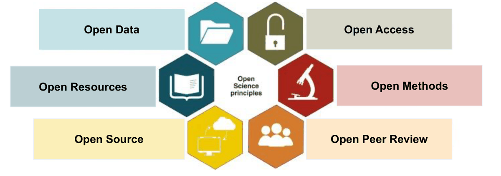{width="95%"}

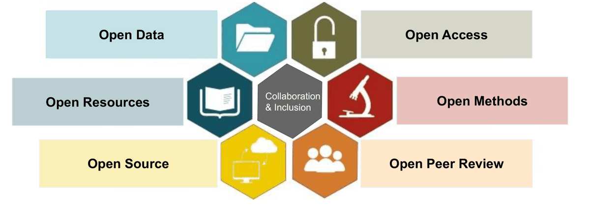{.fragment width="95%"}

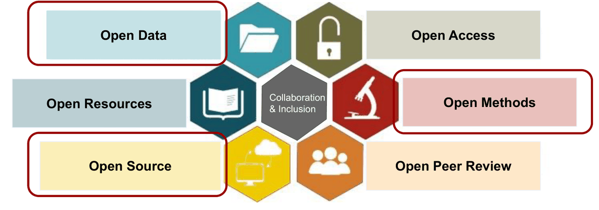{.fragment width="95%"}
:::

[Gallagher et al. (2020) *Nature Ecology & Evolution*]{.credit}

::: {.notes}
Three minutes. Six principles around a center. Click once: the center is
collaboration and inclusion, which is what the six are for. Click again: today
focuses on three of them, open data, open methods and open source, because they
are the ones most in your control, and they're free.

Open access (publishing so anyone can read the paper) usually costs money;
open peer review and open resources are mostly up to journals and institutions.
:::

# Open data

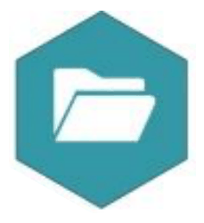{.nostretch width="110"}

## What are open data? {.smaller}

**Available and accessible:** the data must be ***available as a whole*** and at
no more than a reasonable reproduction cost, preferably by downloading over the
internet. The data must also be available in a ***convenient and modifiable
form***.

**Reusable and redistributable:** the data must be provided under terms that
***permit re-use and redistribution***, including the intermixing with other
datasets.

**Universal participation:** ***everyone must be able to use***, re-use and
redistribute. There should be no discrimination against fields of endeavor or
against persons or groups.

[opendatahandbook.org]{.credit}

::: {.notes}
Two minutes. The three conditions, from the Open Data Handbook. A dataset
"available on request" fails the first one; a dataset with a no-commercial-use
license fails the third.
:::

## Your turn: is it open? {background-color="#f0f4f8" .smaller}

Pick one of these folders in the course repository's `data/`, and read its
README: `Avonet`, `Mangroves`, `Reef_fish` or `Beetle_competition`.

**Where are the data archived? Under what license? Could you reuse them in a
published paper?**

::: {.fragment}
::: {.small-table}
| Dataset | Archived | License | Open? |
|---|---|---|---|
| Avonet | figshare | CC BY 4.0 | yes |
| Reef_fish | NOAA, with a DOI | CC0 | yes |
| Mangroves | a university repository, with a DOI | CC BY-NC 4.0 | not by this definition: no commercial use |
| Beetle_competition | only on GitHub | CC BY 4.0 | open, but not archived: one copy, no DOI |
:::
:::

::: {.notes}
Five minutes in pairs, one dataset each, then fill in the table together.

Mangroves is the interesting one: freely downloadable, but the NC (non-commercial)
clause fails "no discrimination against fields of endeavor". You could still use
it in a paper, but not in, say, a consultancy report.

Beetle_competition is the instructor's own unpublished data: openly licensed,
but sitting in one place with no DOI. That's the setup for the LOCKSS point in a
few slides.
:::

## Global questions need global participation {.smaller}

:::: {.columns}
::: {.column width="58%"}
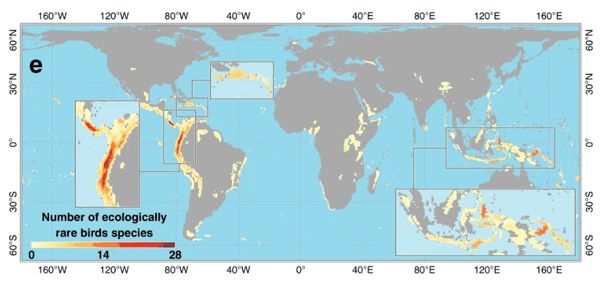
:::

::: {.column width="42%"}
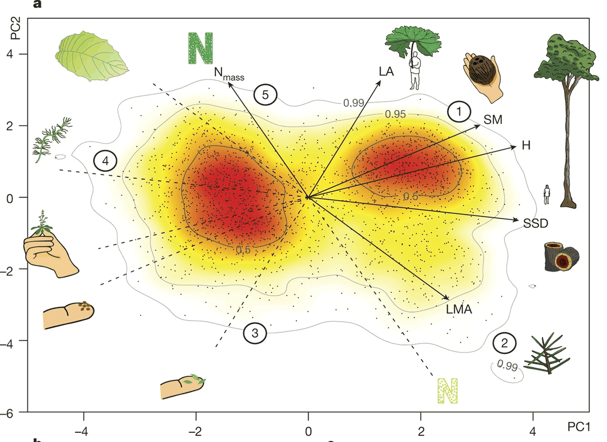

Global spectrum of plant form and function
:::
::::

[Loiseau et al. (2020) *Nature Communications*; Díaz et al. (2016) *Nature*]{.credit}

::: {.notes}
Two minutes. Neither of these could exist without thousands of people's data:
the map combines bird records from across the world, and the plant spectrum
combines traits measured on tens of thousands of species by hundreds of
researchers. You can't ask global questions without help.
:::

## Open data enhance reproducibility {.smaller}

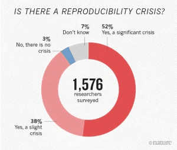{width="38%"}

[Baker (2016) *Nature*]{.credit}

::: {.notes}
Two minutes. A survey of 1,576 researchers: over half thought there was a
significant reproducibility crisis. You can't check a result without the data
behind it.
:::

## Ethical responsibilities {.smaller}

**Publicly funded data are public property.**

**Transparency is a key part of science.**

**Open data increase inclusion.**

**Open data save money!**

[Piwowar et al. (2011) *Nature*]{.credit}

::: {.notes}
Two minutes. Inclusion: researchers at institutions without the money to
collect data globally can still answer global questions with shared data.
Saving money: data collected once and reused many times.
:::

## Open data improve citations and publications {.smaller}

:::: {.columns}
::: {.column width="50%"}
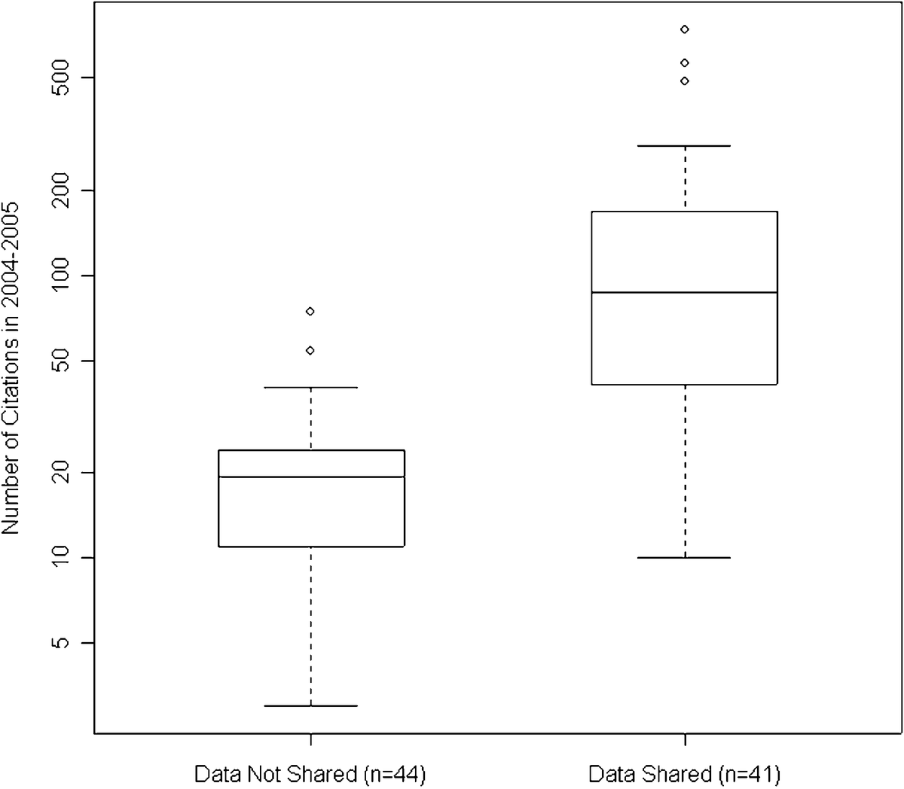{width="80%"}
:::

::: {.column width="50%"}
::: {.fragment}
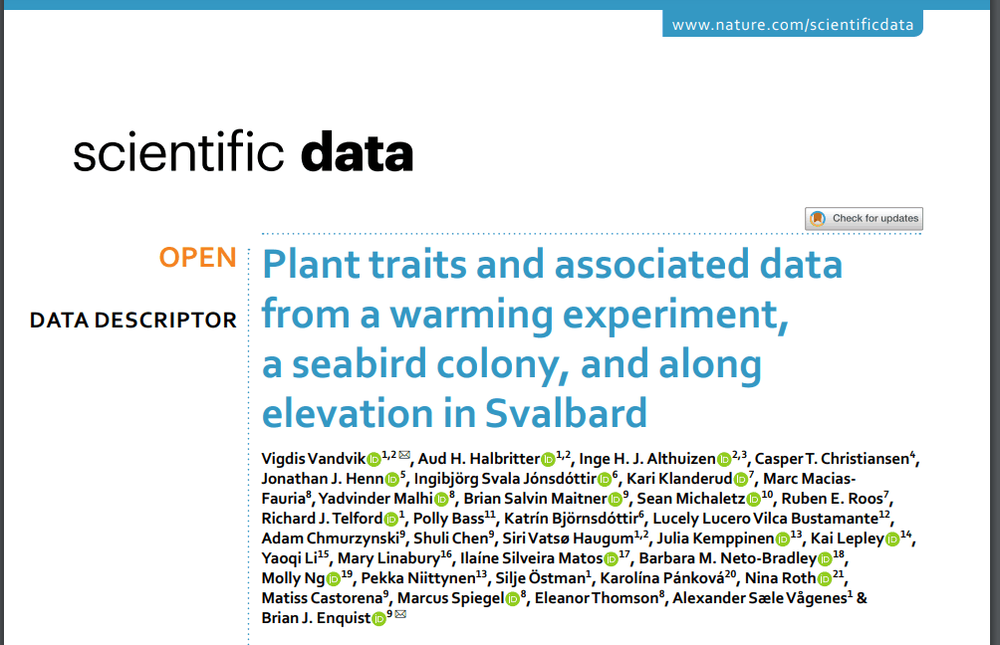
:::
:::
::::

[Piwowar et al. (2007) *PLOS ONE*]{.credit}

::: {.notes}
Two minutes. Studies that shared their data were cited more than those that
didn't. Click: and a dataset can be a publication in its own right. Data
journals such as Scientific Data publish papers that describe a dataset.
:::

## How to share data {.smaller}

**Range of options**

::: {.r-stack}
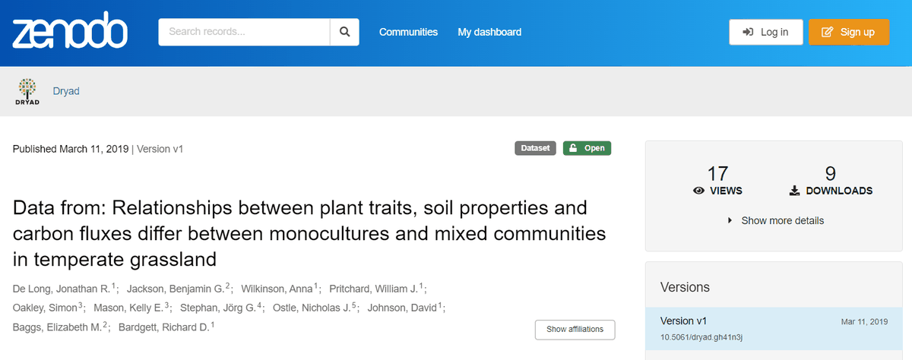{.fragment width="70%"}

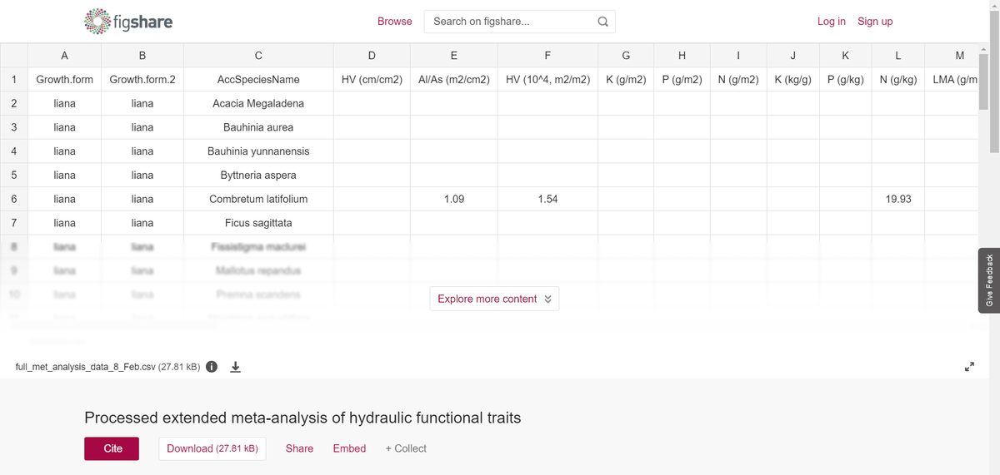{.fragment width="70%"}

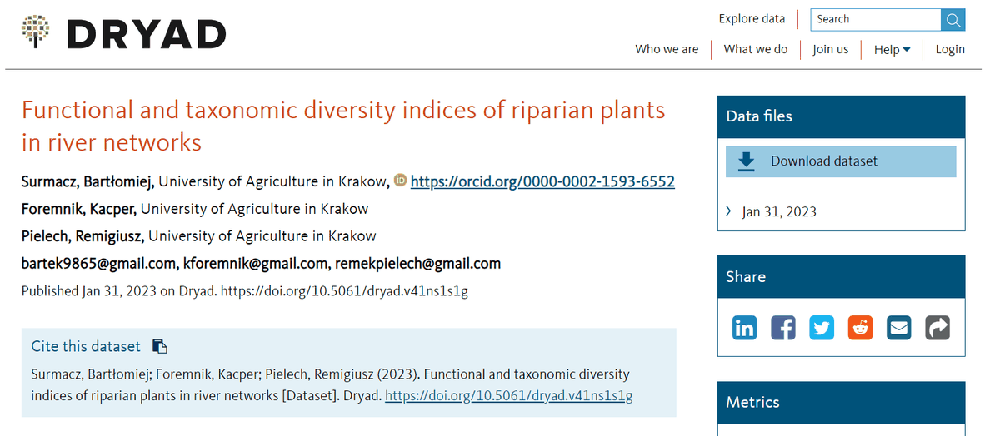{.fragment width="70%"}

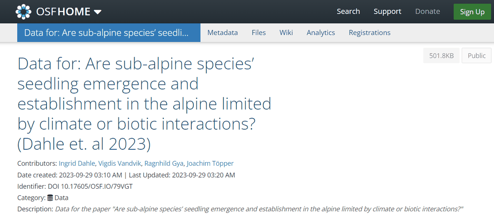{.fragment width="70%"}

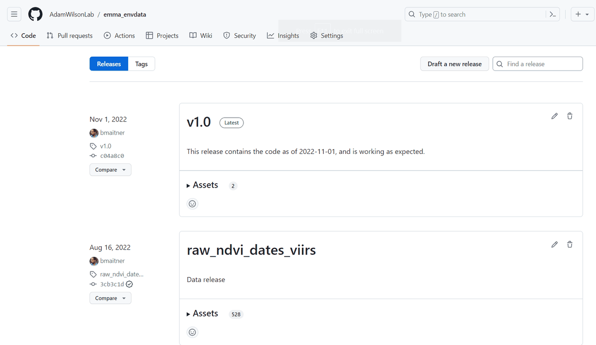{.fragment width="70%"}

::: {.fragment .callout-box}
**Best option:** **L**ots **O**f **C**opies **K**eep **S**tuff **S**afe (**LOCKSS**)

Less risk of loss, and more chance people find it (and cite it).
:::
:::

[Keller et al. (2022) *Methods in Ecology and Evolution*]{.credit}

::: {.notes}
Three minutes. One click per repository: Zenodo, Figshare, Dryad, OSF, GitHub.
Different repositories have different pros and cons (file size, number of
files, cost), but for most datasets you can find one that works. Then the
punchline: more than one. LOCKSS is a long-standing digital preservation
principle (and a Stanford Libraries program of the same name): no single copy
is safe, many independent copies are.
:::

## What is Open Science? {.smaller}

::: {.r-stack}
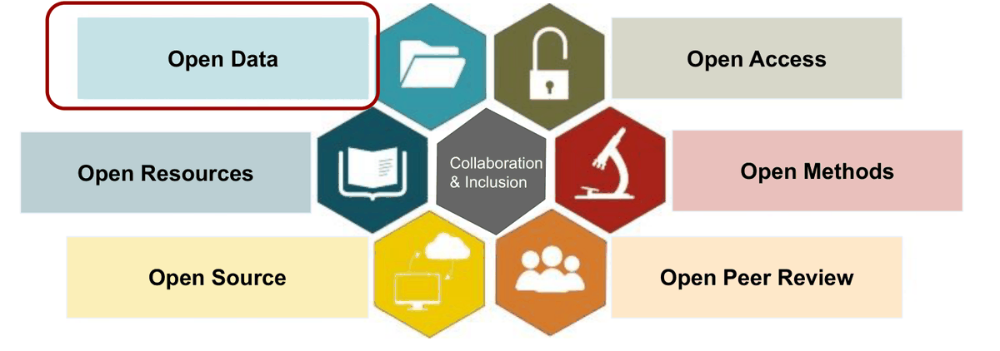{width="95%"}

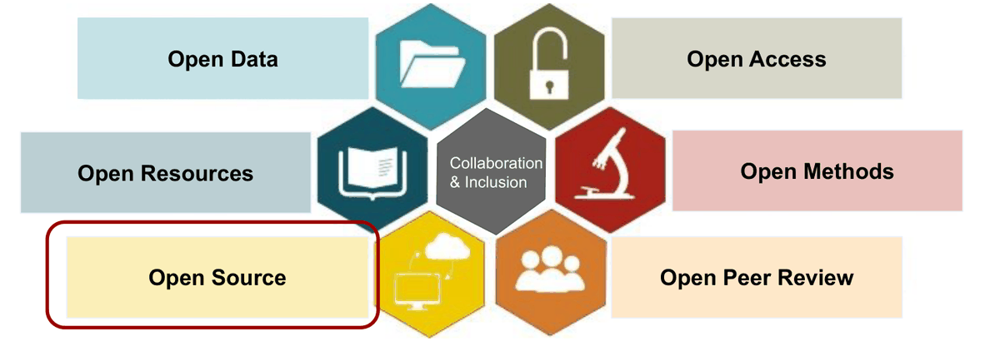{.fragment width="95%"}
:::

[Gallagher et al. (2020) *Nature Ecology & Evolution*]{.credit}

::: {.notes}
One minute. Hopefully that's convinced you there's value in data sharing. Click:
but data aren't useful unless we do something with them. That's where open
source comes in.
:::

# Open source

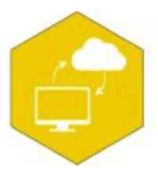{.nostretch width="110"}

## What is open source? {.smaller}

**Free redistribution:** the license shall not restrict any party from selling
or giving away the software as a component of an aggregate software
distribution containing programs from several different sources. The license
***shall not require a royalty or other fee*** for such sale.

**No discrimination against persons or groups:** the license must not
discriminate against any person or group of persons.

**No discrimination against fields of endeavor:** the license must not restrict
anyone from making use of the program in a specific field of endeavor. For
example, it may not restrict the program from being used in a business, or from
being used for genetic research.

::: {.fragment}
**In short: code that is free to use, both in terms of costs and restrictions.**
:::

[opensource.org/osd]{.credit}

::: {.notes}
Two minutes. Three of the ten criteria in the Open Source Definition. Read the
last line after the click: it's the version to remember.
:::

## Your turn: which are open source? {background-color="#f0f4f8" .smaller}

R &nbsp;·&nbsp; RStudio Desktop &nbsp;·&nbsp; Python &nbsp;·&nbsp; QGIS
&nbsp;·&nbsp; Excel &nbsp;·&nbsp; ArcGIS &nbsp;·&nbsp; MATLAB &nbsp;·&nbsp; JMP
&nbsp;·&nbsp; Google Earth

::: {.fragment}
| | |
|---|---|
| **Open source** | R, RStudio Desktop, Python, QGIS |
| **Paid and closed** | Excel, ArcGIS, MATLAB, JMP |
| **Free, but not open source** | Google Earth |
:::

::: {.fragment}
Free to use is not the same as open: with closed software you can't read,
change or redistribute the code.
:::

::: {.notes}
Two minutes, answered aloud. Google Earth is the one that catches people: it
costs nothing, but it's proprietary. RStudio Desktop is open source (AGPL); some
of Posit's server products are commercial.
:::

## Reproducibility and transparency {.smaller}

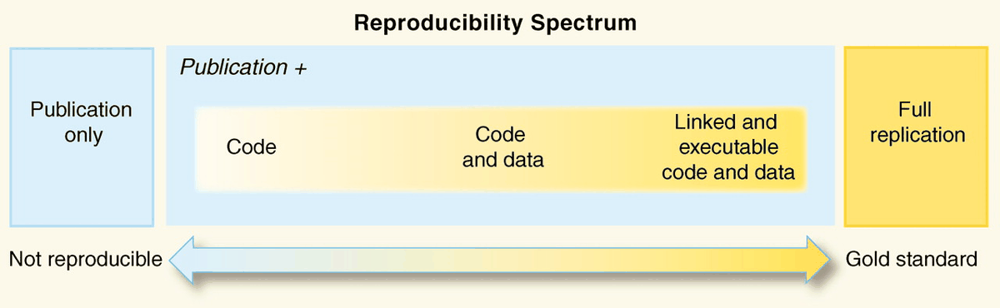

[Peng (2011) *Science*]{.credit}

::: {.notes}
Two minutes. Stress that having code is better than nothing, but the further
right you are, the more confidence others can have in the result. Lecture 28's
five D's are how you move right.
:::

## Open source reduces wasted efforts {.smaller}

::: {.r-stack}
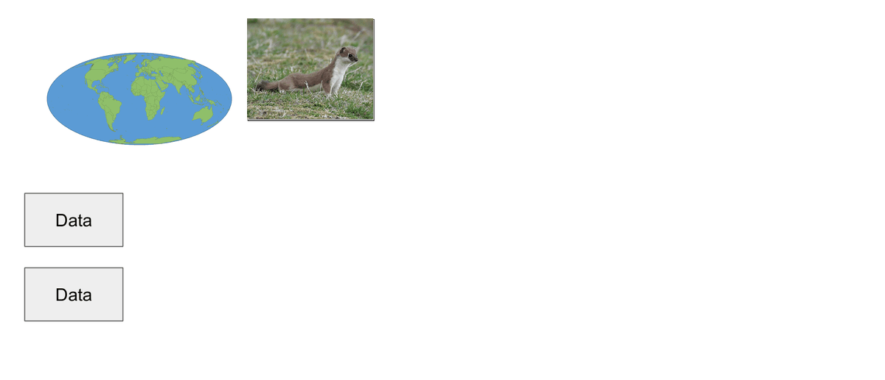{width="100%"}

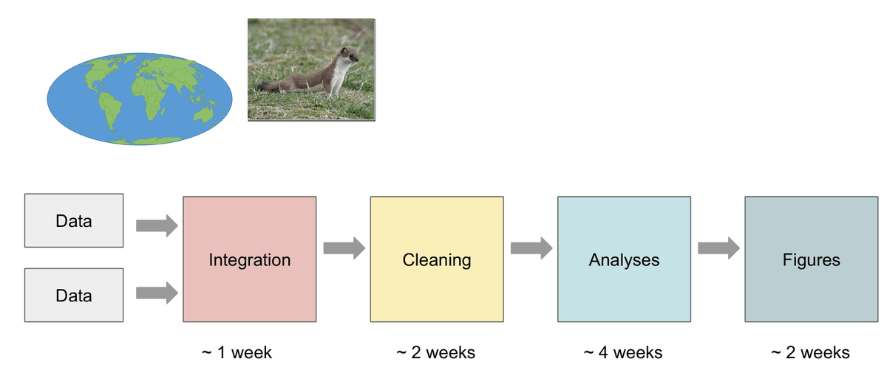{.fragment width="100%"}

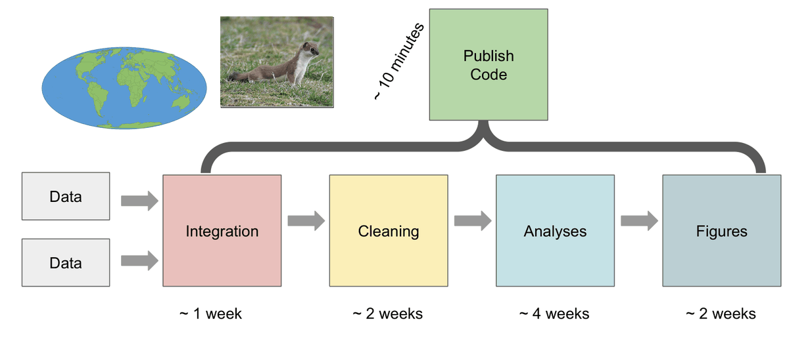{.fragment width="100%"}

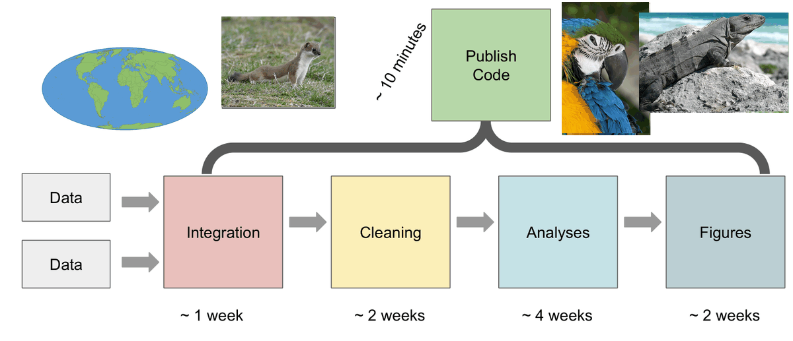{.fragment width="100%"}

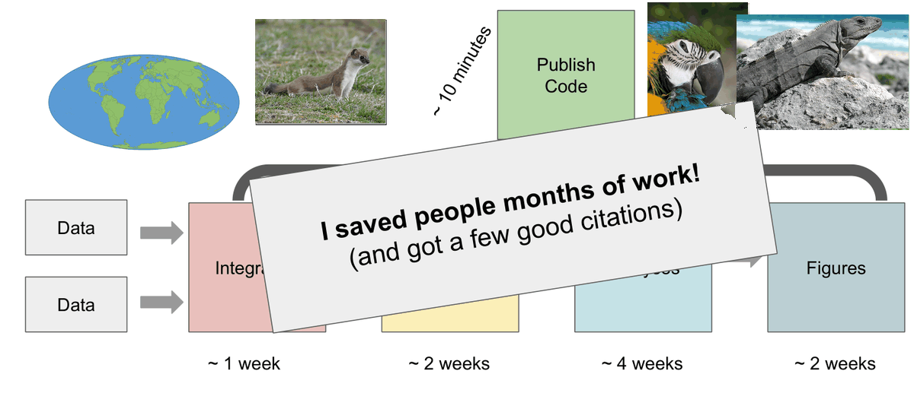{.fragment width="100%"}
:::

[Photos via Wikimedia Commons: stoat, Justin Philbois (CC0); macaw, Jebulon (CC0);
black spiny-tailed iguana, Ken Thomas (public domain).]{.credit}

::: {.notes}
Four minutes, one click per step. A project combining two datasets: about a
week to integrate them, two weeks to clean, four for analyses, two for figures.
Publishing the code takes about ten minutes. Then the next people working on
other species (the macaw, the iguana) can start from your code instead of
from scratch.

The punchline is "I saved people months of work, and got a few good
citations". Or maybe it's the other way: maybe someone saved ME months of work,
and all it cost me was a citation.
:::

## Open source reduces barriers {.smaller}

::: {.r-stack}
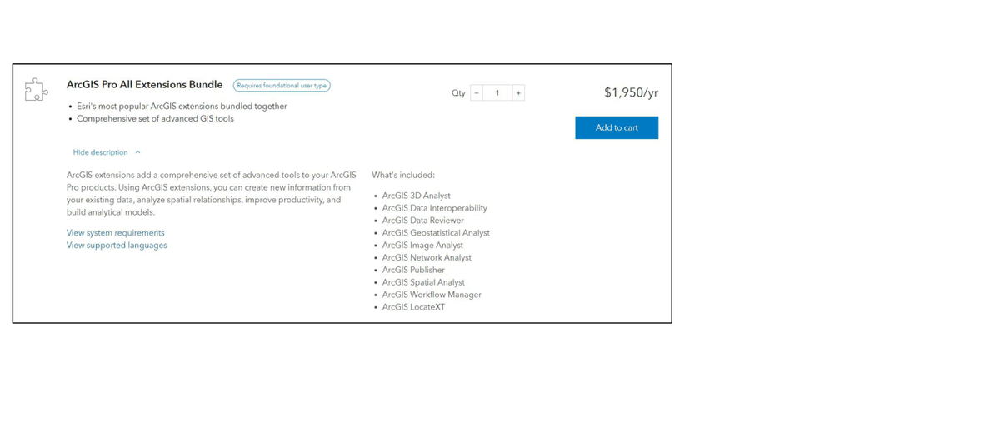{width="100%"}

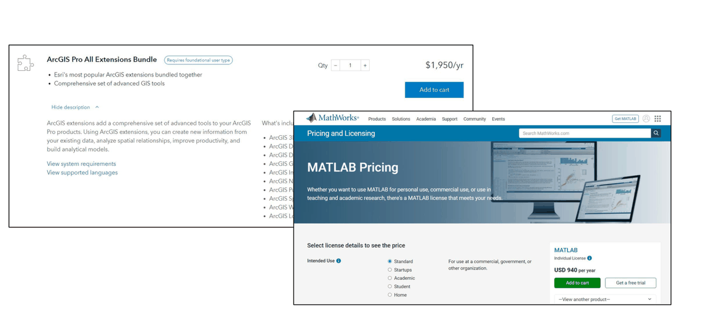{.fragment width="100%"}

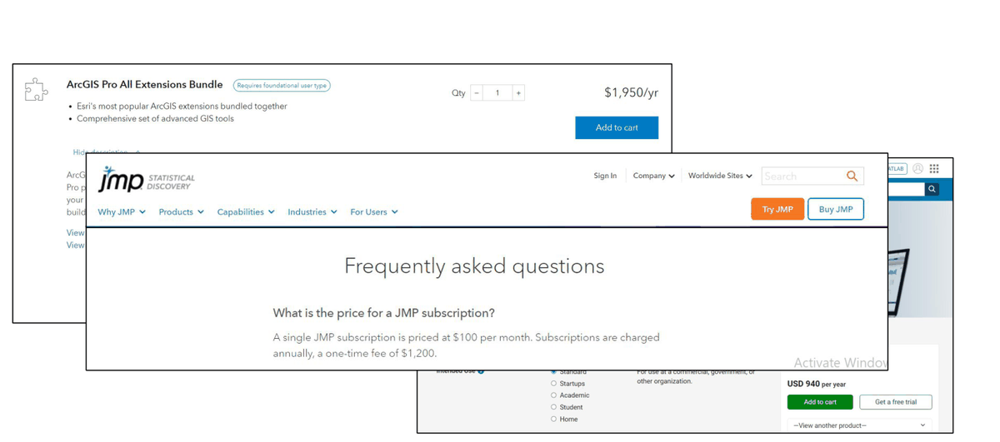{.fragment width="100%"}

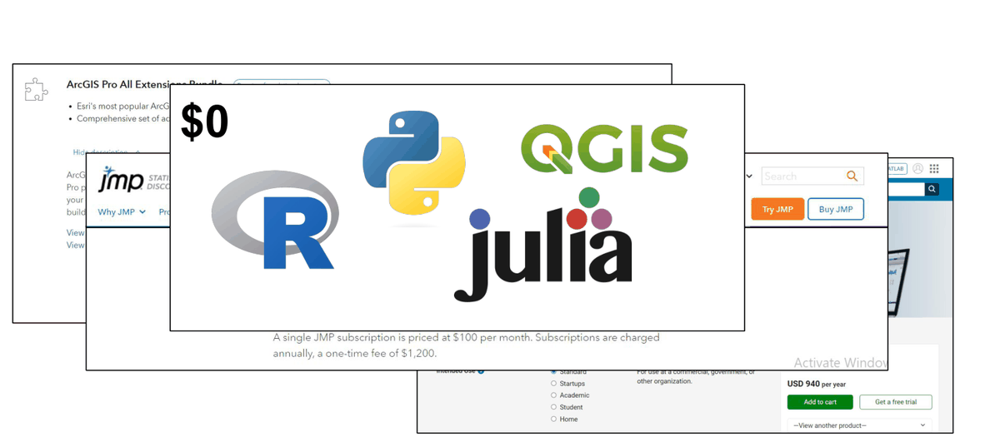{.fragment width="100%"}
:::

::: {.notes}
Two minutes. Commercial software prices, one click each: ArcGIS Pro, MATLAB,
JMP, as they were when the screenshots were taken. Last click: R, Python, QGIS and Julia
cost $0, so anyone can use them, anywhere, including after you leave a
university that pays for the licenses.
:::

## Code sharing increases citations {.smaller}

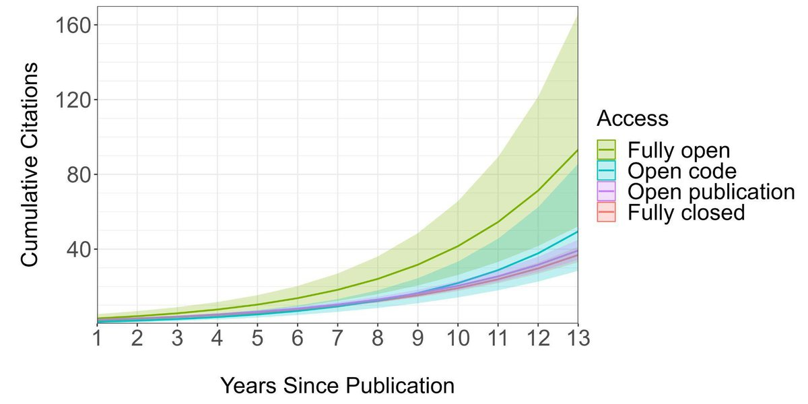{width="70%"}

[Maitner et al. (2024) *Ecology and Evolution*]{.credit}

::: {.notes}
Two minutes. This week's reading. Papers that share their code and data are
cited more over time than closed ones. More open means more citations, which
means more impact.
:::

## What is Open Science? {.smaller}

::: {.r-stack}
{width="95%"}

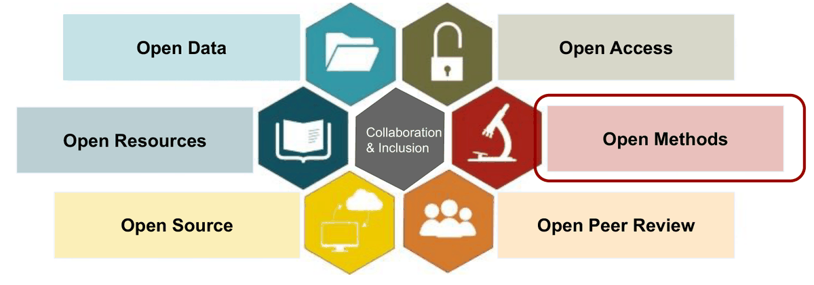{.fragment width="95%"}
:::

[Gallagher et al. (2020) *Nature Ecology & Evolution*]{.credit}

::: {.notes}
Thirty seconds. On to the third: open methods.
:::

# Open methods

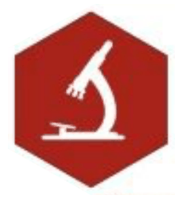{.nostretch width="110"}

## What are open methods? {.smaller}

Making the methods underlying research open and freely accessible.

**Examples:** laboratory protocols, data collection protocols, metadata
standards, materials, reagents, and code (which overlaps with open source).

::: {.notes}
One minute.
:::

## Open methods increase transparency {.smaller}

{width="38%"}

[Baker (2016) *Nature*]{.credit}

::: {.notes}
One minute. The same survey as before: reproducing a result needs the methods as
much as the data.
:::

## Shared methods increase confidence {.smaller}

:::: {.columns}
::: {.column width="50%"}
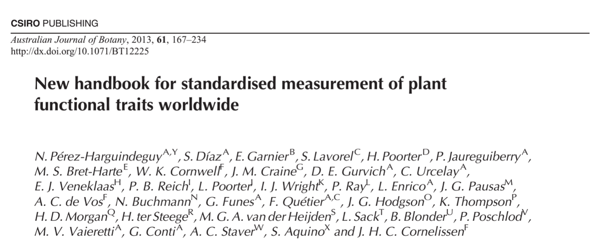
:::

::: {.column width="50%"}
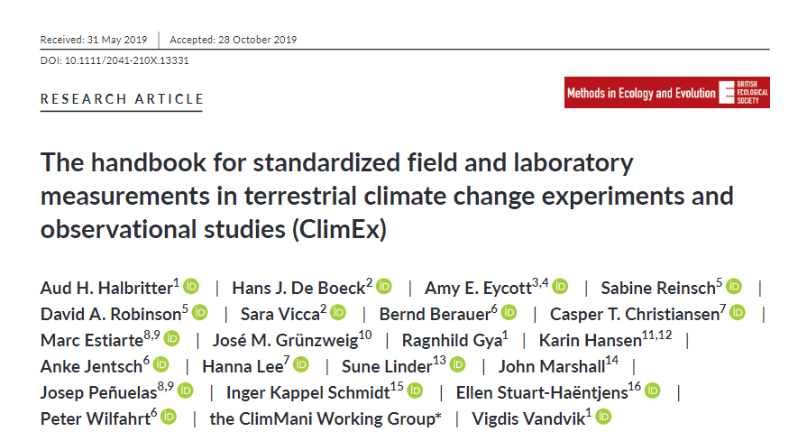
:::
::::

[Pérez-Harguindeguy et al. (2013) *Australian Journal of Botany*; Halbritter et
al. (2020) *Methods in Ecology and Evolution*]{.credit}

::: {.notes}
Two minutes. Handbooks of standard protocols: if everyone measures leaf area the
same way, you can trust a comparison between two studies.
:::

## Shared methods increase compatibility {.smaller}

**Data integration is a major time sink.**

**Using shared metadata standards and methods** increases interoperability.

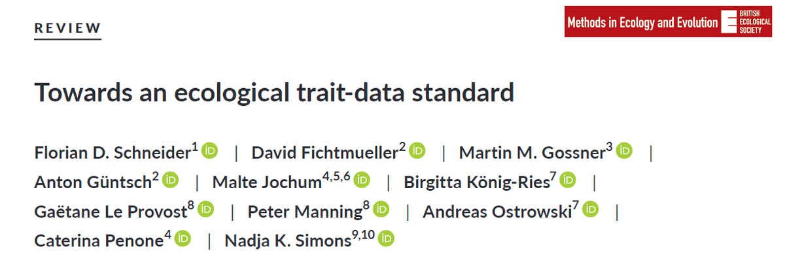{width="65%"}

[Schneider et al. (2019) *Methods in Ecology and Evolution*]{.credit}

::: {.notes}
Two minutes. Integration was the first week on the wasted-efforts slide. A
shared standard for column names and units turns that week into an afternoon.
:::

## Open methods increase data value {.smaller}

**Before each click:** which of these would open methods make better?

::: {.r-stack}
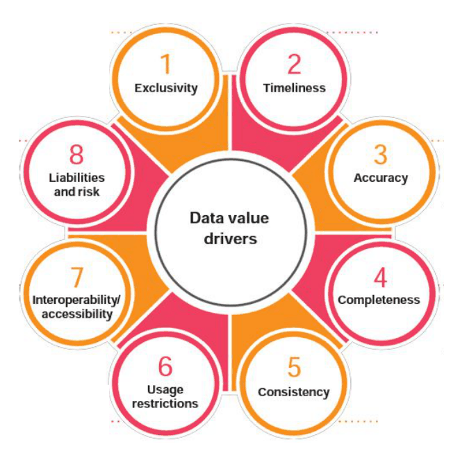{width="48%"}

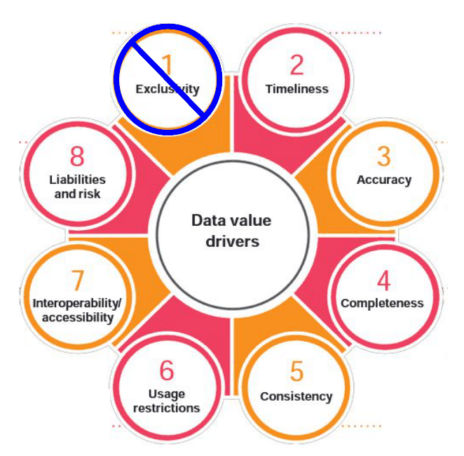{.fragment width="48%"}

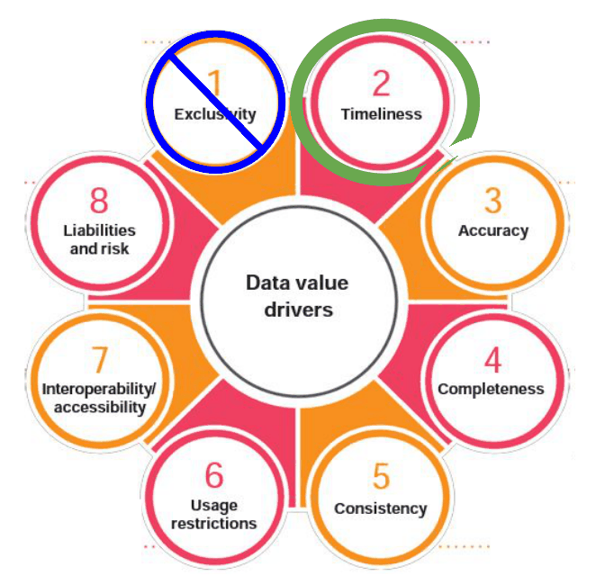{.fragment width="48%"}

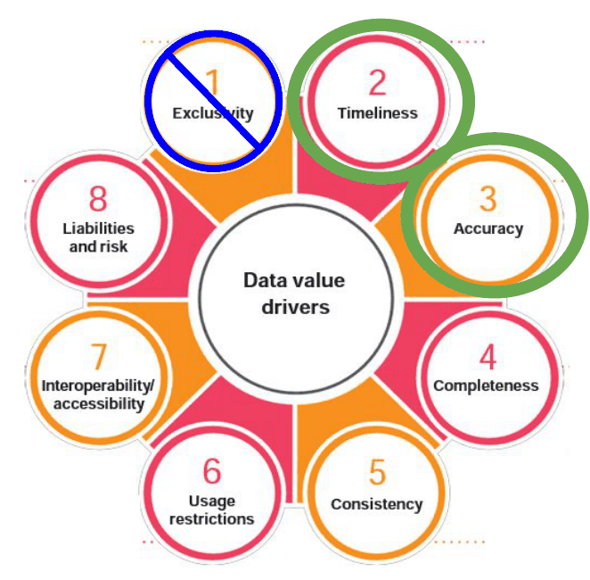{.fragment width="48%"}

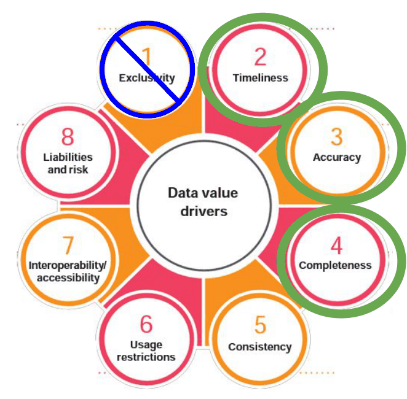{.fragment width="48%"}

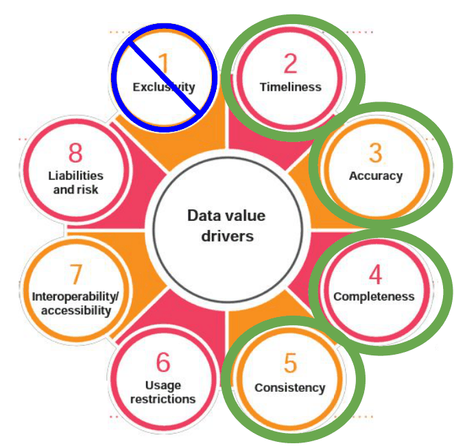{.fragment width="48%"}

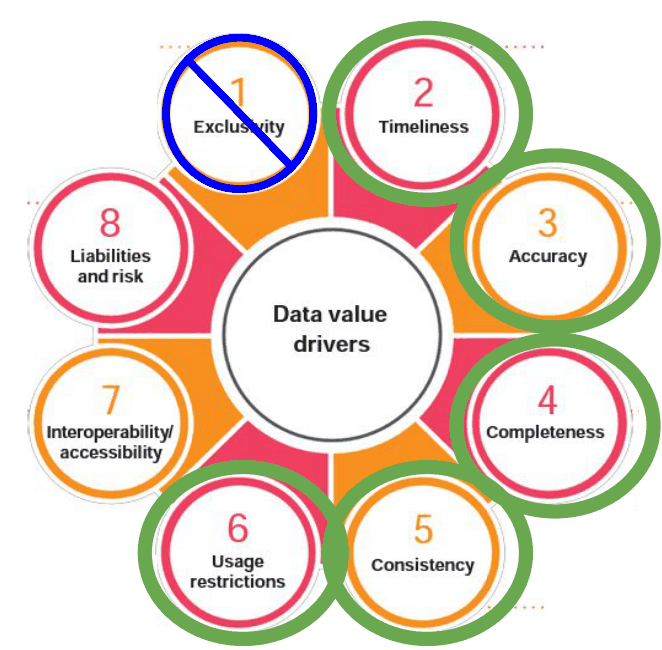{.fragment width="48%"}

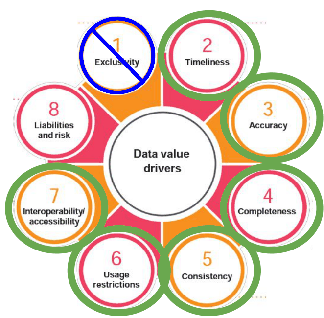{.fragment width="48%"}

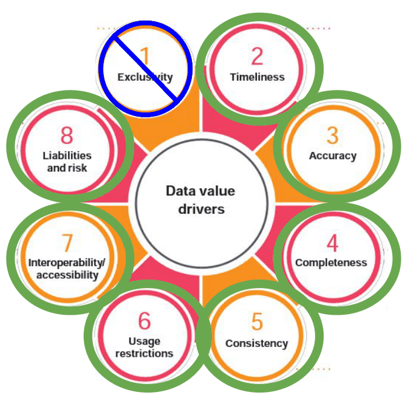{.fragment width="48%"}
:::

[PwC, *Putting a value on data*:
pwc.co.uk/data-analytics/documents/putting-value-on-data.pdf]{.credit}

::: {.notes}
Four minutes. Eight things that make data valuable. Ask for a prediction
before each click. First click: open science gives up exclusivity. Each later
click circles a driver that open methods improve, in order around the wheel: timeliness, accuracy, completeness,
consistency, usage restrictions, interoperability, and liabilities and risk. Seven of eight go up.

Arguably, shared workflows and code also speed things up when it matters, for
example in the response to the Australian bushfires.
:::

## Methods papers are highly cited {.smaller}

:::: {.columns}
::: {.column width="42%"}
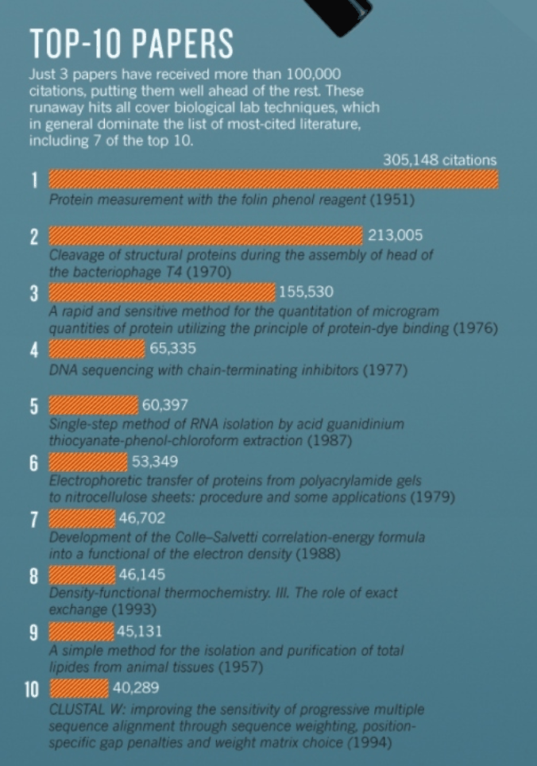{width="62%"}
:::

::: {.column width="58%"}
::: {.fragment}

(as are open access papers, so presumably open methods will be especially
successful?)
:::
:::
::::

[Van Noorden et al. (2014) *Nature*]{.credit}

::: {.notes}
Two minutes. Most of the 100 most-cited papers of all time describe methods
(lab techniques, software, statistical approaches), not discoveries. Click: the
citation curve from earlier, for comparison.
:::

## What is Open Science? {.smaller}

::: {.r-stack}
{width="95%"}

{.fragment width="95%"}
:::

[Gallagher et al. (2020) *Nature Ecology & Evolution*]{.credit}

::: {.notes}
One minute. Back to the center: open data, source and methods all serve
collaboration and inclusion.
:::

# Wrapping up

## Back to your list {.smaller}

**Which of your reasons not to share did today answer?**

::: {.fragment}
::: {.small-table}
| Worry | From today |
|---|---|
| my code is messy | messy shared code beats none (Peng's spectrum) |
| someone will scoop me | a DOI makes it citable, and repositories can embargo data until your paper is out |
| the data are sensitive | share what you can: metadata, or coarsened locations; some data shouldn't be fully open |
| they're not my data | ask the owner; you can still share your code |
| I don't know how | Zenodo, Dryad, OSF or Figshare for data; GitHub plus Zenodo for code |
:::
:::

::: {.notes}
Three minutes. Go back to the list on the board from the start of class and
cross off what today answered. Whatever is left is worth a real conversation;
sensitive data in particular is a good reason, not an excuse.
:::

## Which tool, when {.smaller}

::: {.small-table}
| You want to | Do this |
|---|---|
| keep your data safe and findable | deposit it in a repository, in more than one place |
| get credit for a dataset | a DOI from the repository, or a data paper |
| share code others can run | GitHub, archived on Zenodo, with the five D's from Lecture 28 |
| analysis software anyone can use | open source: R, Python, QGIS, Julia |
| results others can compare with yours | shared protocols and metadata standards |
| more citations | share your data, code and methods |
:::

::: {.notes}
The slide to photograph.
:::

## Remainder of class

Coding time in class (optional).

**Before the final:** prepare your presentations.

::: {.notes}
The rest of class is project time. Circulate: this is the last chance to catch
problems with someone's final project code in person.
:::
