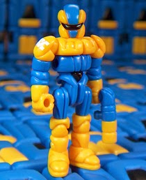

```{r}
#| echo: false
knitr::opts_chunk$set(dev.args = list(bg = "transparent"))
```

## This is optional {.smaller}

A supplement, not a lecture. Nothing here will be on an exam, nothing here is
due, and you can work through it whenever it becomes useful.

It assumes Lecture 8 (ggplot2) and nothing after it, except for the last
section, which uses a model of the kind fitted in Lectures 15 and 16.

**Every code block here is meant to be run.** There is no "watch this one":
if it is on the page, you can paste it into R and get the figure next to it.

*Last checked: 2026-10-16, with ggplot2 4.0.3, ggridges 0.5.7, ggbump 0.1.99,
patchwork 1.3.2, glyospalettes 0.2.2, transformerpalettes 0.2.0.*

## What you need {.smaller}

```{r}
#| eval: false
install.packages(c("ggplot2", "ggridges", "ggbump", "patchwork",
                   "viridis", "colorspace"))
```

Then:

```{r}
library(ggplot2)
library(ggridges)
library(ggbump)
library(patchwork)
```

## The data {.smaller}

Three tables from the course repository. They are already tidy, so nothing here
is about wrangling.

```{r}
base <- "https://github.com/bmaitner/biometry_course/raw/refs/heads/main/data/class_examples/"

reef <- read.csv(paste0(base, "reef_surveys.csv"))
ranks <- read.csv(paste0(base, "bbs_species_ranks.csv"))
occ <- read.csv(paste0(base, "bobwhite_occupancy.csv"))

dim(reef)
```

`reef` is 8,560 NCRMP reef fish surveys, with depth, species richness and
habitat. `ranks` is the six commonest Florida birds in each year. `occ` is
bobwhite occupancy of Breeding Bird Survey routes, one row per year.

# Part 1: Color {background-color="#f0f4f8"}

## The default palette is not a choice {.smaller}

ggplot2 picks colors by walking evenly around a color wheel. That is a
reasonable default and a poor decision, because it ignores everything about
your data.

```{r}
#| fig-height: 3.4
reef$depth_class <- cut(reef$depth, c(0, 5, 10, 15, 20, 35),
                        labels = c("0-5 m", "5-10 m", "10-15 m",
                                   "15-20 m", "20+ m"))

ggplot(reef, aes(depth_class, richness, fill = depth_class)) +
  geom_boxplot() +
  theme_minimal() +
  labs(x = "depth", y = "species richness")
```

## Three kinds of data, three kinds of palette {.smaller}

The single most useful idea in this supplement:

| Your variable | Palette type | Example |
|---|---|---|
| unordered groups: habitat, species, treatment | **qualitative**, distinct hues | `scale_fill_viridis_d()` |
| ordered or continuous: depth, temperature, year | **sequential**, one hue, light to dark | `scale_fill_viridis_c()` |
| a meaningful midpoint: change, difference, residual | **diverging**, two hues either side of pale | `scale_fill_gradient2()` |

Depth classes above are **ordered**, so the five unrelated hues are actively
misleading. They suggest five unrelated categories.

## The same plot, honestly colored {.smaller}

```{r}
#| fig-height: 3.6
ggplot(reef, aes(depth_class, richness, fill = depth_class)) +
  geom_boxplot() +
  scale_fill_viridis_d(option = "mako", direction = -1, guide = "none") +
  theme_minimal() +
  labs(x = "depth", y = "species richness")
```

The color now carries the same information as the x axis: deeper is darker.
`direction = -1` is doing real work there, because mako runs dark to light by
default, which would have put the darkest color on the shallowest water.

Since the color duplicates the axis, the legend is dropped with `guide = "none"`.

## Why viridis {.smaller}

The viridis palettes are built so that equal steps in the data look like equal
steps in color. Most palettes are not, which is why the rainbow invents stripes
that are not in your data.

Three practical consequences:

- **It survives being printed in black and white**, because lightness increases
  steadily along the scale
- **It survives color blindness**, for the same reason
- **It does not create false boundaries**, so a smooth gradient looks smooth

```{r}
#| echo: false
#| fig-height: 1.5
pal <- function(cols, name){
  n <- length(cols)
  image(matrix(1:n, ncol = 1), col = cols, axes = FALSE)
  title(name, cex.main = 0.9, line = 0.3)
}
par(mfrow = c(1, 2), mar = c(0.4, 0.4, 1.6, 0.4))
pal(rainbow(12), "rainbow: stripes you did not ask for")
pal(viridis::viridis(12), "viridis: even")
```

## Checking for color blindness {.smaller}

You do not have to guess. `colorspace` simulates how colors look to someone
with the commonest form of color blindness, which affects roughly 1 in 12 men.

```{r}
#| fig-height: 3.4
library(colorspace)

default_hues <- scales::hue_pal()(5)
mako <- viridis::viridis(5, option = "mako")

swatchplot(list("ggplot default"     = default_hues,
                "    deuteranopia"   = deutan(default_hues),
                "viridis mako"       = mako,
                "    deuteranopia"   = deutan(mako)))
```

## What that showed {.smaller}

Three of the five default colors collapse into near-identical olive:

```{r}
rbind(default = default_hues, deuteranopia = deutan(default_hues))[, 1:3]
```

Those are the red, the yellow-green and the green. In the boxplot two slides
back, three of the five boxes become the same color.

The mako scale survives, because it never relied on hue to carry the order. It
used **lightness**, and lightness is unaffected.

**That is the real argument for ordered palettes**: they degrade gracefully.
A palette that separates groups by hue alone has a single point of failure.

## Checking a whole figure {.smaller}

To check a finished figure rather than a palette, `colorspace` ships an
interactive viewer. Run this and paste in a saved image:

```{r}
#| eval: false
colorspace::cvd_emulator()
```

A quicker habit, and the one actually worth building: **print it in black and
white.** If the figure still works in greyscale, it will survive any form of
color blindness, because you have stopped relying on hue.

## Palettes from outside CRAN {.smaller}

Not everything useful is on CRAN. Packages under development, specialist tools,
and anything written by someone in your lab usually live on GitHub, and
`remotes` installs them directly:

```{r}
#| eval: false
install.packages("remotes")

remotes::install_github("bmaitner/glyospalettes")
remotes::install_github("bmaitner/transformerpalettes")
```

```{r}
library(glyospalettes)
library(transformerpalettes)
```

**One caution worth absorbing:** installing from GitHub runs code written by
whoever owns that repository, with no review in between. CRAN at least checks
that a package builds and does not do anything obviously hostile. Install from
GitHub when you know whose repository it is.

## Fun palettes, serious diagnostics {.smaller}

Both packages take their colors from toy lines: the Glyos figures and Generation
1 Transformers. The colors are the lighthearted part.

The tools underneath are not. They are the clearest demonstration of Part 1's
argument, because **a palette chosen to look good on a toy is not automatically
readable on a chart**, and these ship what you need to tell the difference.

```{r}
glyos_palette_stats("glyaxia")[, c("n_colours", "min_de", "min_de_deutan",
                                   "lum_range", "colorblind", "sequential")]
```

## Reading that output {.smaller}

Every column is a question from Part 1, answered with a number:

| Column | The question it answers |
|---|---|
| `min_de` | How far apart are the two **closest** colors? Under about 10, they get confused |
| `min_de_deutan` | The same, under color blindness. Passing the first and failing this means it separates by hue alone |
| `lum_range` | How much **lightness** does it span? This is what survives greyscale |
| `colorblind`, `sequential` | Verdicts, from thresholds on the columns above |

**This is the useful part.** The thresholds are rules of thumb, but the
quantities are the real criteria, and they apply to any palette from any source.

## Shortlisting {.smaller}

Rather than reading stats for 193 palettes, ask for the ones that pass:

```{r}
head(glyos_find_palettes("sequential"), 6)

head(tf_find_palettes("colorblind"), 6)
```

Then look at them, because passing a numeric check is not the same as being a
good choice.

## Colors that survive your background {.smaller}

The most useful tool in either package. A color that reads on a white slide can
vanish on a dark one, and `tf_pick()` answers that directly:

```{r}
tf_pick("optimus_prime", n = 3, style = "light", colorblind = TRUE)
```

On white it keeps the red, the navy and the near-black, dropping the silver and
the gold as too pale to see.

## The same palette, a dark background {.smaller}

```{r}
tf_pick("optimus_prime", n = 3, style = "dark")
```

Now the navy and the black are gone, and the silver and gold are in.

**Same five colors in, a different three out.** Which colors work is a property
of the palette *and* the background together, which is why a figure that looked
fine in RStudio can be unreadable projected on a dark theme.

## Using any palette, from any source {.smaller}

`scale_fill_manual()` takes a vector of colors, so this works for these
packages, for a journal's house colors, or for hex codes off a website:

```{r}
#| fig-height: 3.1
hades <- rev(as.character(glyos_palette("hades", 5, type = "continuous",
                                        sort = TRUE)))

ggplot(reef, aes(depth_class, richness, fill = depth_class)) +
  geom_boxplot() +
  scale_fill_manual(values = hades, guide = "none") +
  theme_minimal() +
  labs(x = "depth", y = "species richness")
```

`type = "continuous"` interpolates the four-color palette to the five we need,
and `sort = TRUE` orders it by lightness. `rev()` then puts the dark end on the
deep water, matching the mako version earlier.

Getting that direction right is a surprisingly easy thing to get wrong, and the
figure still looks perfectly professional when it is backward.

## Putting it to work {.smaller}

`tf_pick()` gave us three colors that hold up on a white slide. Here they are
doing a real job, on how many reef surveys fall in each protection category:

```{r}
#| fig-height: 2.9
reef$protection_f <- factor(reef$protection, levels = c(0, 1, 2),
                            labels = c("Unprotected", "Protected", "Research only"))

prime <- as.character(tf_pick("optimus_prime", n = 3, style = "light",
                              colorblind = TRUE))

ggplot(reef, aes(protection_f, fill = protection_f)) +
  geom_bar() +
  scale_fill_manual(values = prime, guide = "none") +
  theme_minimal() +
  labs(x = NULL, y = "surveys",
       title = "Colorway: Optimus Prime (G1, 1984)")
```

## Now one from Glyos {.smaller}

```{r}
#| fig-height: 2.7
glyaxia <- as.character(glyos_palette("glyaxia", 3))

ggplot(reef, aes(protection_f, richness, fill = protection_f)) +
  geom_violin(colour = NA) +
  geom_boxplot(width = 0.1, fill = "white", outlier.size = 0.3) +
  scale_fill_manual(values = glyaxia, guide = "none") +
  theme_minimal() +
  labs(x = NULL, y = "species richness",
       title = "Colorway: Glyaxia Command (Onell Design, 2014)")
```

## The object the colors came from {.smaller}

:::: {.columns}

::: {.column width="38%"}
{height="290px"}

[Glyan, Glyaxia Command colorway, Onell Design, 2014. Photo: Official Glyos
Database, <https://database.glyos.com/2014/05/glyan-glyaxia-standard.html>]{style="font-size:0.38em; color:#777"}
:::

::: {.column width="60%"}
```{r}
#| echo: false
#| fig-height: 2.4
glyospalettes::glyos_show_palettes(names = "glyaxia")
```

Yellow and blue plastic, black visor. Those are the five colors in the palette,
and the three used in the violin plot on the previous slide.
:::

::::

## One more, from Transformers {.smaller}

:::: {.columns}

::: {.column width="38%"}
{height="290px"}

[Megatron, Generation 1 toy, 1984. Photo: TFWiki,
<https://tfwiki.net/wiki/Megatron_(G1)/toys>]{style="font-size:0.38em; color:#777"}
:::

::: {.column width="60%"}
```{r}
#| echo: false
#| fig-height: 2.4
transformerpalettes::tf_show_palettes(names = "megatron")
```

Chromed silver, grey, red, black, and a purple insignia. A perfectly usable
five-color categorical palette that happens to be a 1984 toy.
:::

::::

## Finding these yourself {.smaller}

Both packages carry the provenance in their data, so you never have to guess
which object a palette came from:

```{r}
glyos_colorways[glyos_colorways$palette == "glyaxia",
                c("colorway", "year", "source")]
```

```{r}
#| eval: false
tf_characters[tf_characters$palette == "megatron",
              c("character", "year", "source")]
```

Naming the colorway in a figure title, as on the previous slides, is a small
thing that makes a plot memorable in a talk, and it means that six months later
you know exactly how to reproduce the colors.

# Part 2: Showing a distribution per group {background-color="#f0f4f8"}

## The problem {.smaller}

Lecture 12 made the point that a single histogram can hide structure: if two
groups have different distributions, the pooled histogram is some third shape
belonging to nobody.

The usual fix is a boxplot, which shows the median and spread but **hides the
shape**. A bimodal group and a flat group can give identical boxes.

```{r}
#| fig-height: 2.9
ggplot(reef, aes(habitat, richness)) +
  geom_boxplot() +
  coord_flip() +
  theme_minimal() +
  theme(axis.text.y = element_text(size = 6)) +
  labs(x = NULL, y = "species richness")
```

## Violins: the shape, without the stacking {.smaller}

A violin is a density, mirrored. It shows what the boxplot hides, in the same
space the boxplot used:

```{r}
#| fig-height: 3.2
ggplot(reef, aes(depth_class, richness, fill = depth_class)) +
  geom_violin(colour = NA) +
  geom_boxplot(width = 0.12, fill = "white", outlier.size = 0.3) +
  scale_fill_viridis_d(option = "mako", direction = -1, guide = "none") +
  theme_minimal() +
  labs(x = "depth", y = "species richness")
```

The white boxplot inside is the standard pairing: the violin carries the shape,
the box carries the median and quartiles, and you give up neither.

## Ridgelines show the shape {.smaller}

```{r}
#| fig-height: 4.2
reef$habitat_short <- substr(reef$habitat, 1, 28)

ggplot(reef, aes(x = richness, y = habitat_short, fill = after_stat(x))) +
  geom_density_ridges_gradient(scale = 2.2, rel_min_height = 0.01) +
  scale_fill_viridis_c(option = "mako", guide = "none") +
  theme_ridges(font_size = 9) +
  labs(x = "species richness", y = NULL)
```

## What that figure is worth {.smaller}

The boxplot said these habitats differ in median richness. The ridgeline says
more:

- Some habitats are **tightly peaked**, others spread across the whole range
- Some are **skewed**, with a long tail of unusually rich surveys
- The differences between habitats are **small relative to the variation
  within** each one, which a boxplot tends to understate

That last point is the one that changes conclusions, and it is invisible in a
plot of medians.

**Use a boxplot when center and spread are all you need, and a violin or a
ridgeline when the shape is part of the finding.** Which of those two depends
mostly on how many groups you have, which is the next slide.

## The y axis does not have to be a category {.smaller}

In the habitat plot the vertical axis was just a list of labels, in whatever
order. When your groups come from a **number**, map the ridges to that number
and the spacing carries information too:

```{r}
#| fig-height: 2.9
brk <- c(0, 3, 6, 10, 15, 22, 32)
mid <- (head(brk, -1) + tail(brk, -1)) / 2
reef$band_mid <- mid[as.integer(cut(reef$depth, brk))]

ggplot(subset(reef, !is.na(band_mid)),
       aes(x = richness, y = -band_mid, group = band_mid, fill = -band_mid)) +
  geom_density_ridges(scale = 2.2, rel_min_height = 0.01, colour = "white") +
  scale_y_continuous(breaks = -mid, labels = paste0(mid, " m")) +
  scale_fill_viridis_c(option = "mako", guide = "none") +
  theme_ridges(font_size = 9) +
  labs(x = "species richness", y = "depth")
```

## What that buys {.smaller}

The figure is now a **cross-section of the reef**. Shallow water is at the top,
deep water at the bottom, because `y = -band_mid` puts depth where depth
actually is.

. . .

And the **gaps are real**. The 1.5 m and 4.5 m ridges nearly touch because those
bands are three metres apart; the 18.5 m and 27 m ridges sit far apart because
they are. An evenly spaced categorical axis would have thrown that away and
implied the bands were equally separated.

. . .

The same trick works for **elevation up a mountainside**, distance along a
transect, or time. Whenever the groups are slices of a continuous thing, let the
axis say so.

::: {.notes}
Worth pausing on, because it is the difference between a figure that displays
groups and one that displays a gradient.
:::

## Three ways, and when to reach for each {.smaller}

They are the same idea at three levels of detail, and the right choice is mostly
about how many groups you have:

| Plot | Shows | Reach for it when |
|---|---|---|
| **Boxplot** | five numbers | many groups, and center and spread are all you need |
| **Violin** | the full shape, mirrored | a handful of groups, and the shape matters |
| **Ridgeline** | the full shape, stacked | many groups, and the shape still matters |

Violins get crowded past about eight groups, which is the point where ridgelines
take over: stacking them vertically buys room that mirroring does not.

# Part 3: Parts of a whole {background-color="#f0f4f8"}

## Pie charts {.smaller}

A pie is a stacked bar in polar coordinates, which is exactly how you build one:

```{r}
#| fig-height: 2.8
prot_counts <- as.data.frame(table(reef$protection_f))
names(prot_counts) <- c("protection", "n")

ggplot(prot_counts, aes(x = "", y = n, fill = protection)) +
  geom_col(width = 1, colour = "white") +
  coord_polar(theta = "y") +
  scale_fill_manual(values = prime) +
  theme_void() +
  labs(fill = NULL)
```

## And a donut {.smaller}

Same code, with the bar pushed away from the center so the middle is empty:

```{r}
#| fig-height: 2.8
ggplot(prot_counts, aes(x = 2, y = n, fill = protection)) +
  geom_col(width = 1, colour = "white") +
  coord_polar(theta = "y") +
  xlim(0.5, 2.5) +
  scale_fill_manual(values = prime) +
  theme_void() +
  labs(fill = NULL)
```

## What the hole costs, or does not {.smaller}

The standard advice goes: a pie asks you to compare **angles**, people are bad at
angles, and a donut is worse still because removing the center removes the angle.

. . .

**The evidence does not support that.** Skau and Kosara (2016) built pies and
donuts that isolated each cue, arc length, center angle and segment area, and
varied the donut's inner radius from a filled pie down to a thin ring.

- **Angle was the least important cue** in both chart types
- **Donuts were read about as accurately as pies**

. . .

So if you prefer the look of a donut, the research does not say you are hurting
your reader. Pick either.

. . .

Worth noticing what just happened: a confident, widely repeated design rule
turned out to be mostly folklore once somebody ran the experiment. Figure advice
is full of that, which is a good reason to check the ones you repeat.

## Why a bar chart still wins {.smaller}

Cleveland and McGill ranked how accurately people read different visual
encodings. Most accurate first:

1. **Position** along a common scale
2. Position on non-aligned scales
3. **Length**, direction, angle
4. **Area**
5. Volume, curvature
6. **Shading and color saturation**

. . .

A bar chart puts your numbers at **rank 1**. A pie or donut puts them at 3 and 4.
That is the real argument, and it has nothing to do with the hole.

[Cleveland, W.S. and McGill, R. (1984). Graphical perception: theory,
experimentation, and application to the development of graphical methods.
*Journal of the American Statistical Association* 79(387), 531-554.
doi:10.1080/01621459.1984.10478080]{style="font-size:0.42em; color:#777"}

## Two things to take from that list {.smaller}

**Color is last.** Everything in Part 1 was about an encoding at the bottom of
the ranking. That is not an argument against caring about color, it is an
argument for not asking color to carry the finding on its own. Use it to support
a position or length encoding, not to replace one.

. . .

**Treat it as a strong guide, not a law.** The ordering began as a hypothesis
their experiments were designed to test, and later work suggests it collapses to
fewer tiers depending on the task. It earns its keep as a default, which is
different from a proof.

. . .

What also survives, for pies specifically: **comparing across two pies is hard**
in a way comparing two bar charts is not, and **both fail with many categories**,
which is the next slide.

## Where it falls apart {.smaller}

The same chart, on the 21 habitat categories in this dataset:

```{r}
#| fig-height: 3.0
hab_counts <- as.data.frame(table(reef$habitat))
names(hab_counts) <- c("habitat", "n")

ggplot(hab_counts, aes(x = "", y = n, fill = habitat)) +
  geom_col(width = 1, colour = "white") +
  coord_polar(theta = "y") +
  theme_void() +
  theme(legend.position = "none")
```

And that is **before** the legend, which would need 21 entries to tell you which
sliver is which.

## The same data, as bars {.smaller}

```{r}
#| fig-height: 3.2
hab_counts$habitat <- substr(hab_counts$habitat, 1, 34)

ggplot(hab_counts, aes(x = n, y = reorder(habitat, n))) +
  geom_col(fill = "#3B6B8F") +
  theme_minimal(base_size = 8) +
  labs(x = "surveys", y = NULL)
```

Sorted, labeled directly, no legend, and you can read any value off the axis.

## The rule {.smaller}

**A pie is defensible when** you have two or three categories, they genuinely
sum to a whole, and you only need the reader to see "about half" or "about a
quarter".

. . .

**It is not defensible when** there are more than about five categories, when
slices need to be compared precisely, or when you want the reader to compare
across two pies. Those are all bar chart jobs.

. . .

The protection pie above is at the edge of acceptable. The habitat one is not,
and no palette would have saved it.

# Part 4: What the research actually says {background-color="#f0f4f8"}

## Has that 1984 ranking held up? {.smaller}

Broadly, yes. Heer and Bostock re-ran the experiments with crowdsourced
participants and recovered an ordering close to the original, while extending it
to rectangular areas (treemaps, cartograms) and circular ones (bubble charts).

. . .

So the hierarchy is not 1980s folklore. It replicates.

. . .

What has changed is the **question**. "Which chart type is best?" turned out to
be narrower than people treated it as.

[Heer, J. and Bostock, M. (2010). Crowdsourcing graphical perception: using
Mechanical Turk to assess visualization design. *CHI '10*, 203-212.
doi:10.1145/1753326.1753357]{style="font-size:0.42em; color:#777"}

## Effectiveness depends on the task {.smaller}

Saket, Endert and Demiralp compared five everyday chart types, table, line, bar,
scatterplot and pie, across **ten different analysis tasks** on real datasets.

. . .

Effectiveness shifted meaningfully from task to task, and several chart types
were competitive on many of them. There was no single winner.

. . .

So the question worth asking is not "what is the best chart" but **"what do I
want the reader to do with it?"** Read one value. Compare two groups. Find the
maximum. Spot a cluster. Judge a trend. Those have different answers.

Cleveland and McGill answered one of those questions, comparing magnitudes,
very well. It was never meant to answer all of them.

[Saket, B., Endert, A. and Demiralp, C. (2019). Task-based effectiveness of
basic visualizations. *IEEE Transactions on Visualization and Computer
Graphics*. arXiv:1709.08546]{style="font-size:0.42em; color:#777"}

## The newer question: what the reader concludes {.smaller}

The older work asked whether a reader can **decode** a number from a chart. The
newer work asks what they **take away**, which is not the same thing and is
often not what the designer intended.

That covers how uncertainty is shown, how a title frames the conclusion, how
axis choices steer the eye, and how people reason about risk.

. . .

One concrete finding, for anyone presenting rates: use **absolute** rather than
relative rates, and give probabilities as **counts** ("3 out of 10") rather than
percentages.

## Where to read the current state {.smaller}

If you read one thing, read this review. It is written for non-specialists and
pulls together visual perception, graph comprehension and uncertainty, which
mostly had not been talking to each other.

[Franconeri, S.L., Padilla, L.M., Shah, P., Zacks, J.M. and Hullman, J. (2021).
The science of visual data communication: what works. *Psychological Science in
the Public Interest* 22(3), 110-161.
doi:10.1177/15291006211051956]{style="font-size:0.5em"}

. . .

**The honest summary of all of it:** put the numbers you most want compared into
position or length, be suspicious of confident design rules including the ones
on these slides, and remember that the reader's conclusion is the output you
actually care about.

# Part 5: Combining panels {background-color="#f0f4f8"}

## patchwork {.smaller}

Save plots as objects, then combine them with `+`, `|` and `/`.

```{r}
#| fig-height: 3.2
a <- ggplot(reef, aes(depth, richness)) +
  geom_point(alpha = 0.06) + theme_minimal() + labs(x = "depth (m)", y = "richness")

b <- ggplot(reef, aes(richness)) +
  geom_histogram(bins = 30, fill = "#3B6B8F") + theme_minimal() +
  labs(x = "richness", y = "surveys")

a | b
```

## Layouts and labels {.smaller}

`|` puts plots side by side, `/` stacks them, and brackets group them.
`plot_annotation()` adds the panel letters a reviewer will ask for.

```{r}
#| fig-height: 3.6
(a | b) / (b | a) +
  plot_annotation(tag_levels = "A",
                  title = "Reef fish surveys, four views")
```

In a talk, build the same figure one panel at a time. In a paper, this is one
figure instead of four.

# Part 6: Rank over time {background-color="#f0f4f8"}

## The naive version {.smaller}

`ggbump` draws rank changes as smooth curves. Here are the six commonest
Florida birds in each year since 1997.

```{r}
#| fig-height: 3.6
ggplot(ranks, aes(year, rank, colour = common_name)) +
  geom_bump(linewidth = 1) +
  geom_point(size = 1.6) +
  scale_y_reverse(breaks = 1:6) +
  theme_minimal() +
  labs(y = "rank", colour = NULL)
```

## That figure is a mess, and it is instructive {.smaller}

Ten species, ten colors, a legend that forces the reader to look back and forth,
and so many crossings that no line can be followed.

The problem is not the chart type. It is that the figure is trying to say ten
things at once.

**A figure should make one point.** Decide what the point is, then make
everything that is not the point recede.

Here is a point worth making: **the Chimney Swift was the commonest bird in
Florida in 1997 and never appeared in the top six again.**

## The same data, one point {.smaller}

```{r}
#| fig-height: 3.3
highlight <- c("Chimney Swift", "Northern Cardinal")
ranks$focus <- ifelse(ranks$common_name %in% highlight, ranks$common_name, "other")

ggplot(ranks, aes(year, rank, colour = focus, group = common_name)) +
  geom_bump(aes(linewidth = focus != "other")) +
  geom_point(data = subset(ranks, focus != "other"), size = 2.4) +
  scale_y_reverse(breaks = 1:6) +
  scale_colour_manual(values = c("Chimney Swift" = "#D81B60",
                                 "Northern Cardinal" = "#1E88E5",
                                 "other" = "grey82")) +
  scale_linewidth_manual(values = c(0.6, 1.6), guide = "none") +
  theme_minimal() +
  labs(y = "rank", colour = NULL)
```

## The technique, which generalizes {.smaller}

Three lines did the work, and they work on any plot type:

1. Make a column that holds the series name for the few you care about and a
   constant like `"other"` for everything else
2. `scale_colour_manual()` with real colors for those few and a pale grey for
   `"other"`
3. Make the highlighted series thicker

The greyed lines are still there, so the reader can see the context and check
that nothing has been hidden. They just stop competing.

**This one technique will improve more of your figures than any palette
choice.**

## Now check the story before you tell it {.smaller}

The figure says the Chimney Swift was number one and then vanished. Both halves
are true, and the explanation is not the one you would guess.

This check needs the raw survey data rather than the summary, so it is the one
place here that downloads the full file (15 MB, a few seconds):

```{r}
bbs <- read.csv(paste0("https://github.com/bmaitner/biometry_course/raw/",
                       "refs/heads/main/data/BBS/FL_BBS.csv"))

swifts_97 <- bbs$total_sightings[bbs$Scientific_Name == "Chaetura pelagica" &
                                   bbs$Year == 1997]

sort(swifts_97, decreasing = TRUE)[1:6]
```

One route recorded **3,166 swifts**. The next highest recorded 54.

## What that means {.smaller}

Chimney Swifts roost communally, pouring into a single chimney by the thousand
at dusk. One observer, on one morning, on one route, hit a roost.

That single number made the species the commonest bird in Florida for one year
in this figure. The 1998 "collapse" to 474 birds is not a population crash. It
is the absence of that chimney.

**Two lessons, and the second is the general one:**

- A **bump chart shows rank and hides magnitude**. Rank 1 and rank 2 may be
  nearly tied, or differ tenfold, and the chart looks identical
- **Any dramatic pattern deserves one check before it becomes a sentence.**
  Sort the raw numbers. It takes thirty seconds and it is the difference
  between a finding and an embarrassment

# Part 7: Showing a model {background-color="#f0f4f8"}

## The gap this fills {.smaller}

By the end of Chapter 6 you can fit a model and report parameters. A table of
parameters convinces nobody. A figure showing the fitted model over the data is
what makes a result believable, and it is the first thing a reviewer looks for.

The recipe has three steps, and it is the same for every model you will fit:

1. **Make a grid** of covariate values to predict at
2. **Compute the prediction** at each, from the fitted parameters
3. **Plot the data, then the prediction on top**

## Step 0: fit something {.smaller}

The bobwhite occupancy model from Lecture 16: the probability a route holds
bobwhite declines logistically with year.

```{r}
nll <- function(par){
  p <- plogis(par[1] + par[2] * occ$elapsed)
  -sum(dbinom(occ$n_occupied, size = occ$n_routes, prob = p, log = TRUE))
}

fit <- optim(c(a = 2, b = -0.05), nll, method = "BFGS", hessian = TRUE)

round(fit$par, 4)
```

## Steps 1 and 2: predict over a grid {.smaller}

```{r}
pred <- data.frame(elapsed = seq(0, 22, length.out = 100))

pred$fit <- plogis(fit$par[1] + fit$par[2] * pred$elapsed)

head(pred, 3)
```

The grid is finer than the data on purpose: 100 points draw a smooth curve,
whereas predicting only at the observed years draws a polygon.

## Step 3: the figure {.smaller}

```{r}
#| fig-height: 3.4
occ$prop <- occ$n_occupied / occ$n_routes

ggplot(occ, aes(elapsed, prop)) +
  geom_point(aes(size = n_routes), alpha = 0.6) +
  geom_line(data = pred, aes(elapsed, fit), colour = "#D81B60", linewidth = 1.2) +
  scale_size_continuous(range = c(1, 4), name = "routes") +
  theme_minimal() +
  labs(x = "years since 1997", y = "proportion of routes occupied")
```

Point size carries sample size, so a year based on 64 routes does not look as
authoritative as one based on 87.

## Adding uncertainty {.smaller}

A curve with no band implies a precision you do not have. `optim(hessian =
TRUE)` gives you what you need: the curvature of the likelihood surface, which
is the subject of Lecture 17.

```{r}
vcov_mat <- solve(fit$hessian)

round(sqrt(diag(vcov_mat)), 4)        # standard errors of a and b
```

Then simulate parameter pairs from that uncertainty, build one curve per pair,
and take the middle 95% at each x. This is Lecture 13's simulation idea, used
for a new purpose.

## The band, in six lines {.smaller}

```{r}
set.seed(1)
draws <- MASS::mvrnorm(2000, mu = fit$par, Sigma = vcov_mat)

curves <- apply(draws, 1, function(par){
  plogis(par[1] + par[2] * pred$elapsed)
})

pred$lo <- apply(curves, 1, quantile, 0.025)
pred$hi <- apply(curves, 1, quantile, 0.975)
```

`curves` is a 100 by 2000 matrix: one row per grid point, one column per
simulated parameter pair. The quantiles are taken **across** simulations, at
each grid point.

## The finished figure {.smaller}

```{r}
#| fig-height: 3.6
ggplot(occ, aes(elapsed, prop)) +
  geom_ribbon(data = pred, aes(x = elapsed, ymin = lo, ymax = hi),
              inherit.aes = FALSE, fill = "#D81B60", alpha = 0.18) +
  geom_line(data = pred, aes(elapsed, fit), colour = "#D81B60", linewidth = 1.2) +
  geom_point(aes(size = n_routes), alpha = 0.6) +
  scale_size_continuous(range = c(1, 4), name = "routes") +
  theme_minimal() +
  labs(x = "years since 1997", y = "proportion of routes occupied")
```

## Read the band, not just the line {.smaller}

The band is **narrowest in the middle** of the data and widens toward both
ends. That is not a quirk of this dataset, it is what fitting a line does: the
fitted line pivots around the center of the data, so small changes in slope
move the ends a lot and the middle hardly at all.

Two consequences worth carrying around:

- **Extrapolation is worse than it looks.** Extend the x axis and the band
  widens fast
- **The ends of your data are the weakest part of your model**, which is
  exactly where people like to read trends off a figure

```{r}
round(c(width_1997 = diff(c(pred$lo[1], pred$hi[1])),
        width_2008 = diff(c(pred$lo[50], pred$hi[50])),
        width_2019 = diff(c(pred$lo[100], pred$hi[100]))), 3)
```

## The same recipe, any model {.smaller}

Nothing above was specific to a logistic curve or a binomial. For the negative
binomial count model from Lecture 16, only the middle line changes:

```{r}
#| eval: false
# grid
pred <- data.frame(frac_built = seq(0, 0.5, length.out = 100))

# prediction: the deterministic function, with the fitted parameters
pred$fit <- fit$par["mu0"] * exp(fit$par["b"] * pred$frac_built)

# plot: data, then prediction on top
ggplot(counts, aes(frac_built, count)) +
  geom_point(alpha = 0.15) +
  geom_line(data = pred, aes(frac_built, fit), colour = "#D81B60")
```

Grid, predict, plot. The model changes; the recipe does not.

# Part 8: The frame around the data {background-color="#f0f4f8"}

## Everything that is not your data {.smaller}

A **theme** controls the frame: panel background, grid lines, axis text, tick
marks, legend position, borders, margins. It cannot change a single plotted
value, which is what makes it safe to experiment with.

Every figure in this supplement called `theme_minimal()`, and `theme_void()`
showed up in Part 3 without comment. Both were choices, and both are worth
making on purpose.

The payoff is not that a figure looks nicer. It is that a theme removes ink that
is not carrying information, which leaves more attention for the ink that is.

## The built-in themes {.smaller}

| Theme | What you get | Reach for it when |
|---|---|---|
| `theme_grey()` | the default: grey panel, white grid | never on purpose |
| `theme_bw()` | white panel, grid, black border | a journal figure |
| `theme_minimal()` | white panel, grid, no border | a slide |
| `theme_classic()` | axis lines, no grid | one clean panel |
| `theme_void()` | nothing but the data | pies, maps |

There are also `theme_linedraw()`, `theme_light()` and `theme_dark()`, which you
will rarely need. They all take the same arguments, so swapping one for another
is a one-word edit. Try two before you settle.

## Four of them, same data {.smaller}

```{r}
#| fig-height: 3.9
pts <- ggplot(reef, aes(depth, richness)) +
  geom_point(alpha = 0.05) +
  labs(x = "depth (m)", y = "richness")

(pts + theme_grey()    + labs(title = "theme_grey") |
 pts + theme_bw()      + labs(title = "theme_bw")) /
(pts + theme_minimal() + labs(title = "theme_minimal") |
 pts + theme_classic() + labs(title = "theme_classic"))
```

## What that comparison shows {.smaller}

`pts` is one object. Adding a theme to it returns a modified copy, so those are
the same figure dressed four ways and nothing about the data moved.

. . .

**`theme_grey()` is the reason your figures look like homework.** The grey panel
is darker than the points on it, so the background competes with the data.

. . .

**`theme_bw()` and `theme_classic()` differ in what they keep.** A border tells
the reader where the panel ends, which matters when panels sit side by side.
Axis lines alone are cleaner, and get ambiguous in a multi-panel figure.

. . .

**`theme_minimal()` is the slide default** because a projector loses
low-contrast detail, and a grid with no border is the least ink that still lets
someone read a value off the axis.

## theme_void: no frame at all {.smaller}

```{r}
#| fig-height: 3.0
pie_raw <- ggplot(prot_counts, aes(x = "", y = n, fill = protection)) +
  geom_col(width = 1, colour = "white") +
  coord_polar(theta = "y") +
  scale_fill_manual(values = prime) +
  labs(x = NULL, y = NULL, fill = NULL)

(pie_raw + theme_minimal() + labs(title = "theme_minimal")) |
  (pie_raw + theme_void() + labs(title = "theme_void"))
```

On the left, the axis numbers are cumulative counts and the grid lines are arcs.
Neither means anything to a reader, which is why Part 3 used `theme_void()`.

## base_size {.smaller}

```{r}
#| fig-height: 3.2
(pts + theme_minimal(base_size = 8) + labs(title = "base_size = 8")) |
  (pts + theme_minimal(base_size = 17) + labs(title = "base_size = 17"))
```

The font size everything else is scaled from. The default, 11, is sized for a
printed page: use roughly 14 to 18 on a slide, and 8 to 10 for one panel of a grid.

## Setting it once: theme_set() {.smaller}

Set the default at the top of a script, and every plot after it uses it:

```{r}
#| fig-height: 2.8
theme_set(theme_minimal(base_size = 13))

ggplot(reef, aes(protection_f, richness)) +
  geom_boxplot(fill = "#B9CBD8") +
  labs(x = NULL, y = "species richness")
```

There is no theme call in that plot, which is the point.

## theme_set() lasts the session {.smaller}

It holds until you restart R or set something else. To go back to the ggplot2
default:

```{r}
theme_set(theme_grey())    # undo it, so the rest of this file is unaffected
```

For a manuscript, this is how every figure ends up matching without you checking
each one: `theme_set()` in the first lines of the script, and no theme calls
after that.

`theme_update()` is the gentler version. It changes one piece of the current
default instead of replacing the whole theme.

## Theme elements {.smaller}

To change one piece of a theme, `theme()` takes a named argument per element,
and the value is an `element_*()` function describing how to draw it:

| Function | For |
|---|---|
| `element_text()` | anything made of words: titles, axis labels, legend text |
| `element_line()` | grid lines, tick marks, axis lines |
| `element_rect()` | panels, plot background, legend boxes |
| `element_blank()` | delete it entirely |

Element names are a hierarchy: `axis.text.x` inherits from `axis.text`, which
inherits from `text`. So setting the short name changes every piece under it:

```{r}
#| eval: false
theme(text = element_text(family = "serif"))   # every piece of text at once
```

`?theme` lists all ninety or so names, of which you will use a dozen.

## Changing one thing {.smaller}

```{r}
#| fig-height: 2.8
ggplot(reef, aes(depth_class, richness, fill = depth_class)) +
  geom_boxplot() +
  scale_fill_viridis_d(option = "mako", direction = -1, guide = "none") +
  theme_minimal(base_size = 12) +
  theme(panel.grid.minor   = element_blank(),
        panel.grid.major.x = element_blank(),
        axis.title         = element_text(face = "bold")) +
  labs(x = "depth", y = "species richness")
```

`theme()` comes **after** `theme_minimal()`. Later layers win, so the other order
silently throws your changes away.

## Why those two lines went {.smaller}

**`panel.grid.minor`** draws lines at values with no label, so nobody can read
anything off them.

. . .

**`panel.grid.major.x`** draws vertical lines on a **categorical** axis. They
line up with category names rather than numbers, so they measure nothing.

. . .

That is the test for any piece of the frame: **does the reader use it to read
the data?** If not, `element_blank()` it.

## Moving the legend {.smaller}

```{r}
#| fig-height: 2.7
ggplot(reef, aes(depth, richness, colour = protection_f)) +
  geom_point(alpha = 0.08) +
  scale_colour_manual(values = prime) +
  guides(colour = guide_legend(override.aes = list(alpha = 1, size = 2.5))) +
  theme_minimal(base_size = 12) +
  theme(legend.position        = "inside",
        legend.position.inside = c(0.84, 0.86),
        legend.background      = element_rect(fill = "white", colour = NA)) +
  labs(x = "depth (m)", y = "species richness", colour = NULL)
```

`override.aes` makes the legend keys solid even though the points are faint.
`legend.position` also takes `"bottom"`, `"top"` and `"none"`.

## The gap between the bars and the axis {.smaller}

```{r}
#| fig-height: 2.8
bars <- ggplot(prot_counts, aes(protection, n, fill = protection)) +
  geom_col() +
  scale_fill_manual(values = prime, guide = "none") +
  theme_minimal(base_size = 12) +
  labs(x = NULL, y = "surveys")

bars
```

Look at the bottoms of the bars. They **float above the x axis** instead of
sitting on it.

## Why the gap is there {.smaller}

ggplot2 pads every continuous scale by **5% of the data range at each end**
before anything is drawn. You did not ask for it, and no argument in
`geom_col()` controls it.

. . .

For points and lines that padding is right. A point at exactly the maximum would
otherwise be drawn half outside the panel and get clipped.

. . .

For bars it is wrong, because a bar's baseline is **a real value, zero**. Padding
below zero puts blank space where the reader expects the axis, so the bars no
longer touch the baseline they are measured from. It is a small thing, and it is
what makes an otherwise fine bar chart look slightly off without anyone being
able to say why.

## expand, and expansion() {.smaller}

```{r}
#| fig-height: 2.8
bars + scale_y_continuous(expand = expansion(mult = c(0, 0.05)))
```

Nothing below, the usual 5% above: the bars sit on the axis, and the tallest
still has headroom.

## How expansion() works {.smaller}

The padding lives on the **scale**, not the geom, which is why the fix is a
`scale_y_continuous()` call. `expansion()` builds it out of two kinds:

- **`mult`**, a proportion of the data range
- **`add`**, in the units of the data

Each takes one number for both ends, or `c(lower, upper)`. So
`expansion(mult = c(0, 0.05))` reads as **0% below, 5% above**.

. . .

The headroom matters more than it looks. Take it away too and the tallest bar
runs into the top of the panel, which reads as a value that was cut off.

## Horizontal bars: fix x, not y {.smaller}

```{r}
#| fig-height: 3.2
ggplot(hab_counts, aes(x = n, y = reorder(habitat, n))) +
  geom_col(fill = "#3B6B8F") +
  scale_x_continuous(expand = expansion(mult = c(0, 0.05))) +
  theme_minimal(base_size = 8) +
  labs(x = "surveys", y = NULL)
```

Change the scale the bars **grow along**. The one they sit on is fine left alone.

## Flush is not always right {.smaller}

```{r}
#| fig-height: 2.8
occ_pts <- ggplot(occ, aes(elapsed, prop)) +
  geom_point(size = 3) +
  labs(x = "years since 1997", y = "proportion occupied")

(occ_pts + scale_x_continuous(expand = expansion(0, 0)) +
           scale_y_continuous(expand = expansion(0, 0)) +
           theme_minimal() + labs(title = "expansion(0, 0)")) |
  (occ_pts + theme_minimal() + labs(title = "the default"))
```

On the left, the first, last and lowest years are each cut in half by the border.

## The four cases you will need {.smaller}

**The rule:** drop the padding on the side where zero is a baseline the geom is
drawn from. Keep it wherever the extreme value is a data point, as it is for the
bobwhite years.

| What you want | Code |
|---|---|
| bars flush to the axis, headroom above | `expansion(mult = c(0, 0.05))` |
| flush at both ends: a filled area, a raster, a map | `expansion(0, 0)` |
| a fixed pad, in data units | `expansion(add = c(0, 2))` |
| the default back | leave `expand` out |

. . .

You will also meet `expand = c(0, 0)` in older code. That is the
pre-`expansion()` syntax, where the two numbers are the multiplicative and the
additive padding, so `c(0, 0)` does mean none. It is worth not writing, because
`c(0, 0.05)` in that syntax means something quite different from
`expansion(0, 0.05)`.

## ylim() is not expansion {.smaller}

```{r}
#| fig-height: 2.8
box <- ggplot(reef, aes(protection_f, richness)) +
  geom_boxplot(fill = "#B9CBD8") +
  theme_minimal(base_size = 10) +
  labs(x = NULL, y = "richness")

(box + ylim(0, 20) + labs(title = "ylim()")) |
  (box + coord_cartesian(ylim = c(0, 20)) + labs(title = "coord_cartesian()"))
```

Same data, same y range, and two different sets of boxplots.

## What ylim() did {.smaller}

`ylim()`, and `scale_y_continuous(limits = )` with it, **throws away rows
outside the range** before anything is computed.

. . .

Over half the surveys (4,662 of 8,560) have richness above 20, so the left
boxplots are built from what is left, and the unprotected median falls from 24
to 14. ggplot2 mentions this only in a warning about "removed rows", which is
easy to scroll past.

. . .

**`coord_cartesian()` zooms** the finished figure and keeps all the data. That
is almost always the one you meant.

. . .

**Expansion does neither.** It changes the padding only, never the limits and
never the data.

## Putting it together {.smaller}

```{r}
#| fig-height: 2.5
ggplot(prot_counts, aes(n, reorder(protection, n))) +
  geom_col(fill = "#3B6B8F", width = 0.7) +
  geom_text(aes(label = n), hjust = -0.15, size = 3.2) +
  scale_x_continuous(expand = expansion(mult = c(0, 0.12))) +
  theme_minimal(base_size = 12) +
  theme(panel.grid.major.y = element_blank(),
        panel.grid.minor   = element_blank()) +
  labs(x = "surveys", y = NULL)
```

Flush bars, 12% headroom so the labels fit, and no grid lines that measure nothing.

# Taking it with you {background-color="#f0f4f8"}

## What this buys you {.smaller}

1. **Match the palette to the data.** Ordered data gets an ordered palette.
   This is the cheapest improvement available to you.
2. **Check for color blindness** with `deutan()` on your palette, or just look
   at the figure in greyscale, before anything goes in a talk.
3. **Show the shape** when the shape is the point: a violin for a few groups,
   ridgelines for many. A boxplot hides it.
4. **Make one point per figure**, and grey out everything that is not it.
5. **Reach for a bar chart** when slices need comparing. Pie or donut matters
   much less than people say.
6. **Plot your model over your data**, with a band. Grid, predict, plot.
7. **Choose the frame on purpose.** Pick a theme, set `base_size` for where the
   figure will be shown, and sit bars on their axis with
   `expansion(mult = c(0, 0.05))`.

## Where it fits {.smaller}

- **Assignments 3 and 4**: the model-prediction recipe in Part 5 applies
  directly to anything you fit
- **The final project presentation**: Parts 1, 3 and 4. A talk is where a
  cluttered figure costs you the most, because nobody can pause on it
- **Your own papers, later**: Part 5 and the color blindness check
- **Every figure you make**: Part 8. `theme_set()` at the top of a script is
  one line, and it makes every figure after it match

## Going further: learning {.smaller}

- **ggplot2 book**, free online: <https://ggplot2-book.org>
- **R Graph Gallery**, worked examples of nearly every chart type:
  <https://r-graph-gallery.com>
- **Fundamentals of Data Visualization**, Claus Wilke, free online and the best
  single source on *why* a figure works: <https://clauswilke.com/dataviz>
- **patchwork**: <https://patchwork.data-imaginist.com>
- **ggridges vignette**: `vignette("introduction", package = "ggridges")`

## Going further: the evidence {.smaller}

- **Franconeri et al. (2021)**, the review from Part 4, and the best place to
  start: <https://doi.org/10.1177/15291006211051956>
- **Cleveland and McGill (1984)**, the original ranking:
  <https://doi.org/10.1080/01621459.1984.10478080>
- **Heer and Bostock (2010)**, the replication:
  <https://doi.org/10.1145/1753326.1753357>
- **Saket et al. (2019)**, effectiveness by task: <https://arxiv.org/abs/1709.08546>
- **Skau and Kosara (2016)**, pies and donuts:
  <https://doi.org/10.1111/cgf.12888>

. . .

If you want a figure reviewed, bring it to office hours. That is a faster way to
improve than reading any of the above.
